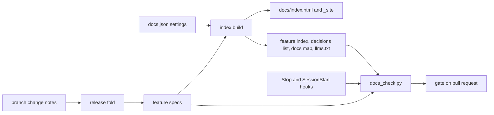

# DOCSPEC — Documentation Standard

**Status:** Normative
**Version:** 1.1.0
**Applies to:** every project that keeps its documentation with the `luismc-docs` plugin
**Audience:** Claude Code sessions and people working in those projects, and the implementers of `luismc-docs`
**Owner:** Luis Carvalho
**Last reviewed:** 2026-10-31

---

## At a glance

### In one paragraph

DOCSPEC says where a project's documents live and how they stay true to the code. Lasting docs sit in `docs/`, in folders split by reader question. Each feature has one spec with front matter. A script builds an offline site and a feature index from that front matter. Branches add change notes, and the release folds them into one version per doc. Checks and hooks warn when code changes without its doc. Briefs and reports stay on agent branches.

### Why

**Problem.** Docs scatter, go stale, and pile up as briefs and reports nobody reads again. Readers cannot tell which page is true.

**Goals.**

- Each kind of doc has one home, chosen by the reader's question.
- Feature specs have one shape and drive a browsable index.
- Versions and change history are kept without hand edits.
- Checks keep a doc true to the code.
- An existing repository can move to the standard.

**Non-goals.** It does not define the content of a project's docs, the artifacts record (ARTIFACTSPEC), or how work is delivered (DELIVERYSPEC). It does not publish docs to a web host.

### How it works



1. Settings in `docs.json` name the apps, topics and code roots.
2. Each feature spec carries front matter and a code list.
3. `docs_index.py build` writes the site, the feature index and the other generated files.
4. `docs_check.py` runs the checks: layout, front matter, links, sources, versions, freshness and the code-to-doc map.
5. A branch that changes a binding doc adds a change note. `docs_fold.py fold` turns the notes into one version row per doc.
6. The Stop hook warns when mapped code changed without its doc. The SessionStart hook adds the rule to the agent's context.

---

## 0. How to use this document

### 0.1 What this document is

A project's documents answer different questions for different readers: what is this, what does feature X do, what are the UX rules, how is it built, how do I run it, what is the value. Without a standard, docs scatter, go stale, and pile up as agent briefs and reports nobody reads again.

This specification defines:

- where each kind of document lives;
- what a feature spec contains;
- how the docs are browsed offline;
- how versions and change history are kept;
- which checks keep a doc true to the code;
- how an existing repository moves to the standard.

An implementer can build `luismc-docs` from it. A reviewer can check a project against it with `docs_check.py`.

**What this document is not:** it does not define the content of a project's docs, the artifacts record (ARTIFACTSPEC), or how work is delivered (DELIVERYSPEC).

### 0.2 Reading order

1. §1 scope and definitions, §2 the layout.
2. §4 feature specs and §3 the overview.
3. §6 the index, §7 versions, §8 the checks.
4. §9 moving an existing repository, §10 temporary documents.
5. §13 test gate and §14 conformance gate.

### 0.3 Requirement language

**MUST** and **MUST NOT** are binding. **SHOULD** and **SHOULD NOT** may be broken only with a recorded reason. **MAY** is optional.

Requirements are numbered `R<section>.<n>`. Each can be cited alone. Numbering is append-only: a retired number is never reused, and sections are never renumbered to close a gap.

---

## Decision record

These are the owner's choices of 31 October 2026, from the documentation standard artifact (DOC1). Each row names the sections or requirements that carry the choice.

| # | Question | Resolution | Consequence |
|---|---|---|---|
| D1 | How are the folders under `docs/` split? | By reader question; each page tags its Diataxis type. | §2, R4.2 |
| D2 | How are docs browsed? | A plugin script renders a static site and `docs/index.html`; no server. | §6 |
| D3 | What shape has the overview? | Five fixed pages, arc42-light. | §3 |
| D4 | How are feature specs written and indexed? | One folder per feature; front matter drives the index by app and topic. | §4 |
| D5 | How do docs carry versions? | Change notes folded at release; one version per release. | §7 |
| D6 | How do docs stay true to the code? | A code-to-doc map plus executable checks. | §8 |
| D7 | Who writes docs and what checks them? | The coding agent writes; hooks remind; the gate enforces. | §8.2 |
| D8 | Where are decisions recorded? | `decisions.json` per feature, MADR for cross-cutting choices; one generated list. | §11.1 |
| D9 | Where do briefs, reports and working notes live? | Branch-only under `docs/work/`, never on the default branch. | §10 |
| D10 | Where do UX rules live? | Only in the design system; feature specs show screens and cite rule IDs. | §11.2 |
| D11 | How are diagrams and images kept? | Mermaid in Markdown; images as files next to the spec. | §11.3 |
| D12 | Where does the standard live? | The plugin `luismc-docs` with this specification. | §12 |
| D13 | How do existing repos move? | One scripted move, then content as touched. | §9 |
| D14 | Where does the artifacts record live? | `docs/project/` (the `record_dir` setting; `move-record` moves it). | R2.4, R9.6 |
| D15 | Is every doc rewritten after the move? | A full rewrite to the new templates is planned as a follow-up, not part of the move. | R9.5 |

---

## 1. Scope

### 1.1 Definitions

| Term | Meaning |
|---|---|
| lasting doc | A Markdown file under `docs/` outside `docs/work/`. It lives on the default branch. |
| temporary doc | An agent brief, report, prompt or scratch note under `docs/work/`. It lives only on an agent branch. |
| binding doc | A doc the code must meet: feature specs, architecture specs, design-system version files. Only binding docs carry a version. |
| feature | A user-visible capability with its own folder `docs/features/<feature>/`. |
| change note | A one-line file that records one change to one binding doc. A branch writes it; the release folds it. |
| fold | The release step that turns change notes into one version row per doc. |
| generated file | A file a `luismc-docs` script writes. Nobody edits it by hand (R2.5). |
| docs map | `docs/docs-map.json`: code globs mapped to the docs that describe them. |
| the scripts | The Python scripts in the plugin's `scripts/` folder. |

### 1.2 In scope

- the layout of `docs/`;
- the feature spec template and front matter;
- the browsable index;
- versions and change notes;
- the checks and hooks;
- moving an existing repository;
- the rule for temporary documents.

### 1.3 Out of scope

- the content of a project's documents;
- publishing docs to a web host;
- spelling and style checks (a project MAY add its own).

---

## 2. Layout

### 2.1 Folders

```
<repo>/
├── README.md        what this repo is; links to docs/index.html
├── AGENTS.md        standing rules for every agent
└── docs/
    ├── index.html   generated; opens from file://
    ├── llms.txt     generated map of the docs for agents
    ├── docs.json    the project's docs settings
    ├── docs-map.json  generated
    ├── README.md    how the docs are kept
    ├── overview/    README, apps, system, glossary, quality
    ├── features/    index.md (generated) and one folder per feature
    ├── design-system/
    ├── architecture/   decisions/ (MADR), decisions.md (generated), cross-cutting specs
    ├── guides/      setup, runbooks/, how-to guides
    ├── reference/   generated
    ├── project/     the artifacts record
    ├── archive/     superseded docs, never binding
    ├── _site/       generated, git-ignored
    └── work/        branch-only
```

- **R2.1** — A project that follows this standard MUST have `docs/docs.json`, `docs/README.md`, the five overview pages (R3.1) and `AGENTS.md`. `docs_check.py` reports each missing file (L1).
- **R2.2** — Lasting docs MUST live in the folder that answers their reader's question (§2.1). A doc about one feature goes in that feature's folder. A rule that spans features goes in `architecture/`. A task a person performs goes in `guides/`.
- **R2.3** — Every lasting page SHOULD carry its Diataxis type (`tutorial`, `how-to`, `reference` or `explanation`) in the front matter key `type`. Feature specs MUST (R4.2).
- **R2.4** — The artifacts record MUST live in the folder named by `record_dir` in `docs/docs.json` (default `docs/project`), and the artifacts plugin's own `record_dir` setting MUST name the same folder. `docs_setup.py move-record` moves the record and sets both settings.
- **R2.5** — The generated files are:
  - `docs/index.html`
  - `docs/llms.txt`
  - `docs/features/index.md`
  - `docs/architecture/decisions.md`
  - `docs/docs-map.json`
  - everything in `docs/reference/` that a `generated_reference` entry names
  - `docs/_site/`

  Nobody edits them by hand. `docs_check.py` fails a stale one (G1, G2).
- **R2.6** — `docs/_site/` MUST be git-ignored. `docs/index.html` is committed and links into `_site/`. When `_site/` is missing, its search says to run `docs_index.py build`.
- **R2.7** — `docs/archive/` holds superseded docs. A doc moved there keeps a link to its replacement. Nobody cites it as a rule.

---

## 3. Overview

- **R3.1** — `docs/overview/` MUST hold exactly these pages. A project MAY add pages. It MUST NOT drop these five.

  | Page | Content |
  |---|---|
  | `README.md` | mission, users, why, what it is not |
  | `apps.md` | one section per app, linked to its features |
  | `system.md` | a C4 context diagram and a container diagram in Mermaid, and the main data flows |
  | `glossary.md` | one term, one meaning; the words users may see |
  | `quality.md` | quality goals, constraints, risks |
- **R3.2** — The app names in `apps.md` MUST be the values of `apps` in `docs/docs.json` (R4.4).
- **R3.3** — The overview MUST NOT repeat a feature's content. It links to the feature spec.

---

## 4. Feature specs

### 4.1 Folder and file

- **R4.1** — Each feature MUST have the folder `docs/features/<feature>/` with `spec.md`. Its images go in `images/`, diagrams too big for Mermaid in `diagrams/`, and its change notes in `changes/` (R7.1). The folder name is lower-case words joined by hyphens. It never changes.
- **R4.2** — `spec.md` MUST start with front matter that holds these keys:

  - `id` (equal to the folder name)
  - `title`
  - `apps`
  - `topics`
  - `status` (`proposed`, `building`, `live` or `retired`)
  - `version` (x.y.z)
  - `owner` (`owner` or `agents`)
  - `type` (a Diataxis type)
  - `code` (a list of globs; MAY be empty for a feature with no code yet)

  It SHOULD also carry `design_system` (rule IDs cited), `last_verified` (a date) and `artifact` (the feature artifact's file name). `docs_check.py` reports a missing or invalid key (F1).
- **R4.3** — `version` MUST be written only by the release fold (R7.4). `status: live` means the code has shipped and the checks pass. `building` marks unfinished parts `NOT YET IMPLEMENTED`. `retired` moves the spec to `archive/` (R2.7).
- **R4.4** — The values of `apps` and `topics` MUST come from the lists in `docs/docs.json` when those lists are not empty. A feature that two apps use lists both, and the index shows it under both.
- **R4.5** — `docs/features/index.md` MUST be generated from the front matter (R6.3). Nobody writes it by hand.

### 4.2 Template

- **R4.6** — A spec follows `templates/feature-spec.md`. Its sections are:

  1. in one paragraph
  2. why (problem, users, goals, non-goals)
  3. how it works (a flow diagram and the steps in words)
  4. screens and states
  5. functional requirements
  6. non-functional requirements
  7. design
  8. failure modes
  9. how it is proven
  10. decisions
  11. not built yet
  12. code map

  Then comes `## Versions`. Sections 1 to 4 are for every reader (product, design, UX). Sections 5 to 12 are for engineers. Delete a section that does not apply.
- **R4.7** — Every functional or non-functional requirement MUST carry an ID `R<section>.<n>` and be testable. Section 9 maps each ID to the test that proves it; `docs_check.py` reports a test path that does not exist (S2).
- **R4.8** — Every spec SHOULD have at least one Mermaid diagram or image; `docs_check.py` warns when it has none (D1). Every image MUST have alt text (K2).
- **R4.9** — Section 12 lists `Source: <path>` lines, one per file to keep in step. A `Source:` path that does not exist is an error (S1).
- **R4.10** — A feature that has a feature artifact keeps the artifact for work and decisions in flight. The spec says how the feature works now. A finding from the artifact's work is promoted into the spec in the same branch.

---

## 5. The other folders

- **R5.1** — `architecture/` holds binding cross-cutting specs (data model, security, platform). Each has front matter (`id`, `title`, `version`, `owner`, `code`) and a `## Versions` table that the fold writes. Decision records live in `architecture/decisions/` (R11.1).
- **R5.2** — `guides/` holds how-to pages and `runbooks/` (install, release, restore, incident). Guides have no version. Git is their history.
- **R5.3** — `reference/` holds facts that a tool can produce (API, CLI help, config keys, environment variables, schema). A page there MUST be generated by a command listed in `generated_reference` in `docs/docs.json`. `docs_check.py` runs the command and fails when the output differs from the committed copy (G2).
- **R5.4** — `design-system/` keeps the project's own version folders and approval rules unchanged. This standard only requires that it is the only home of UX rules (R11.2).

---

## 6. Index and browsing

### 6.1 The index script

- **R6.1** — `docs_index.py build` MUST write `docs/index.html` and one HTML page per lasting doc in `docs/_site/`. It MUST use only the Python standard library. The result MUST work when opened from `file://`: no server, no `fetch`. A script tag loads the search data.
- **R6.2** — The home page MUST offer:

  - search over title, path and text
  - a link to the overview
  - the feature index by app and by topic
  - the list of all pages
  - the gaps list (R6.4)
- **R6.3** — `docs_index.py build` MUST also write these files:

  - `docs/features/index.md` (features by app, by topic and by status)
  - `docs/architecture/decisions.md` (R11.1)
  - `docs/docs-map.json` (code globs mapped to docs)
  - `docs/llms.txt` (a map of the docs for agents)

  `docs_index.py check` exits 1 when a committed generated file differs from what a build would write.
- **R6.4** — The gaps list MUST name:

  - feature folders without `spec.md`
  - specs without front matter, apps, topics or an owner
  - specs without a diagram or image
  - apps that no spec lists
  - missing overview pages

  The home page shows a feature as stale when its `last_verified` is missing or older than `stale_days` (default 90).
- **R6.5** — Mermaid blocks render as diagrams offline. The plugin ships a committed copy of Mermaid 11.4.1 (`vendor/mermaid.min.js`, MIT, with `vendor/LICENSE-mermaid` and `vendor/README.md` naming version and source). `docs_index.py build` uses it by default and copies it to `docs/_site/vendor/`. Overrides, in order: `--mermaid PATH`, `DOCS_MERMAID_JS`, a copy already in `docs/_site/vendor/` (for example from `docs_index.py fetch-mermaid`, which downloads the pinned version). If no copy is found, a block shows as readable source with a note. Pages set the diagram theme from the reader's light or dark preference.
- **R6.6** — Relative links between docs MUST work in the built site. A `.md` link becomes the page's `.html`. An asset is copied next to the page. A link outside `docs/` is left as written.
- **R6.7** — `docs/work/`, `docs/_site/` and change notes MUST NOT be indexed.

---

## 7. Versions and change notes

- **R7.1** — A branch that changes a binding doc MUST add one change note. It MUST NOT edit the doc's version or version table. The note is `docs/features/<feature>/changes/<task>.md`, or `docs/<area>/changes/<doc>/<task>.md` for another binding doc. `docs_fold.py note` writes it.
- **R7.2** — A note has front matter `change` (`patch`, `minor` or `major`), optional `breaking: true` (which means major), optional `section`, and `task`. Its body is one line: what changed, in which section, and the decision or reason. There is one note per task per doc.
- **R7.3** — The version rule applies per release. The highest note wins:

  - major when a note is breaking
  - minor when any note adds or changes behaviour
  - patch for wording and fixes to the doc only
- **R7.4** — `docs_fold.py fold --release <name>` MUST do this for each doc with notes:

  - bump `version` in the front matter once
  - write one row at the top of the doc's `## Versions` table (version, date, release, the notes as lines, the task IDs)
  - delete the folded notes

  `--dry-run` prints the plan and changes nothing. A note that names a doc that does not exist is an error. The script keeps that note.
- **R7.5** — Only binding docs carry a version. Guides, runbooks and the overview do not. Git is their history.
- **R7.6** — `docs_check.py` fails a binding doc whose front matter version differs from the top row of its table (V1). `docs_fold.py pending` exits 1 while notes wait. The release gate on the default branch runs it.

---

## 8. Keeping docs true

### 8.1 Checks

- **R8.1** — `docs_check.py` MUST run these checks and exit 1 on any error: layout (L1); feature front matter (F1); every relative link and anchor resolves (K1) and every image has alt text (K2); every `Source:` path exists (S1) and every test path in a "How it is proven" table exists (S2); version table equals front matter (V1); generated files are fresh (G1) and generated reference equals the committed copy (G2); mapped code changed without a doc (M1); files added under `docs/work/` (W1).
- **R8.2** — `docs_check.py` MUST warn (T1, T2, D1, U1) when a feature's `last_verified` is missing or older than `stale_days`, when the latest commit to the feature's `code` globs is newer than the doc's last commit or `last_verified`, and when a spec has no diagram. `--strict` turns warnings into failures.
- **R8.3** — A project SHOULD list every code folder it wants mapped in `code_roots`; M1 then warns about changed code under a root that no spec maps.
- **R8.4** — The checks MUST be stack-neutral: they read Markdown, JSON, git and the paths named in the docs, and run the project's own commands only for `generated_reference`.

### 8.2 People, agents and hooks

- **R8.5** — The coding agent that changes behaviour writes the docs in the same branch. Every agent brief SHOULD carry a `docs:` line naming the docs the task updates.
- **R8.6** — The map check (M1) MUST fail a branch whose changed files match a docs-map glob unless the branch also changes the mapped doc, adds a change note for it, or a commit message on the branch has a line `Docs: none, <reason>`.
- **R8.7** — The plugin's Stop hook MUST run the map check at the end of a turn and, when it fails, print a warning (`systemMessage`) naming the docs. It MUST NOT block. The SessionStart hook MUST add the documentation rule to the agent's context. Both do nothing in a repository without `docs/docs.json` and fail open on any error.
- **R8.8** — The owner reviews decisions and design-system versions, not every doc.

---

## 9. Existing repositories

- **R9.1** — `docs_setup.py migrate` MUST be a dry run by default: it prints the plan (old path, new path, why, and whether the target is a guess) and changes nothing. `--apply` makes the changes. `--map OLD=NEW` overrides one target.
- **R9.2** — With `--apply`, the script MUST move files with `git mv` (keeping history; `os.rename` outside git), rewrite every relative link in the Markdown and HTML files under `docs/` and in the root `README.md`, `AGENTS.md` and `CLAUDE.md` so it still resolves, add front matter stubs to moved feature specs, and then create what the layout lacks (R2.1).
- **R9.3** — The script MUST NOT delete a file. A move whose target exists is skipped, reported, and exits 2. A second run changes nothing.
- **R9.4** — The script MUST NOT move `docs/work/`; it reports what is there. The artifacts record under `docs/work/artifacts` or `docs/artifacts` moves to `record_dir`; `docs/work/agents/BRIEF.md` moves to `AGENTS.md`.
- **R9.5** — The move is mechanical. Content work (splitting app design specs into feature specs, writing the overview, promoting the lasting content of retired artifacts) follows as tasks over normal work, and the gaps list (R6.4) tracks it. A full rewrite of every doc to the templates is planned separately (D15).
- **R9.6** — `docs_setup.py move-record` MUST move the record to `record_dir`, set `record_dir` in `.claude/artifacts.json`, never overwrite an existing file, and be a dry run unless `--apply`.
- **R9.7** — `docs_setup.py init` MUST create the layout in a repository with none, never over an existing file, and ignore `docs/_site/`.
- **R9.8** — A migration SHOULD run between trains so no branch is in flight.

---

## 10. Temporary documents

- **R10.1** — Agent briefs, reports, prompts and scratch notes MUST live under `docs/work/` on the agent's branch, for example `docs/work/reports/<task>.md`, and MUST NOT reach the default branch.
- **R10.2** — `docs_work.py guard --base <ref>` MUST exit 1 when the branch adds a file under `docs/work/`; the gate runs it on a ready pull request to the default branch (W1).
- **R10.3** — The join step MUST run `docs_work.py strip --apply` on the joined head and put each report's summary line (`docs_work.py summaries`) into the release pull request body.
- **R10.4** — A finding or measurement worth keeping MUST be promoted into a lasting doc in the same branch before the join.
- **R10.5** — Standing rules are not temporary: they live in `AGENTS.md`, which `CLAUDE.md` imports.

---

## 11. Decisions, the design system and diagrams

### 11.1 Decisions

- **R11.1** — A decision about one feature is kept in that feature's `decisions.json` in the record and copied into the spec's Decisions table when decided. A choice that spans features is a MADR file `docs/architecture/decisions/NNNN-title.md` (`templates/madr.md`); a superseded one links to its replacement. `docs/architecture/decisions.md` is generated and lists both.

### 11.2 Design system

- **R11.2** — UX rules, tokens, components and patterns MUST live only in `docs/design-system/`. A feature spec shows its screens and states and cites rules by ID without copying them. `docs_check.py` warns (U1) on rule-like text (must, never, always, should next to a UI term) in a screens section unless the line cites a design-system ID or carries `<!-- ux-ok -->` (U1). **U1 is a warning for now; it becomes an error later (owner decision, 31 Oct 2026).** Keep `<!-- ux-ok -->` on lines that are allowed.
- **R11.3** — The words users see (labels, messages) live in the design system's content rules or in the glossary.

### 11.3 Diagrams

- **R11.4** — Flows, sequences, states and C4-style diagrams are Mermaid code blocks in the Markdown. Screenshots and mocks are image files next to the spec, with alt text.

---

## 12. Packaging

- **R12.1** — The standard ships as the plugin `luismc-docs`: this specification; the skills `docs-setup`, `feature-spec-new`, `docs-index`, `docs-check` and `docs-note`; the scripts `docs_setup.py`, `docs_index.py`, `docs_fold.py`, `docs_check.py`, `docs_work.py` and the two hooks; the templates.
- **R12.2** — The plugin MUST work in a project without the delivery or artifacts plugins. The other plugins point to it for docs rules and MUST NOT restate them.
- **R12.3** — `docs.json` keys: `apps`, `topics`, `record_dir`, `default_branch`, `stale_days`, `binding` (folders whose docs are binding), `code_roots` and `generated_reference` (a list of `{name, command, output}`).
- **R12.4** — The scripts MUST use only the Python standard library and run on Python 3.9 or later.

---

## 13. Test gate

- **R13.1** — Every script has tests in `tests/`: `test_lib.py`, `test_setup.py`, `test_index.py`, `test_fold.py`, `test_check.py`, `test_work.py`, `test_hooks.py`, run with `python3 -I -m unittest discover -s claude/plugins/docs/tests`.
- **R13.2** — The tests cover each requirement that a script implements: R2.1, R2.5 and R6.3 (`test_index.py`, `test_check.py`), R4.2 (`test_check.py`), R6.1 to R6.7 (`test_index.py`), R7.1 to R7.6 (`test_fold.py`), R8.1 to R8.7 (`test_check.py`, `test_hooks.py`), R9.1 to R9.7 (`test_setup.py`), R10.2 and R10.3 (`test_work.py`).
- **R13.3** — This specification MUST pass `python3 tools/spec_check.py claude/plugins/docs/references/docspec.md`.

---

## 14. Conformance gate

- **R14.1** — A project conforms when `python3 <plugin>/scripts/docs_check.py --base <default branch>` exits 0 on its branch and `python3 <plugin>/scripts/docs_index.py check` exits 0.
- **R14.2** — A project records the DOCSPEC version it follows in `docs/docs.json` as `docspec`.
