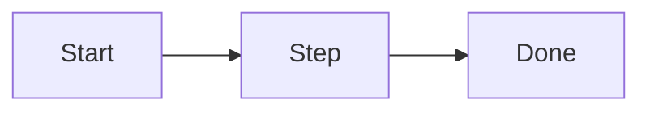

# <Feature title>

The top half (sections 1 to 4) is for every reader: product, design, UX. The bottom half (5 to 12) is for engineers. Delete a section that does not apply.

## 1. In one paragraph

What it does and for whom, in plain words.

## 2. Why

Problem, users, goals, non-goals.

## 3. How it works

The steps in words.

## 4. Screens and states

Screenshots or mocks in `images/` (alt text required): empty, busy and error states. Cite design-system IDs ("components 15"); no new UX rules here.

## 5. Functional requirements

**R5.1** — <a testable requirement>

## 6. Non-functional requirements

Performance budgets, security and privacy, data kept and for how long, accessibility, limits (default and ceiling).

**R6.1** — <a testable requirement>

## 7. Design

Data model, interfaces, jobs. A diagram of the parts.

## 8. Failure modes

For each dependency: fail open or fail closed, and why.

## 9. How it is proven

| Requirement | Test |
|---|---|
| R5.1 | `path/to/test` |

## 10. Decisions

| ID | Question | Chosen | Date |
|---|---|---|---|

## 11. Not built yet

Marked NOT YET IMPLEMENTED, with the seam that would change.

## 12. Code map

Source: path/to/file
