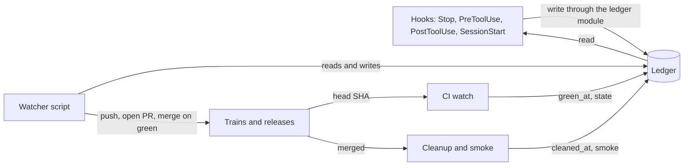

# DELIVERYSPEC — Delivery rules

**Status:** Normative
**Version:** 1.2.0
**Applies to:** every project that delivers its work with the `luismc-delivery` plugin, and the plugin itself
**Audience:** Claude Code sessions and people working in those projects, and the implementers of `luismc-delivery`

---

## At a glance

### In one paragraph

This spec holds the delivery rules. Each rule has an ID (`DL-nn`, `Q-n`, `D-n`) that hooks, scripts and the shipped rule files cite. A rule says what must hold, which check enforces it, and whether that check is built. The checks read one ledger file, `.delivery/ledger.json`. A project sets its limits in `.delivery/config.json`.

### Why

A lesson kept as a memory note works only if the orchestrator remembers it. A lesson kept as a hook, a script or a ledger field cannot be forgotten. Rule IDs let a hook name the rule it enforces. They also let a test prove that every cited ID exists.

### How it works



1. A hook sees a tool call or a turn end and records it in the ledger (section 2).
2. A PreToolUse or Stop hook reads the ledger and the rules in section 1, then denies or blocks when a rule is broken (D3).
3. The watcher runs between turns. It pushes the next train, opens its ready PR and merges the previous train when its CI is green for the current head (D5).
4. The CI watch reads the workflow runs of the head commit and sets `green_at` (DL-06, DL-07).
5. After the merge, cleanup removes the branches and worktrees. The smoke test checks production (DL-14, DL-18).
6. Each project sets its limits in section 6.

---

## Reading the rules

Every rule in section 1 has these columns.

- **Source**: where the rule came from. rules = the user's rules files. CLAUDE.md = the user's or the project's CLAUDE.md. owner rule = a rule the owner set on that date. owner lesson = a lesson the owner gave; the rule now records it.
- **Scope**: G = generic (belongs in a plugin), P = project-specific (per-project config or the project's own scripts).
- **Kind**: STOP = Stop-hook block; PRE = PreToolUse deny; POST = PostToolUse ledger write; SS = SessionStart; WATCH = watcher script; CI = CI guard test; GIT = git hook; TEXT = rules text only.
- **Today**: Y = enforced, W = warns only, ~ = partly, N = not enforced (rules text only).

Goal: each delivery and orchestration rule is a mechanical check in the plugins (hook, script or ledger field), not a note the orchestrator must remember.

## 1. Rules

### Trains, CI and merge (1a)

| ID | Rule (imperative) | Source | Scope | Kind | The check reads | Today |
|---|---|---|---|---|---|---|
| DL-01 | Never push to a branch whose ready PR's CI is running; late work rides the next train. | owner lesson, rules | G | GIT pre-push + PRE `git push` | `gh pr list --head`, `gh run list --commit`; `trains[].ci.state` | Y `train_freeze.py` via `.githooks/pre-push` (both repos); not as PRE |
| DL-02 | Join and check the next train while the previous train's CI runs; push it the moment that CI is green. | owner lesson | G | STOP | `trains[k].green_at` set, `trains[k+1].state=joined`, `pushed_at` null > 5 min | N |
| DL-03 | Merge a green train at once. Never leave one unmerged (RELEASE-27 sat green ~10 h). | owner lesson | G | STOP + WATCH | `trains[].green_at` set, `merged_at` null, no `hold` reason | N |
| DL-04 | Before any question dialog, do every action that does not need the answer (merges, pushes, launches, publish). | owner lesson | G | PRE `AskUserQuestion` | ledger "actionable now" set (DL-02/03/24 conditions true) | N |
| DL-05 | Never `gh pr merge --auto`. | owner lesson, rules | G | PRE | command tokens | N (rules text; `session_guard.py` does not cover it) |
| DL-06 | Merge only after `ci_watch.py` passed for the PR's current head SHA. | owner lesson, rules | G | PRE `gh pr merge` | `trains[].ci.head_sha == gh pr view headRefOid` and `ci.state=success` | ~ `ci_watch.py` exists; merge not gated |
| DL-07 | Watch CI by the workflow runs of the head commit, never by the PR check list. | rules | G | PRE (deny `gh pr checks --watch`) | command tokens | ~ `ci_watch.py`; nothing stops the other way |
| DL-08 | Open a ready PR only from a release/integration branch; every other PR is a draft. | CLAUDE.md, rules | G | PRE | branch name vs `release_branches` | Y `session_guard.py` ready-PR guard (wired in a project's settings) |
| DL-09 | Check runners are online for every label CI needs before opening a ready PR. | owner lesson | G | PRE `gh pr create`/`ready` + WATCH | `runners[]` (`gh api .../actions/runners`), `runs-on` labels | W `runner_health.py` (join, ci_watch), `runners-check.ts` (P) |
| DL-10 | A ready PR from `release/*` runs `release:prepare` (fold spec notes) before CI. | owner lesson | G (change_notes) | PRE `gh pr create`/`ready` | `change_notes.py --check-folded` exit | ~ CI fails late (`--check-folded`) |
| DL-11 | A join is light. Merge, resolve conflicts, fold spec notes, run typecheck and lint of the touched packages and the fast guards (pre-push), then push and open the ready PR at once. Never run the branch gate or a full suite on the joined head. Do not wait for a sandbox gate before the ready PR. Do not re-run the full gate after a join fix. The ready PR's CI is the one full run. | owner lesson | G (+P steps) | PRE (test guard) |`gate.json` join steps (`"join"` flag, `join_guards`), `.delivery/join-result.json`| Y `join.py` light check + `session_guard.py`; `hook_pre_tool.py` PreToolUse deny (branch gate on a release/integration branch, join brief naming it) |
| DL-12 | Each agent runs one affected branch gate, and never `--full` unless a valve trips. On the CI-gate path (DL-81) the agent's gate is its branch CI run; locally it runs only the touched tests and the fast guards. | owner lesson | G | PRE | command tokens, valve files changed | Y `session_guard.py` test guard, `branch_gate.py` default |
| DL-13 | Trust an agent branch's gate only through a `gate-result.json` that matches the current head and base. The join checks it per branch, never for the joined head or the ready PR. | rules | G | script | `refs/gate-results/<b>` | Y `gate_verify.py`, `join.py` |
| DL-14 | After a merge, run `cleanup.py --pr N`. Leave no merged branch or finished worktree. | owner lesson, rules | G | STOP + POST | `trains[].merged_at` set, `cleaned_at` null; the message names the project's `cleanup_command`, then `delivery_ledger.py cleaned --pr N`, which verifies the branches and worktrees are gone and records `cleaned_at` on every row with that pr | ~ `cleanup.py`, `train-cleanup.yml` (remote); local not forced |
| DL-15 | A ready/train PR body lists the drafts it carries (`Carries: #x, #y`). | owner lesson | G | PRE `gh pr create` (ready) | `--body` text vs `trains[].cargo[].pr` | N |
| DL-16 | A train leaves with what is green; it never waits for the slowest cargo. | owner lesson | G | STOP (warn) | `trains[].cargo[].gate` all green except members still building > 15 min after first green | N |
| DL-17 | One train in CI at a time; on the timeline, a wait is a gap, never a phase. | owner lesson | G | POST (phases from events) | `trains[].phases.actual` written only by events | N (hand-drawn chart) |
| DL-18 | Deploy once per merge. Smoke-test production after it. Fix forward on a new branch. Ask before a rollback when the owner is awake. | CLAUDE.md, owner lesson | G | STOP | `trains[].merged_at` set, `smoke.state` null; the message names the project's `smoke_command`, then `delivery_ledger.py smoke --pr N`, which reads the newest `smoke_workflow` run on the merge commit and records `smoke` and `live_at` on every row with that pr | ~ deploy-job smoke (CI); `smoke_packaged.py` for packaged apps |
| DL-19 | Vercel deploys only from the default branch. No preview deploys for agent branches. Never merge mid-round to see it deployed. | CLAUDE.md | G | PRE (`vercel deploy` without `--prod`, on non-default branch) | git branch, command | ~ `git.deploymentEnabled` config |
| DL-20 | Never `vercel env rm` to narrow targets; after an env change re-list Production. | owner lesson | G | PRE (deny `vercel env rm`) + POST (queue a re-list) | command tokens | N |
| DL-21 | CI jobs run only on self-hosted runners; never a GitHub-hosted `runs-on`. | CLAUDE.md | P (G as option) | CI | workflow YAML | N |
| DL-22 | Build artifacts: keep only the newest of each stable name. | rules | G | CI | artifacts list | Y `artifact-prune.yml` / `artifact_prune.py` |
| DL-23 | A gate that fails at `setup` means a stale lockfile. Regenerate and commit it; never install unfrozen. | rules | G | PRE (deny `--no-frozen-lockfile`, `npm install` in gate context) | command tokens | N |
| DL-24 | Only the release PR folds spec change notes. Never commit with conflict markers. | owner lesson | G | GIT pre-commit | staged diff for `^<<<<<<<` | ~ `change_notes.py`; marker check not confirmed |
| DL-25 | removed: project-specific, not part of the plugins |
| DL-26 | removed: project-specific, not part of the plugins |
| DL-27 | removed: project-specific, not part of the plugins |

### Agents (1b)

| ID | Rule (imperative) | Source | Scope | Kind | The check reads | Today |
|---|---|---|---|---|---|---|
| DL-30 | Size each agent ETA from scope: setup + work by files touched + affected checks. State the breakdown. Never pad. | owner lesson | G | POST (on launch) + STOP | `agents[].eta.breakdown` present; total vs `eta_table` (small fix 15-25, UI 25-35, multi-list 40-60) | N (the registry has `expected_basis`, R6.10, but nothing ties it to a launch) |
| DL-31 | Give every ETA as a clock time: the run's real start + its typical duration. Name the dependency. Use "tomorrow" only when computed past midnight. | owner lesson | G | STOP | last assistant text; `agents[].started`, `trains[].ci.started` | ~ `~/.claude/hooks/no-tomorrow.mjs`, registered only in a project's `settings.local.json` (not a plugin) |
| DL-32 | Check each critical-path job's own log every ~30 min. A log older than its step's typical time means investigate now. DS33 (D65): the session's 15-minute cron fires only when the session is idle. So the background watcher also checks every `running` agent row every 15 min (`watcher.check_interval_min`). It records `last_checked`, `last_activity`, `head_sha`, `branch`, `check_note` and `stalled` (no activity for longer than the ETA's work + checks). A watcher-recorded check counts as the check. A `stalled` row blocks. The watcher never marks an agent `done` by guess. | owner lesson | G | WATCH + STOP | `agents[].log_path` mtime, `agents[].last_checked`, `jobs[].log_path` | N |
| DL-33 | Never end a turn with work in flight without a background watcher that wakes within 20 min. | owner lesson | G | STOP | in-flight set (agents running, trains in CI, installs) vs `watchers[].heartbeat_at` | ~ artifacts Stop hook only asks for a Running task (R8.10) |
| DL-34 | After a routine reports succeeded, verify its branch moved before counting it done. | owner lesson | G | WATCH | `git ls-remote` sha vs `agents[].base_sha` | N |
| DL-35 | Start cloud runs at once (`run_once_at` = now + ~1 min). | owner lesson | G | PRE `RemoteTrigger` | `run_once_at` vs clock | N |
| DL-36 | Every cloud brief carries these markers: no push notifications; the CRITICAL RUN RULE (never end the turn while waiting, push early); no attribution; the shared BRIEF.md; one affected gate (or, on the CI-gate path, that the branch CI is the gate). A `brief_markers` entry may be a list, and any one item satisfies it. | owner lesson | G | PRE `RemoteTrigger`/`Agent` | prompt text vs `config.brief_markers[]` | N |
| DL-37 | Code agents: Sonnet at medium; Opus agents medium; RemoteTrigger sets `session_context.effort_level`. | owner lesson, rules | G | PRE `Agent`/`RemoteTrigger` | `effort` / `effort_level` / `model` fields | ~ `effort_drift.py` (SessionStart, settings only) |
| DL-38 | Concurrency caps: cloud 50, local <= 3 and only with > 8 GB free memory, total 53. These are the plugin defaults; a project's `.delivery/config.json` `caps` overrides them. | owner lesson, rules | G (caps in config) | PRE `Agent`/`RemoteTrigger` | count `agents[state=running]` by `where`; free memory | N |
| DL-39 | Non-PC-bound work goes to cloud runs until the cloud cap is full; local only for PC-bound steps. | owner lesson | P | PRE `Agent` (local) | prompt has `PC-bound:` reason, or cloud running == cap | N |
| DL-40 | One agent and one branch carry every open task in the same files/area; split only large, truly parallel parts. | owner lesson | G | PRE (context only) | registry To do/Waiting tasks with the same app/area | N (gap, see 3) |
| DL-41 | Split parallel agents by file ownership; never chain an agent on files another running agent owns. | owner lesson, rules | G | PRE `Agent`/`RemoteTrigger` | `agents[].owns[]` overlap | N |
| DL-42 | Agents stop only processes and containers they started; never kill by name or stop every container. | rules | G | PRE | command tokens (`taskkill /IM`, `pkill`, `docker stop $(docker ps -q)`) | N |
| DL-43 | Before briefing an agent that needs an external site, run `reach_check.py`; fetch locally on failure. | rules | G | PRE `RemoteTrigger` (when prompt has URLs) | `reach_checks[]` within 1 h | ~ script exists, not required |
| DL-44 | Agents write their report first and push after every step. | rules | G | TEXT (proxy DL-34) | branch activity | N |
| DL-45 | Commit shared contracts to the integration branch before launching agents. | rules | G | PRE `RemoteTrigger` | brief names a contract path that is on `origin/<integration>` | N |
| DL-86 | A branch that changes UI code (gate.json `ui_paths`) or an e2e spec file (`e2e_spec_paths`) runs, before its CODE DONE or gate pass, the e2e specs that cover the screens it changed: the project's `e2e_map` (changed source globs -> spec files), else the specs of the affected UI packages from the workspace graph, else the app's whole e2e project when nothing maps. A cloud agent runs them in its sandbox; on a PC, at most 2 workers. | owner decision D78 | G | GATE `branch_gate.py` + CI-gate `agent_ci.py` | changed files vs `ui_paths`, `e2e_spec_paths`, `e2e_map` | Y |
| DL-87 | The result records the e2e run: `gate-result.json` has `ui_changed` and an `e2e` object (`required`, `outcome`, `selection`, `specs`, `changed_specs`). `gate_verify.py` refuses a UI branch whose result lacks that record for the current head or whose e2e did not pass. `agent_ci.py` starts no CI for a CODE DONE UI branch until `branch_gate.py --e2e-only` has published a passing record for its head. The messages name the specs and the command. | owner decision D78 | G | GATE + VERIFY + CI-gate | `e2e` in the result at `refs/gate-results/<branch>` | Y |
| DL-88 | Never push an e2e fix blind: the pre-push hook (`e2e_push_check.py`) refuses a push that adds or changes e2e spec files unless `.delivery/gate-result.json` for exactly the pushed commit shows those specs ran and passed (or the whole suite did). | owner decision D78 | G | GIT pre-push | changed spec files vs the local result's `e2e` record and `head` | Y |
| DL-89 | Every cloud brief says the agent runs the e2e specs of the screens it changes before CODE DONE, or that it changes no UI. The launch check looks for "e2e specs" or "no UI change" in the brief. | owner decision D78 | G | PRE `RemoteTrigger`/`Agent` | prompt text; `checks_off` may list `DL-89` | Y |

### Local machine, runners, installs (1c)

| ID | Rule (imperative) | Source | Scope | Kind | The check reads | Today |
|---|---|---|---|---|---|---|
| DL-50 | Run one heavy local job at a time. Heavy jobs yield to train CI and pause the local runner while they run; they always resume it. | owner lesson | G (runner_plan) / P (heavy-job.ts) | PRE (heavy command not via wrapper) + WATCH | `runners[].busy/paused_by`, `jobs[state=running, heavy]` | ~ a project's own heavy-job script; nothing forces the wrapper |
| DL-51 | Never add CI runners on this PC; weigh memory before heavy local work. | owner lesson | P | TEXT + WATCH (memory) | free memory | N |
| DL-52 | removed: project-specific, not part of the plugins |
| DL-53 | Keep worktrees and scratch files only under the work root (`C:\Work\...`), never under the projects folder or `.claude/worktrees`. Remove them when done. | owner lesson | G (root in config) | PRE `git worktree add`, `EnterWorktree` | path vs `config.work_root` | N |
| DL-54 | removed: project-specific, not part of the plugins |
| DL-55 | Installs run one at a time; a second install waits. | owner lesson | P | PRE (`msiexec`, `schtasks /run ...UpdateNow`) + POST | `installs[state=installing]` | N |
| DL-56 | removed: project-specific, not part of the plugins |
| DL-77 | While memory is above 85% or CPU is above 60% on the machine, start no new heavy work (test runners, builds, installs, docker, ffmpeg, background jobs, local agents, workflows). Never hold cloud launches. Never kill or slow anything that is running. | owner rule 23 Oct 2026 (two crashes under file-load peaks) | G | PRE `Bash`, `PowerShell`, `Agent`, `Workflow` (exit 2) | total memory % and CPU % (load.py, ~1 s CPU window, 10 s cache); limits: project `load_limits` over `~/.claude/luismc-delivery-machine.json` over 85/60; heavy list in the plugin README and `heavy_commands` | Y (on in every project where the plugin is enabled, with or without `.delivery/`; fails open with a warning when the machine cannot be measured) |
| DL-78 | When the machine is over a limit, say so once per turn (numbers and limits) so the session holds new work. | owner rule 23 Oct 2026 | G | STOP + SS (non-blocking `systemMessage`; SessionStart also `additionalContext`) | same sample as DL-77 | Y |
| DL-79 | A self-hosted runner starts a job only when the machine is under the DL-77 limits. `runner_load_gate.py` is the runner's `ACTIONS_RUNNER_HOOK_JOB_STARTED` hook. It polls every 15 s for up to 30 min, then fails the job with a log line. The doctor reports whether the hook is set. | owner rule 23 Oct 2026 | G | WATCH (runner hook) + doctor `runner` check | same sample; `ACTIONS_RUNNER_HOOK_JOB_STARTED` in the environment or a runner folder's `.env` | Y when installed (the plugin changes no runner configuration) |
| DL-80 | CI scope rules. A release pull request runs the full suite. A change of only the CI's own files runs the CI tests and a named smoke set, even on a release PR. A change to root configuration or the lockfile runs the full suite. Everything else runs only what the change reaches. The patterns come from the project (`scripts/delivery/ci-scope.json`), never from the plugin. | owner decision 30 Oct 2026 (DS23, DS26) | G (patterns P) | CI | changed paths, event, head and base refs | Y `ci_scope.py` (+ `area_select.py` for the affected jobs); opt-in by the file |
| DL-81 | The CI-gate path (opt-in). An agent runs the tests of what it touched and the fast guards, pushes, and writes a `CODE DONE` line in its report. It does not run the full local gate; its branch CI is its gate. Draft PRs run no CI. So `agent_ci.py` merges the branch onto its base (`--base`, default `origin/master`) into a two-parent commit on `ci/<task>`, and reports conflicts by file without a run. At `CODE DONE` it starts one `workflow_dispatch` run on that commit per branch head. `cleanup.py --pr N` removes the `ci/` refs. A manual run plans what the branch brings since the default branch (`origin/<default>...HEAD`), never the last commit. | owner decision 30 Oct 2026 (DS26) | G | script + brief | report `CODE DONE`, `gh run list --event workflow_dispatch` | Y `agent_ci.py`, `ci.yml` `workflow_dispatch` + plan step |
| DL-82 | Every CI run reports how long it took. The last job writes the artifact `ci-run-times` (stable name; the newest is kept) and a job summary, against a report-only target. | owner decision 30 Oct 2026 (DS23, DS26) | G | CI | the run's jobs via the API | Y `ci_run_times.py`; opt-in by the repository variable `CI_RUN_TIMES=true` |
| DL-83 | On the CI-gate path the orchestrator joins urgent work at code push (a light join, `join.py --ci-gate`, no gate result needed). It sizes an ETA from coding time plus the branch CI run, not a padded local gate. A CI plan script that a helper imports has no top-level `await`. It deadlocked once: Node exit 13, so the plan step never settled and CI ran everything. | owner lessons 30 Oct 2026 (DS26) | G | TEXT + script | `gate.json` `ci_gate` / `--ci-gate`; the ETA breakdown (DL-30) | Y `join.py --ci-gate`; the rest is rules text |
| DL-84 | The branch gate runs in this order: the always-on guards, then type check and lint of the touched packages and their dependents, then unit, integration and e2e tests. A time-limited run always covers lint and types; the limit never skips them. `gate_verify.py` refuses a result in which a required step (`gate.json` `required_steps`, default `typecheck` and `lint`) is missing or was skipped for any reason but "nothing in its scope changed". The pre-push hook also runs lint and typecheck of the touched packages (cached by the task runner, skipped when no package changed). | owner lesson 31 Oct 2026 (a release needed 3 CI runs: 2 red on lint, 1 test crash the agents' gate never reached) | G | script | `gate-result.json` `steps[]`, `required_steps`; `gate.json` step order | Y `delivery_common.py` order check + time-limit floor, `branch_gate.py`, `gate_verify.py`, `fast_guards.py` (steps with `pre_push`) |
| DL-85 | Plan runners for a release CI on one shared Linux runner. Jobs that need no Linux (lint, types, boundary checks, contract and unit tests that run on any OS) run in parallel on another available runner (a second self-hosted runner with its own label, or a hosted one) instead of queueing behind the Linux-only jobs. The Linux-only jobs (integration, e2e, packaging) stay on the Linux runner. The split is advice for the project's `CI_RUNS_ON`-style runner variables, not a script. | owner request 31 Oct 2026 (3 release CI runs of 65-70 min on one runner) | G | TEXT | runner labels and the jobs' `runs-on` | N (advice; the runner plan in STACKSPEC 13.1) |

### Progress page and reporting (1d)

| ID | Rule (imperative) | Source | Scope | Kind | The check reads | Today |
|---|---|---|---|---|---|---|
| DL-60 | On every task state change, update the task and publish Full Progress in the same turn. | owner lesson | G | STOP | `pending --json` | Y artifacts `hook_end_of_turn.py` (R8.3) |
| DL-61 | Publish Full Progress at least hourly, at the top of the hour, when nothing was published in the last 60 min. The session creates the hourly cron at start. | owner lesson | G | SS + WATCH + STOP | `publishes[full-progress].last_at` | N (memory; cron made by hand) |
| DL-62 | Every publish runs `pending --json`, publishes the path it prints, then runs `mark-published`. Check that the version went up. | owner lesson | G | POST (Artifact publish) + PRE `mark-published` | copy mtime/hash vs `publishes[].last_state_hash`, published version | ~ plugin 1.9+ flow; no check that the copy was fresh |
| DL-63 | When a release ships, close every row it carries. No open row may show an Expected time in the past. | owner lesson | G | STOP | registry `expected` vs now; `trains[].cargo[].task` | N |
| DL-64 | Say RELEASE-n to the owner, never train labels or branch names. | owner lesson | G (naming in config) | STOP (text scan) | last assistant text vs `config.train_label_re` | N |
| DL-65 | Every status shown (page, chat) comes from one shared reading of the latest state. | owner lesson | G | design: renderers read the ledger | ledger only | N (applies to the ledger itself) |
| DL-66 | Show times in the owner's zone, labelled (Lisbon). Stamp them from the real clock, never a guess. | owner lesson | G (tz in config) | POST stamps | clock | ~ artifacts script stamps |

### Owner communication and attribution (1e)

| ID | Rule (imperative) | Source | Scope | Kind | The check reads | Today |
|---|---|---|---|---|---|---|
| DL-70 | Ask every open question at once, numbered. Use several dialogs in one message if there are more than 4. Never trickle. | owner lesson, CLAUDE.md | G | PRE `AskUserQuestion` (context) | count of open `owner_questions[]` vs this call | Y (rules text delivered by SessionStart; Q-5 trickle check in PRE) |
| DL-71 | Write no explanation before a dialog in the same turn. Put context inside the question, or ask in plain chat. | owner lesson | G | PRE `AskUserQuestion` | transcript: assistant text since last user message > ~300 chars | N |
| DL-72 | A rejected dialog with no owner words is not a stop: keep working, re-ask in plain chat. | owner lesson | G | POST-failure `AskUserQuestion` (context) | tool error text | N |
| DL-73 | Never send email, messages, posts, issues or comments in the owner's name. Write drafts as files. | owner lesson, user CLAUDE.md | G | PRE (outbound: `gh issue/pr comment`, `gh issue create`, mail/Slack MCP send) | tool name, command | ~ auto-mode classifier only |
| DL-74 | No Co-Authored-By or Claude attribution in commits or PR bodies (owner choice). | owner lesson | G (owner opt) | GIT commit-msg + PRE `git commit`/`gh pr create` | message/body text | N; violated by a project CI auto-fix script |
| DL-75 | Create every doc under `docs/`. | rules | G | PRE `Write` of `*.md` | path | N |
| DL-76 | A release runs CI once. Nothing after the merge re-runs what the release PR proved on the same tree. Only publish, deploy and production smoke run on the default branch. | owner lesson | P | STOP | PR merge commit tree vs PR head tree; default-branch runs of that commit and their jobs vs `pr_proven_jobs` | N |

Counts: 66 rules (DL-01..27, 30..45, 50..56, 60..66, 70..79). Enforced today: 8 Y,
1 warn-only (W), 17 partly (~), 37 not enforced (N).

## 2. Ledger schema: `.delivery/ledger.json`

One file per repository (git-ignored with `.delivery/`). Only `delivery_ledger.py` writes it: atomic write via temp + rename, a lock file, `schema: 1`. Hooks never edit it by hand. Every field below names its writer. Readers: the Stop/PreToolUse hooks, the watcher and the Full Progress renderer (DL-65: the one truth for shown state).

```jsonc
{
  "schema": 1,
  "updated_at": "ISO-UTC",
  "config_ref": ".delivery/config.json",        // caps, work_root, brief markers, tz, labels
  "trains": [{
    "id": "T-2026-10-14-01",                       // ledger id
    "release_no": 29,                              // RELEASE-n (from the artifacts record)
    "branch": "release/29",                        // ready PR head
    "pr": 412,
    "state": "planned|joining|joined|pushed|ci|green|red|merged|live|cleaned|abandoned",
    "hold": null,                                  // {"reason": "...", "by": "owner|rule", "until": ISO}
    "cargo": [{"task": "DV148", "branch": "DV148-fix", "pr": 409, "sha": "…",
               "gate": "pass|fail|none", "joined_sha": "…", "paths": ["apps/web/**"]}],
    "phases": {
      "planned": [{"name": "join|ci|merge|deploy|smoke|install", "start": ISO, "end": ISO, "basis": "…"}],
      "actual":  [{"name": "…", "start": ISO, "end": ISO}]   // gaps are implied, never a phase (DL-17)
    },
    "ci": {"head_sha": "…", "run_ids": [123], "state": "queued|running|success|failure", "started_at": ISO},
    "measure": {"state": "none|clean|regressions", "at": ISO, "report": "path"},
    "smoke": {"state": null, "at": ISO},
    "joined_at": ISO, "pushed_at": ISO, "green_at": ISO, "merged_at": ISO,
    "live_at": ISO, "cleaned_at": ISO
  }],
  "agents": [{
    "task": "DV152",                               // task id(s); "tasks": [...] when bundled
    "where": "local|cloud",
    "id": "trig_… | agent id",                     // RemoteTrigger id or Agent task id
    "session": "cse_…",                            // cloud session when known
    "branch": "DV152-scripts", "base_sha": "…", "head_sha": "…",
    "owns": ["scripts/delivery/**"],              // file ownership (DL-41)
    "model": "sonnet", "effort": "medium",
    "started": ISO,
    "eta": {"total_min": 25, "breakdown": {"setup": 5, "work": 12, "checks": 8},
            "basis": "2 small scripts", "due": ISO},
    "log_path": "C:/…/run.log",                    // local agents and jobs
    "last_checked": ISO, "last_activity": ISO,     // branch moved or log mtime
    "state": "queued|running|pushed|done|empty|stalled|failed|stopped"
  }],
  "jobs": [{"id": "B14-build", "cmd": "…", "heavy": true, "pid": 1234, "log_path": "…",
            "started": ISO, "typical_step_min": 20, "last_checked": ISO, "state": "running|done|failed|waiting-ci"}],
  "installs": [{"product": "app|svc", "version": "0.1.6212", "via": "AppUpdateNow",
                "state": "queued|installing|done|failed", "started": ISO, "ended": ISO, "log": "…"}],
  "publishes": [{"artifact": "full-progress", "url": "https://claude.ai/artifact/…",
                 "last_at": ISO, "last_version": 512, "last_state_hash": "sha256 of the publish copy",
                 "copy_written_at": ISO}],
  "runners": [{"name": "build-pc-linux", "labels": ["self-hosted","Linux","project-linux","project-linux-big"],
               "online": true, "busy": false, "local": true,
               "paused_by": null,                  // job id while heavy-job pauses it
               "checked_at": ISO}],
  "watchers": [{"pid": 4321, "kind": "delivery_watch", "started": ISO, "heartbeat_at": ISO}],
  "owner_questions": [{"id": "Q7", "text": "…", "asked_at": ISO, "answered_at": null, "blocks": ["T-…"]}],
  "events": [{"at": ISO, "kind": "…", "ref": "…", "by": "writer"}]   // append-only, capped (last 500)
}
```

### Who writes each field

| Field | Writer |
|---|---|
| `trains[]` create, `cargo[]`, `release_no`, `phases.planned` | `delivery_ledger.py train plan` (orchestrator; release_no from the artifacts record) |
| `cargo[].gate`, `cargo[].joined_sha`, `joined_at`, `state=joined` | `join.py` (calls the ledger module after each merge and after the light check) |
| `pushed_at`, `state=pushed` | POST hook on `git push` of a train branch (and `join.py --push`) |
| `pr`, `state=ci` | POST hook on `gh pr create` / `gh pr ready` (parses the PR URL) |
| `ci.*`, `green_at`, `state=green/red` | `ci_watch.py` (on decide); the watcher between its calls |
| `merged_at`, `state=merged` | POST hook on `gh pr merge` exit 0; session-start catch-up via `gh pr list --state merged` |
| `live_at`, `smoke` | deploy smoke step / `delivery_log.py live` mirrored; POST on smoke command |
| `cleaned_at` | `cleanup.py --pr N` |
| `measure` | the project's measure script via `delivery_ledger.py measure` |
| `phases.actual` | derived by the ledger module from the timestamps above (never typed) |
| `hold` | `delivery_ledger.py hold` (orchestrator; owner reason required) |
| `agents[]` create (id, where, model, effort, started, eta, owns) | POST hook on `Agent` / `RemoteTrigger create|run` (parses tool input and result; eta/owns from a fenced `delivery:` block in the brief) |
| `agents[].head_sha`, `last_activity`, `state` | watcher (`git ls-remote`, routine `list_runs` status, log mtime) |
| `agents[].last_checked` | POST hook when the session reads that agent's log/branch/run status; watcher never sets it |
| `jobs[]` | `heavy-job` wrapper / `runner_plan.py run` on start/end; watcher for mtime |
| `installs[]` | POST hook on `msiexec` / `schtasks /run …UpdateNow`; watcher reads the product's update-state file |
| `publishes[]` | POST hook on `Artifact` publish (url, version) and on `project_artifacts.py pending`/`mark-published` (hash, copy time) |
| `runners[]` | `runner_health.py` and the watcher (`gh api …/actions/runners`); `paused_by` by the heavy-job wrapper |
| `watchers[]` | the watcher itself (heartbeat each loop) |
| `owner_questions[]` | POST hook on `AskUserQuestion` (asked) and on the next user message (answered) via UserPromptSubmit |
| `events[]` | every writer (append) |

Finished rows (closed trains, finished or disabled agents, finished installs, events) older than `ledger_retention_days` (default 14; 0 keeps all) are dropped when the ledger is written; open rows, rows with no readable timestamp and trains with an active hold are never dropped.

## 3. Gaps: rules no check can fully enforce, and the best proxy

| Rule | Why not mechanical | Best proxy |
|---|---|---|
| DL-40 bundle related tasks into one agent | "same area" and "large" are judgment | PRE on launch injects as additionalContext the open To do/Waiting tasks with the same app/owner, and any overlap with running agents' `owns[]`. It denies only when a running agent owns the same paths (DL-41) |
| DL-30 ETA sizing honesty | true scope unknown to a hook | Require the breakdown block. Warn when the total is > 2x the `eta_table` row for the declared size. Record actual vs ETA in `events` and show the ratio on Full Progress, so padding is visible |
| DL-44 report first, push after every step | inside the agent's own session | A brief marker (DL-36), plus the watcher marks `stalled` when the branch has not moved for `2x eta.breakdown.work` |
| DL-50/51 memory weighing | memory is machine state, thresholds vary | `runner_plan.py` reads free memory and running heavy jobs. PRE acts on known heavy commands outside the wrapper |
| DL-70 "all questions" | whether every open decision is listed is judgment | `owner_questions[]`: PRE on a dialog adds the unanswered ledger questions that are not in this call. STOP warns when a later turn asks new questions while older ones stay unasked |
| DL-71 no text before a dialog | text length is a crude signal | PRE denies once when more than ~300 chars of assistant text precede the dialog in the turn. The reason says "end the turn with the text, ask in plain chat" |
| DL-72 rejected dialog is not a stop | needs reading intent | POST-failure context line only |
| DL-65 one truth | design property | the ledger is the only source the renderer and hooks read; a guard test fails if a hook parses chat for state |
| speed-without-compromise, parallel-by-default | goals, not checks | STOP lists "startable now" items (To do tasks with deps met while slots are free; trains green and unpushed) once per turn |
| DL-73 never send as owner | outbound tools are open-ended | A deny list of known outbound commands and MCP tools in config. The classifier stays the backstop |

## 4. Build split: four parts by file ownership

Commit the shared contract to the integration branch before any part is built. The contract is section 2 of this file
as `claude/plugins/delivery/references/ledger-schema.json` (JSON Schema) and the config shape
`.delivery/config.json` (caps, work_root, tz, brief_markers, train_label_re, long_pole_globs,
measure_globs, eta_table, heavy_commands, outbound_deny). The home is the plugin
`claude/plugins/delivery/` (`luismc-delivery`), so the artifacts plugin keeps to ARTIFACTSPEC.

**(a) Ledger + PostToolUse + watchers**
- `claude/plugins/delivery/scripts/delivery_ledger.py` (module + CLI: plan, hold, measure, show, lock, atomic write, derive phases)
- `claude/plugins/delivery/scripts/hook_post_tool.py` (PostToolUse/PostToolUseFailure for Bash, Agent, RemoteTrigger, Artifact, AskUserQuestion; UserPromptSubmit answer marking)
- `claude/plugins/delivery/scripts/delivery_watch.py` (background watcher: ls-remote, run status, log mtimes, runners, installs, heartbeat)
- `claude/plugins/delivery/references/ledger-schema.json`
- tests: `claude/plugins/delivery/tests/test_ledger*.py`, `test_post_tool*.py`, `test_watch*.py`
- small call-ins (same agent, to avoid split ownership): `tech-stack-setup/.../scripts/delivery/{join,ci_watch,cleanup,runner_health}.py` gain a best-effort `ledger.record(...)` call (no-op when the module is absent)

**(b) Stop / PreToolUse / SessionStart hooks**
- `claude/plugins/delivery/hooks/hooks.json`
- `claude/plugins/delivery/scripts/hook_stop.py` (DL-02, 03, 14, 16, 18, 31 (port `no-tomorrow.mjs`), 32, 33, 61, 63, 64; block-once-per-fingerprint and a 3-block ceiling like R8.4)
- `claude/plugins/delivery/scripts/hook_pre_tool.py` (DL-04, 05, 06, 07, 09, 10, 15, 19, 20, 23, 35-39, 41-43, 45, 53-55, 71, 73-75)
- `claude/plugins/delivery/scripts/hook_session_start.py` (rule delivery, catch-up of merged trains, the hourly-publish instruction for DL-61, stale watcher restart prompt)
- `tech-stack-setup/.../scripts/delivery/session_guard.py` stays the test/ready-PR guard; (b) adds `--auto` deny there only if the plugin is absent (one owner: this agent)
- tests: `claude/plugins/delivery/tests/test_stop*.py`, `test_pre_tool*.py`, `test_session_start*.py`
- reads the ledger only through (a)'s module; uses fixtures until (a) lands

**(c) runner_plan + artifacts publish-on-change / hourly**
- `tech-stack-setup/.../scripts/delivery/runner_plan.py` (generic heavy-job wrapper: waits for train CI, pauses and resumes the local runner, runs one heavy job at a time, keeps a memory floor, optional affinity/priority; records `jobs[]` and `runners[].paused_by`. The `runners` subcommand is D6a: it reports offline runners, repairs them via `runners[].repair` every `retry_seconds` (300), and re-runs the failed train CI runs that are still wanted. A run is still wanted when its head is the branch's current head, it is the newest run of its workflow for that head, no run of the branch is queued or running, and it did not end `cancelled` unless `rerun_cancelled` is true. Ledger events `runner.offline|repair|retry|online|rerun|rerun_skipped|giveup`) + its test; a project's heavy-job script becomes a thin caller later (project branch, not here)
- `claude/plugins/artifacts/scripts/hook_end_of_turn.py` (hourly fail-safe: block when `publishes[full-progress].last_at` > 60 min; fresh-copy check DL-62)
- `claude/plugins/artifacts/scripts/project_artifacts.py` (`pending --json` records copy hash/time; `mark-published` refuses when no publish of the current copy is recorded; expired-Expected check DL-63)
- `claude/plugins/artifacts/scripts/publish_hourly.py` (new: what the hourly cron/watcher calls)
- `claude/plugins/artifacts/references/artifactspec.md` + `plugin.json` version bump, artifacts tests

**(d) claude-setup wiring + rules + per-project config**
- `project-setup/skills/claude-setup/SKILL.md` (enable `luismc-delivery`, write `.delivery/config.json`, retire `~/.claude/hooks/no-tomorrow.mjs` and its `settings.local.json` entry once (b) ships)
- `project-setup/skills/claude-setup/assets/.claude/settings.json` (enabledPlugins, PreToolUse entries)
- `project-setup/skills/claude-setup/assets/.claude/rules/agents-and-integration.md` and `clarifying-questions.md` (re-tag each line `<!-- check: … -->` to its new enforcer; add the DL rules that stay text)
- `project-setup/skills/claude-setup/assets/delivery-config.json` (template; example values: caps 8/3/5, work_root `C:\Work`, tz Europe/Lisbon, `release/\d+[a-z]` label regex, measure globs)
- `project-setup/skills/tech-stack-setup/assets/tooling/shared/.githooks/commit-msg` (DL-74, opt-in by config) and `pre-commit` conflict-marker check (DL-24)
- `.claude-plugin/marketplace.json`, `README.md` section for the new plugin, this spec
- model-profiles / rule-tag tests that check every `<!-- check: -->` path exists

Order: contract commit, then (a)-(d) in parallel. (b) and (c) code against the schema and
fixtures. The join runs (a) first. A project then wires the plugin, adds `.delivery/config.json`, drops any `Co-Authored-By` line from its CI auto-fix script, and makes its heavy-job script call `runner_plan.py`. Each is a change in that project, on its own branch.

## 5. Owner decisions (14 Oct 2026, 22:3x Lisbon)

These decisions are binding. They override sections 1-4 where they differ.

- D1 Approach B+C: hooks enforce inside sessions; watcher scripts (no model) act on time-critical steps.
- D2 Home: the new plugin `claude/plugins/delivery/`, named `luismc-delivery`. claude-setup installs, enables and configures it per project (`.delivery/config.json`). Full Progress publishing stays in `luismc-artifacts`. Delivery only feeds it (publish-on-phase-change + hourly, brief (c)).
- D3 Stop-hook findings BLOCK (not warn), with the block-once-per-fingerprint and 3-block ceiling pattern of artifacts R8.4.
- D4 Cloud first: PreToolUse DENIES a local `Agent` call unless its prompt carries a `PC-bound:` reason line, or the cloud cap is full (DL-39).
- D5 The watcher pushes the next train, opens its ready PR AND merges the previous train the moment its CI is green for the PR's current head. The script checks this through the head's workflow runs; it never uses `gh pr merge --auto`. Holds (`trains[].hold`) stop it.
- D6 Runner orchestration by the watcher. It cancels CI runs that a newer push to the same PR replaced. It holds dependabot and other non-train CI runs (cancel, then re-run after) while a train's CI runs. Heavy local jobs yield to train CI (runner_plan).
- D6a Runner offline (owner 14 Oct ~23:25): report it at once, then retry every 5 minutes. Each retry first tries to repair the runners: it reads runner status via the GitHub API and restarts the runner service or container that the project names in `.delivery/config.json` `runners[].repair`. Only then does it re-queue or re-run the CI that needs them. Never just wait. Every report and repair attempt goes to the ledger.
- D7 After a lesson is enforced with its DL id, its old memory note is DELETED (not trimmed). claude-setup reports which memory files map to enforced ids. The orchestrator deletes them after the plugin release.
- D8 Questions (replaces DL-70..72):
  - Q-1 ask every open question in one go. There is no 4-question cap when the owner says "ask me questions" (several wizard dialogs in one message).
  - Q-2 always use the questions wizard (AskUserQuestion), never plain-text questions in the terminal. The Stop hook blocks a final reply whose closing part is a numbered or bulleted list of questions to the owner instead of wizard calls.
  - Q-3 put context INSIDE each question's text, because text before a dialog is not seen. PreToolUse denies a dialog whose question texts are too short to stand alone (config min chars).
  - Q-4 merge, push and launch before asking. PreToolUse denies AskUserQuestion while the ledger has an actionable-now item (green train unmerged, joined train unpushed with previous green, launch queued).
  - Q-5 no guessing missing parameters, no trickling. PreToolUse denies AskUserQuestion when this session has running agents (`agents[].launched_by`, state queued/running) and has already asked a question batch (`owner_questions[].asked_at`) within `question_window_min` (default 60) since the owner's last prompt (`owner_prompt.at`, written by the UserPromptSubmit recorder). The message says to park the question until the agents of this wave report, then ask everything at once. Allowed: every running agent has `blocked_on: "owner"`; the owner's latest prompt asked for questions (`owner_prompt.asked_for_questions`, "ask me questions"); dialogs issued within `question_batch_sec` (90) of the previous one (Q-1, several dialogs in one message). Switch off with `checks_off: ["Q-5"]`.
  - `clarifying-questions.md` gains Q-2/Q-3 lines and moves under the delivery plugin's rules. `claude/plugins/delivery/rules/clarifying-questions.md` is the canonical text. The SessionStart hook injects it (tags stripped) every session in an opted-in project. The claude-setup asset is a byte copy, kept equal by a plugin test.
- D9 ETA rules (DL-30/31; 0.3.0: a sentence that reports a measured duration, a saving or a cost, or lists two or more durations, is not an ETA, and a clock time or dependency anywhere in the same bullet covers its sentences): every agent launch requires a breakdown (`delivery:` block: setup/work/checks minutes). Stop blocks reply text with an ETA that lacks a clock time + dependency, or that says "tomorrow" or "next round" unless computed past midnight. Port `no-tomorrow.mjs` into the plugin and retire the user-level hook.

## 6. Project config: `.delivery/config.json` (plugin 0.2.0)

The schema `claude/plugins/delivery/references/config-schema.json` describes the config. `delivery_config.py validate [--root DIR | --config FILE] [--json] [--strict]` checks it (exit 0 valid, 1 errors, 2 unreadable JSON). Every key is optional and a 0.1.0 config stays valid. A key the schema does not list is a warning, never an error (so a typo shows); keys starting with `_` are comments. A wrong type, an out-of-range number, an invalid regular expression, a `tz` that zoneinfo cannot load, or `--auto` in a merge flag is an error. Each key has an example in the schema.

- `enforcement` (Stop and PreToolUse hooks; D3). `mode`: `block` (default) or `warn` (findings and denials are shown as a `systemMessage`, nothing blocks). `block_ceiling` (integer >= 1, default 3): the same findings block this many times per session, then the turn ends (replaces the fixed 3 of artifacts R8.4). `log_every_block` (default false): append every block to `.delivery/blocks.log` as `time<TAB>hook<TAB>rule id<TAB>message` (hook is `stop` or `pre-tool`), for the owner's review.
- `watcher` (D5, D6a). `push_trains`, `open_prs`, `merge_on_green`, `manage_runners`: booleans, all default true (= 0.1.0). `merge_on_green` merges with `gh pr merge N --merge`, never `--auto`. It merges only when the PR head is the commit whose CI run was green. The watcher re-reads the head right before the merge and passes `--match-head-commit SHA`. A moved head records `merge.head_moved` and waits for the next pass. `merge_method: "merge"` and `merge_flag: "--merge"` are accepted spellings of the only method; `never_auto_merge` documents D5 and cannot be false. With `manage_runners`, the watcher launches `runner_plan.py runners` itself (found at `runner_plan.script`, else `scripts/delivery/runner_plan.py`) and relaunches it when it exits (D6a). The project does not start it.
- `watcher.ci_workflows` (0.3.0, DL-03): the workflow files that must all complete with conclusion `success` for the PR head commit before a train is green (default `["ci.yml"]`). The latest run of each counts. A missing, running, skipped or failed required workflow is not green. A sibling workflow (an installer build) never stands in for another. The watcher is the only writer of `green_at`. A `ci_watch.py` pass is recorded as the event `ci_watch.passed`; a failure still marks the train red. If a green train's required run is running again, the train goes back to `ci` and `green_at` is cleared (`train.green_revoked`).
- `stop_repeat_limit` (integer >= 0, default 3), `cleanup_command`, `smoke_command`, `smoke_workflow` (DS72). The Stop hook keeps, per session in `.delivery/hook-state.json`, a fingerprint of each finding and of the ledger fields it depends on (the train row for DL-02, DL-03, DL-14, DL-18 and DL-76, the agent row for DL-30 and DL-32). When the same findings block `stop_repeat_limit` consecutive turn ends with no change to those fields, later turn ends are not blocked for them. One non-blocking notice per session says they are still open and names the recording command. This holds until the fields change or a new finding appears; then the hook blocks normally again. 0 never limits. DL-14 and DL-18 name the project's `cleanup_command` / `smoke_command` (`{pr}` = PR number), then the recording command. `delivery_ledger.py smoke --pr N [--run ID|URL]` uses the newest `smoke_workflow` run (default `Production smoke`) on the PR's merge commit. Success records `smoke {state: pass, at, run}` and `live_at` on every row with that pr. A failed run records `fail` and exits 1. A missing or unfinished run records nothing and exits 1. `delivery_ledger.py cleaned --pr N` succeeds when the train's branch and cargo branches are gone from `origin` and no worktree holds them; otherwise it lists what is left and records nothing. Success records `cleaned_at` and state `cleaned` on every row with that pr. Both write through the ledger lock, touch only those fields, add an event, and never touch CI fields.
- `pr_proven_jobs` (0.3.0, DL-76): job names (case-insensitive, globs allowed) the release PR proves. Rule: "A release runs CI once. Nothing after the merge re-runs what the release PR proved on the same tree. Only publish, deploy and production smoke run on the default branch." After a train merges and until it is cleaned, the Stop hook reads the merge commit of the PR and, only when its tree equals the PR head tree, lists the default-branch runs of that commit and flags each non-skipped job named here. Default `[]`: the check is off and makes no network call. Any `gh` failure leaves the check silent.
- `brief_markers` (DL-36): each entry is a string the brief must contain, or a list of strings of which any one is enough (0.10.0), e.g. `["one affected gate", "CI is the gate"]`.
- `load_limits` (DL-77, DL-78): `{"memory_pct": 85, "cpu_pct": 60}`, each 1..100. Precedence per key: `.delivery/config.json`, then the machine file `~/.claude/luismc-delivery-machine.json` (`{"load_limits": {...}}`, optionally `runner_gate` {`max_wait_min`, `poll_sec`, `on_timeout` fail|run} and `runner_dirs` for the doctor), then the defaults 85 and 60. `heavy_commands` (regexes, case-insensitive; plain text also matches) adds commands to the heavy list. The load guard is not opt-in. It runs in every project where the plugin is enabled, with or without `.delivery/`, because it protects the machine. Set `checks_off: ["DL-77"]` (or `["DL-78"]`) to switch a project off. `enforcement.mode: warn` turns the refusal into a message. Heavy: test runners; `pnpm|npm|yarn|bun` scripts `test`, `e2e`, `check*`, `build*` (also via `run`/`exec`/`dlx`); turbo, nx, `tsc -b`, next/vite/webpack builds; cargo, dotnet, go, mvn, gradle, msbuild builds and tests; docker build and compose up/build; ffmpeg; installs (`install|add|ci`) unless `--offline`; background jobs that are not plainly light (git, gh, ls, cat, grep and similar); a local Agent launch (no `isolation` remote/cloud) and any Workflow. Light and never refused: git, gh, ls, cat, grep, rtk-wrapped reads, python one-liners, lint. RemoteTrigger and Agent with remote/cloud isolation are never refused. Over a limit, PRE exits 2 and prints the numbers, the limits, the top processes by CPU and memory (names only) and what to do (wait or finish a running job). CPU is the mean of the samples of the last 30 s (at most 3), so one spike does not decide.
- `runner_plan` (D6, D6a). `cancel_replaced_runs` (watcher cancels CI runs of a branch whose head has moved on), `hold_dependabot_during_train` (watcher cancels and later re-runs non-train CI runs while a train's CI runs), `heavy_jobs_yield` (`runner_plan.py run` waits for train CI; `heavy_local_jobs_yield` is the same key as some projects spell it): booleans, default true. `retry_seconds`, `runner_max_retries`, `report_command` as in D6a. `rerun_cancelled` (boolean, default false): the runner guard also re-runs runs that ended `cancelled`; a cancelled run was usually cancelled on purpose. Without `runner_plan.train_branch_regex`, the top-level `train_branch_re` is used.
- `tz`. An IANA name. If zoneinfo cannot load it (no tzdata, typically on Windows), the validator and `delivery_doctor.py` fail. Any hook that still has to format a time prints a warning once, then uses UTC; it is never silent. SessionStart adds the same warning to its context.
- `delivery_doctor.py [self-check] [--root DIR] [--json]` runs five checks: config valid, gh signed in, tz loads, hooks registered (hooks.json names the hook scripts, and `luismc-delivery` is enabled in project or user settings), ledger writable. Exit 0 all ok, 1 a FAIL, 2 no `.delivery/`.
