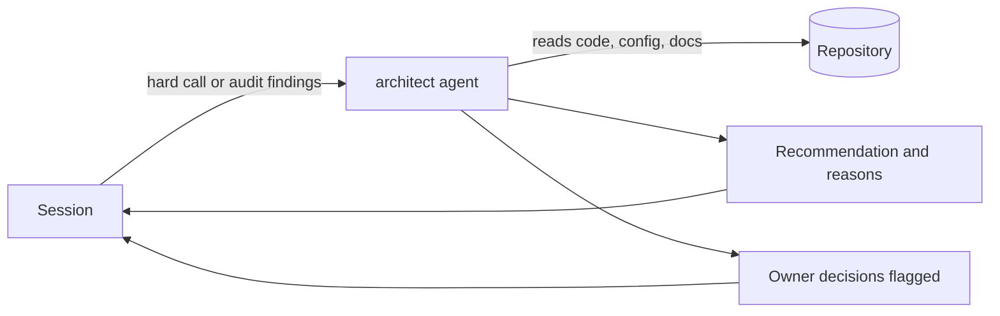

# Architect agent (luismc-agents)

## 1. In one paragraph

`luismc-agents` installs one read-only subagent, `architect`. A session hands it a hard design call or a set of audit findings. It reads the code and answers with one recommendation and the reasons. It does not change files.

## 2. Why

A routine coding agent is a poor judge of a hard tradeoff. It also tends to trust an audit tool's default severity. The architect gives a second, independent view on the decisions that need one.

Goals:

- One direct recommendation, not a list of options.
- Real severity for audit findings, with false positives named.
- Decisions that belong to the owner are flagged, not made.

Non-goals: routine implementation, mechanical coding, and work whose approach is already decided. Those stay on the default model.

## 3. How it works

1. The session starts the agent when the task matches its description: a design tradeoff, a second opinion on a risky approach, or a review of audit findings.
2. The agent reads what it needs. It has not seen the codebase before.
3. It weighs the tradeoffs and gives one recommendation.
4. For audit findings it rates severity and exploitability itself, orders by risk and reversibility, and calls out false positives.
5. Anything that changes scope, is hard to reverse, or is a business tradeoff is surfaced as the owner's decision.

## 5. Functional requirements

**R5.1** — The plugin ships exactly one agent, `claude/plugins/agents/agents/architect.md`.

**R5.2** — The agent runs on the `opus` model at `medium` effort.

**R5.3** — The agent cannot write: its front matter lists `Edit`, `Write` and `NotebookEdit` in `disallowedTools`.

**R5.4** — The agent's description names when to use it (hard design calls, audit-finding review) and when not to (routine or already-decided work).

**R5.5** — The agent's instructions require a direct recommendation with reasoning, not an options survey.

**R5.6** — The agent's instructions require it to flag, not decide, anything that changes scope, is hard to reverse, or is a business tradeoff.

## 7. Design

One Markdown file with front matter (`name`, `description`, `model`, `effort`, `disallowedTools`) and a short prompt. There is no code, hook or script. The plugin manifest is `claude/plugins/agents/.claude-plugin/plugin.json`. The model and effort follow the owner's default of medium for every model; the project-setup plugin's profile table holds the same default (see [models](../models/spec.md)).

## 8. Failure modes

- The agent is not started: the session decides alone. This fails open. The agent is advice, not a gate.
- The agent cannot read a file: it says so and recommends from what it saw.
- The agent cannot edit by design, so a bad run cannot damage the repository.

## 9. How it is proven

| Requirement | Test |
|---|---|
| R5.2 | `tools/test_model_profiles.py` (check D1: architect is opus at medium) |
| R5.1, R5.3, R5.4, R5.5, R5.6 | not covered by a test yet; see section 11 |

## 11. Not built yet

NOT YET IMPLEMENTED: a test that reads `architect.md` and checks R5.1 and R5.3 to R5.6. The seam is `tools/test_model_profiles.py`, which already parses the file.

## 12. Code map

Source: claude/plugins/agents/agents/architect.md
Source: claude/plugins/agents/.claude-plugin/plugin.json
Source: tools/test_model_profiles.py
