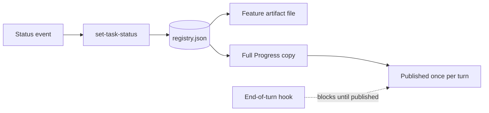
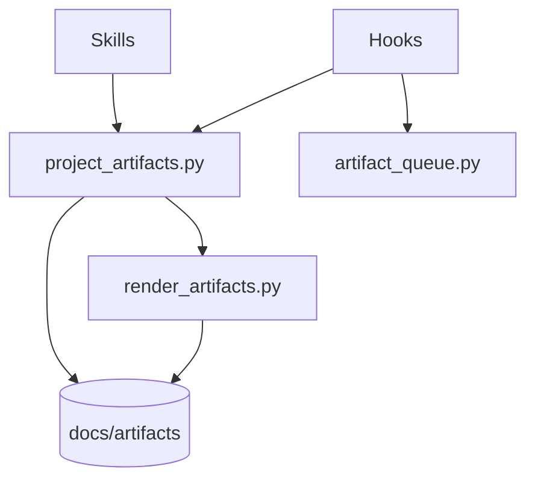

# Project artifacts

This page describes the `luismc-artifacts` plugin as it is built. The normative rules are in [ARTIFACTSPEC](../../../claude/plugins/artifacts/references/artifactspec.md); this page links to them. It does not copy them.

## 1. In one paragraph

`luismc-artifacts` keeps one record of a project's work in `docs/artifacts/` and draws it as pages. Each feature has a feature artifact (a standalone HTML file). The whole project has one full-progress artifact. It is published to claude.ai once per turn. An owner can see what is live, what is running and what needs them without reading code or chat. Every status is written once, in a task registry. Every page is generated from it.

## 2. Why

A project builds many things at once. In an earlier project the pages drifted. A feature page still said "Needs you" hours after the step was done. The status was typed by hand in two places.

Goals:

- One owner-facing view of all work, across every app and service.
- The same look and structure for every artifact in a project.
- Statuses that cannot drift: written once, drawn many times.
- Few publishes: claude.ai allows 200 artifact publishes a day per account.
- A record that lives in the repository, so a deleted page can be rebuilt from it.

Non-goals: the content of a feature, the claude.ai Artifact service, and how a project plans its work.

## 3. How it works

- The project keeps its record in `docs/artifacts/`. It holds a manifest, a task registry, the content of each feature and the rendered pages.
- A task is a unit of work with an ID (a registered prefix plus a number). Every activity is a task before it starts. This includes the session's own work.
- One command, `set-task-status`, changes a task's status. It renders every page that shows the task and writes the files. It never commits or pushes (see [decision 0010](../../architecture/decisions/0010-artifacts-never-commit-or-push.md)).
- A feature artifact is a file opened in a browser. It is never published. Full Progress lists every task and links the feature files. It is the only page published to claude.ai (see [decision 0011](../../architecture/decisions/0011-only-full-progress-is-published.md)).
- Hooks make the session do the rest. They queue status changes seen in git and CI. They deliver the rule at session start. They stop a turn that ends with something unpublished.

Eight statuses with fixed meanings: Live, Built, Running, Needs you, Waiting, To do, On hold, Failed (ARTIFACTSPEC section 6). A release is a task that other tasks ride. Full Progress draws a release timeline and groups items by release (ARTIFACTSPEC sections 5.7 and 5.8).

### The skills

| Skill | What it does |
|---|---|
| `feature-artifact-new` | Writes a feature artifact and its tasks. It creates Full Progress first if the project has none. |
| `full-progress-artifact-new` | Writes the project's one full-progress artifact. It refuses if one exists. |
| `task-add` | Records new work as a task with the next ID. |
| `task-status-update` | Runs `set-task-status`, checks, and publishes what changed. |
| `project-artifact-check` | Checks a project's artifacts against ARTIFACTSPEC. |

The commands are listed in ARTIFACTSPEC section 7. They include `init`, `feature-new`, `task-add`, `set-task-status`, `render`, `check`, `pending`, `mark-published`, `retire` and `promote-to-spec`.

## 4. Screens and states

The two pages are HTML. Section 0 of each is always "Status and checklist". It holds a stamp, a lede, tiles and the checklist. The lede says what needs the owner, or "Nothing needs you". Both pages work in light and dark themes and at phone width. The structure stylesheet is fixed. A project's design tokens are free. See ARTIFACTSPEC section 5.

## 5. Functional requirements

**R5.1** — A project has feature artifacts and exactly one full-progress artifact. Creating the first feature artifact creates Full Progress when none exists.

**R5.2** — A task's status is stored once, in `docs/artifacts/registry.json`. Every checklist and tile is generated from it.

**R5.3** — `set-task-status` updates the registry, renders each page that shows the task, and writes the files in one run.

**R5.4** — `set-task-status` rejects a status outside the eight. It names the nearest allowed one.

**R5.5** — Rendering is deterministic: the same record and stamp give identical HTML.

**R5.6** — A writing command refuses a change that adds a finding, but not one that leaves earlier findings in place.

**R5.7** — A feature artifact is never published and has no URL. Only Full Progress is published.

**R5.8** — Full Progress needs a publish only when what the owner sees changes. A detail-only change does not.

**R5.9** — When claude.ai refuses a publish for its daily limit, the publish is deferred until the reset, and the end-of-turn hook does not block on it.

**R5.10** — Full Progress is published at least every 60 minutes while the project has a record.

**R5.11** — A release's Expected time is the end of its last phase. A mismatch is refused.

**R5.12** — A finished feature artifact can be retired. Its tasks and decisions are kept. Its file and content are deleted.

**R5.13** — `promote-to-spec` writes a feature artifact's content to a feature spec in the luismc-docs template.

## 6. Non-functional requirements

**R6.1** — The plugin never runs a git write and never runs a `gh` command that writes. It may run read-only git calls.

**R6.2** — The scripts use the Python standard library only.

**R6.3** — The after-command hook finishes in under two seconds. Every hook does nothing in a project without a manifest.

**R6.4** — Hooks fail open on an internal error. They exit 0 and print one line on stderr. A turn is released after three unchanged blocks.

**R6.5** — The two pages show no sideways page scroll at 360 px wide. Wide tables scroll inside their box.

**R6.6** — Times are shown in the project's own time zone, named in the page.

Limit: 200 publishes a day per account (a claude.ai limit). The plugin spends at most one per turn.

## 7. Design

- `project_artifacts.py` is the one script. Skills and hooks call it. They never edit the record themselves.
- `render_artifacts.py` renders the pages from the record.
- Four hooks: after-command (queues status changes), before-command (silent), end-of-turn (blocks), session-start (delivers the rule and migrates an older record).
- The rule is delivered at each session start. No copy is placed in the project (ARTIFACTSPEC section 10).
- Record files are listed in ARTIFACTSPEC section 4. The record folder can move under `docs/` with `move-record`.

## 8. Failure modes

| Dependency | If it fails | Why |
|---|---|---|
| `gh` or CI lookup at session start | Skip the catch-up. Say so once. | A missing tool must not stop work. |
| `pending` unreadable in the end-of-turn hook | Fail open | A broken script must not trap a turn. |
| claude.ai daily limit | Defer. Do not block. | The owner cannot fix it. It resets. |
| Time zone data missing (Windows) | Fall back to local time, with a warning | The page still renders. |
| A change that adds a finding | Fail closed: write nothing | A record that was valid stays valid. |

## 9. How it is proven

| Requirement | Test |
|---|---|
| R5.1 | `test_one_full_progress`, `test_feature_new_runs_init_first` in `tools/test_project_artifacts.py` |
| R5.2 | `test_mark_published_leaves_registry_byte_identical`, `test_non_task_commands_leave_registry_alone` in `tools/test_project_artifacts.py` |
| R5.3 | `test_set_task_status`, `test_set_task_status_only_touches_its_artifacts` in `tools/test_project_artifacts.py` |
| R5.4 | `test_status_nearest` in `tools/test_project_artifacts.py` |
| R5.5 | `test_determinism` in `tools/test_project_artifacts.py` |
| R5.6 | `test_earlier_findings_do_not_block_a_change`, `test_a_new_finding_is_refused_beside_earlier_ones` in `tools/test_project_artifacts.py` |
| R5.7 | `test_mark_published_refuses_a_feature_artifact`, `test_pending_never_lists_a_feature_artifact` in `tools/test_project_artifacts.py` |
| R5.8 | `test_detail_only_change_needs_no_publish`, `test_status_change_needs_a_publish` in `tools/test_project_artifacts.py` |
| R5.9 | `test_deferred_publish_does_not_block_until_the_reset` in `tools/test_project_artifacts.py`; `end_of_turn_reminds_once_while_deferred` in `tools/test_project_artifacts_hooks.py` |
| R5.10 | `test_pending_refresh_lists_an_unchanged_full_progress` in `tools/test_project_artifacts.py`; `stop_blocks_when_full_progress_is_over_an_hour_old` in `tools/test_project_artifacts_hooks.py` |
| R5.11 | `test_release_expected_is_the_end_of_the_last_phase`, `test_release_refusals` in `tools/test_project_artifacts.py` |
| R5.12 | `test_retire_moves_the_feature_and_check_stays_clean`, `test_retire_refuses_a_feature_with_an_open_task` in `tools/test_project_artifacts.py` |
| R5.13 | `test_promote_to_spec_writes_the_feature_spec`, `test_promote_mapping_by_heading` in `tools/test_project_artifacts.py` |
| R6.1 | `test_writing_commands_change_files_and_leave_git_alone`, `test_only_read_only_git_is_run` in `tools/test_project_artifacts.py`; `hooks_never_write_record`, `start_runs_no_git_write` in `tools/test_project_artifacts_hooks.py` |
| R6.3 | `after_finishes_in_under_two_seconds`, `stop_does_nothing_without_a_manifest` in `tools/test_project_artifacts_hooks.py` |
| R6.4 | `stop_fails_open_when_pending_cannot_be_read`, `stop_lets_go_after_three_unchanged_blocks_with_a_system_message` in `tools/test_project_artifacts_hooks.py` |
| R6.6 | `test_time_summer_and_winter`, `test_time_local_fallback_warns` in `tools/test_project_artifacts.py` |

R6.2 and R6.5 have no automated test. R6.5 is a manual check (ARTIFACTSPEC section 13). Page rendering is covered by `tools/test_render_artifacts.py`.

## 10. Decisions

The full list is the ARTIFACTSPEC decision record (D1 to D24). These are the lasting ones.

| ID | Question | Chosen | Date |
|---|---|---|---|
| [0010](../../architecture/decisions/0010-artifacts-never-commit-or-push.md) | Does the plugin commit or push? | No: it writes files; the project commits | 2026-10-12 |
| [0011](../../architecture/decisions/0011-only-full-progress-is-published.md) | Which pages are published? | Only Full Progress, once per turn | 2026-10-10 |
| [0012](../../architecture/decisions/0012-release-timeline-and-state-column.md) | How are releases shown? | A timeline and a State column; Expected is the sum of the phases | 2026-10-11 |
| ARTIFACTSPEC D1 | Where is a status stored? | Once, in the registry | 2026-10-10 |
| ARTIFACTSPEC D2 | Do branch names start with the task ID? | Yes | 2026-10-10 |
| ARTIFACTSPEC D4 | What look do pages get? | The project's own design, else a default | 2026-10-10 |
| ARTIFACTSPEC D15 | Which rows fold into Earlier? | Live rows older than 14 days; Built never | 2026-10-12 |
| ARTIFACTSPEC D24 | What happens to a finished feature artifact? | `retire` | 2026-10-30 |

## 11. Not built yet

- A cloud routine that catches changes made outside a session. Today the next session start catches them (ARTIFACTSPEC D3).
- Moving other projects onto the plugin from dev-standards. Each project adopts it in its own sessions (ARTIFACTSPEC D9).

## 12. Code map

Source: `claude/plugins/artifacts/`

| Path | Holds |
|---|---|
| `scripts/project_artifacts.py` | The commands |
| `scripts/render_artifacts.py` | The renderer |
| `scripts/artifact_queue.py` | The shared queue |
| `scripts/hook_*.py`, `hooks/hooks.json` | The four hooks |
| `scripts/publish_hourly.py` | What the hourly cron prints |
| `scripts/artifact_promote.py`, `artifact_retire.py` | `promote-to-spec`, `retire` |
| `templates/`, `design/` | Page templates, structure stylesheet, default design |
| `rules/project-artifacts.md` | The rule delivered at session start |
| `skills/` | The five skills |
| `references/artifactspec.md` | ARTIFACTSPEC |

Tests: `tools/test_project_artifacts.py`, `tools/test_project_artifacts_hooks.py`, `tools/test_render_artifacts.py`, `tools/test_artifact_prune.py`.

## Versions

Written by the release fold. Do not edit by hand.

| Version | Date | Release | What changed | Tasks |
|---|---|---|---|---|
| 0.1.2 | 2026-11-01 | RELEASE-25 | ARTIFACTSPEC section 8 lists the three registered hooks and marks the before-command hook retired (AR50). The artifacts record refuses a manifest file name that is not a plain [a-z0-9-]+.html name inside the record folder (audit F1). | DS152, DS153 |
| 0.1.1 | 2026-11-01 | RELEASE-22 | Wording pass; requirements and IDs unchanged. Added claude/plugins/artifacts/references/artifactspec.md to the code mapping. | DS142 |
