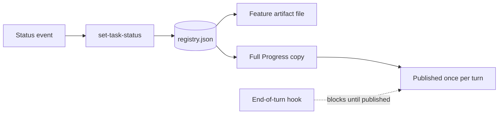
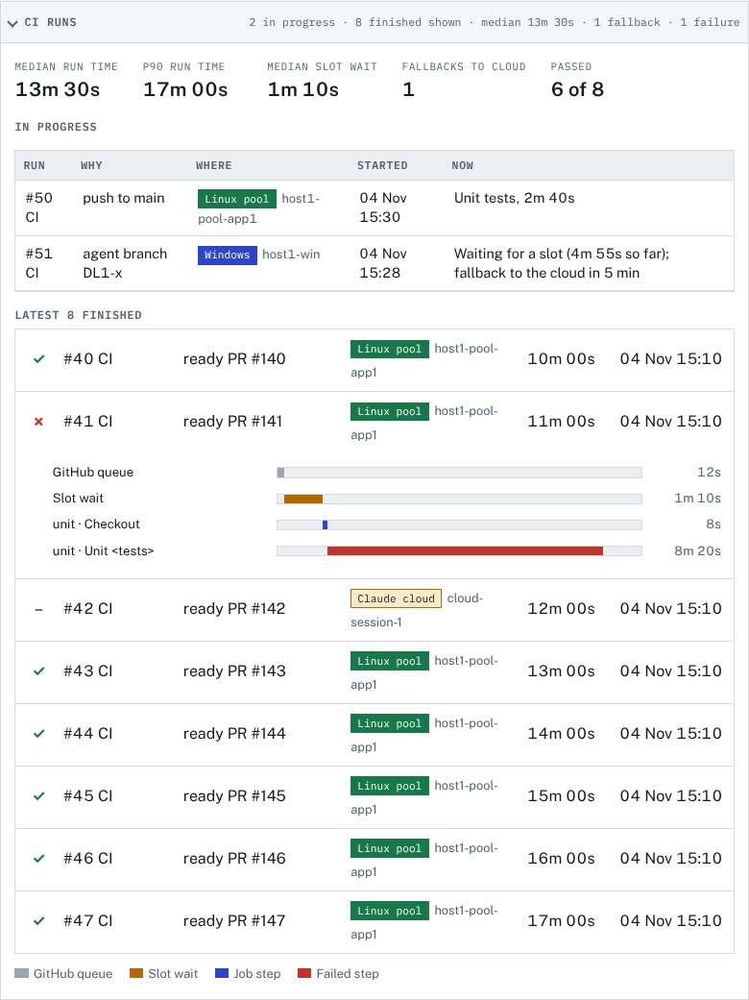
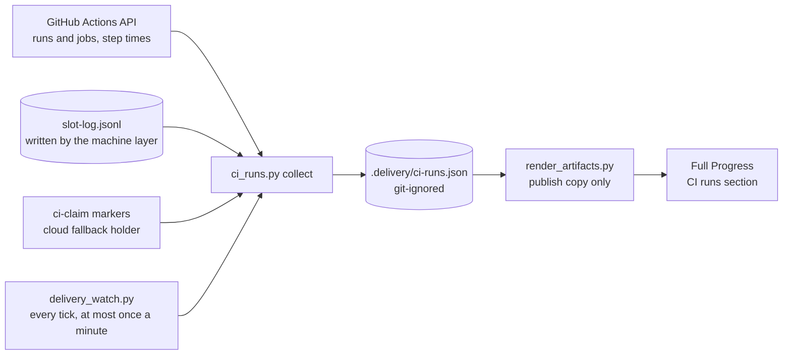
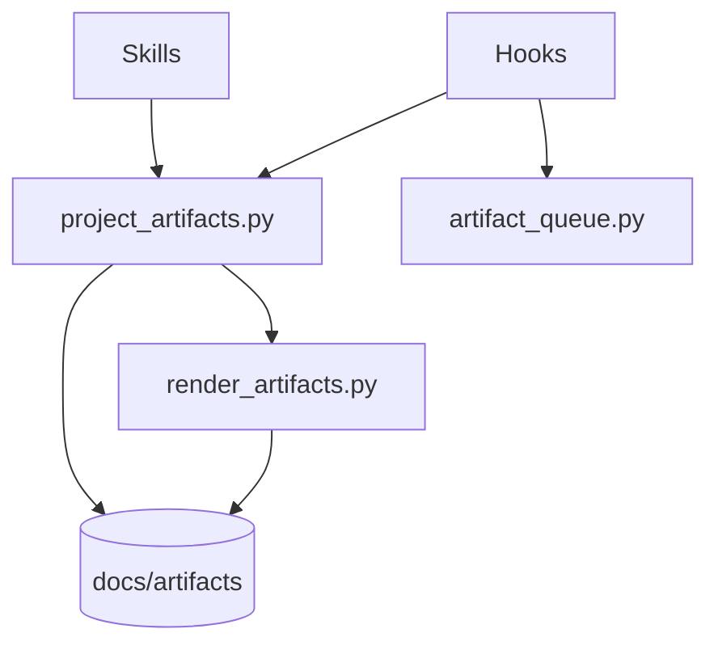

# Project artifacts

This page describes the `luismc-docs` plugin as it is built. The normative rules are in [ARTIFACTSPEC](../../../claude/plugins/docs/references/artifactspec.md); this page links to them. It does not copy them.

## 1. In one paragraph

`luismc-docs` keeps one record of a project's work in `docs/artifacts/` and draws it as pages. Each feature has a feature artifact (a standalone HTML file). The whole project has one full-progress artifact. It is published to claude.ai once per turn. An owner can see what is live, what is running and what needs them without reading code or chat. Every status is written once, in a task registry. Every page is generated from it.

## 2. Why

A project builds many things at once. In an earlier project the pages drifted. A feature page still said "Needs you" hours after the step was done. The status was typed by hand in two places.

Goals:

- One owner-facing view of all work, across every app and service.
- The same look and structure for every artifact in a project.
- Statuses that cannot drift: written once, drawn many times.
- Few publishes: claude.ai allows 200 artifact publishes a day per account.
- A record that lives in the repository, so a deleted page can be rebuilt from it.

Non-goals: the content of a feature, the claude.ai Artifact service, and how a project plans its work.

## 3. How it works

- The project keeps its record in `docs/artifacts/`. It holds a manifest, a task registry, the content of each feature and the rendered pages.
- A task is a unit of work with an ID (a registered prefix plus a number). Every activity is a task before it starts. This includes the session's own work.
- One command, `set-task-status`, changes a task's status. It renders every page that shows the task and writes the files. It never commits or pushes (see [decision 0010](../../architecture/decisions/0010-artifacts-never-commit-or-push.md)).
- A feature artifact is a file opened in a browser. It is never published. Full Progress lists every task and links the feature files. It is the only page published to claude.ai (see [decision 0011](../../architecture/decisions/0011-only-full-progress-is-published.md)).
- Hooks make the session do the rest. They queue status changes seen in git and CI. They deliver the rule at session start. They stop a turn that ends with something unpublished.

Eight statuses with fixed meanings: Live, Built, Running, Needs you, Waiting, To do, On hold, Failed (ARTIFACTSPEC section 6). A release is a task that other tasks ride. Full Progress draws a release timeline and groups items by release (ARTIFACTSPEC sections 5.7 and 5.8).

### The skills

| Skill | What it does |
|---|---|
| `feature-artifact-new` | Writes a feature artifact and its tasks. It creates Full Progress first if the project has none. |
| `full-progress-artifact-new` | Writes the project's one full-progress artifact. It refuses if one exists. |
| `task-add` | Records new work as a task with the next ID. |
| `task-status-update` | Runs `set-task-status`, checks, and publishes what changed. |
| `project-artifact-check` | Checks a project's artifacts against ARTIFACTSPEC. |

The commands are listed in ARTIFACTSPEC section 7. They include `init`, `feature-new`, `task-add`, `set-task-status`, `render`, `check`, `pending`, `mark-published`, `retire` and `promote-to-spec`.

## 4. Screens and states

The two pages are HTML. Section 0 of each is always "Status and checklist". It holds a stamp, a lede, tiles and the checklist. The lede says what needs the owner, or "Nothing needs you". Both pages work in light and dark themes and at phone width. The structure stylesheet is fixed. A project's design tokens are free. See ARTIFACTSPEC section 5.

### CI runs section (D48)

Full Progress ends with a folded section, `CI runs`. The summary line reads, for example, `2 in progress · 20 latest · median 11m 00s · 1 fallback · 1 failed`. Opened, it shows five figures (median and p90 run time, median slot wait, fallbacks to the cloud, passed out of shown), a table of runs in progress, and the latest 20 finished runs. The Where column is one chip, for example `Linux pool · host1` or `GitHub-hosted · ubuntu`; Now is a chip too (`Unit tests · 4m 12s`, or an amber `waiting for a slot · 3m · fallback in 7m`). A finished row opens to a waterfall on one time scale: GitHub queue (grey), slot wait (amber), then one row per job (teal) with its own bar. A job opens to its steps. A failed step is red. A legend names the bar colours. Rules: ARTIFACTSPEC R5.51.

The picture is made from fixture data. A live copy of the same markup, with both themes and the phone layout, is [ci-runs-mockup.html](ci-runs-mockup.html).

Where the data comes from:

- The delivery plugin writes the file. The artifacts plugin only reads it.
- The committed render never reads the file, so it does not change with every CI run. The section appears in the copy that is published.
- With no file, the section is not drawn.

## 5. Functional requirements

**R5.1** — A project has feature artifacts and exactly one full-progress artifact. Creating the first feature artifact creates Full Progress when none exists.

**R5.2** — A task's status is stored once, in `docs/artifacts/registry.json`. Every checklist and tile is generated from it.

**R5.3** — `set-task-status` updates the registry, renders each page that shows the task, and writes the files in one run.

**R5.4** — `set-task-status` rejects a status outside the eight. It names the nearest allowed one.

**R5.5** — Rendering is deterministic: the same record and stamp give identical HTML.

**R5.6** — A writing command refuses a change that adds a finding, but not one that leaves earlier findings in place.

**R5.7** — A feature artifact is never published and has no URL. Only Full Progress is published.

**R5.8** — Full Progress needs a publish only when what the owner sees changes. A detail-only change does not.

**R5.9** — When claude.ai refuses a publish for its daily limit, the publish is deferred until the reset, and the end-of-turn hook does not block on it.

**R5.9a** — While the publish is deferred, `mark-deferred` writes a local copy of Full Progress: the repo copy, with every `feature-*.html` beside it so each row link opens offline. The folder is `<work root>/full-progress/<project slug>/`. `--local DIR` may also name the `full-progress` folder or the full `full-progress/<project slug>` folder; all three give the same folder, and a nested `full-progress/full-progress` is never made. The command prints the folder used. The work root is `--local DIR`, else `work_root` in the project's `.delivery/config.json`, else `work_root` in `machine.json` of the delivery machine folder, else the publish-copy folder with a warning. Each local page has a 60-second auto-refresh tag; the repo and publish copies do not. The page opens in the browser once per deferral, recorded as `local_opened` on the entry. Every writing command refreshes the copies until the reset. (DL246, DL264, D245, D246; ARTIFACTSPEC R9.7)

**R5.10** — Full Progress is published at least every 60 minutes while work is open (a task is Running, Waiting or Needs you).

**R5.11** — A release's Expected time is the end of its last phase. Without `--expected`, a write sets it from the phases; an `--expected` that differs is refused.

**R5.11b** — `--expected` takes `DD Mon HH:MM` as well as `DD Mon ~HH:MM`, and stores the second form. Expected is optional on a To do or On hold row and shows as `Not scheduled`; Running and Waiting need one.

**R5.11c** — When `mark-published` refuses a stale copy, it names the steps in order: `pending --json --refresh`, publish the copy unedited, `mark-published` again. The end-of-turn hook says to make every status change before running `pending`.

**R5.11a** — A release has a number, `RELEASE-n`. `--release` takes the next one past the delivery ledger and the record; `--release N` sets or corrects it and refuses a number in use. A phase may cross midnight: its end rolls to the next day. A phase given as HH:MM that starts before the previous phase ends is the next day, with or without a gap between them (DL359). When the ledger knows the number of an Item's `RELEASE-n` lead, `check` gives the exact `set-task-status <id> --release <n>` command.

**R5.11d** — A project's `design.css` is checked against the accents contract: the token contract minus the page, surface and ink tokens (`--paper`, `--surface`, `--surface-2`, `--ink`, `--ink-muted`, `--rule`, `--rule-strong`) and the size tokens. `design set` and `check` accept a file without them; a file that sets them is accepted with the ignored-tokens warning; a missing accent token, or its dark value, is refused and named. The plugin's own default design keeps the full contract. (DL259)

**R5.12** — A finished feature artifact can be retired. Its tasks and decisions are kept. Its file and content are deleted.

**R5.13** — `promote-to-spec` writes a feature artifact's content to a feature spec in the luismc-docs template.

**R5.14** — Full Progress shows a foldable `CI runs` section when `.delivery/ci-runs.json` exists, and nothing when it does not (ARTIFACTSPEC R5.51, owner decision D48).

**R5.15** — `pending --refresh` renders first, so the publish copy matches a fresh render and `mark-published` accepts it. The refusal text names `render` or `pending --json --refresh`. (AR67)

**R5.16** — The `task-status-update` skill lists `--phase NAME=HH:MM-HH:MM` with the names `agents`, `join`, `ci`, `fix` and `merge`. `ci` and `fix` may repeat. (AR68, DL305)

**R5.17** — The Full Progress and feature pages show the generator badge in the header (`luismc-docs X.Y.Z` and its latest flag) and use the plugin's default page colours and 0.9x font sizes; a project's `design.css` changes accents only (see [Documentation standard plugin](../docs/spec.md) R5.16 to R5.18). The latest flag does not make a page stale: INV-3 compares pages without it. (DL239)

**R5.17a** — Every HTML page the docs plugin writes declares UTF-8 in its first 1024 bytes, so a page opened as a local file shows `·` and `…` correctly. A feature page has `<meta charset="utf-8">` in its head. The Full Progress fragment begins with `<meta charset="utf-8">`, then `<title>`; the artifact host wraps the fragment and keeps the tag. The local copy is the repo copy, so it carries the tag too. (DL260)

**R5.37a** — `check` warns (never an error) when the Full Progress lede names `RELEASE-n` and a higher-numbered release is Live. The text is `content/full-progress/meta.json: the lede names RELEASE-14 but RELEASE-35 is live; update it with edit-content`. `render` prints the same line as a note. Only the release-number test exists; the record keeps no content change times. (DL251, ARTIFACTSPEC R5.37)

**R5.18** — Every command that writes the record (`set-task-status`, `task-add`, `edit-content`, `render` and the rest) also rewrites the Full Progress publish copy when it no longer matches the record, so the copy on disk is never older than the record. Whether `pending` lists the page still follows the fingerprint rule (R5.8). `render` says `record already rendered; publish copy is current` (or `publish copy refreshed`), never a bare `nothing to do`. The stop-hook text and the rule line give the order: `pending --json --refresh`, publish the path it prints, then `mark-published`. (AR70, ARTIFACTSPEC R9.12)

**R5.19** — `task-add` of a To do, Running or Built task with no `--rides`, no `--release` and no open release row prints a warning that names the fix (`task-add --release`, then `--rides`) and exits 0. (AR70, ARTIFACTSPEC R6.15)

**R5.20** — Full Progress is published once after a burst of record changes. While the previous publish, or the last record change, is less than `full_progress.settle_sec` seconds old (default 60, in `.delivery/config.json`), `pending` does not list it and the end-of-turn hook says `Full Progress changes are settling; publish once after the last change` instead of blocking. Once the window has passed and the page still differs, it is asked for as before. `mark-published` warns when the previous publish was inside the window. The hourly fail-safe is not delayed. At the end of a turn only the previous publish holds it back: changes made seconds before the turn ends are asked for once, at that turn end. (AR72, ARTIFACTSPEC R9.13)

**R5.21** — A copy identical to the last published one is not asked for, even with `pending --refresh`, unless the hourly fail-safe or a release change asks. (AR72, ARTIFACTSPEC R9.14)

**R5.22** — A phase list with no dates (`--phase NAME=HH:MM-HH:MM`) takes the day of its first HH:MM phase from the occurrence nearest now (yesterday, today or tomorrow); later phases chain from it, and `DD Mon HH:MM` phases keep their date. A phase more than 12 h ahead while the one before it is past warns, naming the `DD Mon HH:MM` form. `--phase ""` mixed with phases, and a Waiting release with `--expected` over old phases, are refused with the fix named. (AR74, ARTIFACTSPEC R5.52)

**R5.23** — In Full Progress section 1 the `Where it stands` cell is built from the record on every render: `Live: RELEASE-n (DD Mon)` and the version when named, then one clause per open status with the task IDs (ranges when consecutive), what they wait on and the Expected date, as `Waiting: DL346-DL348 on the new pool (~23 Nov)`. It stays near 220 characters, dropping the oldest detail first. A feature with no tasks keeps its lede's first sentence. The cell is in the publish fingerprint. `check` also warns on a lede that names a train label or `#NN` (R5.37a). (AR77, ARTIFACTSPEC R5.53, R5.54)

**R5.24** — A task with no `--expected` gets a default Expected by task type. `task-add` and `set-task-status` take `--type agent|ci|join|test|docs|study|release|other`; the default is `other`. The minutes are 15, 5, 10, 10, 15, 20, 30 and 30. The time is now plus those minutes, rounded up to 5 minutes, in the project's zone, and the basis reads `default ETA, <type>: <n> min`. An explicit `--expected` wins; a To do or On hold row stays `Not scheduled`. (DP7, owner decision D2)

**R5.25** — The end-of-turn hook tells once about an open row past its Expected, in a message that does not block. It tells again only when the row gets a new Expected. A Running or Waiting row more than 60 minutes past due blocks once, naming `overdue-sweep`, which moves it to Needs you. A Needs you row is not named. The hourly fail-safe and the other blocking stops are unchanged. (DP7, owner decision D2, ARTIFACTSPEC R6.14)

**R5.26** — A release is the main unit and a pull request is its carrier. `task-add` and `set-task-status` take `--pr N` (or `#N`), `--release-start TIME` and `--release-waits-on RELEASE-n[,RELEASE-m]`; an empty value clears one. The fields sit on a release only. A waits-on entry must name another existing release, with no cycle. Without `pr` and `release-waits-on` on any open release, the timeline keeps its older look. (DS256, ARTIFACTSPEC R5.55)

**R5.27** — A release that waits on others is never live before them: its Live ETA is the latest of its own and theirs. The timeline and the table are sorted by that ETA; a dependency comes first on a tie. (DS256, ARTIFACTSPEC R5.56)

**R5.28** — The timeline is a tree: a PR row with a 4px left bar and a trunk at x=22, an 18px elbow into each of its releases, dashed arrows from a release to the release it waits on, and no dashed box. It is at most 880 wide, about 52 per row, uses the page font and the CSS colour variables. Under it a table lists Item, Live ETA, CI, Waits on and Status: a `tr.pr` row, then `tr.ch` rows (the last `tr.ch.last`) with the sub-line `<task id> · in PR N`. (DS256, ARTIFACTSPEC R5.57, R5.58)

**R5.29** — Nothing needs hand input. An open release with no `pr` takes it from `.delivery/ledger.json`: the train whose branch is `<TASK-ID>-integration` belongs to that release. An open release with no `release_waits_on` waits on every earlier open release when its train holds commits of the other train not yet on the base branch (git ancestry, skipped when git cannot say), or when `deploy.serial` is true in `.delivery/config.json` and the other train merged first. `--pr` and `--release-waits-on` win. Both reads are read-only; with no ledger nothing changes. The tree (R5.28) then shows for any project with a linked PR. (DL420, ARTIFACTSPEC R5.59) Proof: `claude/plugins/docs/tests/test_dl420_ledger_links.py`.

**R5.30** — The release table shows below the timeline whenever any release is open; the figure is the tree only with a carrier PR or a dependency. A release with no PR is a row of its own with CI "own run". (DL428, ARTIFACTSPEC R5.60) Proof: `tools/test_artifacts_ds256.py`.

**R5.31** — Section 0 of Full Progress opens with one full-width row of badges, not collapsible lines. A badge is a small labelled chip. The row shows the count of tasks that need you, are running, built, waiting, to do and live in the last 24 hours (a count of 0 shows no badge, except Needs you); each active release with its Live ETA; the carrier PRs; the CI runs; the agents, running now and launched in all, each split into local and cloud; and the last Live release with its time. A Needs you badge with tasks, and a CI badge with a failed run that no later run fixed, are marked in the status colours. The count badges replace the count tiles. No task listing is lost: every task stays in the release groups. A feature artifact keeps its At a glance block and its tiles. (DL429, ARTIFACTSPEC R5.61) Proof: `tools/test_artifacts_dl429.py`.

**R5.32** — Under the badges, Full Progress shows a "What is happening" list of at most 8 short bullets, built on every render from the record, the ledger and the CI runs file. There is one bullet for each active release and each of the last 3 Live releases. A bullet names the release as `RELEASE-n` with its PR, then says what went wrong (failed CI jobs by name, fix rounds, a hold, what needs you, a merge not cleaned up, no smoke test), what is being done about it (a running agent, a CI run in progress, or that nothing is running yet) and what went well. With no active release the list says so. This text replaces the lede in Full Progress; a feature artifact keeps its lede. (DL429, ARTIFACTSPEC R5.62) Proof: `tools/test_artifacts_dl429.py`.

**R5.33** — The badges and the bullets read `.delivery/ci-runs.json` and `.delivery/ledger.json` and write nothing. A run belongs to a release when its `why` names the release's PR (`#N`) or the train lists its run ID. With no CI runs file there is no CI badge; with no ledger there is no PR, agent or train detail, and the rest still shows. (DL429, ARTIFACTSPEC R5.63) Proof: `tools/test_artifacts_dl429.py`.

**R5.34** — Next to the CI badge, Full Progress shows a CI waste badge, built from the finished runs in `.delivery/ci-runs.json`: `62% green · 31 min per merged PR · 14 min cancelled (7 d)`. Green is the finished runs that succeeded over all finished runs. Minutes per merged PR is the time of the finished runs that name a PR, over the PRs of releases Live in the last 7 days (`n/a` with none). Cancelled minutes count runs completed in the last 7 days. With no CI runs, or no finished run, there is no badge. It is a plain badge, never marked failed. (DS258, ARTIFACTSPEC R5.64) Proof: `tools/test_artifacts_ds258.py`.

## 6. Non-functional requirements

**R6.1** — The plugin never runs a git write and never runs a `gh` command that writes. It may run read-only git calls.

**R6.2** — The scripts use the Python standard library only.

**R6.3** — The after-command hook takes the task of a `ci_watch.py` or `gh run watch` result from the watched head, not from the checkout: the branch whose head is the watched sha, and no event when that head is on no task branch or its task is already Live. It finishes in under two seconds. Every hook does nothing in a project without a manifest.

**R6.4** — Hooks fail open on an internal error. They exit 0 and print one line on stderr. A turn is released after three unchanged blocks.

**R6.5** — The two pages show no sideways page scroll at 360 px wide. Wide tables scroll inside their box.

**R6.6** — Times are shown in the project's own time zone, named in the page.

Limit: 200 publishes a day per account (a claude.ai limit). The plugin spends at most one per turn.

## 7. Design

- `project_artifacts.py` is the one script. Skills and hooks call it. They never edit the record themselves.
- `render_artifacts.py` renders the pages from the record.
- Four hooks: after-command (queues status changes), before-command (silent), end-of-turn (blocks), session-start (delivers the rule and migrates an older record).
- The rule is delivered at each session start. No copy is placed in the project (ARTIFACTSPEC section 10).
- Record files are listed in ARTIFACTSPEC section 4. The record folder can move under `docs/` with `move-record`.

## 8. Failure modes

| Dependency | If it fails | Why |
|---|---|---|
| `gh` or CI lookup at session start | Skip the catch-up. Say so once. | A missing tool must not stop work. |
| `pending` unreadable in the end-of-turn hook | Fail open | A broken script must not trap a turn. |
| claude.ai daily limit | Defer. Do not block. | The owner cannot fix it. It resets. |
| Time zone data missing (Windows) | Fall back to local time, with a warning | The page still renders. |
| A change that adds a finding | Fail closed: write nothing | A record that was valid stays valid. |
| Content or a task that is invalid | The error names the field and its limit, or the entry and the rule (`item is 93 characters; the limit is 80`). `task-add` and `set-task-status` refuse the replacement character U+FFFD in any free-text option, naming the option and the position; `check` reports one already held in a task or a content file. | The caller can fix it without running `check`. |
| `edit-content` replaces a content folder | The replace is atomic. The script writes a staging folder, swaps it in, then removes the old one. If the folder is locked it replaces the files in place, or stops with `content/<key> is in use ...; nothing changed`. Invalid content restores the old folder. On any failure the old content stays complete. `retire` sets the folder aside the same way. | A locked folder on Windows must never leave a half-deleted folder that a later commit records as deleted. |
| `task-add` for a feature whose decisions asked before 2026-11-14 have empty option summaries | Warns and names `decisions-migrate --feature KEY [--fill-from-title] [--dry-run]`, which fills each empty summary from the option label or sets it to `summary missing`. | A newer decision with an empty summary is still refused (R5.14). |
| `--phase` repeats | `ci2`, `fix2` and so on name a second round of any phase, shown in time order. | Plain `ci` and `fix` may still repeat. |
| `edit-content` of a `decisions.json` | Prints `run docs_index.py build: docs/architecture/decisions.md is now stale`. | The script does not run `docs_index.py`; the generated index is rebuilt there. |

## 9. How it is proven

| Requirement | Test |
|---|---|
| R5.1 | `test_one_full_progress`, `test_feature_new_runs_init_first` in `tools/test_project_artifacts.py` |
| R5.2 | `test_mark_published_leaves_registry_byte_identical`, `test_non_task_commands_leave_registry_alone` in `tools/test_project_artifacts.py` |
| R5.3 | `test_set_task_status`, `test_set_task_status_only_touches_its_artifacts` in `tools/test_project_artifacts.py` |
| R5.17 | `test_badge_in_both_pages`, `test_project_design_changes_accent_not_page_colour`, `test_latest_flag_does_not_make_pages_stale` in `claude/plugins/docs/tests/test_dl239_badge_colour_fonts.py` |
| R5.4 | `test_status_nearest` in `tools/test_project_artifacts.py` |
| R5.9a | `tools/test_artifacts_dl246.py`, `tools/test_artifacts_dl264.py` |
| R5.5 | `test_determinism` in `tools/test_project_artifacts.py` |
| R5.6 | `test_earlier_findings_do_not_block_a_change`, `test_a_new_finding_is_refused_beside_earlier_ones` in `tools/test_project_artifacts.py` |
| R5.7 | `test_mark_published_refuses_a_feature_artifact`, `test_pending_never_lists_a_feature_artifact` in `tools/test_project_artifacts.py` |
| R5.8 | `test_detail_only_change_needs_no_publish`, `test_status_change_needs_a_publish` in `tools/test_project_artifacts.py` |
| R5.9 | `test_deferred_publish_does_not_block_until_the_reset` in `tools/test_project_artifacts.py`; `end_of_turn_reminds_once_while_deferred` in `tools/test_project_artifacts_hooks.py` |
| R5.10 | `test_pending_refresh_lists_an_unchanged_full_progress` in `tools/test_project_artifacts.py`; `stop_blocks_when_full_progress_is_over_an_hour_old` in `tools/test_project_artifacts_hooks.py` |
| R5.11 | `test_release_expected_is_the_end_of_the_last_phase`, `test_release_refusals` in `tools/test_project_artifacts.py` |
| R5.11a | `claude/plugins/docs/tests/test_dl359_phase_gap_midnight.py` (a phase after a gap past midnight, same-day phases, a contiguous wrap) |
| R5.12 | `test_retire_moves_the_feature_and_check_stays_clean`, `test_retire_refuses_a_feature_with_an_open_task` in `tools/test_project_artifacts.py` |
| R5.13 | `test_promote_to_spec_writes_the_feature_spec`, `test_promote_mapping_by_heading` in `tools/test_project_artifacts.py` |
| R5.18 | `test_copy_follows_set_task_status_and_task_add`, `test_detail_only_change_reaches_copy_but_is_not_listed`, `test_render_wording`, `test_render_says_refreshed_when_the_copy_was_old`, `test_order_in_hook_and_rule`, `test_mark_published_still_refuses_an_older_copy` in `claude/plugins/docs/tests/test_ar70_publish_copy.py` |
| R5.19 | `test_task_add_warns_without_a_release_to_ride`, `test_task_add_no_warning_with_an_open_release` in `claude/plugins/docs/tests/test_ar70_publish_copy.py` |
| R5.20 | `test_burst_is_asked_for_once_after_the_window`, `test_a_turn_end_asks_once_after_its_own_changes`, `test_second_publish_inside_the_window_is_warned_and_one_after_is_not`, `test_changes_unpublished_after_the_window_are_still_asked_for`, `test_settle_key_defaults_to_60_and_is_read_from_config` in `claude/plugins/docs/tests/test_ar72_publish_settle.py` |
| R5.21 | `test_unchanged_copy_is_not_asked_for_outside_the_hourly_failsafe`, `test_hourly_failsafe_fires_at_60_minutes` in `claude/plugins/docs/tests/test_ar72_publish_settle.py`; `test_pending_refresh_lists_an_unchanged_full_progress` in `tools/test_project_artifacts.py` |
| R5.22 | `test_next_morning_keeps_the_evening_before`, `test_evening_chains_to_next_day`, `test_same_day_stays_today`, `test_dated_phases_keep_their_date`, `test_far_phase_warns_and_succeeds`, `test_clear_with_others_hint`, `test_waiting_expected_with_old_phases_hint` in `claude/plugins/docs/tests/test_ar74_phase_dates.py` |
| R5.23 | `claude/plugins/docs/tests/test_ar77_where_it_stands.py` (Live part, ranges, Running release, fallback, length, fingerprint, stale-lede warning); `section_one_never_blank` in `tools/test_render_artifacts.py` |
| R5.24 | `dp7_default_eta_table_and_format`, `dp7_task_add_without_expected_takes_the_default_for_its_type`, `dp7_set_task_status_running_without_expected_takes_the_default` in `tools/test_artifacts_dp7.py` |
| R5.25 | `dp7_overdue_sweep_moves_only_rows_over_an_hour_past_due` in `tools/test_artifacts_dp7.py`; `stop_warns_once_on_open_rows_past_their_expected_time`, `stop_blocks_once_to_move_a_row_over_an_hour_past_due_and_leaves_needs_you_alone`, `stop_still_blocks_on_the_other_noisy_checks_with_an_overdue_row_present` in `tools/test_project_artifacts_hooks.py` |
| R5.26 | `validation_rules`, `cli_options_store_and_refuse`, `old_look_without_fields` in `tools/test_artifacts_ds256.py` |
| R5.27 | `eta_rule_lifts_dependent` in `tools/test_artifacts_ds256.py` |
| R5.28 | `tree_draws_pr_rows_and_arrows`, `whole_artifact_checks_clean` in `tools/test_artifacts_ds256.py` |
| R6.1 | `test_writing_commands_change_files_and_leave_git_alone`, `test_only_read_only_git_is_run` in `tools/test_project_artifacts.py`; `hooks_never_write_record`, `start_runs_no_git_write` in `tools/test_project_artifacts_hooks.py` |
| R6.3 | `after_finishes_in_under_two_seconds`, `stop_does_nothing_without_a_manifest` in `tools/test_project_artifacts_hooks.py` |
| R6.4 | `stop_fails_open_when_pending_cannot_be_read`, `stop_lets_go_after_three_unchanged_blocks_with_a_system_message` in `tools/test_project_artifacts_hooks.py` |
| R6.6 | `test_time_summer_and_winter`, `test_time_local_fallback_warns` in `tools/test_project_artifacts.py` |

R6.2 and R6.5 have no automated test. R6.5 is a manual check (ARTIFACTSPEC section 13). Page rendering is covered by `tools/test_render_artifacts.py`.

## 10. Decisions

The full list is the ARTIFACTSPEC decision record (D1 to D24). These are the lasting ones.

| ID | Question | Chosen | Date |
|---|---|---|---|
| [0010](../../architecture/decisions/0010-artifacts-never-commit-or-push.md) | Does the plugin commit or push? | No: it writes files; the project commits | 2026-10-12 |
| [0011](../../architecture/decisions/0011-only-full-progress-is-published.md) | Which pages are published? | Only Full Progress, once per turn | 2026-10-10 |
| [0012](../../architecture/decisions/0012-release-timeline-and-state-column.md) | How are releases shown? | A timeline and a State column; Expected is the sum of the phases | 2026-10-11 |
| ARTIFACTSPEC D1 | Where is a status stored? | Once, in the registry | 2026-10-10 |
| ARTIFACTSPEC D2 | Do branch names start with the task ID? | Yes | 2026-10-10 |
| ARTIFACTSPEC D4 | What look do pages get? | The project's own design, else a default | 2026-10-10 |
| ARTIFACTSPEC D15 | Which rows fold into Earlier? | Live rows older than 14 days; Built never | 2026-10-12 |
| ARTIFACTSPEC D24 | What happens to a finished feature artifact? | `retire` | 2026-10-30 |

Where the record lives when nothing says (D182, DS219): `docs/project`. `.claude/artifacts.json` with a `record_dir` wins. A `record_dir` in `docs/docs.json` is used when there is no `.claude/artifacts.json`. A `.claude/artifacts.json` without `record_dir` keeps the old `docs/artifacts`. With no setting at all, a record that already sits in `docs/artifacts` (and none in `docs/project`) is still found there. The tests are in `tools/test_artifacts_ds219.py`.

The plugin is part of `luismc-docs` since DS219. The five skills are `luismc-docs:feature-artifact-new`, `full-progress-artifact-new`, `project-artifact-check`, `task-add` and `task-status-update`. The artifacts hooks run beside the docs hooks in one `hooks/hooks.json`. The artifacts session hook is `scripts/artifacts/hook_session_start.py`, because the docs plugin has a `scripts/hook_session_start.py` of its own.

## 11. Not built yet

- A cloud routine that catches changes made outside a session. Today the next session start catches them (ARTIFACTSPEC D3).
- Moving other projects onto the plugin from dev-standards. Each project adopts it in its own sessions (ARTIFACTSPEC D9).

## 12. Code map

Source: claude/plugins/docs/references/artifactspec.md
Source: claude/plugins/docs/scripts/project_artifacts.py
Source: claude/plugins/docs/scripts/render_artifacts.py
Source: claude/plugins/docs/scripts/hook_after_command.py
Source: claude/plugins/docs/scripts/hook_end_of_turn.py
Source: claude/plugins/docs/scripts/artifacts/hook_session_start.py

| Path | Holds |
|---|---|
| `scripts/project_artifacts.py` | The commands |
| `scripts/render_artifacts.py` | The renderer, including the CI runs section |
| `scripts/artifact_queue.py` | The shared queue |
| `scripts/hook_*.py`, `hooks/hooks.json` | The four hooks |
| `scripts/publish_hourly.py` | What the hourly cron prints |
| `scripts/artifact_promote.py`, `artifact_retire.py` | `promote-to-spec`, `retire` |
| `templates/`, `design/` | Page templates, structure stylesheet, default design |
| `rules/project-artifacts.md` | The rule delivered at session start |
| `skills/` | The five skills |
| `references/artifactspec.md` | ARTIFACTSPEC |

Tests: `tools/test_project_artifacts.py`, `tools/test_project_artifacts_hooks.py`, `tools/test_render_artifacts.py`, `tools/test_artifact_prune.py`.

## Versions

Written by the release fold. Do not edit by hand.

| Version | Date | Release | What changed | Tasks |
|---|---|---|---|---|
| 0.23.1 | 2026-11-26 | RELEASE-200 | The after-command hook prints the project rule once per session and repository: a new worktree of the same repository no longer prints it again (temp marker keyed by the git common directory). | DS271 |
| 0.23.0 | 2026-11-26 | RELEASE-194 | Full Progress shows a CI waste badge from the CI runs file (R5.34). | DS258 |
| 0.22.1 | 2026-11-26 | RELEASE-193 | The Agents badge shows running and total agents, each split into local and cloud (R5.31). The CI badge flags only failures no later run fixed (R5.31). | DS265, DS266 |
| 0.22.0 | 2026-11-26 | RELEASE-191 | Full Progress section 0 shows full-width status badges and a generated What is happening list instead of the At a glance lines, tiles and lede (R5.31 to R5.33). | DL429 |
| 0.21.0 | 2026-11-26 | RELEASE-189 | The release tree and table show whenever any release is open (R5.30). Touches claude/plugins/docs/.claude-plugin/plugin.json. | DL428 |
| 0.20.0 | 2026-11-26 | RELEASE-187 | A release takes its PR and waits-on from the delivery ledger and git when unset (R5.29). | DL420 |
| 0.19.0 | 2026-11-26 | RELEASE-183 | The Full Progress timeline draws a release tree: a PR carries its releases, dashed arrows show a release waiting on a release, and a table lists them. New release fields --pr, --release-start, --release-waits-on (R5.26 to R5.28). | DS256 |
| 0.18.0 | 2026-11-25 | RELEASE-175 | A --no-release reason that names shipping or a release is refused (R5.47a); work that ships rides a release. Plugin: claude/plugins/docs/.claude-plugin/plugin.json Default Expected by task type (R5.24); an open row past its Expected warns once, then overdue-sweep moves it to Needs you after 60 minutes (R5.25). Plugin files changed: claude/plugins/docs/.claude-plugin/plugin.json. Full Progress adds a Warn mode section with one line when a project runs the delivery rules in warn mode (reads .delivery/warn-report.json). | DP13, DP7, DP8 |
| 0.17.1 | 2026-11-24 | RELEASE-171 | Two checking skills move to the haiku model profile. Plugin: claude/plugins/docs/.claude-plugin/plugin.json. | MP10 |
| 0.17.0 | 2026-11-22 | RELEASE-163 | numbered phase repeats; decisions-migrate; task-add warns on legacy empty summaries | DL392 |
| 0.16.0 | 2026-11-20 | RELEASE-157 | Where it stands in Full Progress section 1 is built from the record: last Live release and open work with IDs, basis and Expected (R5.23). | AR77 |
| 0.15.0 | 2026-11-19 | RELEASE-154 | A phase list with no dates takes its day from the occurrence nearest now; far phases warn; two refusals name the fix (R5.22). | AR74 |
| 0.14.0 | 2026-11-19 | RELEASE-153 | Full Progress is published once after a burst of record changes (settle window, default 60 s); an unchanged copy is not asked for (R5.20, R5.21). | AR72 |
| 0.13.0 | 2026-11-19 | RELEASE-152 | Every command that writes the record refreshes the Full Progress publish copy; render says whether it is current; task-add warns when a task has no release to ride (R5.18, R5.19). | AR70 |
| 0.12.1 | 2026-11-14 | RELEASE-143 | A phase given as HH:MM that starts before the previous phase ends is the next day, with or without a gap (R5.11a). | DL359 |
| 0.12.0 | 2026-11-13 | RELEASE-127 | A release phase may be named fix (a fix round between a red CI and the next CI); ci and fix may repeat. | DL305 |
| 0.11.5 | 2026-11-12 | RELEASE-117 | The after-command hook takes the task of a ci_watch or gh run watch result from the watched head, not from the checkout, and never queues a change for a Live task. | DL275 |
| 0.11.4 | 2026-11-12 | RELEASE-115 | task-add and set-task-status refuse the replacement character U+FFFD in free text; check reports one already held in a task or content file. | DL269 |
| 0.11.3 | 2026-11-11 | RELEASE-113 | mark-deferred --local accepts the work root, the full-progress folder, or the full-progress/<project> folder, and prints the folder used (R5.9a). | DL264 |
| 0.11.2 | 2026-11-11 | RELEASE-111 | A project's design.css is checked against the accents contract; design set accepts a file without the neutral tokens (R5.11d). Full Progress begins with <meta charset="utf-8"> so a local copy shows UTF-8 text correctly (R5.17a). | DL259, DL260 |
| 0.11.1 | 2026-11-11 | RELEASE-109 | edit-content replaces the content folder atomically; on failure (a locked folder, invalid content) the old content stays complete. Full Progress: check warns and render notes when the lede names an older RELEASE-n than the newest Live release (R5.37a). | DL250, DL251 |
| 0.11.0 | 2026-11-11 | RELEASE-108 | Local Full Progress copy is the repo copy with feature pages beside it, uses a machine-wide work root, auto-refreshes, and opens once per deferral. | DL246 |
| 0.10.0 | 2026-11-11 | RELEASE-107 | Full Progress and feature pages show the generator badge, use the default page colours and 0.9x fonts; the latest flag never makes a page stale (R5.17). | DL239 |
| 0.9.0 | 2026-11-11 | RELEASE-106 | mark-deferred writes and opens a local Full Progress page in the work directory; pending shows local_path. | DL238 |
| 0.8.1 | 2026-11-11 | RELEASE-104 | Invalid-record errors name the field, limit or rule; edit-content of decisions says the generated index is stale. | DL228 |
| 0.8.0 | 2026-11-11 | RELEASE-96 | Full Progress embeds a window of the registry (open tasks, plus Live and Dropped tasks changed within 14 days), minified, with omitted and full_registry (ARTIFACTSPEC R5.9). Older Live rows are one count line in Live or built, not an Earlier fold (R6.3). Checklist and feature-list cells no longer carry data-label; the narrow-box CSS labels columns by position. | AR69 |
| 0.7.0 | 2026-11-10 | RELEASE-86 | The artifacts plugin is part of luismc-docs (files moved, skills renamed to luismc-docs:<skill>); the record defaults to docs/project when nothing says (D182). | DS219 |
| 0.6.0 | 2026-11-10 | RELEASE-84 | The ledger and ci-runs readers warn in check and pending when the file's schema is missing or newer than the reader knows. | DL173 |
| 0.5.0 | 2026-11-09 | RELEASE-71 | pending --refresh renders first, so mark-published accepts the publish copy; the task-status-update skill lists the phase names agents, join, ci, merge (AR67, AR68). Adds R5.15 and R5.16: pending --refresh renders first, and the phase flag in the status skill. | AR67, DS203 |
| 0.4.2 | 2026-11-07 | RELEASE-63 | A release with no Expected and no timed phases is headed RELEASE-<n> · not scheduled (R5.46). | AR66 |
| 0.4.1 | 2026-11-07 | RELEASE-59 | The stop hook no longer leaves state temp files behind. The hourly Full Progress publish applies only while work is open (Running, Waiting or Needs you). the mark-published refusal names the steps in order and the hook says to change statuses before pending --expected accepts DD Mon HH:MM and stores DD Mon ~HH:MM Expected is optional on To do and On hold and shows Not scheduled; Running and Waiting need one | AR60, AR61, AR63, AR64, AR65 |
| 0.4.0 | 2026-11-05 | RELEASE-45 | A UserPromptSubmit hook (hook_turn_start.py) stamps the turn start per session; the Stop hook plan-rows check looks only at reports under docs/work/ changed after that stamp, and falls back to the 2-hour window when there is none. plan_rows_check.py lists plan rows and audit findings that have no task; the task key is `<tag>#<id>` in the task detail; the Stop hook runs the check for a report written in the turn and blocks the end of the turn while rows are untasked. The plan-rows check counts a numbered row only under a heading that starts with Plan, Proposed, Proposals or Findings. | DSY146, DSY99, DU11 |
| 0.3.1 | 2026-11-04 | RELEASE-42 | Hooks and helpers fixed after the plugin review: deferred publishes are not asked for, queue writes are locked, DD Mon dates take the nearest year, after-command parsing reads quotes and exit codes correctly, merged catch-up respects open PRs, far-past Expected is not overdue, 29 Feb parses. | AR59 |
| 0.3.0 | 2026-11-04 | RELEASE-41 | A release takes its next number past the delivery ledger; --release N sets or corrects a number; --phase accepts a phase that crosses midnight; the release-label check gives the exact fix when the ledger knows the number. | AR56 |
| 0.2.3 | 2026-11-04 | RELEASE-40 | A release's Expected follows its last phase when --expected is not given (R5.11). | AR55 |
| 0.2.2 | 2026-11-04 | RELEASE-39 | Full Progress names a release by its stored number; the release timeline axis labels no longer overlap. | AR54 |
| 0.2.1 | 2026-11-04 | RELEASE-38 | CI runs section: one Where chip, Now chip, per-job waterfall rows, new summary wording. | DL38 |
| 0.2.0 | 2026-11-04 | RELEASE-37 | Full Progress draws a foldable CI runs section from .delivery/ci-runs.json (R5.14, ARTIFACTSPEC R5.51, D48). | DL31 |
| 0.1.5 | 2026-11-02 | RELEASE-34 | The artifact-prune test reads the prune script and workflow from luismc-delivery templates after the move. Behaviour is unchanged. | DL15 |
| 0.1.4 | 2026-11-01 | RELEASE-30 | The end-of-turn hook asks about background work once per marker, and a background watcher (delivery or CI watch script) does not count as work (AR52, AR53). | AR52 |
| 0.1.3 | 2026-11-01 | RELEASE-27 | The end-of-turn hook reads pending in process (one Python start less per turn). The session-start catch-up skips gh when no task is open. What the hooks ask for does not change. | DS168 |
| 0.1.2 | 2026-11-01 | RELEASE-25 | ARTIFACTSPEC section 8 lists the three registered hooks and marks the before-command hook retired (AR50). The artifacts record refuses a manifest file name that is not a plain [a-z0-9-]+.html name inside the record folder (audit F1). | DS152, DS153 |
| 0.1.1 | 2026-11-01 | RELEASE-22 | Wording pass; requirements and IDs unchanged. Added claude/plugins/artifacts/references/artifactspec.md to the code mapping. | DS142 |
