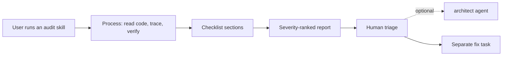

# Audit skills (luismc-audits)

## 1. In one paragraph

`luismc-audits` has three skills that review a repository and write a severity-ranked report: `security-audit`, `performance-audit` and `compliance-audit`. They find and report. They never change code, so a person triages the findings before any fix.

## 2. Why

A review before a release, or of an inherited codebase, needs the same checklist each time and findings a person can rank. Fixing in the same pass hides what was wrong and skips triage.

Goals:

- A fixed checklist per audit, mapped to named frameworks.
- Every finding backed by a real path, a measurement or a calculation.
- Output a person (or the [architect agent](../agents/spec.md)) can rank.

Non-goals: fixing findings, and legal advice. The compliance audit says it is an engineering review.

## 3. How it works

1. The user runs `/luismc-audits:security-audit`, `/luismc-audits:performance-audit` or `/luismc-audits:compliance-audit`.
2. The skill follows its Process section: read the code, verify each candidate, drop what it cannot show.
3. It walks its checklist.
4. It writes the report in its Output Formatting shape, ranked by its severity rubric.
5. A person triages. Fixing is a separate task.

| Skill | Checklist covers | Frameworks named |
|---|---|---|
| security-audit | crypto isolation, storage, logging and leakage, supply chain, stack controls | NIST SP 800-53, FedRAMP High, DoD IL6, SOC 2, ISO 27001/27040, NIS2 |
| performance-audit | data layer, round trips, caching, API budgets, network, compute, memory, frontend | Core Web Vitals, execution plans |
| compliance-audit | data-subject rights, consent, audit trails, sessions, retention, accessibility | GDPR, CCPA/CPRA, HIPAA, SOC 2, NIST, FedRAMP, NIS2, WCAG 2.2, Section 508 |

## 5. Functional requirements

**R5.1** — The plugin ships exactly three skills: `security-audit`, `performance-audit`, `compliance-audit`.

**R5.2** — Each skill states in its text that it reports and does not remediate.

**R5.3** — Each skill has a Process section, a severity rubric, a checklist and an Output Formatting section.

**R5.4** — Each skill runs on `opus` at `medium` effort, and its entry in the model-profile table matches its front matter.

**R5.5** — The performance audit requires measured or calculated impact for each finding.

**R5.6** — The compliance audit requires proof that enforcement happens on the server, not only in the interface.

## 7. Design

Each skill is one `SKILL.md` and nothing else: no scripts, no hooks. The front matter holds `description`, `model` and `effort`. The model-profile table in `claude/plugins/project-setup/skills/claude-setup/assets/model-profiles.json` is the single source for those two values (see [models](../models/spec.md)).

## 8. Failure modes

- An audit that is not run or is cut short fails open: an audit is advice, not a gate.
- The performance audit separates proven regressions from theoretical bottlenecks when it cannot run a plan or trace. The security audit verifies each finding before it reports it.

## 9. How it is proven

| Requirement | Test |
|---|---|
| R5.4 | `tools/test_model_profiles.py` (checks P1 and P2) |
| R5.1, R5.2, R5.3, R5.5, R5.6 | not covered by a test yet; see section 11 |

## 11. Not built yet

NOT YET IMPLEMENTED: a test that reads each `SKILL.md` for R5.2, R5.3, R5.5 and R5.6. The seam is `tools/test_model_profiles.py`, which already walks every skill file.

## 12. Code map

Source: claude/plugins/audits/skills/security-audit/SKILL.md
Source: claude/plugins/audits/skills/performance-audit/SKILL.md
Source: claude/plugins/audits/skills/compliance-audit/SKILL.md
Source: claude/plugins/audits/.claude-plugin/plugin.json
Source: tools/test_model_profiles.py
