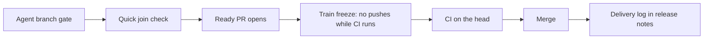

# Delivery speed

## 1. In one paragraph

Shipped as STACKSPEC 8.0.0 in #47; the first delivery log is in the GitHub release train-2026-10-11-47.

## 2. Why

The owner brought a prompt measured in one product over seven days: 82 releases, 971 workflow runs, 3,039 CI jobs. Its diagnosis matches what dev-standards found about itself (see Feature: Test and validation cost). The problem is not the number of tests. Each delivery layer reruns the full suite instead of doing its own share. A finished change also waits for its whole train. Pushes to a train branch keep restarting CI.

- Each change ran the full suite 4 to 6 times: 1 to 3 agent gates, the join gate, PR CI, and a default-branch run on the same tree.
- 56% of CI job-minutes went to cancelled or failed runs, most of the cancels from pushes to a train branch while its CI ran.
- In one traced release, tests ran 51 of the 492 minutes from built to live. The rest was waiting for cargo, restarted CI, and 3 hours queued for the only runner with a required label, which was offline.
- A gate result went stale only because the default branch moved by docs-only commits.
- A packaged program shipped with a worker that never started while every test passed. No test ran the packaged form.

The numbers describe one product. They stay here, not in the specs. The work changes luismc-project-setup (STACKSPEC 13.5 and 13.6, the delivery scripts, the agents rule). It is released as **STACKSPEC 8.0.0** after the TC6 train merges, because it builds on that train's join change (DS45).

## 3. How it works

### The plan (rewritten prompt)

The owner's prompt, reviewed on 11 October and rewritten with the review's fixes and the owner's answers (decisions below). Order matters. Each step builds on the one before.

| Task | Change | Settled by the review |
|---|---|---|
| DL1 | **Stale results.** `gate.json` gets `inert_paths` (default `docs/**`; tech-stack-setup adds `docs/artifacts/**` when luismc-artifacts is enabled). `gate_verify.py` keeps a result valid when the base moved only by commits touching inert paths. | The setup writes it. A sibling plugin does not declare it. It is trusted only because the ready PR's CI still tests the real merge. |
| DL2 | **Quick join check.** `join.py` replaces the second full gate with install, build, typecheck and the tests of the union of the branches' affected packages *plus their dependents*. It keeps TC6's skip when the joined tree equals a trusted branch head. The join report records per-step times. | Builds on DS45 (TC6). Union plus dependents (D6). |
| DL3 | **Agent rule.** Locally, an agent runs the affected suites only. It runs a full suite only when its change trips a full-run valve. It never starts a branch CI run unless the change behaves differently on Linux. | Merged with DS45's rule, which is stricter on CI. |
| DL4 | **Gate scope.** Steps already scope by package (`changed`, `changed+dependents`, `widen_on`). New: a lockfile change widens only when it changes an affected package's dependencies. A shared-UI change runs the end-to-end tests of the apps that import the changed files (found from imports, so `e2e_map` becomes optional). `--full` stays. | Half of the original point existed already. |
| DL5 | **Build-artifact workflows** (installers, bundles, packages) run only when the paths that feed them change. They never run for docs-only or record-only merges. | Extends 7.1.0's `ci_skip_check`. |
| DL6 | **Train freeze.** Once the ready PR opens, the pre-push hook refuses pushes to that train branch until its CI finishes (pass or fail, so fix forward works) or the train is abandoned (the ready PR closed unmerged). Offline, it allows the push and warns. `DELIVERY_FREEZE_OVERRIDE=1` allows a push and prints that the running CI will restart. Late branches ride the next train. | Offline behaviour (D4), override (D9) and a definition of abandoned. |
| DL7 | **Runner health.** Before the ready PR opens, `join.py` checks that an online runner exists for every label the workflow's jobs need, and `ci_watch.py` warns when a job has been queued over 10 minutes with no online runner for its labels. Warnings only. Standard hosted labels count as available. Without admin rights to list self-hosted runners, it says so. tech-stack-setup's runner question warns against a label that only one runner carries, unless a fallback job exists. | Warn, don't block (D5). The single-runner rule moves from generated CI to setup. Generated CI cannot know the runners. |
| DL8 | **Delivery log.** Before `cleanup.py` deletes a branch, it records the branch's finished, joined, CI start and end, and merged times. The deploy step adds live. At the end of each train, the log is appended to the train's GitHub release notes. Time-to-live per change is split into waiting, testing and queueing. | Release notes (D3). It never commits to main. Live comes from the deploy, not cleanup. |
| DL9 | **Packaged smoke test (a new MUST).** A product that ships a packaged program (single executable, installer, app bundle, container image) has CI start the packaged form. CI exercises every child process or worker that the program starts. | MUST, so STACKSPEC 8.0.0 (D2). Products that claim 7.x get it as an upgrade item. |
| DL10 | **dev-standards adopts** the delivery log in its own releases and the train freeze on its integration branches. | Dogfood (D7, D8). |

Each delivery-script change gets scenarios and mutants. Versions come from change notes: STACKSPEC 8.0.0, luismc-project-setup major.

Related: [delivery](../delivery/spec.md), [test cost](../test-cost/spec.md). Rules: STACKSPEC 13.5 and 13.6, [DELIVERYSPEC](../../architecture/DELIVERYSPEC.md). Contract: the `CONTRACT.md` beside the delivery scripts.

## 5. Functional requirements

**R5.1** — `gate_verify.py` keeps a gate result valid when the base moved only by commits touching `inert_paths` (default `docs/**`).

**R5.2** — `join.py` runs install, build, typecheck and the tests of the union of the branches' affected packages and their dependents. It skips the check when the joined tree equals a trusted branch head. It records per-step times.

**R5.3** — A lockfile change widens the gate only when it changes an affected package's dependencies. Shared-UI changes run the end-to-end tests of the apps that import the changed files.

**R5.4** — Build-artifact workflows run only when the paths that feed them change. They never run for docs-only or record-only merges.

**R5.5** — After the ready PR opens, the pre-push hook refuses pushes to that train branch until its CI finishes or the train is abandoned. Offline, it allows the push and warns. `DELIVERY_FREEZE_OVERRIDE=1` allows a push and says that CI will restart.

**R5.6** — Before the ready PR opens, `join.py` checks that an online runner exists for every label the jobs need. `ci_watch.py` warns when a job has been queued over 10 minutes with no online runner for its labels. Both only warn.

**R5.7** — Before `cleanup.py` deletes a branch, it records the branch's finished, joined, CI start, CI end and merged times. The log is appended to the train's release notes. Times are UTC. CI start is the earliest run on the ready PR's branch since the PR was created.

**R5.8** — A product that ships a packaged program has CI start the packaged form. CI exercises every child process (`smoke_packaged.py`, `smoke.json`).

**R5.9** — When all watched runs finish, `ci_watch.py` prints each run's wall time and slowest job. It never changes the exit code.

## 6. Non-functional requirements

**R6.1** — Every script is Python standard library only and exits 0 pass, 1 failed, 2 usage, 3 join conflict, 4 timed out.

**R6.2** — The freeze, runner health and the log never block on a GitHub outage. They allow the work and warn.

## 7. Design

The scripts live in `tooling/shared/scripts/delivery/`. tech-stack-setup copies them into a product. `gate.json` (per track) holds `inert_paths`, steps and `widen_on`. `.delivery/` holds results and logs. `CONTRACT.md` has the details.

## 8. Failure modes

| Dependency | Fails | Why |
|---|---|---|
| GitHub unreachable for the freeze | open, warns | Work must not stop for an outage (D4). |
| Runner list needs admin rights | open, says so | Warnings only (D5). |
| Release notes API fails | log falls back to head-only figures | The log is a report. |
| Stale gate result | closed | An untrusted result never passes. |

## 9. How it is proven

| Requirement | Test |
|---|---|
| R5.1, R5.2, R5.3, R5.5 | `tools/test_delivery_gate.py` |
| R5.4, R5.8 | `tools/test_smoke_packaged.py`, `tools/template_build_check.py` |
| R5.6, R5.9 | `tools/test_delivery_ci.py`, `tools/test_delivery_runner.py` |
| R5.7 | `tools/test_delivery_cleanup.py` |

## 10. Decisions

| ID | Question | Chosen | Date |
|---|---|---|---|
| D1 | Rewrite the pasted delivery prompt with the review’s fixes and queue it after TC6? | Rewrite and queue | 2026-10-11 |
| D2 | Point 7, a smoke test of the packaged program: MUST or SHOULD? | MUST, STACKSPEC 8.0.0 | 2026-10-11 |
| D3 | Point 8: where is the delivery log kept? | Release notes | 2026-10-11 |
| D4 | Point 4: what does the pre-push hook do when it cannot reach GitHub? | Allow and warn | 2026-10-11 |
| D5 | Point 5: no online runner for a job’s labels before the ready PR opens? | Warn, don’t block | 2026-10-11 |
| D6 | Point 3: which tests run at the join when branches affect overlapping packages? | Union plus dependents | 2026-10-11 |
| D7 | Should dev-standards adopt the delivery log in its own releases? (asked as one multi-select question) | Yes | 2026-10-11 |
| D8 | Should dev-standards adopt the train freeze? (same multi-select question) | Yes | 2026-10-11 |
| D9 | Point 4: how is the train freeze overridden on purpose? | Env variable, logged | 2026-10-11 |
| D10 | dev-standards is public: create a public GitHub release per train for the delivery log? | Yes, public releases | 2026-10-11 |
| D11 | Install the train freeze in this repo’s own git hooks? | Yes | 2026-10-11 |
| D12 | Merge this release on green CI without asking again? | Merge on green | 2026-10-11 |
| D13 | Turn hooks on here (core.hooksPath .githooks), which also activates the pre-commit secret check? | Yes, both hooks | 2026-10-11 |
| D14 | How should the runner load gate be reinstalled, now that PowerShell refuses unsigned scripts for the runner's account? | Runner account only | 2026-10-26 |
| D15 | Stop train-cleanup creating a GitHub release on every merge to main? | Stop release per merge | 2026-10-26 |
| D16 | Fix ci_watch.py: right default workflow, repeated gh errors fail instead of green? | Fix ci_watch.py | 2026-10-26 |
| D17 | DELIVERYSPEC Source cells named after another project's memory notes: make generic or keep? | Make them generic | 2026-10-26 |
| D18 | Commit the uncommitted artifacts record and docs/drafts? | Commit both | 2026-10-26 |
| D19 | docs/drafts/delivery-inventory.md is an older copy of DELIVERYSPEC full of another project's paths and rules: what happens to it? | Delete it | 2026-10-26 |

Decisions in MADR form: [0032](../../architecture/decisions/0032-delivery-speed-plan.md), [0033](../../architecture/decisions/0033-packaged-smoke-test-must.md), [0034](../../architecture/decisions/0034-delivery-log-in-release-notes.md), [0039](../../architecture/decisions/0039-generic-ci-speed-for-products.md).

## 11. Not built yet

Nothing from the plan is open. Late branches ride the next train by design.

## 12. Code map

Source: claude/plugins/project-setup/skills/tech-stack-setup/assets/tooling/shared/scripts/delivery/
Source: claude/plugins/project-setup/skills/tech-stack-setup/assets/tooling/shared/.githooks/pre-push
