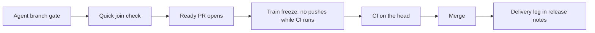

# Delivery speed

## 1. In one paragraph

Shipped as STACKSPEC 8.0.0 in #47; the first delivery log is in the GitHub release train-2026-10-11-47.

## 2. Why

The owner brought a prompt measured in one product over seven days: 82 releases, 971 workflow runs, 3,039 CI jobs. Its diagnosis matches what dev-standards found about itself (see Feature: Test and validation cost). The problem is not the number of tests. It is that each delivery layer reruns the full suite instead of doing its own share. A finished change also waits for its whole train. Pushes to a train branch keep restarting CI.

- Each change ran the full suite 4 to 6 times: 1 to 3 agent gates, the join gate, PR CI, and a default-branch run on the same tree.
- 56% of CI job-minutes went to cancelled or failed runs, most of the cancels from pushes to a train branch while its CI ran.
- In one traced release, tests ran 51 of the 492 minutes from built to live. The rest was waiting for cargo, restarted CI, and 3 hours queued for the only runner with a required label, which was offline.
- A gate result went stale only because the default branch moved by docs-only commits.
- A packaged program shipped with a worker that never started while every test passed. No test ran the packaged form.

The numbers describe one product. They stay here, not in the specs. The work changes luismc-project-setup (STACKSPEC 13.5 and 13.6, the delivery scripts, the agents rule). It is released as **STACKSPEC 8.0.0** after the TC6 train merges, because it builds on that train's join change (DS45).

## 3. How it works

### The plan (rewritten prompt)

The owner's prompt, reviewed on 11 October and rewritten with the review's fixes and the owner's answers (decisions below). Order matters. Each step builds on the one before.

| Task | Change | Settled by the review |
|---|---|---|
| DL1 | **Stale results.** `gate.json` gets `inert_paths` (default `docs/**`; tech-stack-setup adds `docs/artifacts/**` when luismc-docs is enabled). `gate_verify.py` keeps a result valid when the base moved only by commits touching inert paths. | The setup writes it. A sibling plugin does not declare it. It is trusted only because the ready PR's CI still tests the real merge. |
| DL2 | **Quick join check.** `join.py` replaces the second full gate with install, build, typecheck and the tests of the union of the branches' affected packages *plus their dependents*. It keeps TC6's skip when the joined tree equals a trusted branch head. The join report records per-step times. | Builds on DS45 (TC6). Union plus dependents (D6). |
| DL3 | **Agent rule.** Locally, an agent runs the affected suites only. It runs a full suite only when its change trips a full-run valve. It never starts a branch CI run unless the change behaves differently on Linux. | Merged with DS45's rule, which is stricter on CI. |
| DL4 | **Gate scope.** Steps already scope by package (`changed`, `changed+dependents`, `widen_on`). New: a lockfile change widens only when it changes an affected package's dependencies. A shared-UI change runs the end-to-end tests of the apps that import the changed files (found from imports, so `e2e_map` becomes optional). `--full` stays. | Half of the original point existed already. |
| DL5 | **Build-artifact workflows** (installers, bundles, packages) run only when the paths that feed them change. They never run for docs-only or record-only merges. | Extends 7.1.0's `ci_skip_check`. |
| DL6 | **Train freeze.** Once the ready PR opens, the pre-push hook refuses pushes to that train branch until its CI finishes (pass or fail, so fix forward works) or the train is abandoned (the ready PR closed unmerged). Offline, it allows the push and warns. `DELIVERY_FREEZE_OVERRIDE=1` allows a push and prints that the running CI will restart. Late branches ride the next train. | Offline behaviour (D4), override (D9) and a definition of abandoned. |
| DL7 | **Runner health.** Before the ready PR opens, `join.py` checks that an online runner exists for every label the workflow's jobs need, and `ci_watch.py` warns when a job has been queued over 10 minutes with no online runner for its labels. Warnings only. Standard hosted labels count as available. Without admin rights to list self-hosted runners, it says so. tech-stack-setup's runner question warns against a label that only one runner carries, unless a fallback job exists. | Warn, don't block (D5). The single-runner rule moves from generated CI to setup. Generated CI cannot know the runners. |
| DL8 | **Delivery log.** Before `cleanup.py` deletes a branch, it records the branch's finished, joined, CI start and end, and merged times. The deploy step adds live. At the end of each train, the log is appended to the train's GitHub release notes. Time-to-live per change is split into waiting, testing and queueing. | Release notes (D3). It never commits to main. Live comes from the deploy, not cleanup. |
| DL9 | **Packaged smoke test (a new MUST).** A product that ships a packaged program (single executable, installer, app bundle, container image) has CI start the packaged form. CI exercises every child process or worker that the program starts. | MUST, so STACKSPEC 8.0.0 (D2). Products that claim 7.x get it as an upgrade item. |
| DL10 | **dev-standards adopts** the delivery log in its own releases and the train freeze on its integration branches. | Dogfood (D7, D8). |

Each delivery-script change gets scenarios and mutants. Versions come from change notes: STACKSPEC 8.0.0, luismc-project-setup major.

Related: [delivery](../delivery/spec.md), [test cost](../test-cost/spec.md). Rules: STACKSPEC 13.5 and 13.6, [DELIVERYSPEC](../../architecture/DELIVERYSPEC.md). Contract: the `CONTRACT.md` beside the delivery scripts.

## 5. Functional requirements

**R5.1** — `gate_verify.py` keeps a gate result valid when the base moved only by commits touching `inert_paths` (default `docs/**`).

**R5.2** — `join.py` runs install, build, typecheck and the tests of the union of the branches' affected packages and their dependents. It skips the check when the joined tree equals a trusted branch head. It records per-step times.

**R5.3** — A lockfile change widens the gate only when it changes an affected package's dependencies. Shared-UI changes run the end-to-end tests of the apps that import the changed files.

**R5.4** — Build-artifact workflows run only when the paths that feed them change. They never run for docs-only or record-only merges.

**R5.5** — After the ready PR opens, the pre-push hook refuses pushes to that train branch until its CI finishes or the train is abandoned. Offline, it allows the push and warns. `DELIVERY_FREEZE_OVERRIDE=1` allows a push and says that CI will restart.

**R5.6** — Before the ready PR opens, `join.py` checks that an online runner exists for every label the jobs need. `ci_watch.py` warns when a job has been queued over 10 minutes with no online runner for its labels. Both only warn.

**R5.7** — Before `cleanup.py` deletes a branch, it records the branch's finished, joined, CI start, CI end and merged times. The log is appended to the train's release notes. Times are UTC. CI start is the earliest run on the ready PR's branch since the PR was created.

**R5.8** — A product that ships a packaged program has CI start the packaged form. CI exercises every child process (`smoke_packaged.py`, `smoke.json`).

**R5.9** — When all watched runs finish, `ci_watch.py` prints each run's wall time and slowest job. It never changes the exit code.

**R5.10** — The CI workflow templates fail fast and use few jobs (CIR10 L1, L2, L6). In `verify`, the secret scan runs first, then format, lint, typecheck, the boundary check, the codegen drift check, and last the unit and contract tests. Each track's `gate.json` lists its steps in `fail_fast_order`, and the steps run in that order. A Linux workflow has one job per suite family (`verify`, `integration`, `e2e`), never one per tool. A job that only reports is the last step of the last job, with `continue-on-error`, and is never a job of its own. Guard tests in `tools/test_delivery_ci.py` fail a template that breaks any of this.

**R5.11** — `speed_probe.py` times a fixed workload (median of 5 runs) and gives a scale: median over the reference time, never below 1. `scaled(ms)` (Python, and `scaled.mjs`) multiplies a timing budget by it; at scale 1 the budget is unchanged. A scale above 3 is a refusal: the probe exits 2, writes state `error` (never `success`), and the budgets are not judged. A bad `DELIVERY_SPEED_SCALE` also refuses. Budgets run in CI only, alone, one probe per job.

**R5.12** — `ci.limits` in `.delivery/config.json` sets `browser_workers`, `integration_workers` and `memory_gib` per CI option. `delivery_config.ci_limits()` returns them with the measured defaults: 2 browser workers and 8.5 GiB.

**R5.13** — `db_per_worker.py` prints (or runs with `psql`) the SQL for one Postgres database per test worker, copied from a migrated template. Names are checked so they cannot carry SQL. Postgres projects only.

**R5.14** — `ci_tool.py tool <name> [--platform P] [--exe NAME] [--dir]` reads `scripts/delivery/tools.json` (env `CI_TOOLS_JSON` overrides the file). A pin is `{"version", "platforms": {<plat>: {"kind", "url", "sha256", "file"?, "bin"?, "bin_dir"?}}}`. Kind `file` downloads once, caches and makes the file executable. Kind `archive` (tar.gz, tar.xz, zip) is verified and unpacked once into `<tool>/<version>/unpacked-<plat>/`; a member that escapes the folder, a link that escapes, or a device is refused. Kind `crate` verifies and unpacks the `.crate`, then builds it once with `cargo install --locked --path <src> --root <tool>/<version>/root-<plat>` (env `CI_TOOL_CARGO` names cargo). Unpack and build go to a unique `.partial` folder that is renamed, so a failure leaves nothing. It prints the absolute path of `bin_dir/<bin>`, of `bin_dir/<exe>` with `--exe`, or of the bin folder with `--dir`. Exit 0 prints the path; 1 is a fetch, checksum, unpack or build failure, or a missing exe or pin; 2 is bad usage. `fetch` and `gitleaks` are unchanged. (DS199)

**R5.15** — `tools_pin.py` has the commands `rustup-init`, `crate` and `entry`; each merges a pin into `tools.json`. The shipped pins are `rustup-init` 1.29.3 (five platforms), `llvm` 20.1.8 (`linux_x64`, `linux_arm64`, `windows_x64`), and `cargo-deny` 0.20.2 and `cargo-xwin` 0.23.1 (crate sha256, five platforms). Zig 0.17.1 is pinned from the `ziglang` wheels on PyPI (`linux_x64`, `linux_arm64`, `windows_x64`, `darwin_x64`, `darwin_arm64`; sha256 from the PyPI API). Kind `wheel` unpacks the wheel as a zip, refuses a path that escapes, and restores the execute bit stored in the zip entry; `ci_tool.py tool zig` prints `.../unpacked-<plat>/ziglang/zig`. `tools_pin.py entry` accepts `--kind wheel`. Zig is optional for the Linux linker: a system C compiler comes first (D146). (DS199, DS205)

**R5.16** — A gate step in `gate.json` may carry `paths: KEY`. When `scope_map` maps path prefixes to keys, `plan_step` in `delivery_common.py` skips that step if files changed, every changed file lies under some `scope_map` key, and none lies under KEY. An unmapped file, an unknown key or a missing `scope_map` changes nothing. The rust `gate.json` ships the key `rust` only, so a Rust-only change skips JS steps only in a project that adds a `js` key and marks its JS steps `paths: "js"`. (DS201)

## 6. Non-functional requirements

**R6.1** — Every script is Python standard library only and exits 0 pass, 1 failed, 2 usage, 3 join conflict, 4 timed out.

**R6.2** — The freeze, runner health and the log never block on a GitHub outage. They allow the work and warn.

## 7. Design

The scripts live in `luismc-delivery` (`templates/shared/scripts/delivery/`). Its installer writes them into a product. `gate.json` (per track) holds `inert_paths`, steps and `widen_on`. `.delivery/` holds results and logs. `CONTRACT.md` has the details.

## 8. Failure modes

| Dependency | Fails | Why |
|---|---|---|
| GitHub unreachable for the freeze | open, warns | Work must not stop for an outage (D4). |
| Runner list needs admin rights | open, says so | Warnings only (D5). |
| Release notes API fails | log falls back to head-only figures | The log is a report. |
| Stale gate result | closed | An untrusted result never passes. |

## 9. How it is proven

| Requirement | Test |
|---|---|
| R5.1, R5.2, R5.3, R5.5 | `tools/test_delivery_gate.py` |
| R5.4, R5.8 | `tools/test_smoke_packaged.py`, `tools/template_build_check.py` |
| R5.6, R5.9, R5.10 | `tools/test_delivery_ci.py`, `tools/test_delivery_runner.py` |
| R5.7 | `tools/test_delivery_cleanup.py` |
| R5.11, R5.12, R5.13 | `tools/test_delivery_speed.py` |

## 10. Decisions

| ID | Question | Chosen | Date |
|---|---|---|---|
| D1 | Rewrite the pasted delivery prompt with the review’s fixes and queue it after TC6? | Rewrite and queue | 2026-10-11 |
| D2 | Point 7, a smoke test of the packaged program: MUST or SHOULD? | MUST, STACKSPEC 8.0.0 | 2026-10-11 |
| D3 | Point 8: where is the delivery log kept? | Release notes | 2026-10-11 |
| D4 | Point 4: what does the pre-push hook do when it cannot reach GitHub? | Allow and warn | 2026-10-11 |
| D5 | Point 5: no online runner for a job’s labels before the ready PR opens? | Warn, don’t block | 2026-10-11 |
| D6 | Point 3: which tests run at the join when branches affect overlapping packages? | Union plus dependents | 2026-10-11 |
| D7 | Should dev-standards adopt the delivery log in its own releases? (asked as one multi-select question) | Yes | 2026-10-11 |
| D8 | Should dev-standards adopt the train freeze? (same multi-select question) | Yes | 2026-10-11 |
| D9 | Point 4: how is the train freeze overridden on purpose? | Env variable, logged | 2026-10-11 |
| D10 | dev-standards is public: create a public GitHub release per train for the delivery log? | Yes, public releases | 2026-10-11 |
| D11 | Install the train freeze in this repo’s own git hooks? | Yes | 2026-10-11 |
| D12 | Merge this release on green CI without asking again? | Merge on green | 2026-10-11 |
| D13 | Turn hooks on here (core.hooksPath .githooks), which also activates the pre-commit secret check? | Yes, both hooks | 2026-10-11 |
| D14 | How should the runner load gate be reinstalled, now that PowerShell refuses unsigned scripts for the runner's account? | Runner account only | 2026-10-26 |
| D15 | Stop train-cleanup creating a GitHub release on every merge to main? | Stop release per merge | 2026-10-26 |
| D16 | Fix ci_watch.py: right default workflow, repeated gh errors fail instead of green? | Fix ci_watch.py | 2026-10-26 |
| D17 | DELIVERYSPEC Source cells named after another project's memory notes: make generic or keep? | Make them generic | 2026-10-26 |
| D18 | Commit the uncommitted artifacts record and docs/drafts? | Commit both | 2026-10-26 |
| D19 | docs/drafts/delivery-inventory.md is an older copy of DELIVERYSPEC full of another project's paths and rules: what happens to it? | Delete it | 2026-10-26 |
| D20 | The ledger never marks a finished cloud agent done. Close it from branch signals, from a session check, or both? | Both: branch signals first (DL-32a), the session check only as the fallback | 2026-11-02 |

Decisions in MADR form: [0032](../../architecture/decisions/0032-delivery-speed-plan.md), [0033](../../architecture/decisions/0033-packaged-smoke-test-must.md), [0034](../../architecture/decisions/0034-delivery-log-in-release-notes.md), [0039](../../architecture/decisions/0039-generic-ci-speed-for-products.md).

## 11. Not built yet

Nothing from the plan is open. Late branches ride the next train by design.

## 12. Code map

Source: claude/plugins/delivery/templates/shared/scripts/delivery/
Source: claude/plugins/delivery/templates/shared/.githooks/pre-push

## Versions

Written by the release fold. Do not edit by hand.

| Version | Date | Release | What changed | Tasks |
|---|---|---|---|---|
| 0.8.1 | 2026-11-14 | RELEASE-133 | Rust target cache: `<repo>/target` links to the cache folder; spec text is delivery R5.61. | DL329 |
| 0.8.0 | 2026-11-13 | RELEASE-127 | Gate steps accept an optional when_changed list of path patterns; a step is skipped with a reason when no changed file matches. ci_watch cancels the other runs of a train head when one job fails, which lifts the push freeze; --no-cancel-on-red keeps the old wait. fast_guards.py runs the gate.json always_on_guards whose input globs match a changed file, so the boundary check and guard tests run before a push. | DL304, DL306, DL307 |
| 0.7.0 | 2026-11-13 | RELEASE-123 | ci_scope.py gets the rust-release scope (see delivery R5.60). Rust CI speed: crate scoping (rust_scope.py, RUST_CRATES) and a persistent per-runner target cache. Spec text is in the delivery feature, R5.50. | DL294, DL295 |
| 0.6.2 | 2026-11-11 | RELEASE-98 | Secret scans skip the delivery installer's state files; shipped scripts avoid secret-shaped variable names; the branch gate ignores untracked docs/work/ files. | DL204 |
| 0.6.1 | 2026-11-10 | RELEASE-84 | The pre-push hook source moved to delivery templates/shared/.githooks. | DL172 |
| 0.6.0 | 2026-11-09 | RELEASE-71 | DS199's ci_tool.py tool command and tools.json pins (rustup-init, llvm, cargo-deny, cargo-xwin) are used by the Rust workflows in DS201. The tool cache is kept on pool runners; hosted runners use Swatinem/rust-cache. Adds R5.14 to R5.16: the generic tool fetcher, the Rust tool pins and the gate scope map. Zig is pinned from the ziglang wheel on PyPI; ci_tool.py gets a wheel kind, and tool zig prints the zig path. | DS201, DS203, DS205 |
| 0.5.2 | 2026-11-07 | RELEASE-60 | ci_watch reports exit code 137 or Killed as killed for memory with the pool cap, and a slow Set up runner failure as a runner start-up failure, never as a stale lockfile. | DL92 |
| 0.5.1 | 2026-11-05 | RELEASE-47 | The join rebuilds the next-version design-system gallery and commits it when a joined branch changed that folder. | DU4 |
| 0.5.0 | 2026-11-05 | RELEASE-45 | change_notes.py check fails a diff that adds an entry to, or raises a count in, a design-system known-breach list that already exists at the base (known_lists, default scripts/design/*.known.json). | DSY99 |
| 0.4.1 | 2026-11-04 | RELEASE-37 | The CI workflow templates set DELIVERY_SHARD on every job, and a job held for a machine slot counts as waiting for the Option 4 fallback (delivery spec R13.64). | DL32 |
| 0.4.0 | 2026-11-03 | RELEASE-36 | The ts CI template writes the run times as the last step of its last job instead of a job of its own. CI templates run cheap checks first, keep one job per suite family and make report-only work a step of the last job; guard tests cover it (R5.10). Speed probe and scaled(ms) for timing budgets (refuse above scale 3), ci.limits in the config, and a database-per-worker template (R5.10 to R5.12). artifact_prune.py gains --hold and smoke_packaged.py gains an installer rollback check (Windows learnings); no change to the speed rules. | DL16, DL18, DL21, DL25 |
| 0.3.1 | 2026-11-02 | RELEASE-34 | The delivery scripts moved from tech-stack-setup assets/tooling/shared to luismc-delivery templates/shared. The rules are unchanged. | DL15 |
| 0.3.0 | 2026-11-02 | RELEASE-32 | D20: finished agent rows close from branch signals (DL-32a), with a session check as the fallback. | DL14 |
| 0.2.1 | 2026-11-01 | RELEASE-28 | agent_ci.py prints one line per skipped branch with its reason, reports a push the pre-push guards refuse as a failing branch with the guard's own lines (and goes on with the next branch), and reads `agent_ci` from `.delivery/config.json` over `ci-scope.json`. | DS36 |
| 0.2.0 | 2026-11-01 | RELEASE-27 | Agents run the e2e specs of the screens they change: the gate records and verifies them, a pre-push check refuses an unrun e2e spec fix, and briefs say so (DELIVERYSPEC DL-86 to DL-89). | DS35 |
| 0.1.1 | 2026-11-01 | RELEASE-22 | Wording pass; requirements and IDs unchanged. | DS142 |
