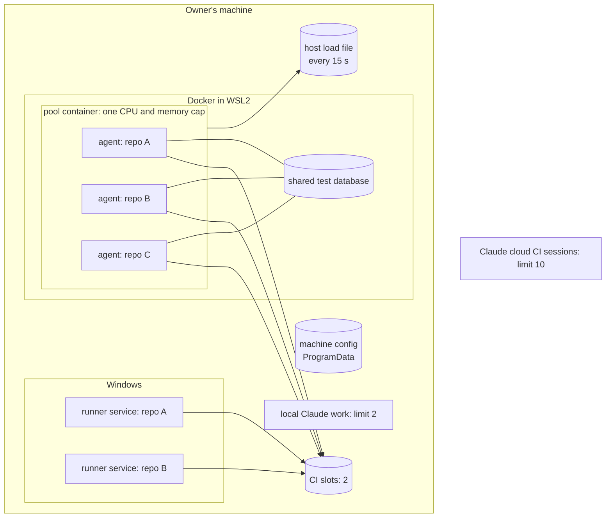
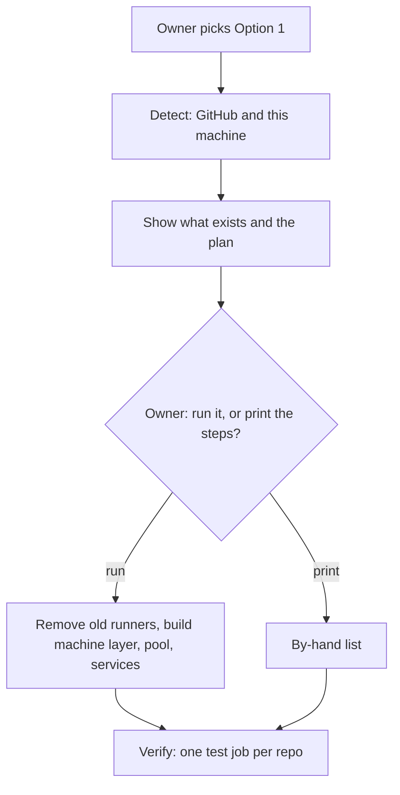

# Shared CI on the owner's machine (design, DL28)

The owner approved this design on 4 Nov 2026 (D48), with the CI runs section (section 11) added. Task DL27 builds it. The binding rules move into [delivery spec section 13](spec.md#13-ci-options) with change notes; this page stays as the explanation and the build contract.

It joins two pieces of work:

- **Pool research** (first version of this page): one Docker container that runs a CI runner for every Linux project.
- **DL27**: one CI queue for the whole machine, so runners of many projects cannot overload it.

The decisions behind it are D21 to D48 in the delivery-speed record (`docs/project/content/delivery-speed/decisions.json`).

## 1. What it fixes

| # | Today | Effect |
|---|---|---|
| G1 | The runner gate (DL-79) checks load only when a job starts. | Two runners of two projects can both start on a quiet machine, then both run heavy jobs. |
| G2 | The gate reads its limits from `~/.claude/luismc-delivery-machine.json`. A Windows runner service runs as `NETWORK SERVICE`, which has another home folder. | Runners never see the owner's limits file. They use the defaults. |
| G3 | A runner in WSL or in a container measures only its VM. | A Linux job starts while Windows is at 90% memory. |
| G4 | Local Claude work and CI runners see each other only through the load numbers. | A local test run and a CI job can start in the same second. |
| G5 | The doctor checks the runners of one project. | Nothing shows every runner on the machine. |
| G6 | Option 4 counts a job as waiting only until it starts (`ci_fallback.py`, `shard_wait_minutes`). The gate holds a job after it starts. | A job held by the gate never starts the fallback. |
| G7 | Each project installs its own runner its own way. | Ten projects mean ten services, ten folders and no common cap. |

## 2. The picture



- **Linux jobs** run in one pool container, with one agent per repository (section 4).
- **Windows jobs** run in one runner service per repository on Windows (D43).
- **All of them** take one of the machine's **2 CI slots** (D21).
- **Local Claude work** (tests, builds, local agents) has its own limit of **2** (D36), not the CI slots.
- **Claude cloud sessions** that run CI, as main runner (Option 3) or fallback (Option 4), have a limit of **10 at once** (D37). They do not use this machine.
- The 85% memory and 60% CPU check (DL-77, DL-79) still applies on top of every limit.

## 3. The machine layer

### 3.1 Machine config

One file for the machine, readable by every runner account:

- Windows: `C:\ProgramData\luismc-delivery\machine.json`
- Linux and macOS: `/etc/luismc-delivery/machine.json`
- Inside the pool container: the same folder, mounted at `/machine`

```json
{
  "load_limits": {"memory_pct": 85, "cpu_pct": 60},
  "ci_slots": 2,
  "local_heavy": 2,
  "cloud_ci_sessions": 10,
  "slot_stale_min": 120,
  "runner_gate": {"max_wait_min": 30, "poll_sec": 15},
  "runner_dirs": ["C:\\actions-runners"]
}
```

- `load.py` reads this file first. The old `~/.claude/luismc-delivery-machine.json` is still read when the new one is missing.
- When both exist and differ, the doctor warns and names the keys.
- A project's `.delivery/config.json` can lower a limit for its own work, never raise a machine limit.
- This fixes G2.

### 3.2 CI slots

- The folder `C:\ProgramData\luismc-delivery\slots\` holds one lock file per busy slot: `slot-1.lock`, `slot-2.lock`.
- The **job-started hook** (`runner_load_gate`, DL-79) does this before a job runs:
  1. It writes a ticket in `queue\` with the repository, run, job, start time and priority.
  2. It waits until its ticket is first in line, a slot is free, and the load is under the limits.
  3. It takes the slot by creating the lock file. Creating it is atomic (create-new), so two hooks never take the same slot.
  4. It removes the ticket and lets the job run.
- **Order** (D30): a ready pull request's run and a run on the default branch come first. Branch and agent runs come next. Within each group it is first come, first served. The hook reads the priority from the event file the runner gives every job (`GITHUB_EVENT_PATH`: a pull request that is not a draft, or a push to the default branch).
- The **job-completed hook** (`ACTIONS_RUNNER_HOOK_JOB_COMPLETED`, new) frees the slot and empties that runner's `_work` folder for that job.
- **Stale slots** (D25): a slot whose runner process is gone is freed at once. Any slot older than `slot_stale_min` (120 minutes) is freed. A freed slot is logged with what held it.
- `delivery_ci.py slots` prints who holds each slot, the queue, and the wait of each ticket.
- This fixes G1 and G7's missing common cap.

### 3.3 Host load file

- A Windows scheduled task runs `load.py --write` every 15 seconds. It writes `C:\ProgramData\luismc-delivery\host-load.json` (memory %, CPU %, time).
- The hook inside WSL or the pool reads that file. When it is older than 60 seconds, the hook uses its own figures and logs that.
- The hook in the pool also reads the container's own cap (`/sys/fs/cgroup/memory.current`, `memory.max`, `cpu.stat`). A job starts only when both the host and the pool are under the limits.
- This fixes G3.

### 3.4 Slot wait starts the fallback

- While the hook waits for a slot, it writes a wait marker for the shard: `ci-wait/<sha>/<shard>`, with the time it started waiting. It uses the same git marker method as the claim markers in `ci_fallback.py`.
- `shard_wait_minutes` counts a shard as waiting while a wait marker exists and no claim does.
- After X minutes (`after_min`), the fallback claims the shard and runs it elsewhere (Option 4, first claim wins).
- When the held job later gets its slot, it sees the claim is taken. It ends without work (exit 3, "claim lost") and frees the slot.
- The hook needs the shard name. The workflow templates pass it to the hook in an environment variable set on the job (`DELIVERY_SHARD`).
- This fixes G6.

### 3.5 Local Claude work

- The load guard (DL-77) counts heavy local work in flight: a heavy foreground command from its start (PreToolUse) to its end (PostToolUse), and local agents from the delivery ledger (the same count DL-38 uses for its cap of 3).
- When the count is at `local_heavy` (2), a new heavy call is refused with the list of what is running. Same message style as DL-77.
- Local work does not take CI slots (D23). The load check covers both.
- This fixes G4.

### 3.6 Cloud CI sessions

- `cloud_ci_sessions` (10) limits Claude cloud sessions that run CI at the same time, as main runner (Option 3) or fallback (Option 4) (D34, D37).
- The count is the claims held by a cloud session without a posted status (`ci-claim` without `ci-posted`).
- At the limit, the launcher waits and retries. It never starts an 11th session.
- These sessions also count toward the cap of 50 cloud agents in `.delivery/config.json`.

## 4. The Linux pool

### 4.1 What it is

One Docker container with one CPU and memory cap. Inside it, one runner agent per repository. GitHub needs one registration per repository on a personal account (section 8). The pool keeps them all in one place, under one cap.

| Part | Choice |
|---|---|
| Image | One Linux image: the runner tarball checked by SHA-256, git, the runner's own dependencies. Workflows install their own toolchains. Label `dev.luismc.runner-pool`. |
| Agents | One folder per repository, `agents/<slug>/`, each with its own `.runner`, `.credentials` and `_work`. Persistent agents only (D39). |
| Users | Each agent runs as its own Unix user (`r-<slug>`), folders `0700`. One repository's job cannot read another's checkout or credentials. |
| Start | `tini`, then `pool_supervisor.py` (standard-library Python, owned by the plugin). It reads `agents.json`, starts each agent as its user, restarts a dead one with back-off, and on stop lets running jobs finish. |
| Cap | `cpus`, `mem_limit` (= `memswap_limit`) on the container. Proposed by the setup from the machine (section 6). |
| Slots | The pool's hooks take the machine's CI slots (section 3.2). The pool has no separate slot count. |
| Database | One shared database sidecar on the pool's private network. Each repository gets its own database and login (D40). |
| Docker in jobs | Refused (D41). No Docker socket in the pool. A job that needs `services:` or a container action uses the sidecar or another runner. |
| Updates | Runner auto-update stays on. |
| Restart | `restart: unless-stopped`, a stop grace period of a few minutes. |
| Files | `C:\ProgramData\luismc-delivery\pools\<name>\`: `compose.yaml`, `agents.json`, `.env` with the cap only (D42). |
| Labels | Each agent: `self-hosted`, `linux`, `x64`, `pool-<name>`, `repo-<slug>`. A project's `CI_RUNS_ON` is `["self-hosted","linux","pool-<name>"]`. |

### 4.2 WSL ceiling

Docker Desktop runs in the WSL2 VM. `%UserProfile%\.wslconfig` (`memory=`, `processors=`) is the outer ceiling. The pool cap must fit inside it, with room for the sidecar and the VM. The setup proposes both values. A change to `.wslconfig` needs `wsl --shutdown`, which stops every container. The setup only does that when no job runs and the owner says yes.

### 4.3 Windows jobs

One runner service per repository on Windows, in `C:\actions-runners\<slug>\`, with the same two hooks. They take the same CI slots. Windows containers are not used.

## 5. Security

- **Private repositories only.** The setup refuses a self-hosted runner for a public repository. The doctor fails if one exists. A pull request from a fork could run code on the machine.
- **Fork pull requests.** The templates run self-hosted jobs only for pushes and for pull requests from the same repository.
- **Tokens.** Registration and removal tokens pass through a pipe and are never printed or written:
  `gh api -X POST repos/OWNER/REPO/actions/runners/registration-token --jq .token | docker exec -i POOL pool-add-agent SLUG ...`
- **Credentials.** Each agent's `.credentials` stays in its own `0700` folder. The plugin never reads it.
- **No Docker socket** in the pool.

## 6. Setup: one guided path

`/delivery-ci-setup`, Option 1, offers to set everything up and run it for the owner (D26, D44). Every step that changes the machine is shown first and runs only after a yes. Deleting anything needs its own yes.



### 6.1 Detect (read only)

- **GitHub** (D46): every repository the owner is admin of. `gh api repos/{o}/{r}/actions/runners` gives name, OS, status, busy and labels. A repository the API refuses is named with the reason. The scan goes on.
- **This machine**:
  - runner services: `Get-Service actions.runner.*`, systemd units, launchd plists;
  - runner folders with a `.runner` file (never `.credentials`);
  - containers: the label `dev.luismc.runner-pool`, or a command that runs `Runner.Listener`;
  - the WSL ceiling in `.wslconfig`.
- A local runner is matched to its GitHub entry by agent id, else by name and repository.

### 6.2 The plan the owner sees

- Every existing runner, where it runs, its repository, and that it will be removed (D44: start clean).
- The machine config with the limits.
- The pool: name, cap, `.wslconfig` values, the repositories that get an agent.
- The Windows services, one per repository that tests on Windows.
- The repository variables (`CI_RUNS_ON`, `CI_SERIAL`).
- The scheduled task for the host load file.

### 6.3 Run (after the owner's yes)

1. **Wait for idle.** Each existing runner finishes its job. Nothing is stopped mid-job.
2. **Remove old runners.** For each one: remove its registration (`config remove` with a removal token through a pipe, or `DELETE /repos/{o}/{r}/actions/runners/{id}`). Then stop and delete its service or container. A container's volumes are deleted only after a separate yes that names them. A test database the owner wants to keep is backed up first.
3. **Machine layer.** Write `machine.json`, create the slot and queue folders, register the host load scheduled task.
4. **WSL ceiling.** Write `.wslconfig`, then `wsl --shutdown` only after a yes.
5. **Pool.** Write the pool files, `docker compose up -d --build`, add one agent per Linux repository with the token pipe.
6. **Windows services.** One per repository that tests on Windows, with both hooks in its `.env`.
7. **Variables.** `gh variable set CI_RUNS_ON` (and `CI_SERIAL` when chosen) per repository.
8. **Verify.** For each repository: the agent is online with its labels, then one run of `pool-check.yml` that takes a slot, prints the runner name and passes. The doctor runs last.

When a step fails, the setup stops, says what is done and what is not, and prints the remaining steps.

A step that needs an elevated shell (a Windows service, the scheduled task, the `NETWORK SERVICE` execution policy) is printed for the owner to run. The setup then checks it.

### 6.4 Sizing

- Memory room = total memory × 85% − memory in use now.
- CPU room = logical CPUs × 60%.
- Pool cap = the smaller of the room and Docker's ceiling, minus the sidecar and 1 GB for the VM.
- The setup refuses a cap below the largest Linux shard's `memory_gib`, and says what to change.

## 7. Doctor: the `machine` check

- The machine config exists and runners can read it. A difference with the old file is a warning.
- Every runner on the machine (services, folders, the pool) has both hooks. A Windows `.ps1` hook passes the execution policy check of DL-79.
- Slots: none is stale. The queue has no ticket older than `slot_stale_min`.
- The host load file is under 60 seconds old.
- The pool: running, plugin image label, cap inside the machine and WSL ceilings, one user per agent, no Docker socket, every agent's repository private.
- An Option 1 project with `CI_RUNS_ON` unset **fails** (D45). It would run on hosted runners and may bill minutes.
- **Disk** (D31): each runner's `_work` size. When the total is large, the doctor offers to clean old work folders. It cleans only after a yes, and only folders of runners with no job running.

## 8. Not in this design

- **A GitHub organization.** One organization-level runner could serve every repository, but on the Free plan private repositories lose branch protection, so it needs the Team plan. Documented here as a later variant (D38). Not built.
- **Ephemeral runners** (D39). They need a long-lived token in the container.
- **Docker inside jobs** (D41).
- **Windows containers** (D43).
- **Lowering CI job priority** (D24). Slots and the load check are the only controls.

## 9. Risks to test in the build

| Risk | Test |
|---|---|
| Lock files created over the Docker bind mount from Windows may not be atomic. | Two processes, one on Windows and one in the pool, race for one slot 1,000 times. If one ever loses, slots move to a small lock service on the host. |
| A hook run as `NETWORK SERVICE` cannot write to `ProgramData`. | The setup grants that account modify rights on `C:\ProgramData\luismc-delivery`. Tested as the real caller (a scheduled task as that account). |
| A crashed job holds a slot for up to 2 hours. | A dead process frees its slot at once; the doctor and `delivery_ci.py slots` show long holders. |
| The hourly routine cannot read the machine's queue. | The wait marker is a git branch (section 3.4), which the routine can read. |
| `wsl --shutdown` stops running containers. | The setup runs it only when no job runs, after a yes. |

## 10. Build plan (DL27)

Three cloud agents, one release. Section 12 splits the files.

| Area | Files |
|---|---|
| Machine config and load | `scripts/load.py`, `references/config-schema.json` |
| Slots and hooks | `scripts/runner_load_gate.py` (+ `.ps1`, `.sh`, `.cmd`), new `scripts/runner_job_done.py` (+ wrappers), new `scripts/machine_slots.py` |
| Fallback | `templates/shared/scripts/delivery/ci_fallback.py`, the workflow templates (`DELIVERY_SHARD`) |
| Local and cloud limits | `scripts/load_guard.py`, `scripts/hook_pre_tool.py`, `scripts/hook_post_tool.py`, the cloud launcher |
| Pool | new `templates/runner-pool/` (Dockerfile, compose, supervisor, add and remove agent, hooks, `pool-check.yml`), new `scripts/delivery_runner_pool.py` (detect, plan, run, verify) |
| Setup and doctor | `scripts/delivery_ci_setup.py`, `commands/delivery-ci-setup.md`, `scripts/delivery_doctor.py`, `scripts/delivery_ci.py` (`slots`) |
| Docs | `docs/features/delivery/spec.md` section 13, `docs/architecture/DELIVERYSPEC.md` (DL-79 change, new DL-90), `docs/guides/set-up-ci.md`, the plugin README, change notes |
| Tests | slot take, free, stale and order; the race test; host load file read and stale; wait marker and fallback; local and cloud limits; detect and plan on fixtures; doctor `machine` check |

After the release, the owner runs the setup on this machine. The first real job through the pool is watched.

## 11. CI runs in Full Progress (D48)

A new foldable section in every project's Full Progress page, folded by default.

- **Summary line:** runs in progress, the number of finished runs shown, median run time, fallbacks, failures.
- **Figures:** median and p90 run time, median slot wait, fallbacks to the cloud, passed out of shown.
- **In progress:** run, why, where, started, and now (the current step, or "waiting for a slot" with the minutes until the fallback).
- **Latest 20 finished:** result, run, why, where, total time, finish time. Each row opens to a bar per step: GitHub queue, slot wait, then every job step; a failed step is marked.
- **Why** is the trigger: ready PR, push to the default branch, agent branch, schedule, re-run by the owner, or a fallback with its wait.
- **Where** is the runner kind and name: Linux pool, Windows service, GitHub-hosted, Claude cloud.
- The approved sample is the "New in Full Progress: CI runs" section of the Shared CI Plan page.

Data:

- Runs, jobs and step times: the GitHub Actions API (`actions/runs`, `actions/runs/{id}/jobs`, whose steps carry `started_at` and `completed_at`).
- Where: the job's `runner_name` and `labels`; for a cloud session, the `ci-claim` marker's holder.
- Slot wait: the slot log (section 12.2).

## 12. Interfaces between the three agents

### 12.1 Agents and files

| Agent | Task | Owns |
|---|---|---|
| A | DL32 machine layer | `load.py`, new `machine_slots.py`, `runner_load_gate.*`, new `runner_job_done.*`, `load_guard.py`, `hook_pre_tool.py`, `hook_post_tool.py`, `delivery_ci.py`, `delivery_doctor.py`, `references/config-schema.json`, `delivery_config.py`, `templates/shared/scripts/delivery/ci_fallback.py` and the cloud launcher, the workflow templates (`DELIVERY_SHARD`), `docs/features/delivery/spec.md`, `docs/architecture/DELIVERYSPEC.md`, their tests |
| B | DL30 pool and setup | new `templates/runner-pool/`, new `scripts/delivery_runner_pool.py`, `scripts/delivery_ci_setup.py`, `commands/delivery-ci-setup.md`, `docs/guides/set-up-ci.md`, this page, their tests |
| C | DL31 CI runs section | new `scripts/ci_runs.py` (delivery), `scripts/delivery_watch.py` (calls it), the artifacts plugin's Full Progress renderer and `references/artifactspec.md`, the artifacts feature spec, their tests |

The delivery `README.md` is shared: each agent adds or edits only its own subsection. Each agent writes its own change notes in `docs/architecture/changes/`.

### 12.2 Slot log (A writes, C reads)

One JSON object per line in `<machine dir>/slot-log.jsonl` (`C:\ProgramData\luismc-delivery\` on Windows, `/etc/luismc-delivery/` elsewhere; `machine_slots.machine_dir()` returns it):

```json
{"repo": "owner/name", "run_id": 123, "run_attempt": 1, "job": "unit", "shard": "unit-1",
 "queued_at": "2026-11-04T14:02:00Z", "slot_at": "2026-11-04T14:03:10Z", "released_at": "2026-11-04T14:12:40Z",
 "slot": 1, "runner": "host1-pool-app1", "outcome": "ran|claim-lost|stale-freed"}
```

A writes `queued_at` and `slot_at` lines at take and a `released_at` line at free (C joins them by `repo`, `run_id`, `run_attempt`, `job`). The file is trimmed to the last 5,000 lines.

### 12.3 Pool checks for the doctor (B provides, A calls)

`delivery_runner_pool.doctor_checks(root) -> list[dict]`, each `{"id": "pool.<name>", "status": "ok"|"warn"|"fail"|"skip", "detail": str}`. A's `delivery_doctor.py` `machine` check calls it when the module imports, and shows `skip` when there is no pool. B's detection also gives `delivery_runner_pool.detect(json=True)`; A does not depend on it.

### 12.4 Machine config (A owns, B writes it through A's helper)

`machine_slots.machine_config()` reads it; `machine_slots.write_machine_config(cfg)` writes it (B's setup calls this, never writes the file itself). Keys as in section 3.1.

### 12.5 CI runs file (C)

`ci_runs.py collect --root .` writes `.delivery/ci-runs.json` (git-ignored):

```json
{"generated_at": "...", "repo": "owner/name",
 "active": [{"run_id": 1, "workflow": "CI", "why": "ready PR #141", "where": {"kind": "pool|windows|hosted|cloud", "name": "..."},
             "started_at": "...", "now": {"step": "Unit tests", "since": "..."} , "slot_wait": {"since": "...", "fallback_in_min": 7}}],
 "finished": [{"run_id": 1, "workflow": "CI", "conclusion": "success|failure|cancelled", "why": "...", "where": {...},
               "queued_s": 12, "slot_wait_s": 70, "total_s": 600, "completed_at": "...",
               "steps": [{"job": "unit", "name": "Unit tests", "start_s": 82, "duration_s": 165, "conclusion": "success"}]}]}
```

The watcher refreshes it each tick (at most once a minute). The Full Progress renderer reads it when it exists and draws section 11; with no file it draws nothing.

## 13. Setup pattern for every plugin setup (owner request, 4 Nov 2026)

Every setup in dev-standards (the delivery CI setup, `claude-setup`, `docs-setup`, `design-system-setup`, `tech-stack-setup`, `auth-setup`) follows the same pattern, so a user always knows what is happening and what to do next.

1. **Plan first.** Before changing anything, show one plan: what it will install, configure and write (with paths), what it changes outside the repository, what needs the user (a yes, an administrator shell, a sign-in, a web setting, a secret), and about how long it takes.
2. **Do the heavy lifting.** After a yes, the setup runs every install and configuration it can itself. It leaves to the user only what it cannot do (an elevated shell, a setting only in a web page, a secret). Each of those has exact steps, and the setup checks it afterwards.
3. **Say each step.** One line per step while it runs: what it is doing, then done, or failed with the reason and the fix.
4. **Finish with a summary** in three parts: *Done* (what changed, with paths), *Left for you* (numbered, exact steps), and *What you can do now* (the commands and features now available, each with a one-line example).
5. **Safe to run again.** A second run says what is already set and changes only what is missing.

| Agent | Applies it to |
|---|---|
| B (DL30) | `commands/delivery-ci-setup.md` and `delivery_runner_pool.py` |
| D (DL33) | the five skill setups above and the delivery part of `claude-setup` |
