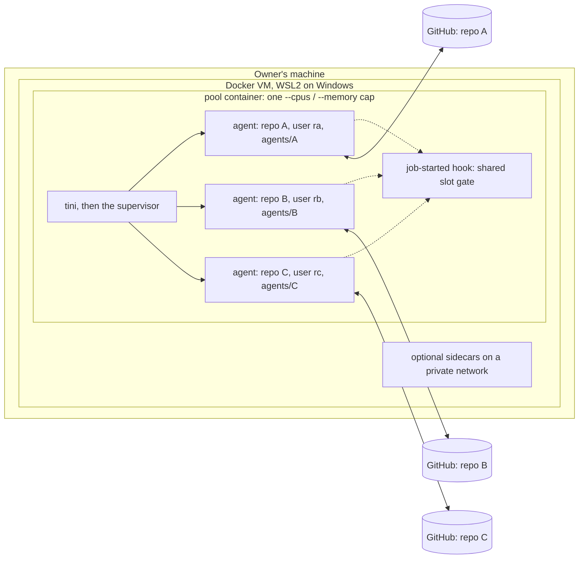
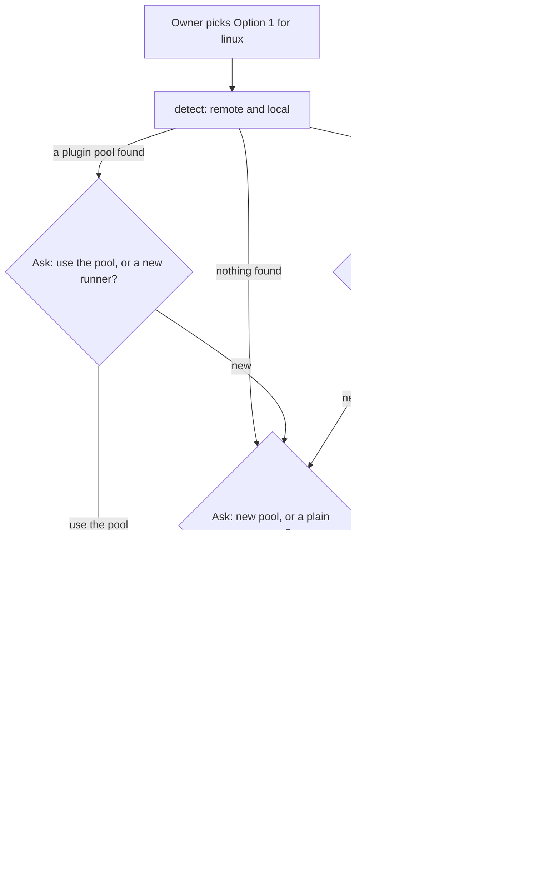

# Shared self-hosted runner pool (research, MB63)

Research for `luismc-delivery`. It is not a binding rule. When the owner approves a design, the delivery spec section 13 gets the rules and a change note.

**The idea.** One Docker container on the owner's machine, with one CPU and memory cap, runs several GitHub Actions runner agents. Each agent is registered to one repository. When a project picks Option 1 (own runners), setup looks for runners that already exist. If it finds this kind of pool, it asks: add an agent for this project to the pool, or make a new runner?

**Where this file lives.** The repository has no `docs/research/` folder. DOCSPEC R2.2 puts a doc about one feature in that feature's folder, so this is `docs/features/delivery/shared-self-hosted-runners.md`.

## 0. How sure the platform facts are

`docs.github.com` was not reachable from the session that wrote this (DNS refused, outside the allowed network). No page was fetched. Each fact below cites the docs URL where a web search showed the text. Read the cited page before you build on a fact. A fact marked **(unverified)** has no docs text behind it in this run.

## 1. Runner scope: personal accounts and organisations

| Fact | Source |
|---|---|
| A runner registered on a repository serves only that repository. A runner registered on an organisation can serve several repositories of that organisation. | [Add runners](https://docs.github.com/en/actions/how-tos/manage-runners/self-hosted-runners/add-runners), [Self-hosted runners (concepts)](https://docs.github.com/en/enterprise-server@3.18/actions/concepts/runners/self-hosted-runners) |
| Only the repository owner can add a runner to a user (personal) repository. | [Add runners](https://docs.github.com/en/actions/how-tos/manage-runners/self-hosted-runners/add-runners) |
| A personal account has no account-level runners. The docs list repository, organisation and enterprise levels only. | Same pages; a community thread says the same: [discussion 179202](https://github.com/orgs/community/discussions/179202) |
| One runner agent is registered to one repository, organisation or enterprise at a time. | Community answer only, [discussion 179202](https://github.com/orgs/community/discussions/179202) **(unverified in the docs)** |
| Runner groups belong to organisations and enterprises. Every organisation has a default group; extra groups are a Team plan feature in the current English page (one localised Enterprise Cloud page also names Free). Public repositories cannot use a group's runners unless the group allows it. | [Managing access with groups](https://docs.github.com/en/actions/how-tos/hosting-your-own-runners/managing-self-hosted-runners/managing-access-to-self-hosted-runners-using-groups) |
| A runner that has not connected for more than 14 days is removed. An ephemeral runner is removed after 1 day offline. A just-in-time runner that never runs a job is removed by itself. | [Remove runners](https://docs.github.com/en/enterprise-server@3.20/actions/how-tos/manage-runners/self-hosted-runners/remove-runners) (Enterprise Server text; github.com text **unverified**) |
| A runner updates itself. With `--disableupdate` the owner must install a new version within 30 days, or GitHub stops queuing jobs to it. A critical security update also stops queuing until the runner is updated. | [Self-hosted runners reference](https://docs.github.com/zh/actions/reference/self-hosted-runners-reference) |
| One runner agent runs one job at a time. | **(unverified)** in this run; it is how the runner works in practice |

**What this means for a personal account.** One agent cannot serve many repositories. A pool needs **one agent per repository**: N registrations, N agent folders, one container. An organisation could register one organisation-level agent instead; the design keeps that as a later variant (section 7, question 1).

## 2. One container, many agents

| Part | Choice | Why |
|---|---|---|
| Image | One Linux image, the runner tarball checked by SHA-256 at build, the runner's own dependencies, git. No language toolchains: workflows install them. | The same shape the owner already runs for one repository. |
| Agents | One folder per repository, `agents/<slug>/`, each a copy of the runner files with its own `.runner`, `.credentials`, `_work`. | The runner keeps its registration in its own folder; two registrations cannot share one folder. |
| Users | Each agent runs as its own Unix user (`r-<slug>`, its own uid). Folders are `0700`. | One repository's job cannot read another's credentials or checkout. |
| State | One named volume for `agents/`, so a restart does not re-register. | Same as the single-runner setup. |
| PID 1 | `tini` (or `docker run --init`), then a supervisor. | Signals reach the agents; zombies are reaped. |
| Supervisor | A small standard-library Python script owned by the plugin (`pool_supervisor.py`) that reads `agents.json`, starts `run.sh` per agent as its user, restarts a dead agent with back-off, and on SIGTERM passes the signal on and waits for running jobs. `s6-overlay` or `supervisord` would also work. | The plugin is standard-library Python and tests its scripts; one config file drives the supervisor, the doctor and add/remove. |
| Shared cap | `cpus:` and `mem_limit:` (= `memswap_limit:`) on the one container. | The owner sets one ceiling for all CI on the machine. |
| Concurrency | Every agent can take a job, so N agents could run N jobs inside one cap. A job-started hook takes one of K slots (a lock file per slot in a shared `/run/pool`) and waits while none is free. K comes from the cap and the shard table's `memory_gib`. | Without it, three heavy jobs share one cap and all run slowly or hit the memory limit. |
| Load gate | The existing `runner_load_gate` hook, run inside the container. It must read the container's cgroup (`/sys/fs/cgroup/memory.current`, `memory.max`, `cpu.stat`), not `/proc/meminfo`, which shows the VM. | Today `load.py` reads machine figures; inside a container that is the wrong number (open work item). |
| Persistent or ephemeral | **Persistent agents** first. Each is registered once by the owner. The job-completed hook cleans `_work` of that agent. | Ephemeral or just-in-time agents need a new registration for every job, so the container would hold a long-lived token that may create runners. See section 4. |
| Just-in-time | Later option. `POST /repos/{owner}/{repo}/actions/runners/generate-jitconfig` returns a config for one runner, passed to `run.sh --jitconfig`; it needs the "Self-hosted runners" write permission. | [REST: self-hosted runners](https://docs.github.com/en/rest/actions/self-hosted-runners) |
| Auto-update | Leave updates on. The runner replaces its own files in its folder; each agent folder updates by itself. The image's version only sets the first install. | No 30-day trap from `--disableupdate`. |
| Restarts | `restart: unless-stopped`, `stop_grace_period` of a few minutes. | A host reboot brings the pool back; a stop lets running jobs finish. |
| Docker in jobs | No Docker socket in the pool. Workflow `services:` and container actions do not work there. A project that needs a database gets a sidecar on the pool's private network, one database per repository (its own user and password). Docker-in-Docker is not offered first. | A mounted socket is root on the VM and lets one repository's job see every container. |
| Labels | Each agent: `self-hosted`, `linux`, `x64`, the pool label `pool-<name>`, and a repository label `repo-<slug>`. `CI_RUNS_ON` = `["self-hosted","linux","pool-<name>"]`. | Repository registration already stops another repository's jobs from reaching an agent. The labels route this repository's jobs to the pool and let the doctor match agents. |

**Windows host.** Docker Desktop runs Linux containers in the WSL2 VM. `%UserProfile%\.wslconfig` (`memory=`, `processors=`) is the outer ceiling; the pool cap must fit inside it with room for sidecars and the VM. Windows jobs cannot run in this pool; a Windows shard still needs a runner service on the host (`actions.runner.*`). One host runner per repository is the same personal-account limit.

**Linux host.** The same compose file. The cap is real cgroup v2 on the host. A systemd unit is not needed; Docker's restart policy starts the pool.

**macOS host.** Docker Desktop runs a Linux VM; its memory setting is the outer ceiling. macOS jobs need a host runner under launchd, one per repository.

## 3. Finding runners that already exist

Detection reads only. It never registers, removes or changes anything.

### 3.1 Remote (GitHub)

1. `gh repo list <owner> --limit 1000 --json nameWithOwner,visibility,viewerPermission`.
2. For each repository with `viewerPermission == ADMIN`: `gh api repos/{o}/{r}/actions/runners --paginate`. Each runner has `id`, `name`, `os`, `status` (`online`/`offline`), `busy` and `labels`. Listing needs admin on the repository ([REST: self-hosted runners](https://docs.github.com/en/rest/actions/self-hosted-runners)).
3. For an organisation owner, also `gh api orgs/{org}/actions/runners` and `orgs/{org}/actions/runner-groups`.
4. Result: a table of runners by repository, with their labels and state. A `pool-<name>` label marks an agent of a plugin pool.

When the API refuses (no admin, a token without the permission, no `gh`): the step says which repository and why, and goes on with the local scan. It never asks for a token.

### 3.2 Local (this machine)

| Where | What to look for |
|---|---|
| Windows services | `Get-Service actions.runner.*`. The service name is `actions.runner.<owner>-<repo>.<runner name>`, so it names the repository. |
| Linux systemd | `systemctl list-units 'actions.runner.*'`, same naming. |
| macOS launchd | `~/Library/LaunchAgents/actions.runner.*.plist`. |
| Runner folders | A `.runner` JSON file (it holds the agent name, the GitHub URL, the agent id and the work folder) in `actions-runner*` folders, the doctor's `runner_dirs`, `DELIVERY_RUNNER_DIRS`. Read the file; never read `.credentials`. |
| Containers | `docker ps -a --format '{{json .}}'`, then `docker inspect` for the label `dev.luismc.runner-pool` (set by the plugin image) or a command that runs `Runner.Listener` / `run.sh`. For a pool, `docker exec <c> cat /pool/agents.json`. For a foreign container, list it as "a runner container the plugin did not make". |
| Docker images | `docker images` for the plugin image name, to say "image built, no container". |

### 3.3 Matching a remote runner to this machine

- A local `.runner` file gives the agent id and the GitHub URL. A remote runner with the same id on that repository is this machine's runner.
- Without the file (a container not made by the plugin), match on the runner name and the repository from the service or container name.
- A remote runner that matches nothing local is "on another machine". A local folder that matches no remote runner is "registered once, now removed or offline for over 14 days".

## 4. Security

- **Private repositories only.** GitHub recommends self-hosted runners only for private repositories, because a pull request from a fork can run code on the runner ([Add runners](https://docs.github.com/en/actions/how-tos/manage-runners/self-hosted-runners/add-runners)). The plugin refuses to add an agent for a public repository, and the doctor fails when a pool agent belongs to a public one.
- **Fork pull requests.** The workflow templates run self-hosted jobs only for pushes and for pull requests whose head repository is the same repository.
- **One user and one folder per repository.** No shared home, no shared tool cache between users. The job-completed hook empties that agent's `_work`.
- **Persistent registration.** Each agent's `.credentials` file is a secret for that one runner. It stays in its own user's `0700` folder on the volume and is never read by the plugin.
- **Registration tokens are secrets.** The owner runs the command; the token passes through a pipe and is never printed, written to a file or put in the compose environment:
  `gh api -X POST repos/OWNER/REPO/actions/runners/registration-token --jq .token | docker exec -i POOL pool-add-agent SLUG --url https://github.com/OWNER/REPO --labels ...`
- **No Docker socket** in the pool (section 2).
- **Sidecars** (a test database) get one database and one login per repository.
- **Shared cap means shared resources.** One repository's heavy job slows another's. That is a speed risk, not a secret risk.

## 5. Machine load

The owner sets ceilings per machine (`load_limits` in `~/.claude/luismc-delivery-machine.json`, for example 85% memory and 60% CPU). Before it writes a cap or adds an agent, the plugin:

1. Measures the machine: total memory, memory in use without the pool, logical CPUs, CPU use (`load.py`).
2. Reads Docker's own ceiling (`docker info`: `NCPU`, `MemTotal`), which on Windows and macOS is the VM.
3. Computes the room: memory room = total × memory ceiling − memory in use now without the pool; CPU room = logical CPUs × CPU ceiling.
4. Proposes the pool cap: memory = the smaller of the room and Docker's memory less sidecars and 1 GB for the VM; CPUs = the smaller of the CPU room and Docker's CPUs less 1.
5. Sets the slots K = floor(cap memory / largest `memory_gib` of the pool's Linux shards), at least 1.
6. Refuses to add an agent when the cap is under the largest shard's memory, and says what to change (the cap, `.wslconfig`, or another machine).

Adding an agent does not raise the cap. It adds one more repository that shares the K slots. The `add-agent` step prints the new sharing (for example "3 repositories, 2 slots").

## 6. When the pool is offline

- `runner_health.py` (in `join.py` and `ci_watch.py`) already warns when no online runner carries a job's labels. With a pool it also names the pool and says "the pool container is stopped" when the local scan sees it.
- An unset `CI_RUNS_ON` makes the templates run on `ubuntu-latest`: a hosted run that may bill minutes. The doctor should fail an Option 1 project whose `CI_RUNS_ON` is unset, so this never happens by accident.
- Option 4 (`ci.fallback`, `after_min_if_offline`) is the planned way to run elsewhere when the pool is down. Nothing new is needed.
- Projects that write labels into `runs-on` instead of `CI_RUNS_ON` cannot switch to a pool or a fallback without an edit. The setup should say so.

## 7. The design: the setup flow

### 7.1 Who owns each step

| Step | Owner in the plugin |
|---|---|
| Ask the questions | `commands/delivery-ci-setup.md`, Option 1 section |
| Detect | new `scripts/delivery_runner_pool.py detect [--json]` |
| Plan, write files | `delivery_runner_pool.py plan` and `delivery_ci_setup.py apply` (answers gain a `pool` section) |
| By-hand list | `by_hand_items` gains the pool items, so the doctor checks each one |
| Add or remove an agent | `pool-add-agent` and `pool-remove-agent` inside the image; `delivery_runner_pool.py add-agent|remove-agent` prints the owner's command |
| Verify | `delivery_runner_pool.py verify`: the agent is online with its labels, then a `workflow_dispatch` of `pool-check.yml` that prints the runner name and passes |
| Check later | `delivery_doctor.py`, check `pool` |

### 7.2 Questions (AskUserQuestion texts)

No question has a default (R13.12).

1. Pool found: "This machine runs a shared runner pool, '<name>', with agents for <n> repositories (<list>). Its cap is <cpus> CPUs and <mem> GB, with <K> jobs at a time. Add an agent for <repo> to it, or make a new runner for <repo>?" Options: "Add an agent to '<name>'", "Make a new runner".
2. Other runners found: "These runners already exist: <table: where, repository, name, labels, online>. A personal account cannot share one runner between repositories, so <repo> needs its own agent. Which do you want?" Options: "Turn the runner container '<c>' into a shared pool and add <repo>", "Make a new shared pool", "Make a plain runner for <repo> only".
3. Nothing found: "No runner was found on GitHub or on this machine. Make a shared pool (one container, one cap, one agent per repository) or a plain runner for <repo> only?"
4. Cap (new pool or a changed cap): "This machine has <mem> GB and <cpus> CPUs; your ceilings are <m>% memory and <c>% CPU; memory in use now is <u> GB. The plugin proposes a cap of <X> CPUs and <Y> GB, so <K> jobs at a time. Use it, or give your own?"
5. Pool name, only for a new pool: "Name the pool (it becomes the label pool-<name>)."
6. Queue: "Should ready-PR runs of <repo> wait for each other (CI_SERIAL)?"
7. When detection could not read some repositories: "<n> repositories could not be listed (no admin rights). Go on with what was found, or stop so you can check them?"
8. Public repository: no question. The setup stops and says a self-hosted runner is refused for a public repository.

### 7.3 The plan the setup prints

- Files written in the project: nothing new in the repository except `CI_RUNS_ON` and `CI_SERIAL` as repository variables (by-hand), and the pool entry in `.delivery/config.json` (`runners[]` gains `{"name": "<pool>/<slug>", "os": "linux", "labels": [...], "pool": "<name>"}`).
- Files on the machine, written by the plugin into a folder it owns (`~/.claude/luismc-delivery/pools/<name>/`, not a repository): `compose.yaml`, `agents.json`, `.env` with only the cap values.
- Owner commands, in order: `docker compose -f <pool>/compose.yaml up -d --build` (new pool), then the token pipe from section 4, then `gh variable set CI_RUNS_ON --body '["self-hosted","linux","pool-<name>"]'`, then `gh variable set CI_SERIAL --body true` if asked.
- Verify: `delivery_runner_pool.py verify --repo <repo>`.

### 7.4 Assets to add under `templates/runner-pool/`

| File | What |
|---|---|
| `Dockerfile` | The image; label `dev.luismc.runner-pool`. |
| `compose.yaml` | The pool service with the cap, the volume, the private network; optional sidecar blocks commented out. |
| `pool_supervisor.py` | The supervisor (section 2). |
| `agents.json` | `{"pool": "<name>", "slots": K, "agents": [{"slug", "repo", "user", "labels"}]}`. |
| `pool-add-agent`, `pool-remove-agent` | Inside the image: make the user and folder, copy the runner files, read the token from stdin, run `config.sh --unattended`, update `agents.json`, tell the supervisor. Removal reads a remove token the same way and runs `config.sh remove`. |
| `job-started.sh`, `job-completed.sh` | The slot gate and load gate; the `_work` clean-up. |
| `pool-check.yml` | The verify workflow (`workflow_dispatch`, `runs-on` from `CI_RUNS_ON`). |

### 7.5 What `delivery_doctor.py` should check (`pool`)

- The pool container is running, and its image carries the plugin label.
- The cap fits the machine ceilings and Docker's ceiling (section 5); K ≥ 1.
- Each agent in `agents.json` is registered on its repository, online, with its labels (needs admin; otherwise "cannot read", closed by `confirm`).
- Each agent runs as its own user; no two agents share a folder; no Docker socket is mounted.
- Each agent's repository is private.
- `CI_RUNS_ON` of this project names the pool label; it is not unset.
- The job-started hook is set for every agent; the load gate reads cgroup figures.
- The runner version inside each agent is the newest or under 30 days old.

### 7.6 Migration: a single-repository runner container

The owner already runs one container with one runner agent for one repository, a state volume holding the registration, and a database sidecar on a private network. To turn it into a pool without re-registering:

1. Wait until the runner is idle; stop the container.
2. Build the pool image. Mount the old state volume read-only once and copy `.runner`, `.credentials` and `.credentials_rsaparams` into `agents/<slug>/` (owned by that agent's new user). The agent keeps its id, name and labels; GitHub sees the same runner.
3. Add the pool label to the agent, through the repository's runner settings or `POST /repos/{o}/{r}/actions/runners/{id}/labels` (owner runs it).
4. Start the pool with the old cap. The sidecar stays on the same network; a new repository gets its own database in it.
5. Add agents for the other repositories with the token pipe.
6. Keep the old container definition until the first green run through the pool.

A project whose workflows write labels in `runs-on` keeps working, because the agent keeps its old labels. Moving it to `CI_RUNS_ON` is its own change.

## 8. Open questions for the owner

1. Personal account or organisation? With an organisation, one organisation-level agent group could serve all repositories, and the pool would need fewer agents. Should the plugin offer that variant, or stay with one agent per repository?
2. Persistent agents only, or also ephemeral just-in-time agents? Ephemeral needs a long-lived token in the container that can create runners.
3. Slots: should K be computed from the shard table (proposed), or set by hand?
4. Should the slot gate let a small job pass while a heavy job holds the last slot, or is it strict first come, first served?
5. Sidecars: offer a shared database sidecar with one database per repository, or one sidecar per repository, or none?
6. Docker inside jobs: refuse it (proposed), or offer a rootless Docker-in-Docker sidecar per repository later?
7. Where should the pool's files live: in a plugin-owned folder on the machine (proposed), or in a repository the owner picks?
8. Windows jobs: keep one host service runner per repository, or look at Windows containers later?
9. Migration: may the plugin print the migration steps for the existing single-repository container, or does the owner want to do it by hand from this page?
10. An Option 1 project with `CI_RUNS_ON` unset silently runs on hosted runners. Should the doctor fail it (proposed) or only warn?
11. Should detection scan every repository the owner has admin on, or only the repositories the owner names?
12. The load gate must read cgroup figures inside the container. Change `load.py` for that, or give the pool its own small gate?
