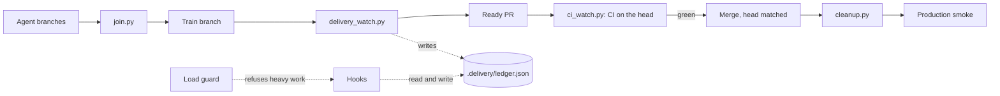
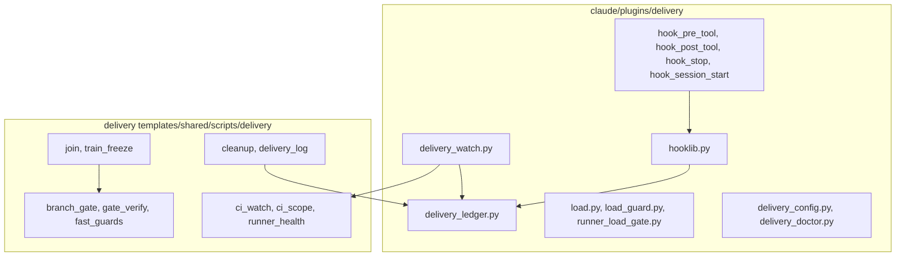
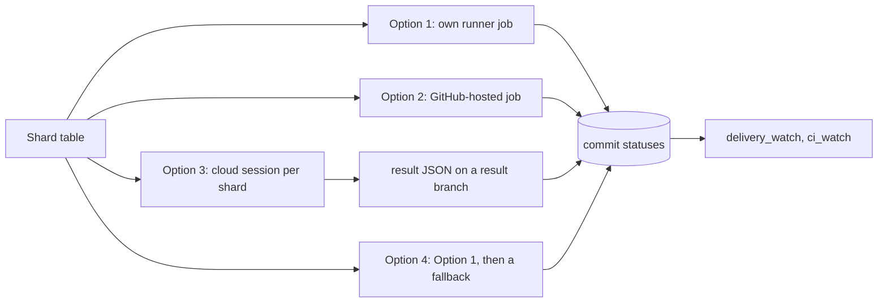
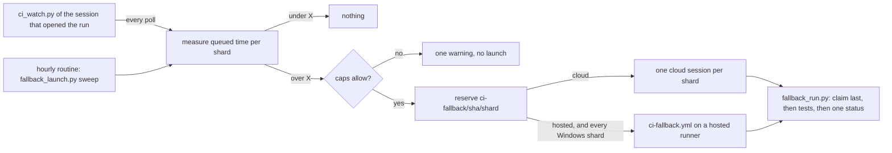

# Delivery guard rails

Related: [delivery speed](../delivery-speed/spec.md), [test cost](../test-cost/spec.md), [agents](../agents/spec.md), [artifacts](../artifacts/spec.md). The normative rules (DL-nn, Q-n) live in [DELIVERYSPEC](../../architecture/DELIVERYSPEC.md). This page does not copy them.

## 1. In one paragraph

`luismc-delivery` keeps a release train moving without the owner watching it. A ledger records trains, agents and questions. Hooks block a turn that leaves work half done. A background watcher pushes the next train, opens its pull request and merges it at green CI. A load guard keeps the machine under its memory and CPU limits. The shared delivery scripts do the gate, join, CI watch and cleanup. They live in `luismc-delivery` (`templates/`), and its installer writes them into a product; `luismc-project-setup` only calls the installer. The owner picks where CI runs, per OS (section 13).

## 2. Why

Delivery lessons used to live in memory notes that an orchestrator had to remember. Notes are forgotten. Hooks are not. Goals:

- Turn each lesson into a check: a hook, a script or a ledger field.
- Never leave a green train unmerged, a merged branch uncleaned or a deploy unsmoked.
- Never crash the machine with parallel installs and test runs.

Non-goals: the plugin does not run the product's tests. It never kills, suspends or re-prioritises a process.

## 3. How it works



1. Agents work on branches. Each branch gets a gate result.
2. `join.py` merges trusted branches into a train branch. It runs a quick check.
3. The watcher pushes the train and opens the ready PR. It watches CI on the PR head.
4. When the current head is green, the watcher merges with `--match-head-commit`. It never uses `--auto`.
5. `cleanup.py` removes merged branches and worktrees. A smoke run on production closes the train.
6. Hooks read the ledger. At turn end, the Stop hook blocks on open items (for example a green unmerged train). A project with no `.delivery/` folder gets no delivery hooks.

## 5. Functional requirements

**R5.1** — With no `.delivery/` folder, every delivery hook does nothing except the machine load guard.

**R5.2** — The ledger `.delivery/ledger.json` is written only through `delivery_ledger.py`. The write is atomic, runs under a lock and carries `schema: 1`. Hooks never edit it by hand.

The ledger lives in the main checkout. A command or hook run from a git worktree finds it there, because a `.delivery/` folder counts only when it holds `config.json` or `ledger.json`. `delivery_ledger.py link --pr N` links a PR to its train by hand when a record was missed.

**R5.3** — The PostToolUse recorder fills the ledger from tool calls (agents, installs, publishes, questions, the owner's prompt time).

**R5.4** — The Stop hook blocks a turn end for each open finding. The same finding blocks at most `enforcement.block_ceiling` times (default 3), and at most `stop_repeat_limit` turns with no ledger change. After that, the hook prints one notice. In `warn` mode it blocks nothing.

**R5.5** — The PreToolUse hook denies the calls that DELIVERYSPEC lists (for example a local `Agent` launch without a `PC-bound:` reason, or a question dialog while work is actionable).

**R5.6** — SessionStart prints a short ledger summary and injects the question rules (Q-1 to Q-5). It says when no watcher has a fresh heartbeat.

**R5.7** — The watcher pushes the next joined train, opens its ready PR (or adopts the one open PR of a train pushed by hand), and merges only when the PR head is the commit whose required workflows (`watcher.ci_workflows`) all succeeded. A `hold` stops it.

**R5.8** — When `runner_plan` allows it, the watcher cancels CI runs that a newer push replaced. It also holds non-train CI runs while a train's CI runs.

**R5.9** — The load guard refuses a new heavy command with exit 2 while memory is above 85% or CPU above 60% (project file over machine file over defaults). It never touches a running process. If the machine cannot be measured, it allows the call with a warning.

**R5.10** — The runner hook `runner_load_gate.py` waits until the machine is under the limits, up to 30 minutes, then exits 1 (or lets the job run with `--on-timeout run`).

**R5.11** — `delivery_ledger.py smoke` and `cleaned` are the only writers of `smoke`, `live_at` and `cleaned_at`. `cleaned` records nothing while a train or cargo branch or worktree is left.

**R5.12** — `delivery_config.py validate` checks `.delivery/config.json` against `references/config-schema.json`. An unknown key is a warning. A wrong type is an error. `delivery_doctor.py` self-checks config, `gh`, time zone, hook registration, ledger and the runner hook.

**R5.13** — Shared scripts (generated into a product): `branch_gate.py` runs the gate and writes `gate-result.json`; `gate_verify.py` trusts a result only for the same head and base; `join.py` merges trusted branches and runs the quick check; `ci_watch.py` watches the runs of one head; `cleanup.py` removes merged branches; `train_freeze.py` refuses pushes to a train in CI. Exit codes are shared: 0 pass, 1 failed or untrusted, 2 usage, 3 join conflict, 4 timed out.

**R5.14** — A branch that changes UI code or e2e specs runs the e2e specs of the screens it changed before it is done (DL-86). `branch_gate.py` records them in `gate-result.json` (`e2e`), `branch_gate.py --e2e-only` does it alone for an agent on the CI-gate path, `gate_verify.py` and `agent_ci.py` refuse a UI branch without a passing record for the head (DL-87), `e2e_push_check.py` in the pre-push hook refuses a push of changed e2e specs that were not run and passed (DL-88), and the launch check requires the brief to say so (DL-89).

The TS template's e2e step downloads Chromium unless `E2E_CHROMIUM_PATH` points at an existing executable (DL89). `agent_setup.sh` sets it for the session when a sandbox has a Chromium preinstalled under `/opt/pw-browsers`. A project that wants this sets the path in `playwright.config`:

```ts
use: { launchOptions: { executablePath: process.env.E2E_CHROMIUM_PATH || undefined } },
```

**R5.15** — One cloud launch has two ids: the routine id (`trig_...`) and the run session id (`cse_...`). The ledger keeps one agent entry and stores the run id in `run_ids`. Every agent command (`agent-eta`, `agent-done`) accepts either id, and DL-30 asks once per agent. A ledger that holds both as two agents is merged on read. (DL96)

**R5.16** — DL-31 accepts an assumed start that a person's action sets, when it is named: "~16:40 if you approve the plan by 15:00". A past duration ("took 3 hours") is a fact, not an ETA. The refusal message lists the accepted forms. (DL97)

**R5.17** — Each watcher row records the plugin `version` it started with. SessionStart stops a watcher with an older version (or none) by its recorded pid, never by name, and starts the newest. A watcher of the same version is left running. (DL98)

**R5.18** — A cloud `RemoteTrigger` create sets `"mcp_connections": []` and `"clear_mcp_connections": true`, or lists the connectors the brief needs. DL-93 refuses a create body with neither. (DL100)

**R5.19** — On Windows the watcher opens no console windows. SessionStart starts it on a hidden console (`CREATE_NO_WINDOW`, never `DETACHED_PROCESS`), and each `gh` and `git` call it makes passes `CREATE_NO_WINDOW`. A watcher that finds another live watcher for the same root, with a heartbeat newer than three intervals and a version not older than its own, exits. (DL109)

**R5.20** — `join.py` never discards a clean merge. A branch that conflicts (other than in lockfiles only) is aborted and skipped, and the join goes on with the next branch. At the end it names each conflicting branch and its files and says which clean merges it kept. With `--push` it pushes the clean merges; without it they stay committed on the local integration branch. Either way it exits 3. The join result adds `partial`, `conflicting` (branch to files), `pushed`, `skipped_steps` and `refused`. On a partial join the steps that judge the whole head (docs strip, gallery rebuild, light checks, ready PR text) wait for the call that joins the rest. A gate refusal still stops the join, and it keeps the clean merges made before it. (DL111)

**R5.21** — Every sibling module a shipped delivery script imports ships with it, and a test checks this. When one is missing, `ci_watch.py` and `fallback_launch.py` print one line that names the missing file, its folder and the fix (`delivery_ci_install.py update --track <track>`, then commit `scripts/delivery/`), and exit 2. After an install or update, and on a dry run, `delivery_ci_install.py` lists `missing imports:`. In a git repository it also lists the managed files git does not track, under `not in git yet (commit them):`. A missing import makes it exit 3. Untracked files never change the exit code. (DL112)

**R5.22** — `cancel_joined_runs.py --into <INTEGRATION> [--remote origin] [--repo OWNER/NAME] [--yes]` finds the active CI runs (queued, waiting, requested, pending, in progress) of branches already merged into the integration branch whose head commit the integration branch contains. A branch pushed again after the join is left alone. Runs of the integration branch, the default branch and unmerged branches are never touched. It is a dry run by default and prints one `cancel <id> <branch> <workflow> <url>` line per run. With `--yes` it runs `gh run cancel` for each run. It exits 0 when done, 1 when a cancel fails, and 2 on a usage error, a missing integration branch, or gh missing or failing. `DELIVERY_GH` names another gh program. Run it after a join so the ready PR's CI gets the runner. (DL113)

**R5.23** — CI jobs keep pinned tools on the runner's own disk. `scripts/delivery/ci_tool.py fetch <url> --sha256 <hex> --name <tool>/<version>/<file>` prints the path of a verified file in the per-runner cache. The cache is `CI_TOOLS_DIR`, else `C:/ci-tools` on Windows and `~/.cache/ci-tools` elsewhere, laid out as `<tool>/<version>/<file>`. It is never `$RUNNER_TEMP` or the workspace. A cached file is used only when its SHA-256 matches the pin; a mismatch is deleted and fetched again. A fetch makes 5 attempts (waits of 10, 20, 30 and 40 s; `CI_TOOL_RETRY_DELAY` sets the base) with a 20 s timeout. It downloads to a `.partial` file, verifies it, then renames it. `ci_tool.py gitleaks [--platform P]` does the same for the gitleaks pin in `tools.json` and prints the binary's path. Exit 0 prints the path, 1 is a failure (one stderr line with the URL, the attempts and the last error), 2 is a usage error. The shipped `ci.yml` gitleaks steps use it, and the runner pool keeps the cache on a `ci-tools` volume at `/ci-tools`. (DL115)

**R5.24** — DL-94: a workflow step that downloads a release asset or binary (curl, wget, Invoke-WebRequest, iwr or urllib, on a `/releases/download/` URL or a `.zip`, `.tar.gz`, `.tgz`, `.exe`, `.msi` or `.xz` file) is flagged when it does not go through `ci_tool.py`, writes into `RUNNER_TEMP`, or has no SHA-256 check. `workflow_fetch_check.py [FILES...]` reports each finding as `<file>:<line>: DL-94 <what> (<fix>)` and exits 0 when clean, 1 on findings and 2 on a usage error. The PreToolUse hook runs the same check on a Write, Edit or MultiEdit of `.github/workflows/*.yml` and blocks a finding. It fails open on its own errors. A reviewed exception ends the line with `# ci-tool: ok <reason>`. (DL116)

**R5.25** — Session start never fails silently on an old watcher. When it cannot stop one (access denied, an elevated process), it tells the session: `delivery_watch pid <pid> (plugin <version or unstamped>) could not be stopped: <reason>. Stop it yourself, from an Administrator shell on Windows: Stop-Process -Id <pid>` (on POSIX, `kill <pid>`, with sudo if needed). It still starts the installed watcher, and it repeats the warning while that row's heartbeat stays fresh. A dead pid is never warned about. Only a row's recorded pid is ever signalled, never a process name. The running watcher prunes, at its heartbeat, watcher rows whose pid is dead and whose heartbeat is older than 24 hours; session start never writes the ledger. (DL118)

**R5.26** — A project keeps its own choices across `delivery_ci_install.py update` with a tracked `scripts/delivery/ci-install.json`: `{"keep": [paths], "skip": [paths]}`, paths relative to the project root. The installer never writes that file. Update never overwrites a `keep` file: it lists it as `kept (ci-install.json) <path>`, and ends with `kept <path>: the plugin's version differs; diff it with <template path> and fold your change into the plugin or drop it`. A missing `keep` file is still written. Install and update never write a `skip` file, even when it is missing, and list it as `skipped (ci-install.json) <path>`. A path the plugin does not manage gets a warning line. Bad JSON exits 2, names the file and writes nothing. The plugin ships `ci-install.example.json`. (DL120)

**R5.27** — `ci_tool.py` needs Python 3.11+ visible to the runner's own account. A Windows runner that runs as a service (for example NETWORK SERVICE) cannot see a per-user Python, so it needs a machine-wide install. Otherwise the gitleaks step fails at once. (DL120)

**R5.28** — `artifact_prune.py` reads an optional `artifact_prune` section from `.delivery/config.json` (or `--config FILE`). `groups` lists objects with `pattern` (a full-match regex with one capture group that names the group), `keep` (default `--keep`), `protect_pr_heads` (`{head_prefix, base}`: keep artifacts built from the head of an open PR from `head_prefix*` into `base`) and `hold_workflow` (keep the whole group while that workflow's newest run per head failed, was cancelled or timed out in the last 24 hours). Artifacts of runs still queued or running, and artifacts younger than `min_age_seconds` (default 3600), stay. GitHub API calls retry 5xx, 429, rate limits, timeouts and dropped connections up to 5 times with backoff; 404 and 410 count as gone. With no section the old rule applies. (DL121)

**R5.29** — `session_guard.py` does not block `gh pr create` or `gh pr ready` aimed at another repository with `-R` or `--repo`. When origin cannot be read, the guard stays on. (DL121)

**R5.30** — `ci_scope.py` reads `no_test_reads` (globs that never trip a `full_files` valve and are not counted as code) and `package_json` (`{file, keys, scripts}`) from `ci-scope.json`. A change to that file runs the full set only when a listed key changed (default: name, type, main, module, exports, bin, engines, packageManager, workspaces, dependencies, devDependencies, peerDependencies, overrides, resolutions, pnpm) or a script matching a `scripts` glob was added, removed or changed (default `*`). Unreadable JSON runs the full set. Without `package_json` the file follows `full_files`. (DL121)

**R5.31** — `ci_watch.py` trims the local Docker disk after the watched runs finish when `ci.docker_trim` is true in `.delivery/config.json` (default off; Windows with Docker only). `ci.docker_trim_images` (default `["postgres:16"]`) names the image used for the trim. `--no-trim` skips it. A failed trim only logs a line. (DL121)

**R5.32** — `cleanup.py` writes the delivery log only when asked: `--delivery-log`, or `cleanup.delivery_log: true` in `.delivery/config.json`; `--no-delivery-log` wins. The default changed from on to off; a project that relies on the log sets the config key. For merge-commit trains, "no work of its own" is judged against the default branch as it was before the train's merge. (DL121)

**R5.33** — `artifact_prune.py` reads `artifact_prune.workflows` from `.delivery/config.json` (or `--config FILE`): a non-empty list of workflow names, default `["CI", "Package"]`. `--print-workflows` prints one name per line. `--sync-workflow [FILE]` rewrites the one-line `workflows: [...]` in FILE (default `.github/workflows/artifact-prune.yml`) and prints `synced` or `unchanged`. `--check-workflow [FILE]` exits 1 when FILE differs. An empty list, a non-string name, a name with a quote, newline or backslash, or a file with no one-line list exits 2. GitHub reads the list before any step runs, so it cannot come from a file at run time; run `--sync-workflow` after `delivery_ci_install.py update`, which restores the template line. The workflow's last step only warns when the list differs; it never fails. (DL122)

**R5.34** — DL-53 accepts a worktree path in Git Bash form (`/c/Work/x`) or WSL form (`/mnt/c/Work/x`) when the work root is `C:/Work`. The hook maps both to `c:/x`, turns backslashes into slashes, lowercases and drops a trailing slash before it compares. A real outside path (`/c/Other`, `/d/Work`, `/mnt/c/Workshop`) is still refused. (DL133)

**R5.35** — The PreToolUse hook warns, and never blocks, on a `RemoteTrigger` `create` or `update` whose `run_once_at` is under 2 hours ahead while a question is open. A question is open when the ledger holds an `owner_questions` entry with no `answered_at`. The warning is a `systemMessage`. (DL136)

**R5.36** — `delivery_ledger.py agent-check <agent or task>` sets `last_checked` on an open agent and adds an `agent.checked` event. The `record` op `agents_done(pr, branches, tasks)` closes (done, ready) the open agents whose task is in the train's cargo or whose branch is in the list. After a clean `cleanup.py --pr N` run, the close-agents step calls it with the train's branches. `delivery_ledger.py show` lists open agents whose task row in `docs/project/*.html` (a `<tr data-task=...>` with a `status-live`, `status-dropped` or `status-built` chip) is finished. An unreadable record adds nothing and never raises. (DL127)

**R5.37** — `ci_watch.py` finds the ledger in the main checkout when run from a worktree: `git rev-parse --git-common-dir` names a `.git` whose parent holds `.delivery/`. Otherwise it uses the repo root as before. (DL132)

**R5.38** — `ci_watch.py` records a CI result against a train in this order: train, PR, branch, head sha. The branch is the local or remote branch at the commit, never `main` or `master`. With no match and a branch, it creates the train in state `ci` (as `delivery_ledger.py plan --branch`). With no branch, it records `ci.unmatched` and prints `delivery_ledger.py plan --branch <branch>` to stderr. `plan --branch` returns the open train of that branch instead of a second one. (DL138)

**R5.39** — When the runs of the named workflow are complete, `ci_watch.py` makes one unfiltered `gh run list --commit <sha>` and adds the runs of every other workflow. A pending run keeps the watch waiting. A failed run makes it exit 1. `--only-workflow` keeps the old watch. If the unfiltered read fails, it prints one warning and the named runs decide. (DL139)

**R5.40** — `join.py` skips a branch B that holds an older head of another branch A of the same call: A's head is not in B and the merge base is on A's side only. It prints `join: B is stacked on an older A; prefer B's side for files B rewrote` and `merge B alone ... or rebase B on the current A`, reports B as conflicting with no files, and exits 3. If B carries A's whole head, it merges normally. (DL128)

**R5.41** — `join.py --into X` fails with exit 2 when X is not on the remote: `integration branch 'X' not found on remote 'origin'; run again with --create, or create it: git push origin origin/<default>:refs/heads/X`. With `--create` it pushes `origin/<default>` as X, prints `join: created X on origin from origin/<default>` and goes on. (DL129)

**R5.42** — When the light check fails and a log in the join log folder holds "unhandled API call" (any case), `join.py` prints, and writes to `quick_check.join_interaction` in `join-result.json`, a `join-interaction failure` note. The note says that each branch passed alone and that a call one branch added is not mocked by another branch's test. (DL135)

**R5.43** — After the light check and before the runner check and the push, `join.py` runs `pre_pr_docs`: `design_system.py visuals --apply` (only when `docs/design-system/next-version` exists), `docs_index.py build` (docs changes are committed as `Rebuild generated docs`) and `docs_check.py --strict`. It lists specs with T2 findings under `specs with T2 findings, verify before push:`. A missing script prints `luismc-docs X not found; ... not run`. The result goes to `pre_pr_docs` in `join-result.json`. This step never changes the exit code. (DL140)

**R5.44** — When the local integration branch is ahead of `origin/X`, `join.py` builds on it and prints `join: local X is ahead of origin/X; building on the local branch`. When the local branch holds commits that origin does not, and origin is not built on them, it exits 2 with `... joining would lose them. Push or rebase local X first.` A conflict under `docs/work/` takes the branch's side and says so. (DL145)

**R5.45** — After its steps, `branch_gate.py` restores `docs/work` only (`git restore --staged --worktree`, then `git clean -fd`), so the next push or gate run sees a clean tree. The gate sets `PYTHONIOENCODING=utf-8`, `PYTHONUTF8=1`, `FORCE_COLOR=0` and `NO_COLOR=1`, and reconfigures stdout and stderr to UTF-8 with `errors=replace`. After the run it rewrites each step log as UTF-8 (UTF-8 bytes, else cp1252 with replace), removes ANSI sequences and turns CRLF into LF. (DL131, DL134)

**R5.46** — When a branch changes `.cs` or `.csproj` files, `branch_gate.py` builds each owning project with `dotnet build` if dotnet exists and the project is not Windows-only. A failing build adds the failed step `csharp-build`. Otherwise `gate-result.json` gets `"warnings": ["C# changed, not compiled on <os> (release CI compiles it)..."]` and the summary prints `warning : ...`. The `warnings` key is written only when it is not empty. With `--only` or `--skip`, the build is skipped. (DL141)

**R5.47** — `test_dl147_workflow_needs.py` reads every `.yml` under `templates/*/.github/workflows/`. A job with `needs` must have an `if:` that starts with `!cancelled()` and checks each needed job's result (`needs.<name>.result`). A job that depends on a `decide` or `plan` job accepts a skipped one: it tests `!= 'failure'`. An aggregate job that judges results itself tests `!= 'cancelled'`. (DL147)

**R5.48** — The rust track's CI helper `scripts/delivery/rust_ci.py` (standard library only) holds the Rust steps, so CI, the pre-push hook and the agent gate run the same commands.
- `toolchain` installs the exact channel and targets of `rust-toolchain.toml` with the pinned `rustup-init`. A channel that is not exact (such as `stable`) fails.
- `env [--format json|sh|cmd]` sets the linker env. For a Windows MSVC target it uses the pinned LLVM `lld-link`, `clang-cl` and `llvm-lib`. On a Linux or macOS host it uses a system `cc`, `gcc` or `clang` first, then the pinned Zig through a `zig cc` wrapper, else it fails with `linker cc not found. Fix: install a C compiler (sudo apt-get install -y build-essential pkg-config), or pin Zig ...`. (DS206, D146)
- `deny` keeps the advisory database in `<tool cache>/advisory-db` and writes `deny.generated.toml` with `db-path`; the committed `deny.toml` is never edited. It runs `cargo deny fetch`, then `check --disable-fetch`. If the fetch fails, a cached copy up to 7 days old gives a warning (stderr and `$GITHUB_STEP_SUMMARY`) and the run goes on. An older copy, or none, fails.
- `run [--] CMD...` runs with the linker env. Only when gate.json `toolchain-isolated` is true (default false, D146) does it remove the folders that hold `cc`, `gcc`, `clang` or `ld` from `PATH`. Folders that hold `cargo` or `rustc` stay. (DS200, D140, D141, D142, D143)

**R5.49** — The rust `smoke.json` has `smoke.binaries`, a list of names. `rust_ci.py smoke` builds each in debug and runs `<bin> --version`. The rust `gate.json` has `toolchain-isolated` (default false, D146), the steps `deny` (when `Cargo.lock` or `deny.toml` changed) and `xwin` (only when a cross target is declared), and runs its cargo steps through `rust_ci.py run --`. `widen_on` keeps `Cargo.lock`. (DS200)

**R5.50** — The rust `ci.yml` and `package.yml` install the toolchain with `rust_ci.py toolchain` and write the linker env from `rust_ci.py env`. `Swatinem/rust-cache` runs only on GitHub-hosted runners. The pinned cargo-deny runs as `rust_ci.py deny`. The sqlx-cli install no longer ends in `|| true`. On `pull_request` the rust workflow runs only for its paths (`crates/**`, `**/Cargo.toml`, `Cargo.lock`, `rust-toolchain.toml`, `rustfmt.toml`, `deny.toml`, `**/*.rs`, `scripts/delivery/rust_ci.py`, `tools.json` and the workflow itself), so Rust under `apps/` runs it. On push it keeps `paths-ignore` for docs, Markdown and JS-only paths; `apps/**` is not ignored. The ts workflow's `paths-ignore` adds the Rust-only paths, so a Rust-only change skips the JS suite and a mixed change runs both. A push to the default branch that changes only JS under `apps/` still runs the rust workflow; pull requests are exact. Branch protection must not require rust jobs on JS-only pull requests. (DS206, D148) `cancel-in-progress` equals the one in the ts workflow. `package.yml` builds a Windows exe with cargo-xwin as the artifact `packaged-program-windows`, beside `packaged-program`, and downloads nothing from other runs. (DS201, D144)

**R5.51** — `delivery_doctor.py` has a `rust` check. It shows nothing unless gate.json `track` is `rust` or `scripts/delivery/rust_ci.py` exists. Failures: `rust.toolchain` (file missing, or channel not `X.Y.Z`), `rust.linker` (no `cc` or `zig` on PATH or in the tool cache; message `linker cc not found. Fix: ...`), `rust.windows` (`clang-cl` or `lld-link` missing while a `targets` entry names `windows`), `rust.pins` (`rustup-init`, `llvm`, `zig` or `cargo-deny` has no 64-hex sha256 in `scripts/delivery/tools.json`; a missing file, bad JSON or missing keys are findings, never a crash). Warnings: `rust.advisory` (no `advisory-db*` folder in the tool cache, or older than 7 days) and `rust.disk` (under 10 GB free). Warnings never fail the check. The doctor changes nothing and prints the fix command. (DS202, D142)

## 6. Non-functional requirements

**R6.1** — Every hook fails open on its own error. It prints a warning and exits 0, except a deliberate deny (exit 2).

**R6.2** — `CLAUDE_DELIVERY_HOOKS=off` disables all hooks. `checks_off` switches one rule off per project.

**R6.3** — Scripts use only the Python standard library and run on Linux, macOS and Windows.

**R6.4** — `.delivery/` is git-ignored. The ledger keeps events only as long as the project keeps the folder.

**R6.5** — The load measurement is cached for 10 seconds. CPU is the mean of up to 3 samples in 30 seconds, so one spike decides nothing.

## 7. Design



Hook events (`hooks/hooks.json`): PreToolUse (Bash, PowerShell, Agent, Workflow, RemoteTrigger, AskUserQuestion, Write), PostToolUse and PostToolUseFailure, UserPromptSubmit, Stop, SessionStart. Each hook runs `python3` and falls back to `python`.

Ledger fields: `trains`, `agents`, `jobs`, `installs`, `publishes`, `runners`, `watchers`, `owner_questions`, `events` (`references/ledger-schema.json`). A train moves through `planned`, `joining`, `joined`, `pushed`, `ci`, `green`, `merged`, `live`, `cleaned` (or `red`, `abandoned`). Only the watcher sets `green_at`.

`CONTRACT.md` lists the shared scripts, their paths in a product and their command lines. It sits next to the scripts. Change the contract first, then the code.

## 8. Failure modes

| Dependency | Fails | Why |
|---|---|---|
| `gh` or the network (hooks) | open | A hook must not stop work for an outage. It warns. |
| Machine measurement | open | The guard protects. It does not gate on a guess. |
| Ledger lock held too long | open, warns | A stale lock must not freeze a session. |
| `gh` in `ci_watch.py` | closed after repeated errors | A watch must not report green it did not see. |
| Gate result missing or stale | closed | An untrusted result is never a pass (exit 1). |
| `train_freeze.py` offline | open, warns | See [delivery speed](../delivery-speed/spec.md), D4. |
| Runner hook with no Python or a refusing PowerShell policy | job fails | The doctor reports it first; see the plugin README. |

## 9. How it is proven

| Requirement | Test |
|---|---|
| R5.1, R5.4, R5.5 | `claude/plugins/delivery/tests/test_stop.py`, `claude/plugins/delivery/tests/test_pre_tool.py`, `tools/test_delivery_hooks.py` |
| R5.2, R5.11 | `claude/plugins/delivery/tests/test_ledger.py` |
| R5.3 | `claude/plugins/delivery/tests/test_recording.py`, `claude/plugins/delivery/tests/test_post_tool.py` |
| R5.5 (questions) | `claude/plugins/delivery/tests/test_questions.py` |
| R5.6, R5.14 | `claude/plugins/delivery/tests/test_brief_template.py`, `claude/plugins/delivery/tests/test_pre_tool.py`, `tools/test_rule_tags.py` |
| R5.7, R5.8 | `claude/plugins/delivery/tests/test_watch.py` |
| R5.9, R5.10, R6.5 | `claude/plugins/delivery/tests/test_load.py`, `tools/test_delivery_runner.py` |
| R5.12 | `claude/plugins/delivery/tests/test_config.py`, `claude/plugins/delivery/tests/test_doctor.py` |
| R13.1 to R13.9 | `claude/plugins/delivery/tests/test_ci_options.py`, `tools/test_delivery_cloud.py` |
| R5.13, R5.14 | `tools/test_delivery_gate.py`, `tools/test_delivery_ci.py`, `tools/test_delivery_cleanup.py`, `tools/test_session_guard.py` |

Run: `python3 -I -m unittest discover -s claude/plugins/delivery/tests -t claude/plugins/delivery/tests` and `python3 -I tools/test_delivery_hooks.py`. For the shared scripts see `docs/testing.md`.

## 10. Decisions

| ID | Question | Chosen | Date |
|---|---|---|---|
| D1 | How are rules enforced? | Hooks inside sessions, scripts for time-critical steps (MADR 0030) | 2026-10-14 |
| D2 | When does the watcher merge? | At green on the current head, never `--auto` | 2026-10-14 |
| D3 | Do findings block or warn? | Block, with a ceiling | 2026-10-14 |
| D4 | Local or cloud agents? | Cloud first | 2026-10-14 |
| D5 | Machine limits? | 85% memory, 60% CPU, hold new work only (MADR 0031) | 2026-10-14 |

Decisions in MADR form: [0030](../../architecture/decisions/0030-delivery-hooks-and-watcher.md), [0031](../../architecture/decisions/0031-machine-load-guard.md). The full owner decisions are in DELIVERYSPEC section 5.

## 11. Not built yet

Some DL rules are advice only today. DELIVERYSPEC section 1 marks the ones that no mechanical check covers yet (for example DL-16, DL-17). A hook for them would go in `hook_stop.py` and `hook_pre_tool.py`.

## 12. Code map

Source: claude/plugins/delivery/scripts/
Source: claude/plugins/delivery/templates/shared/scripts/delivery/
Source: claude/plugins/delivery/templates/

The plugin holds hooks, ledger, watcher, load guard, doctor, the CI option command and the installer. The templates folder holds the shared scripts (gate, join, CI watch, cleanup, the cloud shard runner and status poster), `CONTRACT.md`, the workflow files and each track's `gate.json` and `smoke.json`.

## 13. CI options

CI can run in four ways. The owner picks one **per OS** (linux, windows, macos). The choice is stored in `.delivery/config.json` under `ci.options`. Every project uses the same CI contract; the option decides only where a shard runs and how its result comes back. The docs and the setup say "Option 1 to 4". The config keeps names.

| Option | Name in config | Runs on | Result comes back as |
|---|---|---|---|
| 1 | `self-hosted` | GitHub Actions on the owner's own runners, on **any** machines (a PC, a spare box, a server, a VM) | commit status |
| 2 | `github-hosted` | GitHub Actions on GitHub's runners | commit status |
| 3 | `cloud` | Claude cloud sessions: no Actions, no webhooks | commit status |
| 4 | `self-hosted` plus a `ci.fallback` block | Option 1 first. After X minutes of waiting for a runner, the fallback (Option 2 or 3) runs the shard | commit status |

Option 4 is not a fourth name. It is Option 1 with a `ci.fallback` block for that OS (R13.51).



**R13.1** — There is no default option. Setup asks the owner once for each OS the product tests on and records the answer. `/delivery-ci-setup` is the guided way (see the [set up CI guide](../../guides/set-up-ci.md)); `delivery_ci.py set --os <os> --option <name>` is the bare command and `unset` clears it. The same command changes the choice later. An OS with no answer is "not chosen". Changing the choice changes the config only; the command says what the new choice still needs.

**R13.2** — All options use one **shard table**, `scripts/delivery/ci-shards.json` (path set by `ci.shard_table`). Each shard has an `id`, an `os` and `commands`. It may also have a `context`, the check name it reports under; the `id` is the fallback. The table may name test commands under `tests`; a command `@name` expands to one. The product owns the table. The format is in `CONTRACT.md`. A guard fails when a test file is in no shard or in two shards, and a shard's sizing (workers, memory, timeout) comes from the table.

**R13.3** — The CI and delivery templates live only in `luismc-delivery` (`templates/`). `delivery_ci_install.py install` writes the ones that are missing; `update` overwrites the plugin-owned scripts and keeps the files the project edits (`gate.json`, `smoke.json`, the area and timing maps, `ci.yml`, `package.yml`, `ci-shards.json`). Neither command commits, pushes or chooses an option. `tech-stack-setup` calls the installer at the end of its setup and copies none of these files itself.

**R13.4** — Option 1 runs on the owner's own runners, on any machines. Each machine has one runner entry (a name, an OS and labels). A second or third machine is added the same way as the first. Option 1 keeps the config keys `runners` and `local_runners`, the runner repair loop and the runner load gate. The setup prints the add-a-runner commands for the OS of each machine, and says to add a runner on another machine when a job waits longer than X minutes, because one runner per label is the first bottleneck. Option 2 needs workflow files in `.github/workflows/` and, for larger runners, a paid plan.

**R13.5** — Option 3 uses only cloud sessions. A launcher session starts one shard session per missing shard through the routines API (`RemoteTrigger` create, run, then disable). A scheduled cloud routine watches the heads of the branches in `ci.cloud.branches` with plain git (`cloud_status.py pending`). It starts no GitHub Actions run and needs no webhook. Cloud sessions run Linux only. A shard with `os: windows` needs Option 1 or 2 for Windows.

**R13.6** — A cloud shard runs its commands in order from the repository root, stops at the first failure and writes a result JSON (`schema`, `shard`, `context`, `os`, `sha`, `state`, `started`, `finished`, `commands`, `summary`). `state` is `success`, `failure` or `error`. `error` (wrong OS, HEAD not the requested sha, bad table, a speed probe above 3) is never a pass. With `--push` the result is published as the only file of a new branch `<results_prefix>/<sha>/<shard id>` (default prefix `ci-result`); each (sha, shard) has its own branch, so shards never conflict.

**R13.7** — **Required checks are always commit statuses**, for every option (owner answer 2). The status is `POST /repos/{owner}/{repo}/statuses/{sha}` with the shard's `context`, the result's `state` and a description of at most 140 characters. The contexts are the names the required checks use. The repository ruleset must accept **"Any source"** for them, because the status is not posted by the Actions app; this is the one setting the plugin cannot change, so the setup prints it as a by-hand step. A job name of the workflow is never a required name. Option 3 and the cloud fallback use a statuses-only token the owner creates. It is read from the environment variable named by `ci.cloud.status_token_env` and is never written to a file or printed. A status is posted only for the `sha` in the result; a result for another sha is refused. A newer status on a context replaces the older one.

**R13.8** — The watcher reads results the same way for all options. A train is green when, for the PR head, the newest status of every required context is `success`. A missing result is not green; a failed or errored one is red. `ci_watch.py SHA --context NAME` waits for statuses with the exit codes of the workflow watch (0 pass, 1 failed, 4 timed out).

**R13.9** — `delivery_doctor.py` has a `ci` check. It fails when the shard table has a shard for an OS that was not chosen, or a `windows` shard with no option that can run Windows. For Option 1 it needs a `runners` entry for the OS and warns when no online runner carries a job's labels; for Option 2 a workflow file; for Option 3 `ci.cloud.repo`, `status_token_env` and `branches`, a shard table, and one context per cloud shard; for Option 4 all of Option 1 and the fallback's own parts. A missing token variable is a note, not a failure, because the token lives in the cloud environment. With nothing chosen and no shard table the check passes with a note.

**R13.10** — A shard may list `inputs` (paths) in the shard table, and the table may list `root_files`. From these `pass_records.py` computes an **inputs key**: a hash of the shard id, OS, commands and the git blob ids of the files at HEAD. With `cloud_shard.py run --records` a shard whose key has a `success` pass record is skipped; its result is `success` with `skipped: true` and the record it relied on. A shard with no key (no `inputs`, a path that matches nothing, uncommitted changes under its paths) always runs. A `failure` record never skips, and `--all` ignores records.

**R13.11** — Pass records live on one orphan branch (`ci-pass-records`), one file per branch, shard and key, so shards never conflict. A ready pull request to the base branch reads only the base branch's records, never its own branch's; other runs read their own and the base's. `pass_records.py cleanup` and `cleanup.py` remove the records of branches that no longer exist, and keep the newest 20 records of each branch and shard.

**R13.12** — `/delivery-ci-setup` (command of `luismc-delivery`) is the guided setup for Options 1 to 3. It has **no default at any question**: the engine `delivery_ci_setup.py apply` refuses and lists each missing answer. A cap (monthly minutes, sessions a day) is offered and may be skipped, but only by an explicit "none". It reads the project, asks the option per OS, asks the option's own questions, writes `.delivery/config.json` (`ci.options`, `ci.guided`, `runners`, `ci.limits`, `ci.serial`, `ci.wait_min`, `ci.hosted`, `ci.cloud`), runs `delivery_ci_install.py install` and `delivery_doctor.py`, and prints a numbered by-hand list. Option 1 asks for each machine (name, OS, labels, memory and CPU ceilings) and the minutes X after which the owner adds a runner on another machine; the example for X is 10. Option 2 asks the runner size per OS and larger runners; Option 3 asks the repository, branches, shard timeout and the name of the token variable (Linux only).

**R13.13** — The by-hand list is one function, `by_hand_items`. The printer and the doctor both read it, so each printed step has one doctor check. Option 1: the runner is online with its labels, `CI_RUNS_ON` and `CI_SERIAL` are set, the load gate is set up on the machine. Option 2: the larger runner exists, `CI_RUNS_ON` is set, a GitHub spending limit is set. Option 3: the statuses-only token variable, the ruleset accepts "Any source" for the cloud checks, the sessions can reach the repository. When the project used the setup (`ci.guided`), the `ci` check fails for a step that is open. A step the doctor cannot read (billing, a remote machine, the cloud environment) fails until the owner runs `delivery_ci_setup.py confirm ITEM`. Running the command again changes the choice and prints what the new choice still needs.

**R13.14** — Option 1 is the user's own self-hosted runners **on any machines they run**, not one machine. Every text that names these runners says so. The `ci` doctor check names the runners it found for each OS, and the by-hand steps to add one more on another machine for that OS (`delivery_ci.py add-runner --os <os>` prints the same steps). The rule behind it: a job that waits more than X minutes for a runner means add a runner with the same label on another machine. The config keeps the names `self-hosted`, `github-hosted` and `cloud`, and has an empty `ci.fallback` block for Option 4. The docs and the setup say Option 1 to 4.

**R13.20** — Windows. Only a test that needs a real Windows machine runs on Windows. `windows-real.json` lists those files (with a `marker`, a `cap` and `max_minutes`), and `windows_real.py check` fails when a listed file is gone or has lost its marker, when the table is over its cap, and when an `os: windows` shard is anything but `"set": "windows-real"` running only `@windows-real`. The Linux MSI recipe (`windows-msi-linux.sh`, `windows-msi-check.yml`) is optional and a CI check only: the shipped MSI is built on Windows, because Wine cannot write LZX (the recipe uses `mszip`). It is reopened once a Windows install smoke passes on the Linux-built file at each release. Installers are held until the publish succeeds: `package-windows.yml` cleans up only when no job failed or was cancelled, `artifact_prune.py --hold NAME --hold-workflow FILE` keeps every artifact of NAME while the newest run of that workflow has not succeeded, and `publish_token.py` retries a 5xx token answer after 1, 2 and 4 seconds. A `smoke.json` with `"installer": true` must name a `rollback_check`, the command that proves an update leaves a verified copy of the running version.

### 13.x Option 4 core: a fallback after a wait

Own runners run a shard first. If the shard waits too long for a runner, a fallback may run it. The code is `scripts/delivery/ci_fallback.py` (standard library, plain git, no service).

```mermaid
flowchart TD
  wait[Shard waits for a runner] -->|X minutes, caps allow| gate[fallback_gate counts the caps]
  gate --> fb[Fallback boots]
  main[Runner frees] --> c{claim ci-claim/sha/shard/attempt}
  fb --> c
  c -->|won| run[Run the shard]
  c -->|lost| end[End, post nothing]
  run --> post[post_checked: one status]
  run -.->|no result after shard_timeout_min| reap[Reaper posts error, opens attempt N+1]
```

**R13.30** — Config block `ci.fallback`: `options` (the fallback per OS, `cloud` or `github-hosted`), `after_min` (X, no default; absent means the fallback is off), `after_min_if_offline` (absent means the same as X), `only_for` (`all`: every run may use it), and the optional caps `max_shards_per_day` and `max_minutes_per_month` (hosted only). A fallback without caps is allowed; the setup says what that risks.

**R13.31** — The wait is per shard. It counts only while a job is `queued` and no runner has started it. A run held back by the `CI_SERIAL` queue has no jobs or a pending run status and counts as no wait.

**R13.32** — The claim is the branch `ci-claim/<sha>/<shard>/<attempt>`, created by a push that creates it. The first claim wins. Nobody is pre-empted: a runner that frees up during a fallback sees the claim, ends, and posts nothing. The fallback claims last, just before its first test command.

**R13.33** — A shard's result is one commit status with the shard's context, posted only by `post_checked`. It refuses a result for another sha, a poster that is not the claim holder, a superseded attempt, and a second post of the same attempt (the `ci-posted/<sha>/<shard>/<attempt>` branch is created first).

**R13.34** — The reaper: a claim with no posted marker and no result branch after `ci.cloud.shard_timeout_min` is dead. It posts `error` ("run lost") and opens attempt N+1. Attempts are capped at 2; after attempt 2 the error stays.

**R13.35** — Caps are counted on the pass-records branch (`fallback-counter.json`) before a fallback starts, with the shard timeout as the worst case for hosted minutes, and settled to the real minutes after. A cap that would be passed pauses the fallback with one line (`fallback paused: daily cap` or `fallback paused: monthly cap`). A cap is never overrun, also with two watchers at once.

### Option 4 fallback launchers (DL24)

When Option 4 is chosen, a shard that waits too long for its own runner may start on a fallback. The core's settings are `ci.fallback` in `.delivery/config.json` (`options` per OS, `after_min` = X with no default, optional caps). The launchers add their own keys (`cloud.fire_url`, `cloud.token_env`; `hosted.workflow`, `hosted.ref`). Caps are optional.



**R13.40** — The wait is measured per shard. A job counts while GitHub reports it `queued`, from its `created_at`. A run held back by the one-at-a-time setting has no job yet and does not count. A job with a GitHub-hosted label does not count. A job belongs to the shard whose `id` or `context` is part of the job name.

**R13.41** — Under X nothing starts. Over X, `ci_watch.py` starts one launch per waiting shard, once. The launch is reserved first by creating the branch `ci-fallback/<sha>/<shard>`; git refuses a second create, so the watching session and the hourly routine never start the same shard twice. A shard that already has a claim or a result branch is not started. The hook never changes the exit code of the watch.

**R13.42** — The watcher is the session that opened the run, plus an hourly routine as a safety net (`templates/shared/routines/ci-fallback-watch.json`, a template: nothing creates it). There is no watchdog job in a workflow. **An unattended fallback can start up to an hour late**, because a routine runs at most hourly. The setup says this in plain words.

**R13.43** — The cloud launcher fires the routine's API trigger once per shard (`ci.fallback.cloud.fire_url`, token from the variable named by `cloud.token_env`). The hosted launcher runs `gh workflow run ci-fallback.yml` once per shard. Cloud sessions are Linux, so every Windows shard uses the hosted launcher, and only for a ready pull request.

**R13.44** — A launched job runs `fallback_run.py`: it checks that HEAD is the sha, takes the claim last (just before the first test command), runs the shard and posts one commit status. If the claim is already held it ends at once: no tests, no status. If the claim module is missing it runs nothing and exits 2.

**R13.45** — When a cap is hit the launcher starts nothing and prints one warning for that commit and launch kind ("fallback paused: ..."). Caps and the claim come from the Option 4 core.

**R13.50** — The setup is a conversation with **no default at any question**. It reads the project, asks per OS for the option, asks that option's own questions, writes the config, runs the installer and the doctor, and prints the **by-hand list**: the steps only a person can do (runner install, tokens, repository variables, the ruleset, the spending limit). The doctor re-checks each one. Step by step, see the guide.

**R13.51** — **Option 4: own runners first, a fallback after a wait.** The config for an OS holds `ci.fallback`: the fallback kind (`cloud` or `github-hosted`; for Windows only `github-hosted`), `after_min` (X, the minutes a shard may wait for the main runners; the setup shows 10 as an example and has no default), and optional caps `max_shards_per_day`, `max_minutes_per_month` (hosted) and `only_for`. Every run may use the fallback; `only_for` narrows it (owner answer 6). Hosted Windows runs only the Windows-only set, on ready pull requests to the default branch, within the caps if set (owner answer 7).

**R13.52** — **The wait.** A shard is waiting while GitHub reports its job `queued` and no runner has started it; the wait is now minus the job's `created_at`. The unit is the shard, not the run. Only waits for a runner count toward X; a run held back by the one-at-a-time ready-PR setting (`CI_SERIAL`) is waiting for its own predecessor and does not count (owner answer 5).

**R13.53** — **The claim.** Before any work, a runner takes a **claim**: a branch `ci-claim/<sha>/<shard>/<attempt>` created by a push. A second create of the same name is refused by git, so the first claim wins and nobody is pre-empted (owner answer 9). The main job claims in its first step and ends in seconds if refused. The fallback boots, checks out, installs, and claims last, just before the first test command; if the main runner started meanwhile, the fallback ends. Only the claim holder posts the status. `cloud_status.py post` refuses a result for any sha but its own and refuses to post unless the claim names the poster. A new push gives a new sha; old claims are ignored and `cleanup.py` deletes `ci-claim/*` for finished commits.

**R13.54** — **The watcher.** The fallback is started by a **watcher**: the CI watch of the session that opened the pull request, plus an hourly scheduled routine as a safety net (owner answer 1). There is no watchdog job in the workflow, also for a hosted fallback. An unattended fallback may therefore start **up to an hour late**, because a routine's minimum interval is one hour. The setup says this in plain words. If `runner_health.py` sees no online runner with the job's labels, the watcher may start the fallback at once (setting `after_min_if_offline`).

**R13.55** — **The reaper.** A claim with no result after `ci.cloud.shard_timeout_min` is a lost run. The watcher posts `error` ("run lost") and opens attempt N+1. The attempt counter is capped at 2.

**R13.56** — **Caps are optional.** The setup offers `max_shards_per_day` and `max_minutes_per_month`, explains the risk of none, and does **not** refuse a fallback without them (owner answer 4). A counter on the records branch adds up fallback shards and minutes. When a cap is hit, the fallback is off, the run waits and the watcher says "fallback paused: monthly cap". GitHub's own spending limit is the hard stop for hosted runners; it stays a by-hand step the setup prints.

**R13.57** — **Speed rules the templates follow.** Cheap checks run first (secret scan, format, lint, typecheck, boundary check). Linux gets one job per suite family; Windows gets as few jobs as the tests allow. A job that only reports is a step of the last job, not a job. A shard is skipped when its **inputs key** (a hash of the shard id, its commands, the git blob ids of its workspaces and their dependencies, and a list of root files) has a pass record; pass records live on one orphan branch, a failed record never skips, and a ready PR to the default branch reads only the default branch's records. `--all` ignores records.

**R13.58** — **Budgets and limits.** Timing budgets run only in CI, alone, on a runner of known speed. A speed probe (median of 5 runs of a fixed workload) scales every millisecond budget; a scale above 3 refuses to judge and the shard reports `error` (owner answer 8). `ci.limits` holds `browser_workers`, `integration_workers` and `memory_gib` per option; a shard that reports a peak above its limit fails a guard.

**R13.59** — **Windows.** The Windows-only test set is a table (`windows-real`) with a guard, and the shard table gets `os: windows` shards that name only that set. Installer pieces may be built on Linux (an optional recipe). A Linux-built MSI is a **CI check only** (owner answer 10); the shipped MSI is built on Windows. Installer artifacts are kept until publish succeeds. Option 3 does not cover Windows.

**R13.60** — **One machine config** (D21, D22, G2). Every runner account on a machine reads one file: `machine.json` in the machine folder (`C:\ProgramData\luismc-delivery\` on Windows, `/etc/luismc-delivery/` elsewhere, `/machine` in the pool; `DELIVERY_MACHINE_DIR` overrides it for tests). It holds `load_limits`, `ci_slots` (2), `local_heavy` (2), `cloud_ci_sessions` (10), `slot_stale_min` (120), `runner_gate` and `runner_dirs`. Setup code writes it only through `machine_slots.write_machine_config`. `load.py` reads it first and the old `~/.claude/luismc-delivery-machine.json` only when the new file has no `load_limits`. A project's `.delivery/config.json` may lower a machine limit for its own work and never raises it. The doctor warns when the two files differ.

**R13.61** — **CI slots and one queue** (D21, D30). The job-started hook `runner_load_gate` takes a ticket in `queue/`, waits until its ticket is first, a slot is free and the load is under the limits, then takes the slot by creating `slots/slot-N.lock` (create-new, so two hooks never take one slot) and removes its ticket. A ready pull request's run and a run on the default branch go first (read from `GITHUB_EVENT_PATH`); inside a group it is first come, first served. After `runner_gate.max_wait_min` (30) the job fails with a log line (or `on_timeout: run` lets it go without a slot). Without a machine folder the hook is the plain load gate of DL-79.

**R13.62** — **Free the slot** (D25). The job-completed hook `runner_job_done` (`ACTIONS_RUNNER_HOOK_JOB_COMPLETED`) frees the job's slot, writes the released line of the slot log and empties the job's work folder (only inside a `_work` folder). A slot whose holder process is gone (same host) is freed at once. Any slot older than `slot_stale_min` is freed. Each freed slot is logged with what held it. The slot log `slot-log.jsonl` has one JSON line per take and per free (repository, run, attempt, job, shard, queue time, slot time, release time, slot, runner, outcome `ran`, `claim-lost` or `stale-freed`) and keeps the last 5,000 lines. `delivery_ci.py slots` prints the holders, the queue and each wait.

**R13.63** — **Host load file** (D22, G3). A scheduled task on the host runs `load.py --write` every 15 seconds and writes `host-load.json` (memory %, CPU %, time). A reader in WSL or a container uses it when it is under 60 seconds old, and its own figures when it is older. Inside a container the reader also reads the cgroup v2 figures (`memory.current`, `memory.max`, `cpu.stat`) and decides on the worse of host and container.

**R13.64** — **A slot wait starts the fallback** (D29, D32, G6). While the hook waits it keeps the marker `ci-wait/<sha>/<shard>`, a git branch made like a claim (the shard is `DELIVERY_SHARD` when the hook sees it, else the job key `GITHUB_JOB`; a job-level `env:` value does not reach the hook, so each sharded job's key is named after its shard, and the fallback uses the same name for `ci-wait` and `ci-claim`). `shard_wait_minutes` counts a shard with a wait marker and no claim as waiting, from the time on the marker. When the fallback has claimed the shard and the held job later gets its slot, the job ends without work (exit 3, "claim lost") and frees the slot. The marker is written from a git checkout (`DELIVERY_MARKER_ROOT`, or the job's workspace); with none, the hook writes no marker and says so. It loads `ci_fallback.py` from that checkout, else from the plugin's own copy, and logs one line whenever it writes no marker (no sha, no shard, no checkout, no module, or a failed push).

**R13.65** — **Local heavy work limit** (D23, D36, G4). At most `local_heavy` (2) heavy local calls run at once on the machine, across sessions. A heavy foreground command (Bash, PowerShell, Workflow) counts from its PreToolUse to its PostToolUse; a local agent counts from the ledger. At the limit a new heavy call is refused with the list of what runs. A project may lower the limit, never raise it. Local work does not take CI slots; the load check covers both. `checks_off: ["DL-91"]` turns it off.

**R13.66** — **Cloud CI session limit** (D34, D37). At most `cloud_ci_sessions` (10) Claude cloud sessions run CI at once, as main runner (Option 3) or fallback (Option 4). The count is the cloud claims with no `ci-posted` marker (a claim older than 3 hours is not counted). At the limit the launcher waits and retries; it never starts an 11th session. These sessions also count toward the cap of 50 cloud agents. A hosted fallback is not limited here.

**R13.67** — **Doctor `machine` check** (D31, D45). It checks that `machine.json` exists and is readable, that every runner folder has both hooks (a Windows `.ps1` hook passes the execution policy check; a hook that ends in `.cmd` **fails**, because the runner accepts only `.sh`, `.ps1` and `.js`), that no slot is stale and no ticket is older than `slot_stale_min`, that `host-load.json` is under 60 seconds old, the pool checks when the pool module is installed, and a dry-run push of a `ci-wait` test ref from each runner's kept checkout (**warns** with the fix when it fails: store a fine-grained token with contents write for the runner account, or use the pool), the size of each runner's `_work` folder (large totals are a warning with an offer to clean; cleaning needs a yes and skips runners with a job running). An Option 1 project whose repository variable `CI_RUNS_ON` is unset **fails**: its jobs would run on hosted runners and may bill minutes.

**R13.68** — **Pool image layers** (DL149, D146). The pool base image is ubuntu:24.04 and always carries `build-essential` and `pkg-config`. `.delivery/config.json` `pool.layers` may list `windows-packaging`, which adds `dotnet-sdk-8.0 wine wine64 xvfb xauth msitools` (about 1 GB, 64-bit Wine, packages from the distribution, no extra feed); it is off by default. A project file `.delivery/pool.apt` lists extra apt packages, one per line, `#` for comments. A name holds only letters, digits and `+ - .` and does not start with `-`; anything else is refused with the line number and nothing changes. An unknown layer is refused the same way. `pool-refresh` reads both from the project checkout and writes them to the pool `.env` as `POOL_LAYERS` and `POOL_APT`; `compose.yaml` passes them as build args. A missing or empty key changes nothing.

**R13.69** — **No rebuild under a running job** (DL149). `pool-refresh --yes` reads `gh api repos/<repo>/actions/runners` for each repository in the pool's `agents.json`. When a pool runner has `busy=true`, or the list cannot be read, it refuses with `refused: pool runner busy: <name> (<repo>). Wait for the job or use --force.` and changes nothing. `--force` rebuilds and prints a warning.

**R13.70** — **Doctor pool checks** (DL149). `pool.<name>.layer-windows-packaging`: with the layer on, `wine`, `xvfb-run` and `dotnet` exist in the pool image (a warning when Docker cannot be read). `pool.<name>.layers-config`: the project config and the pool `.env` agree. `pool.<name>.stray-dockerfile`: a Dockerfile under a `runners` or `runner` folder of the project is flagged, because the pool never uses it; the fix is `.delivery/pool.apt` or a layer. `pool.<name>.tool-cache`: `compose.yaml` mounts a named volume at `/ci-tools` and it is writable.

**R13.71** — **Setup asks about Windows installers** (DL149). `/delivery-ci-setup` asks whether the project builds Windows installers on Linux and suggests yes when the repository has `*.wxs` files. Yes adds `windows-packaging` to `pool.layers`. It also names `.delivery/pool.apt`.

The cloud runner (`cloud_shard.py`) and the poster (`cloud_status.py`) are tested versions of this contract. A product may contribute a proven runner later. It keeps the result JSON, the result branch name, the claim and the status rules.

Failure modes:

| What fails | Result |
|---|---|
| A shard session or runner dies after claiming | No status. The reaper posts `error` after the timeout and opens attempt 2. |
| Main and fallback start together | One claim wins; the other ends and posts nothing. |
| The main runner frees up during a fallback run | The first claim wins; the fallback finishes. The caps limit the cost. |
| A cap is hit | The fallback pauses; the run waits; one warning line. |
| The ruleset still says "Actions app" | The doctor cannot see it. The checks stay missing. The setup lists it as a by-hand step. |
| The status token is missing or wrong | `cloud_status.py` exits 2 and posts nothing. The head stays not green. |
| A new push moves the branch | Results and claims of the old sha are ignored. |
| Nobody has a session open | The hourly routine starts the fallback, up to an hour late. |
| The speed probe is above 3 on a fallback runner | The shard reports `error`, not `success`. |
| The records branch cannot be reached | No shard is skipped; every shard runs (R13.10). |
| A job crashes while it holds a slot | A dead holder process frees the slot at once; any slot is freed after `slot_stale_min` (R13.62). |
| The machine folder cannot be written by the runner account | The hook says so and falls back to the load check only; the doctor fails `machine.config`. |
| A job is held for a slot while the fallback runs its shard | The held job gets its slot, finds the claim taken, ends with exit 3 and frees the slot (R13.64). |
| Ten cloud CI sessions already run | The launcher starts no more and retries on the next poll (R13.66). |

**R13.72** — **Install keeps the prune workflow list** (DL150). After `delivery_ci_install.py update` rewrites `artifact-prune.yml` from the template, it runs `scripts/delivery/artifact_prune.py --sync-workflow` in the project. The project's `artifact_prune.workflows` list is applied and does not revert. When the sync fails, the update prints the error and the fix. It does not undo the update.

**R13.73** — **Install checks time zone data** (DL157). Windows Python has no time zone data, so `zoneinfo` cannot load a zone such as `Europe/Lisbon` and the delivery scripts fall back to UTC. The installer, and the install step of the claude-setup skill, load the `tz` of `.delivery/config.json`. When that fails, they run `python -m pip install --user tzdata`, ask first when interactive, say what they did, and check again. The doctor keeps its own `tz` check.

## Versions

Written by the release fold. Do not edit by hand.

| Version | Date | Release | What changed | Tasks |
|---|---|---|---|---|
| 0.17.0 | 2026-11-09 | RELEASE-71 | DL-53 worktree check normalises Git Bash and WSL paths; DL-136 pre-tool hook warns when a routine runs within 2 hours while an owner question is open.<br>Workflow templates: a job that needs a skippable job starts its if: with !cancelled() and checks needs.<name>.result; a test enforces it.<br>Pool image: opt-in windows-packaging layer (pool.layers in .delivery/config.json), .delivery/pool.apt fragment, pool-refresh refuses while a pool runner is busy (--force overrides), doctor checks the layer tools, stray runner Dockerfiles and the /ci-tools volume.<br>The Rust track runs through rust_ci.py: pinned toolchain install, linker environment, cached advisory check, isolated gate commands and a debug-binary smoke. The gate adds deny and xwin steps.<br>DS201: the Rust CI and package workflows use the pinned toolchain, linker environment and cargo-deny helper (rust_ci.py). Gate step selection reads the gate.json scope_map and step paths: a change under Rust paths selects only the Rust steps, and the reverse.<br>Adds requirements R5.33 to R5.51 for the release: prune workflow list, hook and ledger fixes, ci_watch, join, gate, workflow needs guard, the rust CI helper and the rust doctor.<br>DS206: the Rust workflow runs on a pull request only when a Rust path changed (including Rust under apps/); the JS workflow ignores Rust-only changes. The Rust gate.json sets toolchain-isolated to false; rust_ci.py links with system cc first, then pinned Zig, else fails with linker cc not found. | DL133, DL147, DL149, DS200, DS201, DS203, DS206 |
| 0.16.0 | 2026-11-09 | RELEASE-70 | Project script fixes folded into the templates: artifact_prune groups, holds and retries; session_guard allows -R other repos; ci_scope package.json valve and no_test_reads; ci_watch optional Docker trim; cleanup delivery log off by default (R5.28-R5.32). | DL121 |
| 0.15.0 | 2026-11-08 | RELEASE-68 | Session start names a watcher it cannot stop and how to stop it; dead watcher rows are pruned (R5.25).<br>scripts/delivery/ci-install.json keep and skip lists survive updates; Windows service runners need a machine-wide Python for ci_tool.py (R5.26, R5.27). | DL118, DL120 |
| 0.14.0 | 2026-11-08 | RELEASE-67 | Pinned CI tools are cached on the runner disk with ci_tool.py: checksum-verified, with retries (R5.23).<br>DL-94 flags workflow downloads that skip the cache or the checksum (R5.24). | DL115, DL116 |
| 0.13.0 | 2026-11-08 | RELEASE-66 | join.py keeps and reports clean merges when a later branch conflicts (R5.20).<br>Missing delivery modules are named, listed by the installer, and checked by a test (R5.21).<br>New cancel_joined_runs.py cancels CI runs of branches already joined (R5.22). | DL111, DL112, DL113 |
| 0.12.4 | 2026-11-07 | RELEASE-65 | On Windows the watcher opens no console windows, and a second watcher for the same root exits (R5.19). | DL109 |
| 0.12.3 | 2026-11-07 | RELEASE-63 | A failed gate setup step names two causes: a stale lockfile, or an install killed for memory (exit 137, first when the code is 137). | DL105 |
| 0.12.2 | 2026-11-07 | RELEASE-62 | A pool setup rerun keeps the cap in the pool .env (--resize to change it) and never lowers .wslconfig; pool-refresh rewrites only the runner SHA and the browser settings, then rebuilds (D118). | DL103 |
| 0.12.1 | 2026-11-07 | RELEASE-61 | Pool setup picks POOL_BROWSERS=chromium when a served repository uses Playwright; the doctor fails when such a repository meets POOL_BROWSERS=none or an image without the browser libraries (D117). | DL101 |
| 0.12.0 | 2026-11-07 | RELEASE-60 | A cloud create must clear the account's connectors, DL-93 (R5.18).<br>Pool fixes: RUNNER_SHA256 in the pool .env, recreate on a changed cap, doctor checks for required variables and the live cap, a 4 GiB / 2 CPU sizing floor, and memory-kill reporting in ci_watch.<br>Cloud agents: the trig_ and cse_ ids share one ledger entry (R5.15).<br>DL-31 accepts an assumed start named as such and ignores past durations (R5.16).<br>SessionStart stops a watcher from an older plugin version and starts the newest (R5.17).<br>A join no longer deletes the fresh local branches and worktrees of agents being launched: branches born after the join started, or with a running agent in the ledger, are kept and reported. | DL100, DL92, DL96, DL97, DL98, DL99 |
| 0.11.0 | 2026-11-06 | RELEASE-58 | The e2e step skips the Chromium download when E2E_CHROMIUM_PATH points at an existing browser; agent setup sets it when a sandbox has one preinstalled under /opt/pw-browsers.<br>The ledger lives in the main checkout and is found from a git worktree; delivery_ledger.py link --pr N links a PR to its train by hand. | DL89, DL90 |
| 0.10.0 | 2026-11-06 | RELEASE-57 | The runner pool image installs gh from a pinned, SHA-256-checked tarball; pool-check verifies it.<br>Pool agents get their own temp folder; the job hooks clean it and the job user's /tmp entries at job start and end (Temp files paragraph). | DL86, DL87 |
| 0.9.0 | 2026-11-06 | RELEASE-56 | CI_MAX_PARALLEL is the pool's CPU cap divided by its agents; the doctor warns when POOL_MEM per agent is under 4 GiB.<br>Shared runner pool: jobs get their database through the pool-db-env step (db.env now has PG* values), an opt-in --db-createdb flag, per-database CONNECT isolation, and a rerun of pool-add-agent refreshes db.env for existing agents without changing the password. | DL83, DL84 |
| 0.8.1 | 2026-11-06 | RELEASE-55 | Pool hooks run /usr/bin/python3 with the job's python variables cleared, so setup-python jobs no longer fail at Complete runner. | DL81 |
| 0.8.0 | 2026-11-06 | RELEASE-54 | Runner pool: CPU cap follows memory (1.5 GiB per CPU), cpuset pins the cores, CI_MAX_PARALLEL hint for jobs, doctor warns under 1.0 GiB per CPU. | DL79 |
| 0.7.4 | 2026-11-06 | RELEASE-52 | Pool run fixes: agents.json saved in place on a bind mount; a rerun keeps a matching Windows runner; labels compared case-insensitively; Windows hook scripts copied to a stable runner-hooks folder with the full python path (D99).<br>pool-check also runs on a push of its own file, so it can run before it reaches the default branch. | DL74, DL77 |
| 0.7.3 | 2026-11-05 | RELEASE-53 | The browser step uses a checked Node 22 tarball for Playwright install-deps; Ubuntu's Node 18 is too old. | DL76 |
| 0.7.2 | 2026-11-05 | RELEASE-51 | The pool image installs libatomic1, xz-utils, unzip, zip and jq; pool-check checks them. | DL71 |
| 0.7.1 | 2026-11-05 | RELEASE-50 | Runner pool: the Chromium libraries match the project's Playwright version (flag, lockfile, or pin 1.62.1). | DL69 |
| 0.7.0 | 2026-11-05 | RELEASE-49 | Pool image option browsers (none or chromium) adds the Chromium system libraries; the CI_RUNS_ON check warns about workflows that need root. Detail in shared-self-hosted-runners section 4.1. | DL67 |
| 0.6.2 | 2026-11-05 | RELEASE-48 | Runner pool: host load task check by file age, latest runner version with a floor and a pinned fallback, two-call database setup that can be rerun, and a stable memory cap that shows old -> new values. | DL63 |
| 0.6.1 | 2026-11-05 | RELEASE-47 | The join rebuilds the next-version design-system gallery and commits it when a joined branch changed that folder. | DU4 |
| 0.6.0 | 2026-11-05 | RELEASE-45 | Design-gate reference (kit as a required check, DL-92), the edit-time design hook wired in hooks.json (warn once per turn, then deny), design_system config keys in the schema, and a known-list growth check in change_notes.py. | DSY99 |
| 0.5.4 | 2026-11-04 | RELEASE-42 | A release waits only for the configured CI workflows, or for those that run on every pull-request commit.<br>Ledger writes keep an unreadable ledger instead of replacing it; agent-eta accepts any open agent by either id; --root works after the subcommand; duplicate agent rows merge. | DL53, DL55 |
| 0.5.3 | 2026-11-04 | RELEASE-40 | DL-31 flags forecasts only, not past events. DL-03: green needs a finished run of every pull_request workflow; skipped counts as success; push-only workflows are not waited on.<br>agent_setup.sh activates the lowest Node major that satisfies package.json engines.node, and prints one line about it. New guide: run work in cloud routines (DL45). | DL43, DL44 |
| 0.5.2 | 2026-11-04 | RELEASE-39 | The pool setup command measures the pool cap, derives repositories when none are named, and checks each step with its own check. | DL41 |
| 0.5.1 | 2026-11-04 | RELEASE-38 | Windows runner hooks use the .ps1 wrappers (the runner rejects .cmd); the shard of a job is DELIVERY_SHARD in the hook, else the job key; the ci-wait marker loads the plugin's own ci_fallback when the workspace has none and logs why it is skipped; the doctor fails a .cmd hook and warns when the runner account cannot push.<br>Setup plan: repositories come from detect; runner removal is a named deletion; a detected Windows runner service gets a print-then-check step; the host load task runs a 15-second loop with absolute paths; the WSL ceiling step is added; detect finds the Windows runner folder and containers inside WSL Docker; sizing is measured. | DL39, DL40 |
| 0.5.0 | 2026-11-04 | RELEASE-37 | Shared CI on your machine: the feature page is rewritten for readers (problem, picture, job path, setup, limits, security). The guided Option 1 setup builds a Linux pool and Windows services on one machine.<br>New ci_runs.py collect writes .delivery/ci-runs.json for the Full Progress CI runs section; delivery_watch.py refreshes it each tick (D48, contract section 11 and 12.5).<br>Section 13 gains R13.60 to R13.67: the machine config, CI slots and one queue, the job-completed hook and stale slots, the host load file, the slot wait that starts the fallback, the local heavy limit, the cloud CI session limit and the doctor machine check. | DL30, DL31, DL32 |
| 0.4.0 | 2026-11-03 | RELEASE-36 | The ts CI template writes the run times as the last step of its last job instead of a job of its own.<br>Section 13 says Option 1 to 4: Option 1 is the user's own self-hosted runners on any machines; add R13.14 (add-a-runner guide, doctor names the by-hand steps per machine and OS, empty ci.fallback block). delivery_ci.py takes 1\|2\|3 and gains add-runner.<br>CI templates order checks cheapest first and gate.json gains fail_fast_order (see delivery-speed R5.10).<br>Shard table: suites with parts or members, a guard that puts every test file in exactly one shard, timings balance for all suites, shard sizing and a memory limit in cloud_shard.py (CIR10 L3).<br>Pass records (R13.10, R13.11): a shard's inputs key is hashed from its commands and the git blobs of its inputs; a shard whose key has a success record on the records branch is skipped; a failed record never skips; a ready pull request reads only the base branch's records; cleanup removes the records of deleted branches.<br>ci.limits (browser_workers, integration_workers, memory_gib per CI option) joins the CI config; the speed probe and database-per-worker templates are described in delivery-speed R5.10 to R5.12.<br>Added /delivery-ci-setup, the guided setup for Options 1 to 3 with no default at any question, and a doctor check for each by-hand step it prints (R13.12, R13.13). (section 13)<br>Section 13 gains the Option 4 core (R13.30 to R13.35): the ci.fallback block, per-shard runner waits, the branch claim, the claim-checked status poster, the reaper and the optional caps counter.<br>Option 4 fallback launchers: a cloud launcher (one session per waiting shard), a hosted launcher (workflow dispatch, and hosted Windows for the Windows-only set), a hook in ci_watch.py that measures runner waits and starts the fallback after X, and an hourly safety-net routine template. An unattended fallback can start up to an hour late.<br>Windows learnings (CIR10 W1 to W5): Windows-only test table and guard, optional Linux MSI recipe as a CI check only, installers held until publish succeeds, token retry on 5xx, rollback checklist item in the packaged smoke, safe flaky re-run on Windows.<br>Section 13 rewritten for four options (own runners on any machine, GitHub-hosted, Claude cloud sessions, own runners with a fallback after X minutes): commit statuses for every option, claim, watcher, reaper, optional caps, speed rules. New guide 'Set up CI'. | DL16, DL17, DL18, DL19, DL20, DL21, DL22, DL23, DL24, DL25, DL26 |
| 0.3.0 | 2026-11-02 | RELEASE-34 | New section 13, CI options: the owner picks GitHub self-hosted runners, GitHub-hosted runners or Claude cloud sessions per OS, with no default. All three use one shard table; the watcher reads workflow runs for a and b and commit statuses for c. The CI and delivery templates moved from tech-stack-setup into luismc-delivery (templates/) with an installer; the doctor has a ci check. | DL15 |
| 0.2.2 | 2026-11-01 | RELEASE-27 | The DL-76 Stop check remembers its verdict per merge commit in .delivery/state/dl76-checked.json, skips skipped runs, and checks at most 3 trains per turn end.<br>The merge check (DL-06) reads only the newest run of each workflow on a pull request's head and counts a skipped run as passing; a failed, cancelled or timed-out newest run still blocks the merge. | DS167, DS34-dl06-skipped-runs |
| 0.2.1 | 2026-11-01 | RELEASE-26 | The load guard cache is now per user (under ~/.claude/) and written atomically through a private temp file. | DS164 |
| 0.2.0 | 2026-11-01 | RELEASE-25 | The watcher refuses a runner_plan script outside the repository root.<br>The load guard no longer waits 1 s per fresh sample; CPU comes from the change since the previous cached sample.<br>The delivery ledger now drops finished rows (closed trains, finished or disabled agents, finished installs, old events) older than 14 days when it writes. New optional config key ledger_retention_days sets the window; 0 keeps everything. Open rows are never dropped. | DS154, DS155, DS156 |
| 0.1.1 | 2026-11-01 | RELEASE-22 | Wording pass; requirements and IDs unchanged. | DS142 |
