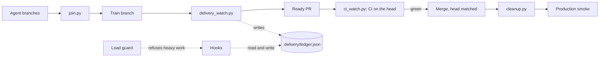
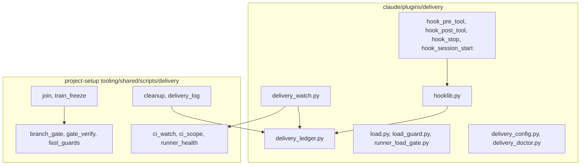

# Delivery guard rails

Related: [delivery speed](../delivery-speed/spec.md), [test cost](../test-cost/spec.md), [agents](../agents/spec.md), [artifacts](../artifacts/spec.md). The normative rules (DL-nn, Q-n) live in [DELIVERYSPEC](../../architecture/DELIVERYSPEC.md). This page does not copy them.

## 1. In one paragraph

`luismc-delivery` keeps a release train moving without the owner watching it. A ledger records trains, agents and questions. Hooks block a turn that leaves work half done. A background watcher pushes the next train, opens its pull request and merges it at green CI. A load guard keeps the machine under its memory and CPU limits. The shared delivery scripts do the gate, join, CI watch and cleanup. `luismc-project-setup` copies them into a product.

## 2. Why

Delivery lessons used to live in memory notes that an orchestrator had to remember. Notes are forgotten. Hooks are not. Goals:

- Turn each lesson into a check: a hook, a script or a ledger field.
- Never leave a green train unmerged, a merged branch uncleaned or a deploy unsmoked.
- Never crash the machine with parallel installs and test runs.

Non-goals: the plugin does not run the product's tests. It never kills, suspends or re-prioritises a process.

## 3. How it works

1. Agents work on branches. Each branch gets a gate result.
2. `join.py` merges trusted branches into a train branch. It runs a quick check.
3. The watcher pushes the train and opens the ready PR. It watches CI on the PR head.
4. When the current head is green, the watcher merges with `--match-head-commit`. It never uses `--auto`.
5. `cleanup.py` removes merged branches and worktrees. A smoke run on production closes the train.
6. Hooks read the ledger. At turn end, the Stop hook blocks on open items (for example a green unmerged train). A project with no `.delivery/` folder gets no delivery hooks.

## 5. Functional requirements

**R5.1** — With no `.delivery/` folder, every delivery hook does nothing except the machine load guard.

**R5.2** — The ledger `.delivery/ledger.json` is written only through `delivery_ledger.py`. The write is atomic, runs under a lock and carries `schema: 1`. Hooks never edit it by hand.

**R5.3** — The PostToolUse recorder fills the ledger from tool calls (agents, installs, publishes, questions, the owner's prompt time).

**R5.4** — The Stop hook blocks a turn end for each open finding. The same finding blocks at most `enforcement.block_ceiling` times (default 3), and at most `stop_repeat_limit` turns with no ledger change. After that, the hook prints one notice. In `warn` mode it blocks nothing.

**R5.5** — The PreToolUse hook denies the calls that DELIVERYSPEC lists (for example a local `Agent` launch without a `PC-bound:` reason, or a question dialog while work is actionable).

**R5.6** — SessionStart prints a short ledger summary and injects the question rules (Q-1 to Q-5). It says when no watcher has a fresh heartbeat.

**R5.7** — The watcher pushes the next joined train, opens its ready PR (or adopts the one open PR of a train pushed by hand), and merges only when the PR head is the commit whose required workflows (`watcher.ci_workflows`) all succeeded. A `hold` stops it.

**R5.8** — When `runner_plan` allows it, the watcher cancels CI runs that a newer push replaced. It also holds non-train CI runs while a train's CI runs.

**R5.9** — The load guard refuses a new heavy command with exit 2 while memory is above 85% or CPU above 60% (project file over machine file over defaults). It never touches a running process. If the machine cannot be measured, it allows the call with a warning.

**R5.10** — The runner hook `runner_load_gate.py` waits until the machine is under the limits, up to 30 minutes, then exits 1 (or lets the job run with `--on-timeout run`).

**R5.11** — `delivery_ledger.py smoke` and `cleaned` are the only writers of `smoke`, `live_at` and `cleaned_at`. `cleaned` records nothing while a train or cargo branch or worktree is left.

**R5.12** — `delivery_config.py validate` checks `.delivery/config.json` against `references/config-schema.json`. An unknown key is a warning. A wrong type is an error. `delivery_doctor.py` self-checks config, `gh`, time zone, hook registration, ledger and the runner hook.

**R5.13** — Shared scripts (generated into a product): `branch_gate.py` runs the gate and writes `gate-result.json`; `gate_verify.py` trusts a result only for the same head and base; `join.py` merges trusted branches and runs the quick check; `ci_watch.py` watches the runs of one head; `cleanup.py` removes merged branches; `train_freeze.py` refuses pushes to a train in CI. Exit codes are shared: 0 pass, 1 failed or untrusted, 2 usage, 3 join conflict, 4 timed out.

## 6. Non-functional requirements

**R6.1** — Every hook fails open on its own error. It prints a warning and exits 0, except a deliberate deny (exit 2).

**R6.2** — `CLAUDE_DELIVERY_HOOKS=off` disables all hooks. `checks_off` switches one rule off per project.

**R6.3** — Scripts use only the Python standard library and run on Linux, macOS and Windows.

**R6.4** — `.delivery/` is git-ignored. The ledger keeps events only as long as the project keeps the folder.

**R6.5** — The load measurement is cached for 10 seconds. CPU is the mean of up to 3 samples in 30 seconds, so one spike decides nothing.

## 7. Design

Hook events (`hooks/hooks.json`): PreToolUse (Bash, PowerShell, Agent, Workflow, RemoteTrigger, AskUserQuestion, Write), PostToolUse and PostToolUseFailure, UserPromptSubmit, Stop, SessionStart. Each hook runs `python3` and falls back to `python`.

Ledger fields: `trains`, `agents`, `jobs`, `installs`, `publishes`, `runners`, `watchers`, `owner_questions`, `events` (`references/ledger-schema.json`). A train moves through `planned`, `joining`, `joined`, `pushed`, `ci`, `green`, `merged`, `live`, `cleaned` (or `red`, `abandoned`). Only the watcher sets `green_at`.

`CONTRACT.md` lists the shared scripts, their paths in a product and their command lines. It sits next to the scripts. Change the contract first, then the code.

## 8. Failure modes

| Dependency | Fails | Why |
|---|---|---|
| `gh` or the network (hooks) | open | A hook must not stop work for an outage. It warns. |
| Machine measurement | open | The guard protects. It does not gate on a guess. |
| Ledger lock held too long | open, warns | A stale lock must not freeze a session. |
| `gh` in `ci_watch.py` | closed after repeated errors | A watch must not report green it did not see. |
| Gate result missing or stale | closed | An untrusted result is never a pass (exit 1). |
| `train_freeze.py` offline | open, warns | See [delivery speed](../delivery-speed/spec.md), D4. |
| Runner hook with no Python or a refusing PowerShell policy | job fails | The doctor reports it first; see the plugin README. |

## 9. How it is proven

| Requirement | Test |
|---|---|
| R5.1, R5.4, R5.5 | `claude/plugins/delivery/tests/test_stop.py`, `claude/plugins/delivery/tests/test_pre_tool.py`, `tools/test_delivery_hooks.py` |
| R5.2, R5.11 | `claude/plugins/delivery/tests/test_ledger.py` |
| R5.3 | `claude/plugins/delivery/tests/test_recording.py`, `claude/plugins/delivery/tests/test_post_tool.py` |
| R5.5 (questions) | `claude/plugins/delivery/tests/test_questions.py` |
| R5.6 | `claude/plugins/delivery/tests/test_brief_template.py`, `tools/test_rule_tags.py` |
| R5.7, R5.8 | `claude/plugins/delivery/tests/test_watch.py` |
| R5.9, R5.10, R6.5 | `claude/plugins/delivery/tests/test_load.py`, `tools/test_delivery_runner.py` |
| R5.12 | `claude/plugins/delivery/tests/test_config.py`, `claude/plugins/delivery/tests/test_doctor.py` |
| R5.13 | `tools/test_delivery_gate.py`, `tools/test_delivery_ci.py`, `tools/test_delivery_cleanup.py`, `tools/test_session_guard.py` |

Run: `python3 -I -m unittest discover -s claude/plugins/delivery/tests -t claude/plugins/delivery/tests` and `python3 -I tools/test_delivery_hooks.py`. For the shared scripts see `docs/testing.md`.

## 10. Decisions

| ID | Question | Chosen | Date |
|---|---|---|---|
| D1 | How are rules enforced? | Hooks inside sessions, scripts for time-critical steps (MADR 0030) | 2026-10-14 |
| D2 | When does the watcher merge? | At green on the current head, never `--auto` | 2026-10-14 |
| D3 | Do findings block or warn? | Block, with a ceiling | 2026-10-14 |
| D4 | Local or cloud agents? | Cloud first | 2026-10-14 |
| D5 | Machine limits? | 85% memory, 60% CPU, hold new work only (MADR 0031) | 2026-10-14 |

Decisions in MADR form: [0030](../../architecture/decisions/0030-delivery-hooks-and-watcher.md), [0031](../../architecture/decisions/0031-machine-load-guard.md). The full owner decisions are in DELIVERYSPEC section 5.

## 11. Not built yet

Some DL rules are advice only today. DELIVERYSPEC section 1 marks the ones that no mechanical check covers yet (for example DL-16, DL-17). A hook for them would go in `hook_stop.py` and `hook_pre_tool.py`.

## 12. Code map

Source: claude/plugins/delivery/scripts/
Source: claude/plugins/project-setup/skills/tech-stack-setup/assets/tooling/shared/scripts/delivery/

The plugin holds hooks, ledger, watcher, load guard and doctor. The shared folder holds gate, join, CI watch, cleanup and `CONTRACT.md`.

## Versions

Written by the release fold. Do not edit by hand.

| Version | Date | Release | What changed | Tasks |
|---|---|---|---|---|
| 0.2.1 | 2026-11-01 | RELEASE-26 | The load guard cache is now per user (under ~/.claude/) and written atomically through a private temp file. | DS164 |
| 0.2.0 | 2026-11-01 | RELEASE-25 | The watcher refuses a runner_plan script outside the repository root. The load guard no longer waits 1 s per fresh sample; CPU comes from the change since the previous cached sample. The delivery ledger now drops finished rows (closed trains, finished or disabled agents, finished installs, old events) older than 14 days when it writes. New optional config key ledger_retention_days sets the window; 0 keeps everything. Open rows are never dropped. | DS154, DS155, DS156 |
| 0.1.1 | 2026-11-01 | RELEASE-22 | Wording pass; requirements and IDs unchanged. | DS142 |
