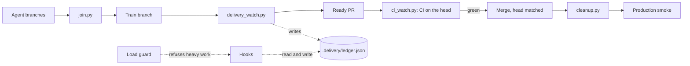
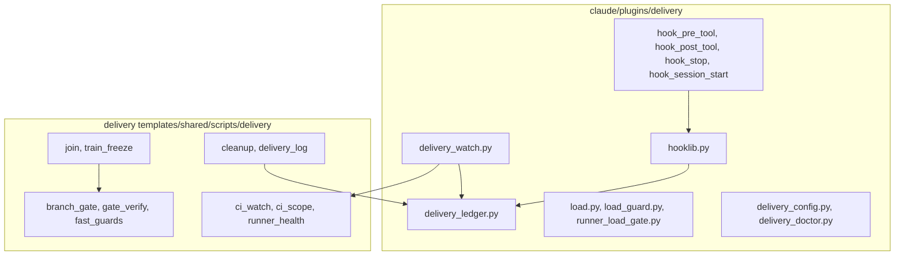
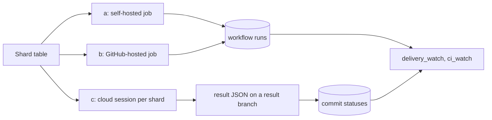

# Delivery guard rails

Related: [delivery speed](../delivery-speed/spec.md), [test cost](../test-cost/spec.md), [agents](../agents/spec.md), [artifacts](../artifacts/spec.md). The normative rules (DL-nn, Q-n) live in [DELIVERYSPEC](../../architecture/DELIVERYSPEC.md). This page does not copy them.

## 1. In one paragraph

`luismc-delivery` keeps a release train moving without the owner watching it. A ledger records trains, agents and questions. Hooks block a turn that leaves work half done. A background watcher pushes the next train, opens its pull request and merges it at green CI. A load guard keeps the machine under its memory and CPU limits. The shared delivery scripts do the gate, join, CI watch and cleanup. They live in `luismc-delivery` (`templates/`), and its installer writes them into a product; `luismc-project-setup` only calls the installer. The owner picks where CI runs, per OS (section 13).

## 2. Why

Delivery lessons used to live in memory notes that an orchestrator had to remember. Notes are forgotten. Hooks are not. Goals:

- Turn each lesson into a check: a hook, a script or a ledger field.
- Never leave a green train unmerged, a merged branch uncleaned or a deploy unsmoked.
- Never crash the machine with parallel installs and test runs.

Non-goals: the plugin does not run the product's tests. It never kills, suspends or re-prioritises a process.

## 3. How it works

1. Agents work on branches. Each branch gets a gate result.
2. `join.py` merges trusted branches into a train branch. It runs a quick check.
3. The watcher pushes the train and opens the ready PR. It watches CI on the PR head.
4. When the current head is green, the watcher merges with `--match-head-commit`. It never uses `--auto`.
5. `cleanup.py` removes merged branches and worktrees. A smoke run on production closes the train.
6. Hooks read the ledger. At turn end, the Stop hook blocks on open items (for example a green unmerged train). A project with no `.delivery/` folder gets no delivery hooks.

## 5. Functional requirements

**R5.1** — With no `.delivery/` folder, every delivery hook does nothing except the machine load guard.

**R5.2** — The ledger `.delivery/ledger.json` is written only through `delivery_ledger.py`. The write is atomic, runs under a lock and carries `schema: 1`. Hooks never edit it by hand.

**R5.3** — The PostToolUse recorder fills the ledger from tool calls (agents, installs, publishes, questions, the owner's prompt time).

**R5.4** — The Stop hook blocks a turn end for each open finding. The same finding blocks at most `enforcement.block_ceiling` times (default 3), and at most `stop_repeat_limit` turns with no ledger change. After that, the hook prints one notice. In `warn` mode it blocks nothing.

**R5.5** — The PreToolUse hook denies the calls that DELIVERYSPEC lists (for example a local `Agent` launch without a `PC-bound:` reason, or a question dialog while work is actionable).

**R5.6** — SessionStart prints a short ledger summary and injects the question rules (Q-1 to Q-5). It says when no watcher has a fresh heartbeat.

**R5.7** — The watcher pushes the next joined train, opens its ready PR (or adopts the one open PR of a train pushed by hand), and merges only when the PR head is the commit whose required workflows (`watcher.ci_workflows`) all succeeded. A `hold` stops it.

**R5.8** — When `runner_plan` allows it, the watcher cancels CI runs that a newer push replaced. It also holds non-train CI runs while a train's CI runs.

**R5.9** — The load guard refuses a new heavy command with exit 2 while memory is above 85% or CPU above 60% (project file over machine file over defaults). It never touches a running process. If the machine cannot be measured, it allows the call with a warning.

**R5.10** — The runner hook `runner_load_gate.py` waits until the machine is under the limits, up to 30 minutes, then exits 1 (or lets the job run with `--on-timeout run`).

**R5.11** — `delivery_ledger.py smoke` and `cleaned` are the only writers of `smoke`, `live_at` and `cleaned_at`. `cleaned` records nothing while a train or cargo branch or worktree is left.

**R5.12** — `delivery_config.py validate` checks `.delivery/config.json` against `references/config-schema.json`. An unknown key is a warning. A wrong type is an error. `delivery_doctor.py` self-checks config, `gh`, time zone, hook registration, ledger and the runner hook.

**R5.13** — Shared scripts (generated into a product): `branch_gate.py` runs the gate and writes `gate-result.json`; `gate_verify.py` trusts a result only for the same head and base; `join.py` merges trusted branches and runs the quick check; `ci_watch.py` watches the runs of one head; `cleanup.py` removes merged branches; `train_freeze.py` refuses pushes to a train in CI. Exit codes are shared: 0 pass, 1 failed or untrusted, 2 usage, 3 join conflict, 4 timed out.

**R5.14** — A branch that changes UI code or e2e specs runs the e2e specs of the screens it changed before it is done (DL-86). `branch_gate.py` records them in `gate-result.json` (`e2e`), `branch_gate.py --e2e-only` does it alone for an agent on the CI-gate path, `gate_verify.py` and `agent_ci.py` refuse a UI branch without a passing record for the head (DL-87), `e2e_push_check.py` in the pre-push hook refuses a push of changed e2e specs that were not run and passed (DL-88), and the launch check requires the brief to say so (DL-89).

## 6. Non-functional requirements

**R6.1** — Every hook fails open on its own error. It prints a warning and exits 0, except a deliberate deny (exit 2).

**R6.2** — `CLAUDE_DELIVERY_HOOKS=off` disables all hooks. `checks_off` switches one rule off per project.

**R6.3** — Scripts use only the Python standard library and run on Linux, macOS and Windows.

**R6.4** — `.delivery/` is git-ignored. The ledger keeps events only as long as the project keeps the folder.

**R6.5** — The load measurement is cached for 10 seconds. CPU is the mean of up to 3 samples in 30 seconds, so one spike decides nothing.

## 7. Design

Hook events (`hooks/hooks.json`): PreToolUse (Bash, PowerShell, Agent, Workflow, RemoteTrigger, AskUserQuestion, Write), PostToolUse and PostToolUseFailure, UserPromptSubmit, Stop, SessionStart. Each hook runs `python3` and falls back to `python`.

Ledger fields: `trains`, `agents`, `jobs`, `installs`, `publishes`, `runners`, `watchers`, `owner_questions`, `events` (`references/ledger-schema.json`). A train moves through `planned`, `joining`, `joined`, `pushed`, `ci`, `green`, `merged`, `live`, `cleaned` (or `red`, `abandoned`). Only the watcher sets `green_at`.

`CONTRACT.md` lists the shared scripts, their paths in a product and their command lines. It sits next to the scripts. Change the contract first, then the code.

## 8. Failure modes

| Dependency | Fails | Why |
|---|---|---|
| `gh` or the network (hooks) | open | A hook must not stop work for an outage. It warns. |
| Machine measurement | open | The guard protects. It does not gate on a guess. |
| Ledger lock held too long | open, warns | A stale lock must not freeze a session. |
| `gh` in `ci_watch.py` | closed after repeated errors | A watch must not report green it did not see. |
| Gate result missing or stale | closed | An untrusted result is never a pass (exit 1). |
| `train_freeze.py` offline | open, warns | See [delivery speed](../delivery-speed/spec.md), D4. |
| Runner hook with no Python or a refusing PowerShell policy | job fails | The doctor reports it first; see the plugin README. |

## 9. How it is proven

| Requirement | Test |
|---|---|
| R5.1, R5.4, R5.5 | `claude/plugins/delivery/tests/test_stop.py`, `claude/plugins/delivery/tests/test_pre_tool.py`, `tools/test_delivery_hooks.py` |
| R5.2, R5.11 | `claude/plugins/delivery/tests/test_ledger.py` |
| R5.3 | `claude/plugins/delivery/tests/test_recording.py`, `claude/plugins/delivery/tests/test_post_tool.py` |
| R5.5 (questions) | `claude/plugins/delivery/tests/test_questions.py` |
| R5.6, R5.14 | `claude/plugins/delivery/tests/test_brief_template.py`, `claude/plugins/delivery/tests/test_pre_tool.py`, `tools/test_rule_tags.py` |
| R5.7, R5.8 | `claude/plugins/delivery/tests/test_watch.py` |
| R5.9, R5.10, R6.5 | `claude/plugins/delivery/tests/test_load.py`, `tools/test_delivery_runner.py` |
| R5.12 | `claude/plugins/delivery/tests/test_config.py`, `claude/plugins/delivery/tests/test_doctor.py` |
| R13.1 to R13.9 | `claude/plugins/delivery/tests/test_ci_options.py`, `tools/test_delivery_cloud.py` |
| R5.13, R5.14 | `tools/test_delivery_gate.py`, `tools/test_delivery_ci.py`, `tools/test_delivery_cleanup.py`, `tools/test_session_guard.py` |

Run: `python3 -I -m unittest discover -s claude/plugins/delivery/tests -t claude/plugins/delivery/tests` and `python3 -I tools/test_delivery_hooks.py`. For the shared scripts see `docs/testing.md`.

## 10. Decisions

| ID | Question | Chosen | Date |
|---|---|---|---|
| D1 | How are rules enforced? | Hooks inside sessions, scripts for time-critical steps (MADR 0030) | 2026-10-14 |
| D2 | When does the watcher merge? | At green on the current head, never `--auto` | 2026-10-14 |
| D3 | Do findings block or warn? | Block, with a ceiling | 2026-10-14 |
| D4 | Local or cloud agents? | Cloud first | 2026-10-14 |
| D5 | Machine limits? | 85% memory, 60% CPU, hold new work only (MADR 0031) | 2026-10-14 |

Decisions in MADR form: [0030](../../architecture/decisions/0030-delivery-hooks-and-watcher.md), [0031](../../architecture/decisions/0031-machine-load-guard.md). The full owner decisions are in DELIVERYSPEC section 5.

## 11. Not built yet

Some DL rules are advice only today. DELIVERYSPEC section 1 marks the ones that no mechanical check covers yet (for example DL-16, DL-17). A hook for them would go in `hook_stop.py` and `hook_pre_tool.py`.

## 12. Code map

Source: claude/plugins/delivery/scripts/
Source: claude/plugins/delivery/templates/shared/scripts/delivery/
Source: claude/plugins/delivery/templates/

The plugin holds hooks, ledger, watcher, load guard, doctor, the CI option command and the installer. The templates folder holds the shared scripts (gate, join, CI watch, cleanup, the cloud shard runner and status poster), `CONTRACT.md`, the workflow files and each track's `gate.json` and `smoke.json`.

## 13. CI options

CI can run in three places. The owner picks one **per OS** (linux, windows, macos). The choice is stored in `.delivery/config.json` under `ci.options`. Every project uses the same CI contract; the option decides only where a shard runs and how its result comes back.

| Option | Name in config | Runs on | Result comes back as |
|---|---|---|---|
| a | `self-hosted` | GitHub Actions on the owner's runners | workflow run |
| b | `github-hosted` | GitHub Actions on GitHub's runners | workflow run |
| c | `cloud` | Claude cloud sessions: no Actions, no webhooks | commit status |

**R13.1** — There is no default option. Setup asks the owner once for each OS the product tests on and records the answer with `delivery_ci.py set --os <os> --option a|b|c`. The same command changes the choice later (`unset` clears it). An OS with no answer is "not chosen".

**R13.2** — All three options use one **shard table**, `scripts/delivery/ci-shards.json` (path set by `ci.shard_table`). Each shard has an `id`, an `os` and `commands`. It may also have a `context`, the check name it reports under; the `id` is the fallback. The table may name test commands under `tests`; a command `@name` expands to one. The product owns the table. The format is in `CONTRACT.md`.

**R13.3** — The CI and delivery templates live only in `luismc-delivery` (`templates/`). `delivery_ci_install.py install` writes the ones that are missing; `update` overwrites the plugin-owned scripts and keeps the files the project edits (`gate.json`, `smoke.json`, the area and timing maps, `ci.yml`, `package.yml`, `ci-shards.json`). Neither command commits, pushes or chooses an option. `tech-stack-setup` calls the installer at the end of its setup and copies none of these files itself.

**R13.4** — Option a keeps the config keys `runners` and `local_runners`, the runner repair loop and the runner load gate. Option b needs workflow files in `.github/workflows/`. Neither needs anything else.

**R13.5** — Option c uses only cloud sessions. A launcher session starts one shard session per missing shard through the routines API (`RemoteTrigger` create, run, then disable). A scheduled cloud routine watches the heads of the branches in `ci.cloud.branches` with plain git (`cloud_status.py pending`). It starts no GitHub Actions run and needs no webhook.

**R13.6** — A cloud shard runs its commands in order from the repository root, stops at the first failure and writes a result JSON (`schema`, `shard`, `context`, `os`, `sha`, `state`, `started`, `finished`, `commands`, `summary`). `state` is `success`, `failure` or `error`. `error` (wrong OS, HEAD not the requested sha, bad table) is never a pass. With `--push` the result is published as the only file of a new branch `<results_prefix>/<sha>/<shard id>` (default prefix `ci-result`); each (sha, shard) has its own branch, so shards never conflict.

**R13.7** — The one GitHub dependency of option c is the commit status: `POST /repos/{owner}/{repo}/statuses/{sha}` with the shard's `context`, the result's `state` and a description of at most 140 characters. The contexts are the names the required checks use. The token is a statuses-only token the owner creates. It is read from the environment variable named by `ci.cloud.status_token_env` and is never written to a file or printed. A status is posted only for the `sha` in the result; a result for another sha is refused.

**R13.8** — The watcher reads results the same way for all three options. A train is green when, for the PR head, the newest result of every required check is `success`: each workflow of `watcher.ci_workflows` (a, b) and each cloud context of the shard table (c). A missing result is not green; a failed or errored one is red. When every chosen OS is cloud, no workflow is read. `ci_watch.py SHA --context NAME` waits for statuses with the exit codes of the workflow watch (0 pass, 1 failed, 4 timed out).

**R13.9** — `delivery_doctor.py` has a `ci` check. It fails when the shard table has a shard for an OS that was not chosen. For a it needs a `runners` entry for the OS; for b a workflow file; for c `ci.cloud.repo`, `status_token_env` and `branches`, a shard table, and one context per cloud shard. A missing token variable is a note, not a failure, because the token lives in the cloud environment. With nothing chosen and no shard table the check passes with a note.

**R13.20** — Windows. Only a test that needs a real Windows machine runs on Windows. `windows-real.json` lists those files (with a `marker`, a `cap` and `max_minutes`), and `windows_real.py check` fails when a listed file is gone or has lost its marker, when the table is over its cap, and when an `os: windows` shard is anything but `"set": "windows-real"` running only `@windows-real`. The Linux MSI recipe (`windows-msi-linux.sh`, `windows-msi-check.yml`) is optional and a CI check only: the shipped MSI is built on Windows, because Wine cannot write LZX (the recipe uses `mszip`). It is reopened once a Windows install smoke passes on the Linux-built file at each release. Installers are held until the publish succeeds: `package-windows.yml` cleans up only when no job failed or was cancelled, `artifact_prune.py --hold NAME --hold-workflow FILE` keeps every artifact of NAME while the newest run of that workflow has not succeeded, and `publish_token.py` retries a 5xx token answer after 1, 2 and 4 seconds. A `smoke.json` with `"installer": true` must name a `rollback_check`, the command that proves an update leaves a verified copy of the running version.

The cloud runner (`cloud_shard.py`) and the poster (`cloud_status.py`) are **starters**: small, tested versions of this contract. A product may contribute a proven runner later. It keeps the result JSON, the result branch name and the status rules.

Failure modes of option c:

| What fails | Result |
|---|---|
| A shard session dies | No result branch. The head stays not green. The watcher routine starts the shard again after `ci.cloud.shard_timeout_min`. |
| The status token is missing or wrong | `cloud_status.py` exits 2 and posts nothing. The head stays not green. |
| A new push moves the branch | Results of the old sha are ignored. The new head needs its own. |

## Versions

Written by the release fold. Do not edit by hand.

| Version | Date | Release | What changed | Tasks |
|---|---|---|---|---|
| 0.3.0 | 2026-11-02 | RELEASE-34 | New section 13, CI options: the owner picks GitHub self-hosted runners, GitHub-hosted runners or Claude cloud sessions per OS, with no default. All three use one shard table; the watcher reads workflow runs for a and b and commit statuses for c. The CI and delivery templates moved from tech-stack-setup into luismc-delivery (templates/) with an installer; the doctor has a ci check. | DL15 |
| 0.2.2 | 2026-11-01 | RELEASE-27 | The DL-76 Stop check remembers its verdict per merge commit in .delivery/state/dl76-checked.json, skips skipped runs, and checks at most 3 trains per turn end. The merge check (DL-06) reads only the newest run of each workflow on a pull request's head and counts a skipped run as passing; a failed, cancelled or timed-out newest run still blocks the merge. | DS167, DS34-dl06-skipped-runs |
| 0.2.1 | 2026-11-01 | RELEASE-26 | The load guard cache is now per user (under ~/.claude/) and written atomically through a private temp file. | DS164 |
| 0.2.0 | 2026-11-01 | RELEASE-25 | The watcher refuses a runner_plan script outside the repository root. The load guard no longer waits 1 s per fresh sample; CPU comes from the change since the previous cached sample. The delivery ledger now drops finished rows (closed trains, finished or disabled agents, finished installs, old events) older than 14 days when it writes. New optional config key ledger_retention_days sets the window; 0 keeps everything. Open rows are never dropped. | DS154, DS155, DS156 |
| 0.1.1 | 2026-11-01 | RELEASE-22 | Wording pass; requirements and IDs unchanged. | DS142 |
