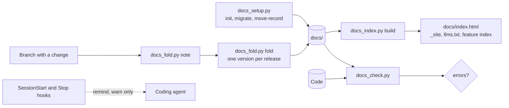
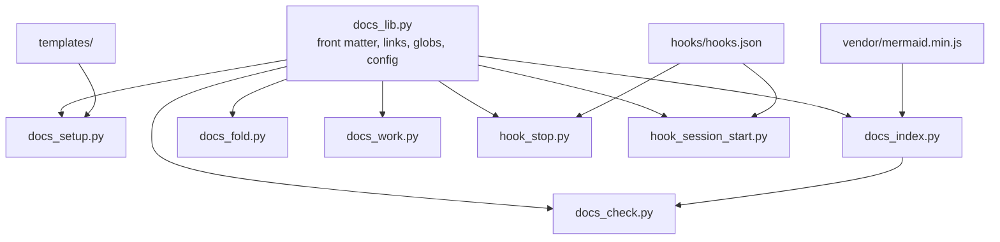

# Documentation standard plugin (luismc-docs)

The normative rules are in [DOCSPEC](../../../claude/plugins/docs/references/docspec.md). This page says what the plugin does and how it is proven. It does not copy the rules.

## 1. In one paragraph

`luismc-docs` puts a project's documents where each reader expects them and keeps them true to the code. It lays out `docs/`. It builds an offline site with search. It folds one-line change notes into one version per release. It checks links, `Source:` lines and freshness. It warns the coding agent when code changed without its docs.

## 2. Why

Documents scatter and go stale. They pile up as briefs and reports that nobody rereads. A person cannot tell which page is true. DOCSPEC (sections 0.1 and 2) sets the layout and the checks. The plugin makes them mechanical.

Goals: one layout for every project, no server to browse it, checks that a gate can enforce, and nothing specific to one project.

Non-goals: the content of a project's docs, publishing to a web host, the artifacts record, and how work is delivered.

## 3. How it works

1. `docs-setup` lays out a new repo, or moves an existing one with `git mv` (dry run first).
2. The agent writes feature specs with `feature-spec-new`.
3. `docs-index` builds the site and the generated files.
4. `docs-note` adds one change note per task. The release fold turns the notes into a version row.
5. `docs-check` runs on every branch gate. The hooks only remind.

Skills: `docs-setup`, `feature-spec-new`, `docs-index`, `docs-check`, `docs-note`. Scripts: `docs_setup.py`, `docs_index.py`, `docs_fold.py`, `docs_check.py`, `docs_work.py`, `docs_lib.py`, `hook_stop.py`, `hook_session_start.py`.

## 5. Functional requirements

**R5.1** — `docs_setup.py migrate` prints a plan and changes nothing unless `--apply` is given. With `--apply`, it moves files with `git mv`, rewrites relative links and never deletes a file (DOCSPEC R9.1 to R9.3).

**R5.2** — `docs_setup.py migrate` run twice changes nothing the second time. A move whose target exists is skipped and kept (DOCSPEC R9.3).

**R5.3** — `docs_setup.py init` creates the layout in a repository that has none. It never overwrites a file (DOCSPEC R9.7).

**R5.4** — `docs_setup.py move-record` moves the artifacts record to `record_dir` and points the artifacts plugin at it (DOCSPEC R9.6).

**R5.5** — `docs_index.py build` writes `docs/index.html`, one page per lasting doc, `features/index.md`, `decisions.md`, `docs-map.json` and `llms.txt`. The output is deterministic. It opens from `file://` (DOCSPEC R6.1 to R6.3).

**R5.6** — `docs_index.py build` does not index `docs/work/`, `docs/_site/` or change notes (DOCSPEC R6.7).

**R5.7** — `docs_index.py check` reports a stale generated file (DOCSPEC R6.3).

**R5.8** — `docs_fold.py note` refuses an unknown doc, a duplicate and a multi-line note (DOCSPEC R7.1, R7.2).

**R5.9** — `docs_fold.py fold` bumps each doc's version once per release, using the highest change. It writes one version row and deletes the folded notes. `--dry-run` changes nothing (DOCSPEC R7.3, R7.4).

**R5.10** — `docs_check.py` reports layout, front matter, link, image, `Source:`, test-path, version-table, generated-file, map and `docs/work/` findings. It exits 1 on any error (DOCSPEC R8.1).

**R5.11** — `docs_check.py` warns on stale or missing `last_verified`, code newer than its doc, and a spec with no diagram. `--strict` turns warnings into failures (DOCSPEC R8.2).

**R5.12** — `docs_work.py guard` exits 1 when a branch adds files under `docs/work/`. `strip` and `summaries` serve the join step (DOCSPEC R10.2, R10.3).

**R5.13** — The Stop hook prints a warning, never a block, when mapped code changed without docs. The SessionStart hook adds the docs rule. Both do nothing without `docs/docs.json`. Both fail open on error (DOCSPEC R8.7).

## 6. Non-functional requirements

**R6.1** — The scripts use only the Python standard library and run on Python 3.9 or later (DOCSPEC R12.4).

**R6.2** — The checks read Markdown, JSON, git and named paths only. They run a project command only for `generated_reference` (DOCSPEC R8.4).

## 7. Design

Settings live in the project's `docs/docs.json` (DOCSPEC R12.3). The plugin works without the delivery or artifacts plugins (DOCSPEC R12.2). Mermaid 11.4.1 is committed, so diagrams render offline.

## 8. Failure modes

- Hooks fail open. An error or a missing `docs/docs.json` means no output. The gate blocks, not the hook.
- `docs_check.py` fails closed: any error exits 1.
- Missing Mermaid copy: a block shows as readable source, with a note.
- A move collision: the file is kept. The run exits 2.

## 9. How it is proven

| Requirement | Test |
|---|---|
| R5.1, R5.2, R5.3, R5.4 | `claude/plugins/docs/tests/test_setup.py` |
| R5.5, R5.6, R5.7 | `claude/plugins/docs/tests/test_index.py` |
| R5.8, R5.9 | `claude/plugins/docs/tests/test_fold.py` |
| R5.10, R5.11 | `claude/plugins/docs/tests/test_check.py` |
| R5.12 | `claude/plugins/docs/tests/test_work.py` |
| R5.13 | `claude/plugins/docs/tests/test_hooks.py` |
| R6.1, R6.2 | `claude/plugins/docs/tests/test_lib.py` |

Run: `python3 -I -m unittest discover -s claude/plugins/docs/tests`.

## 10. Decisions

| ID | Question | Chosen | Date |
|---|---|---|---|
| 0001-docs-rewrite | Rewrite every doc to DOCSPEC? | Yes, requirement IDs kept | 2026-10-31 |

The standard's own decision table is DOCSPEC D1 to D15.

## 11. Not built yet

NOT YET IMPLEMENTED: U1 as an error (it is a warning until the owner decides). `test_lib.py` proves R6.1 and R6.2 only in part. No test checks the Python 3.9 floor.

## 12. Code map

Source: claude/plugins/docs/references/docspec.md
Source: claude/plugins/docs/scripts/docs_setup.py
Source: claude/plugins/docs/scripts/docs_index.py
Source: claude/plugins/docs/scripts/docs_fold.py
Source: claude/plugins/docs/scripts/docs_check.py
Source: claude/plugins/docs/scripts/docs_work.py
Source: claude/plugins/docs/scripts/docs_lib.py
Source: claude/plugins/docs/scripts/hook_stop.py
Source: claude/plugins/docs/scripts/hook_session_start.py
Source: claude/plugins/docs/hooks/hooks.json
Source: claude/plugins/docs/templates/feature-spec.md

## Versions

Written by the release fold. Do not edit by hand.

| Version | Date | Release | What changed | Tasks |
|---|---|---|---|---|
| 0.1.2 | 2026-11-01 | RELEASE-24 | The front-matter parser reads block lists, so the docs map is no longer empty for specs that list code paths. | DS150 |
| 0.1.1 | 2026-11-01 | RELEASE-22 | Wording pass; requirements and IDs unchanged. | DS142 |
