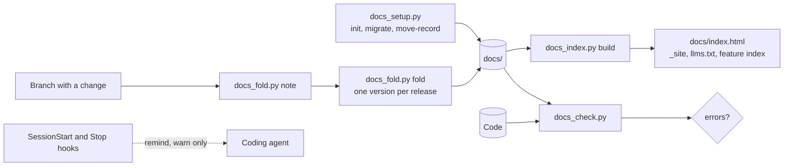
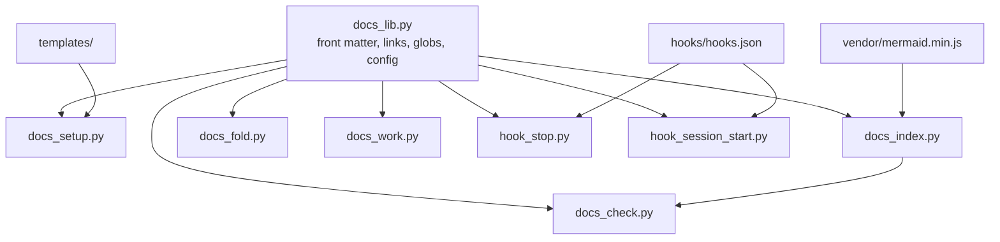

# Documentation standard plugin (luismc-docs)

The normative rules are in [DOCSPEC](../../../claude/plugins/docs/references/docspec.md). This page says what the plugin does and how it is proven. It does not copy the rules.

## 1. In one paragraph

`luismc-docs` puts a project's documents where each reader expects them and keeps them true to the code. It lays out `docs/`. It builds an offline site with search. It folds one-line change notes into one version per release. It checks links, `Source:` lines and freshness. It warns the coding agent when code changed without its docs. Since DS219 it also holds what `luismc-artifacts` and `luismc-specs` did: the project record and artifacts (see [Project artifacts](../artifacts/spec.md)) and the `spec-new` and `spec-check` skills (see [Spec authoring and checking](../specs/spec.md)). Those two plugins left the marketplace. Their skills are `luismc-docs:<skill>` now.

## 2. Why

Documents scatter and go stale. They pile up as briefs and reports that nobody rereads. A person cannot tell which page is true. DOCSPEC (sections 0.1 and 2) sets the layout and the checks. The plugin makes them mechanical.

Goals: one layout for every project, no server to browse it, checks that a gate can enforce, and nothing specific to one project.

Non-goals: the content of a project's docs, publishing to a web host, and how work is delivered.

## 3. How it works

1. `docs-setup` lays out a new repo, or moves an existing one with `git mv` (dry run first).
2. The agent writes feature specs with `feature-spec-new`.
3. `docs-index` builds the site and the generated files.
4. `docs-note` adds one change note per task. The release fold turns the notes into a version row.
5. `docs-check` runs on every branch gate. The hooks only remind.

`docs-setup` and `design-system-setup` follow the setup pattern (plan first, do the work after a yes, one line per step, a summary with Done, Left for you and What you can do now, safe to run again). See [the setup skills guide](../../guides/setup-skills.md) for a flow of each.

Skills: `docs-setup`, `feature-spec-new`, `docs-index`, `docs-check`, `docs-note`. Scripts: `docs_setup.py`, `docs_index.py`, `docs_fold.py`, `docs_check.py`, `docs_work.py`, `docs_lib.py`, `hook_stop.py`, `hook_session_start.py`.

## 5. Functional requirements

**R5.1** — `docs_setup.py migrate` prints a plan and changes nothing unless `--apply` is given. With `--apply`, it moves files with `git mv`, rewrites relative links and never deletes a file (DOCSPEC R9.1 to R9.3).

**R5.2** — `docs_setup.py migrate` run twice changes nothing the second time. A move whose target exists is skipped and kept (DOCSPEC R9.3).

**R5.3** — `docs_setup.py init` creates the layout in a repository that has none. It never overwrites a file (DOCSPEC R9.7).

**R5.4** — `docs_setup.py move-record` moves the artifacts record to `record_dir` and points the artifacts plugin at it (DOCSPEC R9.6).

**R5.5** — `docs_index.py build` writes `docs/index.html`, one page per lasting doc, `features/index.md`, `decisions.md`, `docs-map.json` and `llms.txt`. The output is deterministic. It opens from `file://` (DOCSPEC R6.1 to R6.3).

**R5.6** — `docs_index.py build` does not index `docs/work/`, `docs/_site/` or change notes (DOCSPEC R6.7).

**R5.7** — `docs_index.py check` reports a stale generated file (DOCSPEC R6.3).

**R5.8** — `docs_fold.py note` refuses an unknown doc, a duplicate and a multi-line note (DOCSPEC R7.1, R7.2).

**R5.9** — `docs_fold.py fold` bumps each doc's version once per release, using the highest change. It writes one version row and deletes the folded notes. `--dry-run` changes nothing (DOCSPEC R7.3, R7.4).

**R5.9a** — A doc with a `**Version:** X.Y.Z` line and no `version:` front matter is folded in place. The fold bumps that line, adds a row only to an existing `## Versions` or `## Change log` table, and adds no front matter. A doc with both a front matter `version:` and a `**Version:**` line is refused. Test: `claude/plugins/docs/tests/test_dl243_version_line.py`.

**R5.10** — `docs_check.py` reports layout, front matter, link, image, `Source:`, test-path, version-table, generated-file, map and `docs/work/` findings. It exits 1 on any error (DOCSPEC R8.1).

**R5.11** — `docs_check.py` warns on stale or missing `last_verified`, code newer than its doc, and a spec with no diagram. `--strict` turns warnings into failures (DOCSPEC R8.2).

**R5.11a** — The "code newer than its doc" warning (T2) gives the same result on a developer machine, in CI and on a pull request merge ref. It compares UTC dates of the last non-merge commit for the code and for the doc, so a commit's time zone and a merge commit dated "now" change nothing. On a shallow clone the dates are wrong, so T2 is skipped and one info line goes to stderr; fetch full history to run it.

**R5.12** — `docs_work.py guard` exits 1 when a branch adds files under `docs/work/`. `strip` and `summaries` serve the join step (DOCSPEC R10.2, R10.3).

**R5.13** — The Stop hook prints a warning, never a block, when mapped code changed without docs. The SessionStart hook adds the docs rule. Both do nothing without `docs/docs.json`. Both fail open on error (DOCSPEC R8.7).

**R5.14** — `design_system.py components` copies the opt-in React and TypeScript templates (`DatePicker`, `TimePicker` with units `h`, `hm` or `hms`, `NumberKeypad`) with their unit tests, never overwrites a file, and adds one numbered section per component to `next-version/components.md` with one `CHANGES.md` entry. It adds each component's words to the "Component words" table of `content.md`, with no duplicates. A rerun adds nothing. The gallery draws the three components. The templates use tokens only, and their tests pass and typecheck in a fresh project (DOCSPEC R15.10).

**R5.15** — The design-system starter has rule UX-56: dates use the date picker, times the time picker, and the number keypad only counts, measures and codes; never a native date, time or number input. The enforcement kit has a raw-inputs guard that fails on `type="date"`, `"time"`, `"datetime-local"` and `"number"` and honours its known list (DOCSPEC R15.11).

**R5.16** — Every page the plugin generates shows `luismc-docs X.Y.Z` in the top right of its header with a flag: green `latest`, amber `update: X.Y.Z` when a newer version is published, or neutral `latest: unknown`. The state is judged at build time from the local marketplace clone (`~/.claude/plugins/marketplaces/<name>/`); the network is never read. One module, `gen_badge.py`, serves every renderer: the site (`docs/index.html` and `_site`), the design-system gallery and the record pages. `features/index.md`, `decisions.md` and `llms.txt` get one header line, `Generated by luismc-docs X.Y.Z (state)`. The freshness checks (`docs_index.py check`, `docs_check.py` G1, and the record's INV-3) ignore that line and the flag, so a build with a clone and one without agree. A feature spec made from the template gets `generator: luismc-docs X.Y.Z`; an existing spec is never rewritten.

**R5.17** — Every generated page uses the default page, surface, ink and line colours of `design/default-design.css`, in light and dark. A project's `design.css` may change accents only: its `--paper`, `--surface`, `--surface-2`, `--ink`, `--ink-muted`, `--rule`, `--rule-strong` and size tokens are dropped when the page is drawn, and the token check warns that they are ignored. The site and the gallery use the same page colours.

**R5.18** — Font sizes in the plugin's pages are 0.9 times the earlier ones: the base is 14.4px, and px and `clamp()` sizes are scaled (`rem` sizes follow the base). Pages drawn in a project's design-system gallery keep that project's own size tokens.

## 6. Non-functional requirements

**R6.1** — The scripts use only the Python standard library and run on Python 3.9 or later (DOCSPEC R12.4).

**R6.2** — The checks read Markdown, JSON, git and named paths only. They run a project command only for `generated_reference` (DOCSPEC R8.4).

## 7. Design

Settings live in the project's `docs/docs.json` (DOCSPEC R12.3). The plugin works without the delivery or artifacts plugins (DOCSPEC R12.2). Mermaid 11.4.1 is committed, so diagrams render offline.

## 8. Failure modes

- Hooks fail open. An error or a missing `docs/docs.json` means no output. The gate blocks, not the hook.
- `docs_check.py` fails closed: any error exits 1.
- Missing Mermaid copy: a block shows as readable source, with a note.
- A move collision: the file is kept. The run exits 2.

## 9. How it is proven

| Requirement | Test |
|---|---|
| R5.1, R5.2, R5.3, R5.4 | `claude/plugins/docs/tests/test_setup.py` |
| R5.5, R5.6, R5.7 | `claude/plugins/docs/tests/test_index.py` |
| R5.8, R5.9 | `claude/plugins/docs/tests/test_fold.py` |
| R5.10, R5.11 | `claude/plugins/docs/tests/test_check.py` |
| R5.12 | `claude/plugins/docs/tests/test_work.py` |
| R5.13 | `claude/plugins/docs/tests/test_hooks.py` |
| R5.14 | `claude/plugins/docs/tests/test_components.py`, `tools/test_ds_guard_templates.py` |
| R5.15 | `claude/plugins/docs/tests/test_components.py`, `tools/test_ds_guard_templates.py` |
| R5.16, R5.17, R5.18 | `claude/plugins/docs/tests/test_dl239_badge_colour_fonts.py` |
| R6.1, R6.2 | `claude/plugins/docs/tests/test_lib.py` |

Run: `python3 -I -m unittest discover -s claude/plugins/docs/tests`.

## 10. Decisions

| ID | Question | Chosen | Date |
|---|---|---|---|
| 0001-docs-rewrite | Rewrite every doc to DOCSPEC? | Yes, requirement IDs kept | 2026-10-31 |

The standard's own decision table is DOCSPEC D1 to D15.

## 11. Not built yet

NOT YET IMPLEMENTED: U1 as an error (it is a warning until the owner decides). `test_lib.py` proves R6.1 and R6.2 only in part. No test checks the Python 3.9 floor.

## 12. Code map

Source: claude/plugins/docs/references/docspec.md
Source: claude/plugins/docs/scripts/docs_setup.py
Source: claude/plugins/docs/scripts/docs_index.py
Source: claude/plugins/docs/scripts/docs_fold.py
Source: claude/plugins/docs/scripts/docs_check.py
Source: claude/plugins/docs/scripts/docs_work.py
Source: claude/plugins/docs/scripts/docs_lib.py
Source: claude/plugins/docs/scripts/hook_stop.py
Source: claude/plugins/docs/scripts/hook_session_start.py
Source: claude/plugins/docs/hooks/hooks.json
Source: claude/plugins/docs/templates/feature-spec.md

## Versions

Written by the release fold. Do not edit by hand.

| Version | Date | Release | What changed | Tasks |
|---|---|---|---|---|
| 1.2.0 | 2026-11-11 | RELEASE-106 | mark-deferred writes and opens a local Full Progress page; the end-of-turn hook prints its path while deferred. | DL238 |
| 1.1.1 | 2026-11-11 | RELEASE-102 | T2 compares UTC dates of non-merge commits, so CI and local runs agree; T2 is skipped with an info line on a shallow clone. | DL219 |
| 1.1.0 | 2026-11-11 | RELEASE-96 | Full Progress page is lighter: a windowed embedded registry, one line for older Live rows, no per-cell data-label (ARTIFACTSPEC R5.9, R6.3). | AR69 |
| 1.0.0 | 2026-11-10 | RELEASE-86 | luismc-docs now holds the project record, artifacts and the spec skills; luismc-artifacts and luismc-specs leave the marketplace (D182, D185, D186). | DS219 |
| 0.10.1 | 2026-11-09 | RELEASE-71 | docs_work.py strip --apply commits the docs/work/ removal, or exits 1 and says what is left staged. | DS193 |
| 0.10.0 | 2026-11-07 | RELEASE-64 | design_system.py components installs the opt-in DatePicker, TimePicker and NumberKeypad templates (React and TypeScript) with their spec sections (R5.14). The design-system starter has rule UX-56 and the enforcement kit a raw-inputs guard (no native date, time or number input); design_system.py components adds the component words to content.md; the gallery draws the date picker, the time picker and the number keypad (R5.14, R5.15). | UXC24, UXC27 |
| 0.9.0 | 2026-11-05 | RELEASE-47 | The design-system starter has rules UX-49 to UX-55, extended rules, and a wizard state word table. The design-system starter adds a Looks line per component, a change review component, a filter bar, text-on-fill token pairs, more motion tokens, tokens per width, closed border widths and a weight ceiling per type role. The docs scripts accept a lone --; DS4 is information only on a task branch; design_system.py relink accepts link-only edits of an approved version; new drafts show where CHANGES.md entries go; the version README has a section for what the apps do not follow yet. The design-system enforcement kit adds a raw-controls guard (no raw button, input, select or textarea in app code) and a contrast guard (WCAG 2.2 AA for text-on-fill token pairs in every theme), each with a known list that only shrinks. The offline design-system gallery draws the change review component and the list-toolbar filter bar, and shows text-on-fill pairs with contrast, motion, per-width tokens, border widths and type weights. | DU2, DU3, DU4, DU5, DU6 |
| 0.8.0 | 2026-11-05 | RELEASE-46 | The design-system template has a full Dialog and sheet component and rules UX-43 to UX-48. | DS189 |
| 0.7.0 | 2026-11-05 | RELEASE-45 | Design-system enforcement kit templates (TypeScript and Vitest only; no app CSS scan, DOM layout checker, wizard harness with ten required states), a UI brief checklist written by design_system.py brief, and R15.9. | DSY99 |
| 0.6.2 | 2026-11-05 | RELEASE-43 | Design system versions moved to docs/archive/ are not a numbering gap. | DS187 |
| 0.6.1 | 2026-11-04 | RELEASE-42 | Review fixes: new files listed one by one, UTF-8 git output, BOM ignored, own-doc notes only clear M1, real default branch recorded, no-base warning, real approval dates. | DS184 |
| 0.6.0 | 2026-11-04 | RELEASE-37 | docs-setup and design-system-setup follow the setup pattern: plan first, one line per step, and a Done, Left for you, What you can do now summary. | DL33 |
| 0.5.0 | 2026-11-02 | RELEASE-33 | The docs plugin rebuilds a stale next-version design-system gallery at session start and at Stop. | ST5 |
| 0.4.0 | 2026-11-02 | RELEASE-32 | The design-system gallery draws swatches with contrast, type, spacing, radius and every starter component, light and dark; an older gallery script makes next-version stale (DS4). | ST4 |
| 0.3.0 | 2026-11-01 | RELEASE-29 | The starter design system adds the wizard end (Review, the work, Done), generic components, rules UX-30 to UX-42 and more token kinds; Check is retired. | ST3 |
| 0.2.2 | 2026-11-01 | RELEASE-28 | The README install line now uses --scope project. | SO4 |
| 0.2.1 | 2026-11-01 | RELEASE-27 | The Stop hook runs fewer git calls and skips the check when nothing changed since the last turn end; it warns in the same cases. | DS169 |
| 0.2.0 | 2026-11-01 | RELEASE-25 | The docs plugin gains the design-system-setup skill and design_system.py: it lays out docs/design-system (version folders, approvals.json, review visuals), promotes an approved next-version and adds the DS1-DS5 checks (DOCSPEC section 15). The docs gate prints each generated_reference command before running it. fetch-mermaid checks the downloaded mermaid.min.js against a pinned SHA-256 and refuses on a mismatch. feature-spec-new is stated as the one skill that writes every feature spec. The design system starter is now a full, project-neutral set: about 29 UX rules, 20 components, light and dark tokens and an action vocabulary. A read-only design_system.py styles command lists the project's style files. | DOC17-design-system-skill, DS154, DS161, SO3, ST2 |
| 0.1.2 | 2026-11-01 | RELEASE-24 | The front-matter parser reads block lists, so the docs map is no longer empty for specs that list code paths. | DS150 |
| 0.1.1 | 2026-11-01 | RELEASE-22 | Wording pass; requirements and IDs unchanged. | DS142 |
