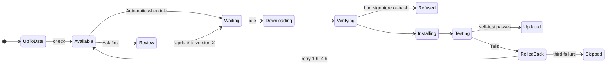

# Install, update and remove

## 1. In one paragraph

Every project with a local app (a service, a tray icon, a local console) installs, updates and removes it the same way, in its own look. A contract file in the design system, `lifecycle.json`, holds the states, words, defaults, paths and the systems the project ships for. Shared templates give the screens and the updater core. Checks LC-1 to LC-33 fail the build when a project leaves the contract. They run only for the systems the project ships for. A project may turn a check off only with a recorded owner decision.

## 2. Why

Each project built its own installer, updater, words and remove dialog, and each agent suggested something new. A study of three projects found three update engines, three retry rules, three remove dialogs and design-system rules for updates with no tests behind them. Notes did not stop the drift, so the standard is a contract with checks. The shared contract for the build is [lifecycle-contract](../../architecture/lifecycle-contract.md).

## 3. How it works

### Decisions (owner, 21 Nov 2026)

| ID | Decision |
|---|---|
| D-a | The OS package (msi, deb, rpm, pkg) is the update. The updater runs it silently. |
| D-b | Two policies: Automatic when idle (default, any idle time, optional time window) and Ask first. Required updates always install. |
| D-c | After a failed update test the old version runs again. Retry after 1 h, then 4 h; after the third failure, wait for a newer version. |
| D-d | A signed-in owner may start an install from any device. Every check, install, rollback and remove is audited with actor and result. |
| D-e | Remove asks every time with no default: Remove stays disabled until Keep my data or Delete my data too is chosen. A silent remove keeps data; `PURGE=1`, `apt purge` or `--delete-data` deletes it. |
| D-f | A signed manifest (Ed25519), SHA-256 and build provenance now. OS code signing per product by owner decision. |
| D-g | The web console comes first. One native window shows progress and questions. The tray only notifies. |
| D-h | Checks are on and block by default. An opt-out needs a decision ID, a reason and a review date. |
| D-i | Checks run only for the systems and distributions in the project's `targets`. Where test runs execute is the project's choice. |
| D-j | The design-system guards of DS234 block at once, with no warning period. |

### Parts

| Part | Plugin | What it does |
|---|---|---|
| `lifecycle.json` schema, starter and `words.json` | luismc-docs | The contract per project; words per state; banned words |
| UI part templates (React, Rust) | luismc-docs | Update banner, Updates card, history, remote update, remove dialog, fleet rows, native question window, tray model |
| Design-system guards | luismc-docs | Rendered layout and overlap, spacing tokens, layout roles, "none yet" limit, cited rule names its test, lifecycle UI guards |
| Updater test interface and conformance runner | luismc-delivery | A black-box run of the update flow against a fake signed update server |
| Updater core templates (Rust, Go) | luismc-delivery | State machine, manifest check, retry timer, policies, audit events |
| OS step scripts and lanes template | luismc-delivery | Install, upgrade, broken update, rollback, remove, purge and leftover scan per system |
| Release check and opt-out report | luismc-delivery | A release fails unless every target's lane passed; opt-outs listed with their cost |

### Flow

## 4. Requirements

**R1.1** — A project with a local app keeps `lifecycle.json` in its design system, valid against the schema (LC-1).

**R1.2** — Every lifecycle UI string comes from the words table and no banned word appears (LC-2, LC-31).

**R1.3** — The updater passes the conformance runner (LC-3 to LC-7, LC-25, LC-26, LC-28).

**R1.4** — Each target in `targets` passes its lane: install, upgrade, broken update and rollback, downgrade refused, remove, purge, leftover scan and package lints (LC-8 to LC-21, LC-29, LC-32, LC-33). A system not in `targets` is not checked.

**R1.5** — The UI parts use the shared templates and tokens only and render without overlap or clipping (LC-22 to LC-24, LC-30).

**R1.6** — An opt-out names an owner decision, a reason and a review date; past the date the check fails again (LC-27).

## 5. Tests

| Requirement | Test |
|---|---|
| R1.1, R1.2 | `claude/plugins/docs/tests/test_ds235a_lifecycle_contract.py` |
| R1.3 | `claude/plugins/delivery/tests/test_ds235c_conformance.py` |
| R1.4 | `claude/plugins/delivery/tests/test_ds235d_os_steps.py`, `claude/plugins/delivery/tests/test_ds235d_release_optout.py` |
| R1.5 | `claude/plugins/docs/tests/test_ds235b_guards.py`, `claude/plugins/docs/tests/test_ds235b_parts.py` |
| R1.6 | `claude/plugins/delivery/tests/test_ds235d_release_optout.py` |

## Versions

Written by the release fold. Do not edit by hand.
