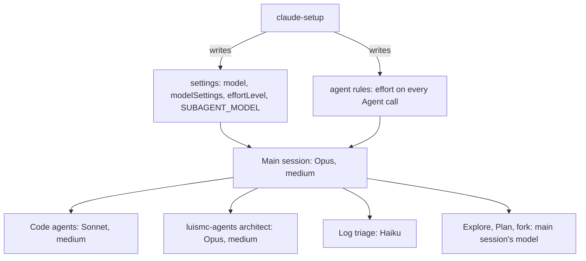

# Model and effort profiles

## 1. In one paragraph

Every project set up by `claude-setup` runs its main session on Opus and its code agents on Sonnet, both at medium effort. Each skill declares the model and effort for its kind of work. `model-profiles.json` sets the default in one place. A test keeps every skill in step with it.

## 2. Why

Which model runs which work is a design decision, and it has a cost. So this feature is specified and tested like any other.

Evidence from a real project's sessions (9 and 10 October 2026):

- Merging, conflict resolution, lint fixes and running checks were mechanical work. Only contracts, scope and judgment calls needed the strongest model.
- 18 parallel cloud agents used the 5-hour session limit in about 20 minutes. Five at a time finished the same work.
- One repository set effort by hand. The setup that every project gets did not set it.

Goals: a cheap default that is the same on every machine, a profile for each skill, and a warning when a saved effort stops applying.

Non-goals: choosing the model for a user's own prompt, and overriding the built-in Explore and Plan agents (decided: leave both on Opus).

## 3. How it works

- `claude-setup` writes the main model, the effort for each model (`modelSettings`), a top-level `effortLevel`, and `CLAUDE_CODE_SUBAGENT_MODEL=sonnet`. It preselects medium. It asks on every run.
- The agent rules tell the main session to pass `effort` on every implementation Agent call.
- Each skill's `model` and `effort` are in its SKILL.md frontmatter, taken from `model-profiles.json`.

### Where a model and an effort come from

Read each list from the top. The first source that is set wins.

| For | Order |
|---|---|
| A subagent's model | the Agent call, the agent file, `CLAUDE_CODE_SUBAGENT_MODEL`, the main session's model |
| A subagent's effort | `CLAUDE_CODE_EFFORT_LEVEL`, the Agent call, the agent file, the session's effort |
| The main session's effort | `CLAUDE_CODE_EFFORT_LEVEL`, `--effort` or `/effort`, `modelSettings` for the model ID, the top-level `effortLevel`, the model's default |

The docs do not say that `modelSettings` reaches subagents. So the effort is also passed on each Agent call.

### The profiles

| Who | Does | Model | Effort |
|---|---|---|---|
| Main session | Plans, writes contracts, decides, reviews risky diffs | Opus | medium |
| Code agents | Write code, fix lint, resolve conflicts a script cannot | Sonnet | medium |
| Merges and checks | Join branches, run gates | none: scripts | none |
| Log triage | Read CI logs, name the failure | Haiku | default |
| `luismc-agents:architect` | Hard design calls, audit review | Opus | medium |
| Explore, Plan, fork | Search, plan, continue | main session's | main session's |
| Cloud agents, routines | Unattended work | settings model | top-level `effortLevel` |

| Kind of skill | Skills | Model | Effort |
|---|---|---|---|
| judgment | spec-new, security-audit, performance-audit, compliance-audit, tech-stack-setup, auth-setup, feature-artifact-new, feature-spec-new | Opus | medium |
| mechanical | spec-check, project-artifact-check, task-add, task-status-update, full-progress-artifact-new, docs-setup, docs-index, docs-check, docs-note | Sonnet | medium |
| setup | claude-setup | Sonnet | medium |

## 4. Screens and states

There is no screen. `claude-setup` shows its change plan once. It asks for confirmation before it writes outside the repository. The drift warning is a one-line system message at session start.

## 5. Functional requirements

**R5.1** — Every plugin SKILL.md names its skill in `model-profiles.json`, and its `model` and `effort` frontmatter match that profile.

**R5.2** — Every profile is medium for both Opus and Sonnet: the architect agent is medium, the settings template's top-level `effortLevel` is medium, and `claude-setup` recommends medium for both models.

**R5.3** — The agent rules file has one line per role and carries the `{{SUBAGENT_EFFORT}}` placeholder.

**R5.4** — The settings template registers the SessionStart `effort_drift.py` hook, and the hook file ships next to it.

**R5.5** — The session-start hook warns when the active Opus or Sonnet model ID has no saved effort entry, and stays silent when it has one or when it cannot tell the model.

**R5.6** — No plugin ships an agent named Explore or Plan.

**R5.7** — No `model-delegation.md` remains in the claude-setup assets (the role rules live in the rules file).

## 6. Non-functional requirements

**R6.1** — The drift hook always exits 0 and writes its warning as a `systemMessage`, never to Claude's context.

**R6.2** — The drift hook can be turned off with `CLAUDE_SETUP_EFFORT_DRIFT=off`.

**R6.3** — `claude-setup` writes nothing outside the repository without the owner's confirmation in the change plan.

## 7. Design

- `model-profiles.json` maps three kinds (judgment, mechanical, setup) to a model, an effort and a list of skills. It is the single table.
- Effort is saved under the full model ID (`modelSettings.<model ID>.effortLevel`), but the model is chosen by alias. When an alias moves to a newer ID, nothing matches, and the model runs at its default. Medium is saved for both models, so the fallback is the same value. A drift changes nothing until someone chooses a higher effort.
- `effort_drift.py` reads the SessionStart JSON. When `model` is absent (after `/clear`), it checks `ANTHROPIC_DEFAULT_OPUS_MODEL` and `ANTHROPIC_DEFAULT_SONNET_MODEL`.

## 8. Failure modes

| Situation | Behaviour | Why |
|---|---|---|
| An Agent call names a model | It wins over the agent file and the environment. | Name a model only for a role that needs it. |
| `CLAUDE_CODE_EFFORT_LEVEL` is set | It overrides every saved effort. `claude-setup` reports it as a conflict. | The owner chooses. |
| A project's settings set an effort | It shadows the user setting in that repo. Personal overrides go in `.claude/settings.local.json`. | Settings merge by scope. |
| The drift hook cannot read the model | Silent, exit 0. | A warning that may be wrong is worse than none. |
| A session whose model has no entry (a cloud agent) | It uses the top-level `effortLevel`. | A safe default. |

## 9. How it is proven

| Requirement | Test |
|---|---|
| R5.1 | `tools/test_model_profiles.py` checks P1 and P2 and proves them with `m_wrong_model`, `m_wrong_effort`, `m_no_model_line`, `m_unknown_skill` |
| R5.2 | `tools/test_model_profiles.py` check D1 and `m_opus_profile_high`, `m_sonnet_profile_high`, `m_architect_high`, `m_top_level_high` |
| R5.3 | `tools/test_model_profiles.py` check R1 and `m_role_line`, `m_placeholder` |
| R5.4 | `tools/test_model_profiles.py` check S1 |
| R5.7 | `tools/test_model_profiles.py` check M1 and `m_rule_missing` |

R5.5, R5.6, R6.1, R6.2 and R6.3 have no automated test. R5.5 and R6.1 were verified by hand when the hook shipped. Nobody settled whether a skill's effort reverts after its turn (see section 11).

## 10. Decisions

| ID | Question | Chosen | Date |
|---|---|---|---|
| [0013](../../architecture/decisions/0013-medium-effort-for-both-models.md) | What is the default model and effort? | Opus and Sonnet, both medium | 2026-10-11 |
| [0014](../../architecture/decisions/0014-leave-explore-and-plan-on-opus.md) | Override Explore and Plan? | No, leave both on Opus | 2026-10-10 |
| [0015](../../architecture/decisions/0015-warn-when-saved-effort-stops-applying.md) | What if an alias moves to a model with no saved effort? | Warn at session start | 2026-10-10 |
| page D2 | Where do the role rules live? | A rule file the plugin owns | 2026-10-10 |
| page D4 | How are skills profiled? | By kind of work | 2026-10-10 |

## 11. Not built yet

- NOT YET IMPLEMENTED: a check that a skill's `effort` reverts after its turn. The docs do not describe this behaviour. The seam is a manual run of a skill whose effort differs from the session's.

## 12. Code map

Source: `claude/plugins/project-setup/skills/claude-setup/`

| Path | Holds |
|---|---|
| `assets/model-profiles.json` | The profile table |
| `assets/.claude/settings.json` | Model, effort, subagent model, drift hook |
| `assets/.claude/hooks/effort_drift.py` | The session-start warning |
| `assets/.claude/rules/agents-and-integration.md` | The role rules |
| `SKILL.md` | The setup steps |

Also `claude/plugins/agents/agents/*.md` (the architect's model and effort) and `tools/test_model_profiles.py`.

## Versions
