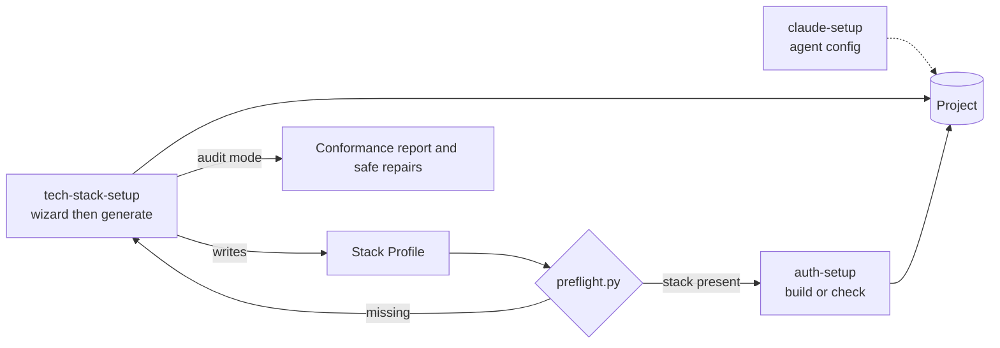
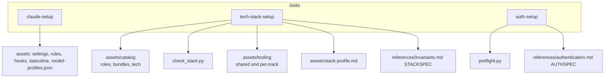

# Project setup (luismc-project-setup)

Two binding specs hold the rules this plugin builds to. Read them there. This page does not copy them.

- STACKSPEC: [invariants.md](../../../claude/plugins/project-setup/skills/tech-stack-setup/references/invariants.md)
- AUTHSPEC: [authentication.md](../../../claude/plugins/project-setup/skills/auth-setup/references/authentication.md)

## 1. In one paragraph

`luismc-project-setup` takes a repository from empty to production-ready. It has three skills, run in order. `tech-stack-setup` helps pick a compatible stack. It generates a repository to STACKSPEC, or audits an existing one. `auth-setup` builds authentication to AUTHSPEC on top of it. `claude-setup` configures Claude Code for the project or the user.

## 2. Why

A new product needs the same hard parts every time: a coherent stack, a gate that proves a branch is ready, authentication that survives erasure rules, and an agent set up to work the same way in every session. Done ad hoc, these drift. Rules in specs and generation in skills make drift measurable.

Goals: every option offered is compatible with earlier choices. The generated repository can be audited against the spec. Authentication is a separate step that can be reviewed.

Non-goals: choosing vendors for the user, and building authentication inside `tech-stack-setup`.

## 3. How it works

1. `tech-stack-setup` interviews the user. After each answer, it filters the options in `assets/catalog/` so that only compatible ones remain. It shows the consequences. Then it generates the repository and a Stack Profile. The profile records the spec versions claimed.
2. `auth-setup` runs `preflight.py` first and refuses until the stack exists. It reads the Stack Profile and interviews the user for the decisions the spec will not default. Then it builds in dependency order. Its second mode audits an existing implementation.
3. `claude-setup` asks for project, user level or both. It shows one batch plan and confirms once. Then it writes the settings, rules, hooks and status line. It never overwrites a hand-written `CLAUDE.md` or an existing settings key.

## 5. Functional requirements

**R5.1** — `tech-stack-setup` offers only technologies compatible with the choices already made, and `check_stack.py --selection` verifies a selection against the catalog.

**R5.2** — `tech-stack-setup` generates for four tracks: TypeScript, Go, Rust and .NET. Each track has its own `gate.json`, `smoke.json` and CI workflows under `assets/tooling/`.

**R5.3** — `tech-stack-setup` writes a Stack Profile that records the STACKSPEC version claimed and the vendor choices. It does not copy either spec into the project.

**R5.4** — `tech-stack-setup` in audit mode reports conformance section by section and shows a diff before any repair.

**R5.5** — `tech-stack-setup` does not build authentication. At the end, it asks whether to run `auth-setup`.

**R5.6** — `auth-setup` runs `preflight.py --require stack` before anything else and stops with the skill to run first when the stack is missing.

**R5.7** — `preflight.py` exits 0 when every requirement holds, 1 when one does not, and 2 on bad arguments.

**R5.8** — `auth-setup` reads the Stack Profile. Before it generates, it reports a claimed AUTHSPEC version that is older than the bundled one.

**R5.9** — `claude-setup` never overwrites an existing `CLAUDE.md` or an existing settings key. The two model-split keys are shown as a conflict when they hold a different model.

**R5.10** — Every skill's `model:` and `effort:` front matter matches its row in `assets/model-profiles.json`.

**R5.11** — Every rule line in the rule files `claude-setup` ships ends with a tag naming its check, or `advice`.

**R5.12** — The shipped STACKSPEC and AUTHSPEC have valid heading numbers, requirement IDs and references, and AUTHSPEC passes its own content checks.

## 6. Non-functional requirements

**R6.1** — `claude-setup` asks which target before reading or writing, and applies one batch after one confirmation.

**R6.2** — The model-profile default is medium effort for every model (the owner's default). The profile table is the one place that sets it.

## 7. Design

- The catalog is data, not requirements. STACKSPEC defines a `CHOICE` level. A choice is reported as recorded or unrecorded, never as violating.
- The shared delivery tooling (`assets/tooling/shared/scripts/delivery/`, git hooks, workflows) is copied into each generated repository. Its rules and tests belong to [delivery](../delivery/spec.md) and [delivery-speed](../delivery-speed/spec.md). This page does not repeat them.
- The per-skill model table, the effort-drift hook and how profiles are applied belong to [models](../models/spec.md).

## 8. Failure modes

- `auth-setup` without a stack: fails closed (`preflight.py` exits 1).
- `check_stack.py` without PyYAML: exits 2 with an install hint.
- `claude-setup` on a conflicting key: leaves the key and shows the conflict (fails safe, no silent change).
- `tech-stack-setup` audit mode: never touches what already conforms.

## 9. How it is proven

| Requirement | Test |
|---|---|
| R5.6, R5.7 | `tools/test_preflight.py` |
| R5.10, R6.2 | `tools/test_model_profiles.py` |
| R5.11 | `tools/test_rule_tags.py` |
| R5.12 | `tools/test_spec_check.py`, `tools/test_authspec_check.py` |
| R5.1 to R5.5, R5.8, R5.9, R6.1 | not covered by a test yet; see section 11 |

## 10. Decisions

| ID | Question | Chosen | Date |
|---|---|---|---|
| 0001-docs-rewrite | Keep STACKSPEC and AUTHSPEC IDs in the rewrite? | Yes, layout and wording only | 2026-10-31 |

## 11. Not built yet

NOT YET IMPLEMENTED: tests for the wizard's filtering and for `check_stack.py` (R5.1), for the four-track tooling (R5.2), for the Stack Profile (R5.3), for the audit mode (R5.4, R5.5, R5.8), and for the no-overwrite rule (R5.9). The skills are prompts, so these tests need a fixture repository. The seam is `tools/`, next to `test_preflight.py`.

## 12. Code map

Source: claude/plugins/project-setup/skills/tech-stack-setup/SKILL.md
Source: claude/plugins/project-setup/skills/tech-stack-setup/assets/check_stack.py
Source: claude/plugins/project-setup/skills/tech-stack-setup/assets/preflight.py
Source: claude/plugins/project-setup/skills/tech-stack-setup/assets/stack-profile.md
Source: claude/plugins/project-setup/skills/tech-stack-setup/assets/catalog/roles.yaml
Source: claude/plugins/project-setup/skills/auth-setup/SKILL.md
Source: claude/plugins/project-setup/skills/claude-setup/SKILL.md
Source: claude/plugins/project-setup/skills/claude-setup/assets/model-profiles.json
Source: claude/plugins/project-setup/.claude-plugin/plugin.json

## Versions

Written by the release fold. Do not edit by hand.

| Version | Date | Release | What changed | Tasks |
|---|---|---|---|---|
| 0.3.0 | 2026-11-01 | RELEASE-27 | Agents run the e2e specs of the screens they change: the gate records and verifies them, a pre-push check refuses an unrun e2e spec fix, and briefs say so (DELIVERYSPEC DL-86 to DL-89). | DS35 |
| 0.2.0 | 2026-11-01 | RELEASE-25 | claude-setup's model profiles list the design-system-setup skill under the mechanical profile (Sonnet, medium). Workflow templates pin every action to a full commit SHA with the tag in a comment (rust-toolchain gets toolchain: stable). agent_setup.sh and the ci.yml secret scan no longer fall back to the release checksums file: with no pin they refuse and print the tools_pin.py command. The artifact-prune REST fallback refuses a next-page URL on a foreign host, and the interim-record converter no longer uses eval. claude-setup now offers to enforce docs, design system, delivery, project record and CI checks, and reports what each plugin enforces; claude-setup status reports only. | DOC17-model-profile, DS162, DS163, SO2 |
| 0.1.1 | 2026-11-01 | RELEASE-22 | Wording pass; requirements and IDs unchanged. | DS143 |
