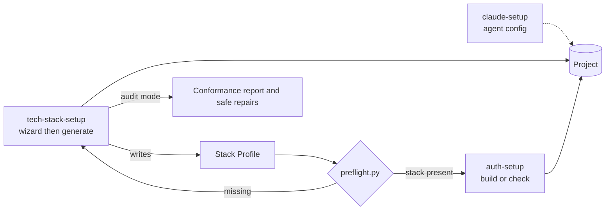
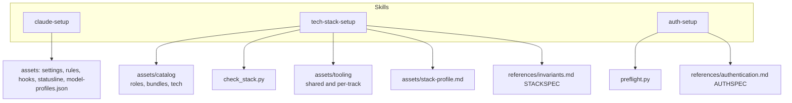
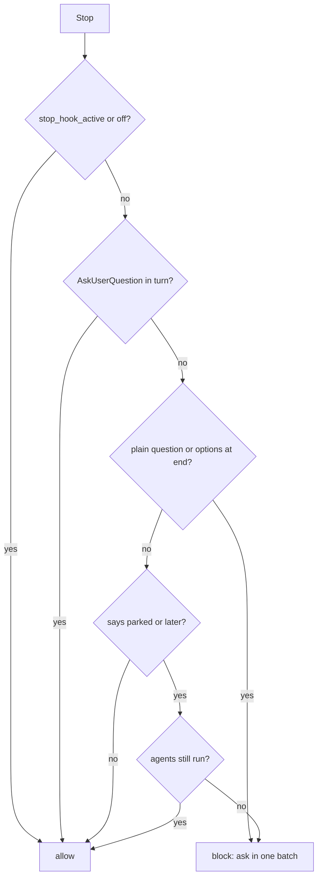

# Project setup (luismc-project-setup)

Two binding specs hold the rules this plugin builds to. Read them there. This page does not copy them.

- STACKSPEC: [invariants.md](../../../claude/plugins/project-setup/skills/tech-stack-setup/references/invariants.md)
- AUTHSPEC: [authentication.md](../../../claude/plugins/project-setup/skills/auth-setup/references/authentication.md)

## 1. In one paragraph

`luismc-project-setup` takes a repository from empty to production-ready. It has three skills, run in order. `tech-stack-setup` helps pick a compatible stack. It generates a repository to STACKSPEC, or audits an existing one. `auth-setup` builds authentication to AUTHSPEC on top of it. `claude-setup` configures Claude Code for the project or the user.

## 2. Why

A new product needs the same hard parts every time: a coherent stack, a gate that proves a branch is ready, authentication that survives erasure rules, and an agent set up to work the same way in every session. Done ad hoc, these drift. Rules in specs and generation in skills make drift measurable.

Goals: every option offered is compatible with earlier choices. The generated repository can be audited against the spec. Authentication is a separate step that can be reviewed.

Non-goals: choosing vendors for the user, and building authentication inside `tech-stack-setup`.

## 3. How it works

1. `tech-stack-setup` interviews the user. After each answer, it filters the options in `assets/catalog/` so that only compatible ones remain. It shows the consequences. Then it generates the repository and a Stack Profile. The profile records the spec versions claimed.
2. `auth-setup` runs `preflight.py` first and refuses until the stack exists. It reads the Stack Profile and interviews the user for the decisions the spec will not default. Then it builds in dependency order. Its second mode audits an existing implementation.
3. `claude-setup` asks for project, user level or both. Project is preselected and marked (Recommended). Rules, `CLAUDE.md`, status line, output style, hook, model split and auto-compact env go to the project's `.claude/` by default. It turns on all eight plugins in the project's `enabledPlugins`, installs missing ones with `--scope project`, and adds `extraKnownMarketplaces` to the project's settings when the entry is missing. Only the transcript-folds chords stay in `~/.claude/keybindings.json`. It shows one batch plan and confirms once. Then it writes the settings, rules, hooks and status line. It never overwrites a hand-written `CLAUDE.md` or an existing settings key. It then asks every question of every offer in one grouped round: docs, design system, delivery, project record, CI, branch protection, other setups and three separate audits (security, compliance, performance). After the yes it runs the picked setups in the same session: the tech-stack-setup audit, auth-setup when repo gates exist, then each audit, holding a heavy step when memory is over 85% or CPU over 60%. For branch protection it reads the current protection, merges the dev-standards check and runs the PUT when the workflow has already run on the default branch. Otherwise it records `pending_protection: true` in `.delivery/config.json`. It never commits or pushes. Its final report ends with one numbered "Left for you" list, followed by the enforcement table, whose rows name the step that fixes them.

All three skills follow the setup pattern (plan first, do the work after a yes, one line per step, a summary with Done, Left for you and What you can do now, safe to run again). See [the setup skills guide](../../guides/setup-skills.md) for a flow of each and what you can do after.

## 5. Functional requirements

**R5.1** — `tech-stack-setup` offers only technologies compatible with the choices already made, and `check_stack.py --selection` verifies a selection against the catalog.

**R5.2** — `tech-stack-setup` generates for four tracks: TypeScript, Go, Rust and .NET. Each track has its own `gate.json`, `smoke.json` and CI workflows. They live in `luismc-delivery` (`templates/`), and `tech-stack-setup` calls the delivery installer at the end of its setup (see [delivery](../delivery/spec.md), R13.3).

**R5.3** — `tech-stack-setup` writes a Stack Profile that records the STACKSPEC version claimed and the vendor choices. It does not copy either spec into the project.

**R5.4** — `tech-stack-setup` in audit mode reports conformance section by section and shows a diff before any repair.

**R5.5** — `tech-stack-setup` does not build authentication. At the end, it asks whether to run `auth-setup`.

**R5.6** — `auth-setup` runs `preflight.py --require stack` before anything else and stops with the skill to run first when the stack is missing.

**R5.7** — `preflight.py` exits 0 when every requirement holds, 1 when one does not, and 2 on bad arguments.

**R5.8** — `auth-setup` reads the Stack Profile. Before it generates, it reports a claimed AUTHSPEC version that is older than the bundled one.

**R5.9** — `claude-setup` never overwrites an existing `CLAUDE.md` or an existing settings key. The two model-split keys are shown as a conflict when they hold a different model.

**R5.10** — Every skill's `model:` and `effort:` front matter matches its row in `assets/model-profiles.json`.

**R5.11** — Every rule line in the rule files `claude-setup` ships ends with a tag naming its check, or `advice`.

**R5.12** — The shipped STACKSPEC and AUTHSPEC have valid heading numbers, requirement IDs and references, and AUTHSPEC passes its own content checks.

**R5.13** — At user level, `claude-setup` installs `~/.claude/hooks/questions_stop.py` and adds it to `hooks.Stop` in `~/.claude/settings.json`, without removing another hook. The hook blocks a stop when the final reply asks the owner a question in plain text, lists options to pick, or says questions are parked, and the turn made no AskUserQuestion call. It enforces Q-1 and Q-2.

## 6. Non-functional requirements

**R6.1** — `claude-setup` asks which target before reading or writing, and applies one batch after one confirmation.

**R6.2** — The model-profile default is medium effort for every model (the owner's default). The profile table is the one place that sets it.

## 7. Design

- The catalog is data, not requirements. STACKSPEC defines a `CHOICE` level. A choice is reported as recorded or unrecorded, never as violating.
- The shared delivery tooling (scripts and workflows in `luismc-delivery` `templates/`) is written into each generated repository by the delivery installer; the git hooks, linters and guards in `assets/tooling/` are copied by `tech-stack-setup`. Its rules and tests belong to [delivery](../delivery/spec.md) and [delivery-speed](../delivery-speed/spec.md). This page does not repeat them.
- The questions Stop hook (R5.13) never loops (`stop_hook_active` allows), ignores code blocks, inline code and quoted lines, lets a park through while agents of the wave still run (Q-5, a running agent in `.delivery/ledger.json`), and fails open on any error. It blocks a list only when the line above it reads as an offer to pick from (not "Files changed:"), and a reply that says there are no open questions passes. Its hook command runs `python3` when present and `python` only otherwise, so exit 2 reaches Claude Code. Turn it off with `CLAUDE_QUESTIONS_STOP=off` (shell or settings `env` block) or `"questionsStop": "off"` in `~/.claude/settings.json`.

- The per-skill model table, the effort-drift hook and how profiles are applied belong to [models](../models/spec.md).

## 8. Failure modes

- `auth-setup` without a stack: fails closed (`preflight.py` exits 1).
- `check_stack.py` without PyYAML: exits 2 with an install hint.
- `claude-setup` on a conflicting key: leaves the key and shows the conflict (fails safe, no silent change).
- `tech-stack-setup` audit mode: never touches what already conforms.

## 9. How it is proven

| Requirement | Test |
|---|---|
| R5.6, R5.7 | `tools/test_preflight.py` |
| R5.10, R6.2 | `tools/test_model_profiles.py` |
| R5.11 | `tools/test_rule_tags.py` |
| R5.13 | `tools/test_questions_stop.py` (the hook on recorded inputs and its wiring) |
| R5.12 | `tools/test_spec_check.py`, `tools/test_authspec_check.py` |
| R5.1 to R5.5, R5.8, R5.9, R6.1 | not covered by a test yet; see section 11 |

## 10. Decisions

| ID | Question | Chosen | Date |
|---|---|---|---|
| 0001-docs-rewrite | Keep STACKSPEC and AUTHSPEC IDs in the rewrite? | Yes, layout and wording only | 2026-10-31 |

## 11. Not built yet

NOT YET IMPLEMENTED: tests for the wizard's filtering and for `check_stack.py` (R5.1), for the four-track tooling (R5.2), for the Stack Profile (R5.3), for the audit mode (R5.4, R5.5, R5.8), and for the no-overwrite rule (R5.9). The skills are prompts, so these tests need a fixture repository. The seam is `tools/`, next to `test_preflight.py`.

## 12. Code map

Source: claude/plugins/project-setup/skills/tech-stack-setup/SKILL.md
Source: claude/plugins/project-setup/skills/tech-stack-setup/assets/check_stack.py
Source: claude/plugins/project-setup/skills/tech-stack-setup/assets/preflight.py
Source: claude/plugins/project-setup/skills/tech-stack-setup/assets/stack-profile.md
Source: claude/plugins/project-setup/skills/tech-stack-setup/assets/catalog/roles.yaml
Source: claude/plugins/project-setup/skills/auth-setup/SKILL.md
Source: claude/plugins/project-setup/skills/claude-setup/SKILL.md
Source: claude/plugins/project-setup/skills/claude-setup/assets/model-profiles.json
Source: claude/plugins/project-setup/skills/claude-setup/assets/.claude/hooks/questions_stop.py
Source: claude/plugins/project-setup/.claude-plugin/plugin.json

## Versions

Written by the release fold. Do not edit by hand.

| Version | Date | Release | What changed | Tasks |
|---|---|---|---|---|
| 0.7.0 | 2026-11-04 | RELEASE-38 | claude-setup installs a user-level Stop hook (questions_stop.py) that blocks plain-text questions and parked questions, enforcing Q-1 and Q-2 (R5.13). | SO6 |
| 0.6.0 | 2026-11-04 | RELEASE-37 | claude-setup, tech-stack-setup and auth-setup follow the setup pattern: plan first, one line per step, and a Done, Left for you, What you can do now summary. | DL33 |
| 0.5.1 | 2026-11-02 | RELEASE-34 | R5.2 and the delivery tooling note: the CI and delivery templates moved to luismc-delivery. tech-stack-setup calls the delivery installer at the end of its setup. No requirement ID changed. | DL15 |
| 0.5.0 | 2026-11-02 | RELEASE-31 | claude-setup runs the picked setups and three separate audits, applies branch protection after reading current protection, and ends its report with a numbered Left for you list. | SO5 |
| 0.4.0 | 2026-11-01 | RELEASE-28 | claude-setup defaults to project level: config files go to the project's .claude/, plugins install with --scope project, and extraKnownMarketplaces is added when missing. | SO4 |
| 0.3.0 | 2026-11-01 | RELEASE-27 | Agents run the e2e specs of the screens they change: the gate records and verifies them, a pre-push check refuses an unrun e2e spec fix, and briefs say so (DELIVERYSPEC DL-86 to DL-89). | DS35 |
| 0.2.0 | 2026-11-01 | RELEASE-25 | claude-setup's model profiles list the design-system-setup skill under the mechanical profile (Sonnet, medium). Workflow templates pin every action to a full commit SHA with the tag in a comment (rust-toolchain gets toolchain: stable). agent_setup.sh and the ci.yml secret scan no longer fall back to the release checksums file: with no pin they refuse and print the tools_pin.py command. The artifact-prune REST fallback refuses a next-page URL on a foreign host, and the interim-record converter no longer uses eval. claude-setup now offers to enforce docs, design system, delivery, project record and CI checks, and reports what each plugin enforces; claude-setup status reports only. | DOC17-model-profile, DS162, DS163, SO2 |
| 0.1.1 | 2026-11-01 | RELEASE-22 | Wording pass; requirements and IDs unchanged. | DS143 |
