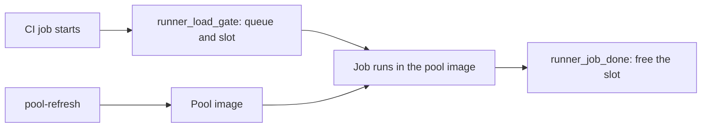

# Shared runner pool

Related: [delivery](../delivery/spec.md). The pool stays inside luismc-delivery. This spec holds its requirements. They moved here from delivery section 13 (D181, D184). Each old ID stays in the delivery spec as a pointer.

## 1. In one paragraph

The runner pool is one set of CI runners that several repositories on one machine share. A machine config limits how many jobs run at once. A pool image carries the build tools. `pool-refresh` rebuilds that image and the doctor checks it.

## 2. Why

Without a shared limit, several runners start heavy jobs at once and the machine stalls. The pool also needs one image that serves every repository, and a rebuild must never break a running job.

## 3. How it works

A job takes a ticket and then a slot. It runs. The completed hook frees the slot. `pool-refresh` changes the image only when no pool runner is busy.

## 5. Functional requirements

Each requirement names its old delivery ID. Delivery keeps that ID as a pointer.

### 5.1 Machine config, slots and load

**R5.1** (was delivery R13.60) — **One machine config** (D21, D22, G2). Every runner account on a machine reads one file: `machine.json` in the machine folder (`C:\ProgramData\luismc-delivery\` on Windows, `/etc/luismc-delivery/` elsewhere, `/machine` in the pool; `DELIVERY_MACHINE_DIR` overrides it for tests). It holds `load_limits`, `ci_slots` (2), `light_slots` (1, minimum 0), `local_heavy` (2), `cloud_ci_sessions` (10), `slot_stale_min` (120), `runner_gate` (`max_wait_min`, `poll_sec`, `on_timeout`, `light_jobs`) and `runner_dirs`. `runner_gate.light_jobs` is a list of job keys or shard names, exact or `fnmatch` globs, matched against `GITHUB_JOB` and `DELIVERY_SHARD` (default `smoke`, `prune`, `prune-*`, `cleanup`, `remove-train`, `decide`, `delete-*`, `runners`). Setup code writes it only through `machine_slots.write_machine_config`. `load.py` reads it first and the old `~/.claude/luismc-delivery-machine.json` only when the new file has no `load_limits`. A project's `.delivery/config.json` may lower a machine limit for its own work and never raises it. The doctor warns when the two files differ.

**R5.2** (was delivery R13.61) — **CI slots and one queue** (D21, D30). The job-started hook `runner_load_gate` takes a ticket in `queue/`, waits until its ticket is first, a slot is free and the load is under the limits, then takes the slot by creating `slots/slot-N.lock` (create-new, so two hooks never take one slot) and removes its ticket. If its own ticket is missing from the queue, the hook logs `own ticket was gone; queued again` and writes it again with the same queue time. It never waits on an empty queue. A ready pull request's run and a run on the default branch go first (read from `GITHUB_EVENT_PATH`); inside a group it is first come, first served. After `runner_gate.max_wait_min` (30) the job fails with a log line (or `on_timeout: run` lets it go without a slot). A light job (see `light_jobs`) takes a light slot, the lock file `slots/light-N.lock` (same create-new and stale rules), with no queue ticket and never a CI slot while a light slot is free. If every light slot is busy it waits for a CI slot in the normal queue order. The load limits hold it like any job, and the log line names the slot (`slot light-1 taken after N s`). With `light_slots` 0 every job takes a CI slot as before. Without a machine folder the hook is the plain load gate of DL-79.

**R5.3** (was delivery R13.62) — **Free the slot** (D25). The job-completed hook `runner_job_done` (`ACTIONS_RUNNER_HOOK_JOB_COMPLETED`) frees the job's slot (CI or light), writes the released line of the slot log and empties the job's work folder (only inside a `_work` folder). A slot whose holder process is gone (same host) is freed at once. Any slot older than `slot_stale_min` is freed. Each freed slot is logged with what held it. The slot log `slot-log.jsonl` has one JSON line per take and per free (repository, run, attempt, job, shard, queue time, slot time, release time, slot, runner, outcome `ran`, `claim-lost` or `stale-freed`) and keeps the last 5,000 lines. The status output of `machine_slots.py status` lists light slots under `light_slots`. `delivery_ci.py slots` prints the holders, then the light slots (`light 1`, free or held, same format), the queue and each wait. The doctor's `machine.slots` check covers light slots too: a stale light lock is reported and freed like a stale CI slot, and its ok line counts both kinds.

**R5.4** (was delivery R13.63) — **Host load file** (D22, G3). A scheduled task on the host runs `load.py --write` every 15 seconds and writes `host-load.json` (memory %, CPU %, time). A reader in WSL or a container uses it when it is under 60 seconds old, and its own figures when it is older. Inside a container the reader also reads the cgroup v2 figures (`memory.current`, `memory.max`, `cpu.stat`) and decides on the worse of host and container.

**R5.5** (was delivery R13.64) — **A slot wait starts the fallback** (D29, D32, G6). While the hook waits it keeps the marker `ci-wait/<sha>/<shard>`, a git branch made like a claim (the shard is `DELIVERY_SHARD` when the hook sees it, else the job key `GITHUB_JOB`; a job-level `env:` value does not reach the hook, so each sharded job's key is named after its shard, and the fallback uses the same name for `ci-wait` and `ci-claim`). `shard_wait_minutes` counts a shard with a wait marker and no claim as waiting, from the time on the marker. When the fallback has claimed the shard and the held job later gets its slot, the job ends without work (exit 3, "claim lost") and frees the slot. The marker is written from a git checkout (`DELIVERY_MARKER_ROOT`, or the job's workspace); with none, the hook writes no marker and says so. It loads `ci_fallback.py` from that checkout, else from the plugin's own copy, and logs one line whenever it writes no marker (no sha, no shard, no checkout, no module, or a failed push).

**R5.6** (was delivery R13.65) — **Local heavy work limit** (D23, D36, G4). At most `local_heavy` (2) heavy local calls run at once on the machine, across sessions. A heavy foreground command (Bash, PowerShell, Workflow) counts from its PreToolUse to its PostToolUse, or until its call has ended without one: its session transcript holds a result for it, a foreground call is older than its own timeout plus 2 minutes, or its transcript is gone or idle for 30 minutes. A call moved to the background, or launched with `run_in_background`, still counts and is freed after 30 minutes. `slot_stale_min` stays the last cap. The refusal shows each entry's age and session and what was just freed; a local agent counts from the ledger. At the limit a new heavy call is refused with the list of what runs. A project may lower the limit, never raise it. Local work does not take CI slots; the load check covers both. `checks_off: ["DL-91"]` turns it off.

**R5.7** (was delivery R13.66) — **Cloud CI session limit** (D34, D37). At most `cloud_ci_sessions` (10) Claude cloud sessions run CI at once, as main runner (Option 3) or fallback (Option 4). The count is the cloud claims with no `ci-posted` marker (a claim older than 3 hours is not counted). At the limit the launcher waits and retries; it never starts an 11th session. These sessions also count toward the cap of 50 cloud agents. A hosted fallback is not limited here.

**R5.8** (was delivery R13.67) — **Doctor `machine` check** (D31, D45). It checks that `machine.json` exists and is readable, that every runner folder has both hooks (a Windows `.ps1` hook passes the execution policy check; a hook that ends in `.cmd` **fails**, because the runner accepts only `.sh`, `.ps1` and `.js`), that no slot is stale and no ticket is older than `slot_stale_min`, that `host-load.json` is under 60 seconds old, the pool checks when the pool module is installed, and a dry-run push of a `ci-wait` test ref from each runner's kept checkout (**warns** with the fix when it fails: store a fine-grained token with contents write for the runner account, or use the pool), the size of each runner's `_work` folder (large totals are a warning with an offer to clean; cleaning needs a yes and skips runners with a job running). An Option 1 project whose repository variable `CI_RUNS_ON` is unset **fails**: its jobs would run on hosted runners and may bill minutes.

### 5.2 Pool image and refresh

**R5.9** (was delivery R13.68) — **Pool image layers** (DL149, D146). The pool base image is ubuntu:24.04 and always carries `build-essential` and `pkg-config`. `.delivery/config.json` `pool.layers` may list `windows-packaging`, which adds `dotnet-sdk-8.0 wine wine64 xvfb xauth msitools` (about 1 GB, 64-bit Wine, packages from the distribution, no extra feed); `linux-packaging` (DL274), which adds `dpkg-dev rpm make checkpolicy selinux-policy-dev policycoreutils gnupg shellcheck systemd createrepo-c` (DL281 added gnupg, shellcheck and systemd; DL287 added createrepo-c) and `policycoreutils-python-utils` when the base image's apt has it (the build skips it quietly if not); and `kvm` (DL274), which adds `qemu-system-x86 qemu-utils cloud-image-utils openssh-client` (DL281 added ssh for `vm_check.py`). All layers are off by default. The doctor checks `dpkg-deb rpmbuild checkmodule semodule_package gpg shellcheck systemd-analyze createrepo_c` for `linux-packaging` and `qemu-system-x86_64 cloud-localds ssh` for `kvm`. A project file `.delivery/pool.apt` lists extra apt packages, one per line, `#` for comments. A name holds only letters, digits and `+ - .` and does not start with `-`; anything else is refused with the line number and nothing changes. An unknown layer is refused the same way. `pool-refresh` reads both from the project checkout and adds them to what the pool `.env` already holds in `POOL_LAYERS` and `POOL_APT` (R5.11); `compose.yaml` passes them as build args. A missing or empty key changes nothing, and a layer turned off in the repo config alone is not removed from the pool.

**R5.10** (was delivery R13.69) — **No rebuild under a running job** (DL149). `pool-refresh --yes` reads `gh api repos/<repo>/actions/runners` for each repository in the pool's `agents.json`. This check runs a second time right before the container is recreated (R5.13), not before the build. When a pool runner has `busy=true`, or the list cannot be read, it refuses with `refused: pool runner busy: <name> (<repo>). Wait for the job or use --force.` and does not recreate the container. `--force` skips the drain and prints a warning.

**R5.11** (was delivery R13.79) — **Shared pool layers** (DL155, D153). One pool may serve several repositories, so `pool-refresh` merges. The layers in `POOL_LAYERS` and the names in `POOL_APT` of the pool `.env` stay; the calling repository's layers and apt names are added. `--drop-layer NAME` and `--drop-apt NAME` (each repeatable) remove one. The pool `.env` records which repository asked for each layer in `POOL_LAYER_SOURCES` (for example `windows-packaging:owner/app1`), and the plan prints `windows-packaging (asked by owner/app1)`. The asking repository is the first `--repos` entry, else the `origin` remote, else the folder name. Turning a layer off in the repository config alone does not remove it; the plan says to pass `--drop-layer`.

**R5.12** (was delivery R13.80) — **Playwright version never drops** (DL155, D154). `pool-refresh` never lowers `PLAYWRIGHT_VERSION` in the pool `.env`. It raises it when the calling repository's lockfile needs a newer one. `--playwright X` sets it exactly and may lower it. When the plan keeps a higher version, it says so and names the flag.

**R5.13** (was delivery R13.84) — **Pool refresh copies the pool files** (DL162). `pool-refresh` compares the plugin's pool files (Dockerfile, compose.yaml, `pool_*.py`, `pool-*` scripts, `hooks/`, and the machine scripts under `delivery/`) with the pool's copies, line endings ignored. The plan lists each file that differs as `<file>: differs from luismc-delivery <version>`. With `--yes`, it copies only those files into `<pool>/bak-<UTC time>/`, writes the templates, then builds with `docker compose build` while the old container keeps serving jobs (DL289). It never touches `.env`, `agents.json` or `db-admin.pw`. After the build it compares the image the running container uses with the tagged image. When they differ, or a file or `.env` line changed, it drains the pool, then runs `docker compose stop pool` and `docker compose up -d --no-build --force-recreate pool`, so the cut lasts seconds. The drain handshake uses the machine folder the container mounts at `/machine`: the refresh writes `<machine>/pools/<pool>/drain`. On seeing it, `pool_supervisor.py` stops listeners that have no job and does not restart them. A listener with a job runs on until it ends, then is stopped. A job is running when the job-started hook has written the marker `/agents/<slug>/.job-running` and the job-completed hook has not removed it; a marker older than 6 hours is stale and ignored. The supervisor lists busy agents in `drain-busy` and writes `drained` when no listener runs. The refresh polls for `drained` for up to `--drain-timeout` seconds (default 2700). On timeout it removes `drain` (the supervisor restarts the listeners), prints `refused: drain timed out, busy: <agents>` and does not recreate the container; the image stays built and a rerun is safe. The refresh removes `drain` before `up`, so a new container starts with none. `--force` skips the drain. A stop signal sent to a runner listener cancels its running job, so `stop_grace_period` alone does not protect a job; only the drain does. The result says what happened: `image unchanged (cache hit)` or `image rebuilt, container recreated`; it never says the pool was rebuilt when the image id did not change. The doctor check `pool.<name>.files-current` warns when a pool file differs and names `pool-refresh --yes`.

**R5.14** (was delivery R13.86) — **Pool refresh fixes a wrong runner hash** (DL165). A `RUNNER_SHA256` in the pool `.env` that is not 64 hex characters, or is one repeated character, is always wrong. When `RUNNER_VERSION` is the pinned version and the hash differs from the pinned hash, the plan lists `RUNNER_SHA256: <short old> -> <short pinned> (did not match the pinned hash for <version>)` and `--yes` writes the pinned hash. For another version it uses the released hash from `runner_sha`; when that cannot be read it keeps the value and says so in the plan. The doctor check `pool.<name>.runner-sha` warns when the hash is not the pinned or released hash for its version and names `pool-refresh --yes`. Tests never write to the real machine folder.

**R5.15** (was delivery R13.87) — **Pool refresh reports the build truthfully** (DL166). When the build fails, `pool-refresh` prints `the rebuild failed: ...`, exits 1 and leaves the old container running. It reads the container id, the image the container runs and the tagged image id before the build and again after it. A changed tagged id is `image rebuilt`; the same id is `image unchanged (cache hit)`. Since DL289 the build never recreates the container, so the recreate is the refresh's own step (R5.13) and the result ends with `container recreated`. When no file or `.env` line changed and the container already runs the tagged image, nothing is drained or recreated.

**R5.16** (was delivery R13.88) — **Pool image has the LLVM tools for Windows builds** (DL167). The pool image always installs the distro `clang`, `lld` and `llvm` packages (about 250 MB) in its base apt layer, not behind `POOL_LAYERS`. It links `clang-cl`, `lld-link`, `llvm-lib`, `llvm-ar`, `llvm-rc` and `lld` into `/usr/local/bin` from the LLVM version found at build time, so every user finds them. A build-time check runs `clang-cl --version`, `lld-link --version` and `llvm-lib /?`, so a broken install fails the build. `cargo xwin build --target x86_64-pc-windows-msvc` needs these tools for crates with C or C++ code.

**R5.17** — **Wine prefix per agent** (DL179, D192). Only when the image has the `windows-packaging` layer (`wine` is on PATH), `pool_supervisor.py` prepares a Wine prefix for each agent user before it starts that agent's runner. It runs, as that user, `WINEPREFIX=/agents/<slug>/.wine wineboot --init` under `xvfb-run -a`, with `WINEDEBUG=-all`, a 180 s timeout and `wineserver -w` after it. It skips an agent whose prefix already holds `system.reg`. A failure is logged and never stops the runner from starting. Without `wine` nothing runs. The prefix lives in `/agents`, so a container recreated by a resize or refresh keeps it.

**R5.18** — **`POOL_WINE_PREFIX`** (DL179, D192). With `wine` on PATH, the supervisor sets `POOL_WINE_PREFIX=/agents/<slug>/.wine` in each agent's environment. A job can use it directly or copy it (`cp -a "$POOL_WINE_PREFIX" "$WINEPREFIX"`) instead of booting a fresh prefix. Without `wine` the variable is not set.

**R5.19** — **Wine runs without `TMPDIR`** (DL180). Wine aborts with `free(): invalid pointer` when `TMPDIR` is set, to any value. With the `windows-packaging` layer the image wraps each Wine entry tool (`wine`, `wine64`, `wine-stable`, `wineboot`, `wineserver`, `winecfg`, `msiexec`) in `/usr/local/bin` with a script that unsets `TMPDIR` and runs the real tool from `/usr/bin`. The pool still sets `TMPDIR` for every other tool. The image build fails if `wine` on PATH is not the wrapper.

**R5.25** — **The shared tool cache works for every agent user** (DL194). Each agent runs as its own Unix user, and `/ci-tools` is shared. When the cache root is world-writable, `ci_tool.py` makes each folder it creates `1777` (sticky: no user can replace or delete another user's file), keeps each finished install folder `0755`, and downloads to a per-process `.partial` that is renamed into place, so any agent user can add a tool and two racing fetches end with one good file. A file already present with the right SHA-256 is used as is. If a version folder made earlier by another user is not writable, `ci_tool.py` warns once on stderr and uses `~/.cache/ci-tools` for that job. Outside the pool (a root that is not world-writable, or Windows) nothing changes.

### 5.3 Pool doctor checks and setup

**R5.17** (was delivery R13.70) — **Doctor pool checks** (DL149). `pool.<name>.layer-windows-packaging`: with the layer on, `wine`, `xvfb-run` and `dotnet` exist in the pool. When the pool container runs, each tool is probed with `docker exec` in it (DL199); only when none runs, with `docker run` on the image tag. A tool the probe ran and did not find is a fail. A docker error (exit 125, 126 or 127, or a timeout) is a warning, `cannot probe`, never a fail. A warning also shows when Docker cannot be read. `pool.<name>.layers-config`: the project config and the pool `.env` agree. `pool.<name>.stray-dockerfile`: a Dockerfile under a `runners` or `runner` folder of the project is flagged, because the pool never uses it; the fix is `.delivery/pool.apt` or a layer. `pool.<name>.tool-cache`: `compose.yaml` mounts a named volume at `/ci-tools` and it is writable.

**R5.18** (was delivery R13.71) — **Setup asks about Windows installers** (DL149). `/delivery-ci-setup` asks whether the project builds Windows installers on Linux and suggests yes when the repository has `*.wxs` files. Yes adds `windows-packaging` to `pool.layers`. It also names `.delivery/pool.apt`.

**R5.19** — **A pool plan keeps what the pool has** (DL176). `pool-plan` and `pool-run` take `--browsers none|chromium`. With no flag, the plan keeps `POOL_BROWSERS` from the pool `.env`; repository detection may raise `none` to `chromium` and never lowers it. The plan also keeps `POOL_LAYERS`, `POOL_APT`, `POOL_LAYER_SOURCES` and `PLAYWRIGHT_VERSION`, and the pool files it writes keep every other `.env` line. `--drop-layer`, `--drop-apt` and `--playwright` change them, as in `pool-refresh` (R5.11, R5.12).

**R5.20** — **A stable cap that does not shrink by accident** (DL176). The memory used outside WSL is the median of about 5 samples taken 1 second apart, so another program's short spike does not cut the room. The plan prints its inputs: the machine total, the memory used outside WSL, the 85% budget, the room and the Docker ceiling. A `--resize` that would lower `POOL_MEM` or `POOL_CPUS` below the `.env` refuses with a plain message and changes nothing, unless the owner passes `--shrink`.

**R5.21** — **The owner sets the pool size** (DL176). `--cpus` and `--used-gib` are machine numbers: this machine's CPU count and the memory used outside WSL. `--pool-gib N` and `--pool-cpus N` are the owner's target for the pool. The plan uses them as given when they fit the 85% memory budget (the pool, the sidecar and the VM headroom), the 60% CPU budget, the floors (4 GiB, 2 CPUs) and 1.5 GiB per CPU. Otherwise it refuses and names the budget that is short. The `.wslconfig` memory and processors rise to fit.

**R5.22** — **The VM is measured, not guessed** (DL177). The size of the WSL VM is the larger of the `vmmem`/`vmmemWSL` working set and its private bytes, and never less than the memory the containers use. Windows trims the working set, so it alone swings. The plan prints each figure on its `Sizing inputs` line.

**R5.23** — **Docker is read through the Windows CLI first** (DL177). On Windows, the container use and the CPUs Docker sees come from the `docker` CLI on `PATH` (Docker Desktop installs it). `wsl docker` is the fallback, used only when that CLI cannot run. If both fail, the use reads 0 and the CPUs read unknown.

**R5.24** — **Sizing does not hang on one moment** (DL177). "Fits" is judged against the larger of the 5-sample median (R5.20) and the host-load file's last sample (memory % of the total, minus the VM). A missing or stale file (over 60 s old) is ignored and the samples alone decide. The `Sizing inputs` line says which decided. A refusal for memory per CPU names the nearest sizes that pass, for example "10 GiB fits 6 CPUs; 7 CPUs needs 10.5 GiB".

**R5.26** — **The pool image carries Node LTS with corepack** (DL215). Like GitHub-hosted runners, the image keeps the official Node LTS tarball (SHA-256 checked) at `/opt/node`, with its `bin` first on `PATH` for every user and the runner. `PATH` is set before the build step that installs Node, because corepack and npm start with `#!/usr/bin/env node` (DL223). It does not depend on `POOL_BROWSERS`. Node 22 bundles corepack; a newer Node without it gets corepack from npm at a pinned version. The image runs `corepack enable` once as root at build time, so the pnpm and yarn shims exist in `/opt/node/bin` and an unprivileged job's own `corepack enable` needs no write access (DL220). The shims pin no version; they read `packageManager` from each project. `actions/setup-node` still puts the project's own Node first. A build-time check runs `node --version && corepack --version` and checks the pnpm shim exists. Playwright `install-deps` (R5.15) uses this Node.

**R5.27** — **A repository can declare NOLOGIN database roles** (DL231). Roles are server-wide and a project login has no CREATEROLE (D227), so a migration that runs `CREATE ROLE` fails. `pool-add-agent --db-role NAME` (repeatable) stores `db_roles` on the repository's entry in `agents.json`. As admin, the pool then makes each missing role with `CREATE ROLE NAME NOLOGIN` behind an `IF NOT EXISTS` check on `pg_roles`, and runs `GRANT NAME TO <login> WITH ADMIN OPTION`. The pool database is PostgreSQL 16, where the grant defaults to INHERIT and SET true, so the project user can `GRANT` on its own objects to the role and `SET ROLE` to it. A name is lowercase letters, digits and underscore, at most 63. The pool refuses a reserved name (`postgres`, `public`, `pg_*`), a pool login or database name, and a role another repository declares, naming both repositories. A rerun repeats the SQL safely and keeps earlier roles. A project migration must be exists-safe: check `pg_roles` before `CREATE ROLE`, because the role already exists.

**R5.28** — **Optional KVM** (DL274, D255, D257). Off by default; with `POOL_KVM` unset nothing changes. The pool never runs privileged (D256).
- *Host check.* `delivery_runner_pool.py doctor` and `delivery_ci_setup.py pool-plan` print `KVM on this host: yes|no (reason)`. The check is `docker run --rm --device /dev/kvm --entrypoint test <pool image or alpine> -r /dev/kvm -a -w /dev/kvm`; on Windows Git Bash the call sets `MSYS_NO_PATHCONV=1`. Exit 0 is yes; 1 means the device is there but not usable; anything else means no device in the Docker VM.
- *Host prerequisites.* Windows: nested virtualization in WSL2, which Docker Desktop then exposes as `/dev/kvm`. Linux: the `kvm` module loaded and `/dev/kvm` open to your user. Memory: each guest VM counts against the pool memory cap (`POOL_MEM`), so size the pool for the guests too.
- *Setting.* `pool-refresh --kvm on` writes `POOL_KVM=1`, `COMPOSE_FILE=compose.yaml:compose.kvm.yaml` and `COMPOSE_PATH_SEPARATOR=:` to the pool `.env` and rebuilds; `--kvm off` removes the three lines. `compose.kvm.yaml` passes `devices: [/dev/kvm:/dev/kvm]` and `POOL_KVM=1` to the pool service, and nothing else. `compose.yaml` is the same with or without KVM. `pool-refresh` refuses `POOL_KVM=1` (set by the flag or already in `.env`) when the host check does not say yes, and changes nothing.
- *Group.* At each agent start, `pool_supervisor.py` reads the group id of `/dev/kvm` inside the container (it assumes none), reuses the group with that id or makes group `kvm` with it, and adds the agent user to it.
- *Label.* `labels_for` adds `kvm` when `POOL_KVM=1` and `/dev/kvm` is readable and writable in the container, so new runners register with it. Existing runners get or lose the label without re-registration through the GitHub API; the doctor prints the exact command (`gh api -X POST repos/OWNER/REPO/actions/runners/ID/labels -f 'labels[]=kvm'`, or `-X DELETE .../labels/kvm` when `POOL_KVM` is off). The supervisor does not call GitHub, because the runner credentials stay on the host.
- *Doctor checks.* `pool.<name>.kvm-host`, `kvm-compose`, `kvm-container` (`/dev/kvm` usable in the running pool) and `kvm-label`. A host without KVM is a fail only when `POOL_KVM=1`.

**R5.29** — **VM checks** (DL281). A job on a runner labelled `kvm` (R5.28) can boot throwaway distro VMs with `scripts/delivery/vm_check.py` (standard library only, Linux only). The guide is `docs/guides/vm-checks.md`.
- *Cache.* `--cache`, else `$VM_CACHE`, else `/ci-tools/vm-cache` when writable, else `~/.cache/vm-check`. At each agent start `prepare_kvm` makes `/ci-tools/vm-cache` as `root:<kvm group>` mode `2775` when the tool volume is mounted, so every runner user shares it. Each write goes to a temp name under a `flock` lock and is renamed, so two jobs never download or build the same thing twice.
- *Kept between runs.* The image (keyed by its published checksum, downloaded again only when that changes, SHA-256 or SHA-512 checked), the prepared base disk (keyed by image checksum and package list), and with `--resume` the snapshot disk (keyed by base key, qemu version, `-cpu host` model, memory and CPUs; a mismatch rebuilds it). The ssh key is made once in the cache with mode 600.
- *Repeated each run.* A thin overlay on the base (or a copy of the snapshot disk, because the saved state lives in that file), the boot or `-loadvm ready`, and after a resume the guest clock set from the host and the guest random pool reseeded. The overlay is always deleted and qemu always killed, also on error or timeout.
- *Commands.* `prepare`, `run`, `selinux` (Enforcing, install an rpm, optional policy module, no AVC denials since boot), `prune` (keep the newest per distro) and `doctor`. Default `-m 1024 -smp 2`; a warning prints when the pool has less than memory + 1 GiB free.

**R5.30** — **Agent users survive id clashes** (DL284). At start, `pool_supervisor.py` recreates each agent's system user from the owner uid and gid of `/agents/<slug>`. A system user or group that holds one of those ids (a package added at image build, for example `systemd`) is moved first, to the highest free id below the lowest agent id and below 900, and one line is logged per move. An existing agent user whose primary group is not its own group with the folder's gid is fixed. Agent users, `root`, `nobody`, `nogroup`, `kvm` and ids under 100 are never moved; a clash with one of them logs an error and that runner does not start.

**R5.31** — **A Windows runner is a shared machine runner with its own account** (DL310, D269, D270, D271). Each Windows runner service of `--windows-repos` runs as a dedicated local account, never NETWORK SERVICE or LocalSystem, and uses the same `machine.json` and slot queue as the Linux pool (R5.1 to R5.3; 85% memory, 60% CPU). There are no separate Windows slots.
- *Account.* `ci-<short slug>`: at most 20 characters, lower case letters, digits and hyphens, the same name for the same repository on every run. A slug that does not fit, or a name another planned repository holds, gets a 4 character hash of the repository name. The account is not an administrator, is a member of the local group `luismc-ci-runners`, may log on as a service and is denied interactive and remote logon. Every `ci-*` account also holds the right to create symbolic links (`SeCreateSymbolicLinkPrivilege`; DL319, D281), because cargo-xwin needs symlinks. A rerun adds it to an existing account (idempotent).
- *Password.* Random. It is made inside the PowerShell process that registers the runner, set on the account and passed only to `config.cmd --windowslogonaccount .\<account> --windowslogonpassword`. It is never in the plan, a script, a log, the output or a report. A rerun makes a new one only when the service is registered again.
- *Rights.* Runner folder: Full for its account, Administrators and SYSTEM only. The machine folder (queue and state): Modify for `luismc-ci-runners`. `runner-hooks`: Read and Execute for the group. `C:/ci-tools`: Modify for the group; `ci_tool.py` still checks every SHA-256.
- *.env.* Per runner, rewritten on every run: `ACTIONS_RUNNER_HOOK_JOB_STARTED` and `ACTIONS_RUNNER_HOOK_JOB_COMPLETED` (the `.ps1` hooks), `CI_TOOLS_DIR=C:/ci-tools`, `RUSTUP_HOME` and `CARGO_HOME` under `<runner folder>/_tools`, and `CI_RUNNER_RIGHTS`, a marker that tells the plan the account has the symlink right; a runner without it gets the account step again, without a new password.

**R5.32** — **One run sets up everything** (DL310, D269, D272). The runner zip comes from `tools.json` (pin `actions-runner`, `windows_x64`) through `ci_tool.py`; the step refuses while the pin has no real SHA-256. The registration token comes from `gh api -X POST repos/<owner>/<repo>/actions/runners/registration-token` when the service is registered and is never stored.
- *Elevated shell.* `pool-run --windows-repos` runs the steps in this order: `runner-hooks`, `win-machine` (group and rights), `win-account`, `win-files` (download and folder rights), `winsvc` (`.env`, `config.cmd --runasservice` with the account, service start), then `var:CI_RUNS_ON_WINDOWS` (R5.36) and any label removal (R5.37). The host-load task is registered with PowerShell cmdlets (`New-ScheduledTaskAction`, `New-ScheduledTaskTrigger -AtStartup`, `Register-ScheduledTask -User SYSTEM -RunLevel Highest -Force`, `Start-ScheduledTask`), not cmd-quoted `schtasks`, whose embedded quotes PowerShell 5.1 mangles (DL320, D274); its check may still use `schtasks /Query`.
- *Not elevated.* The step `win-script` writes `<machine folder>/setup/windows-runner-<slug>.ps1`, which does the same, fetches its own token and holds no secret. The run prints one line: run it in an administrator PowerShell. The run then checks that the service exists.
- *Rerun.* A runner with the planned name, folder, labels, account and `.env` is `already`. A runner with another account is registered again in place: `win-files` first removes it with a remove token (`.../actions/runners/remove-token`; GitHub refuses a registration token there) and stops on a non-zero exit, before the folder is locked to the new account, so a failed removal leaves the old runner working (DL315); one with only a stale `.env` has the file rewritten and the service restarted, without a new password.
- *Skill.* `/delivery-ci-setup` asks whether the project's Windows CI runs on the shared machine runner, then offers to set up everything.

**R5.33** — **An old Windows runner is replaced only after the new one is online** (DL310). When a repository has a self-hosted Windows runner with another name (for example a hand-made one that runs as NETWORK SERVICE), the plan adds steps after the new service: stop and delete the old service, remove the old runner from GitHub, delete the old folder. Each is a deletion that needs the owner's yes naming it. A step waits when the new runner is not online, when the runner list cannot be read, or when the old runner has a job; it never touches a runner with a running job.

**R5.34** — **The doctor checks each Windows runner** (DL310). Per runner folder: the service exists; it runs as its `ci-*` account, with a warning for NETWORK SERVICE, LocalSystem, an administrator account, another name or a missing group membership; `.env` has `CI_TOOLS_DIR`, `RUSTUP_HOME` and `CARGO_HOME`; and the runner reads the same machine folder as the pool (`DELIVERY_MACHINE_DIR` unset or equal, hooks inside it). Ids: `machine.winrunner:<folder>:service|account|env|machine`.

**R5.35** — **Windows-only mode** (DL316, D280). `pool-plan` and `pool-run` take `--only windows` or `--only linux`. The plan then holds only that OS's steps. With `--only windows` no Linux pool step appears: no `pool-files`, `pool-up`, `agent:`, `var:CI_RUNS_ON`, pool verify or `wslconfig`, and Linux containers are left alone. The host-load steps stay in both modes, because the host load is machine level (D274). With `--only linux` no Windows step appears.

**R5.36** — **Windows workflows read `CI_RUNS_ON_WINDOWS`** (DL316, D275, D278). For each Windows repository the plan adds `var:CI_RUNS_ON_WINDOWS:<repo>`, which sets the repository variable to a JSON list of the runner's generic labels: `["self-hosted","Windows","X64"]` plus each generic capability label the runner has. A workflow uses `runs-on: ${{ fromJSON(vars.CI_RUNS_ON_WINDOWS) }}`. The list never holds a project name: the pool stays generic. Generic labels are `self-hosted`, the OS names, the architectures, the pool label and the names in the list `generic_labels` of `machine.json`.

**R5.37** — **A leftover non-generic label is removed only with a yes** (DL316, D275, D279). The plan reads the labels of the repository's Windows runner. For each label that is not generic: when no workflow file of the repository (read through `gh api repos/<owner>/<repo>/contents/.github/workflows`) names it, the plan adds the step `Remove label <name> from runner <runner>` (`gh api -X DELETE repos/<owner>/<repo>/actions/runners/<id>/labels/<name>`), which runs only after a yes that names the label. When a workflow file still names it, there is no step; the plan prints the files that must switch to `vars.CI_RUNS_ON_WINDOWS` (R5.36). When the workflow files cannot be read, nothing is removed and the plan says so.

## 8. Failure modes

| Failure | Result |
|---|---|
| A job crashes while it holds a slot | A dead holder process frees the slot at once; any slot is freed after `slot_stale_min` (R5.3). |
| A job is held for a slot while the fallback runs its shard | The held job gets its slot, finds the claim taken, ends with exit 3 and frees the slot (R5.5). |
| Ten cloud CI sessions already run | The launcher starts no more and retries on the next poll (R5.7). |
| A pool runner is busy or the runner list cannot be read | `pool-refresh --yes` refuses and changes nothing (R5.10). |

## 9. How it is proven

| Requirement | Test |
|---|---|
| R5.1 to R5.8 | `tools/test_delivery_runner.py`, `claude/plugins/delivery/tests/test_load.py`, `claude/plugins/delivery/tests/test_doctor.py` |
| R5.9 to R5.16 | `claude/plugins/delivery/tests/test_runner_pool.py`, `claude/plugins/delivery/tests/test_dl149_pool_layers.py`, `claude/plugins/delivery/tests/test_dl155_pool_refresh_shared.py`, `claude/plugins/delivery/tests/test_dl162_pool_refresh_files.py`, `claude/plugins/delivery/tests/test_dl165_pool_refresh_hash_result.py`, `claude/plugins/delivery/tests/test_dl167_pool_llvm.py`, `claude/plugins/delivery/tests/test_dl289_refresh_drain.py` |
| R5.17, R5.18 | `claude/plugins/delivery/tests/test_dl149_pool_layers.py`, `claude/plugins/delivery/tests/test_doctor.py` |
| R5.19 to R5.21 | `claude/plugins/delivery/tests/test_dl176_pool_resize.py`, `claude/plugins/delivery/tests/test_dl103_pool_keep_cap.py` |
| R5.22 to R5.24 | `claude/plugins/delivery/tests/test_dl177_pool_measure.py` |
| R5.28, R5.29 | `claude/plugins/delivery/tests/test_dl274_kvm_layers.py`, `claude/plugins/delivery/tests/test_dl281_vm_check.py` |
| R5.26 | `claude/plugins/delivery/tests/test_dl215_pool_node.py`, `claude/plugins/delivery/tests/test_dl223_pool_path_order.py` |
| R5.31 to R5.34 | `claude/plugins/delivery/tests/test_dl310_windows_runner.py`, `claude/plugins/delivery/tests/test_dl315_runner_remove_token.py` (mocked probe; the real account, rights and service run only on Windows) |
| R5.31 (symlink right, host-load task), R5.35 to R5.37 | `claude/plugins/delivery/tests/test_dl316_windows_only_generic.py` (mocked probe) |

## 12. Code map

Source: claude/plugins/delivery/scripts/delivery_runner_pool.py
Source: claude/plugins/delivery/scripts/machine_slots.py
Source: claude/plugins/delivery/templates/runner-pool/

## Versions

Written by the release fold. Do not edit by hand.

| Version | Date | Release | What changed | Tasks |
|---|---|---|---|---|
| 0.11.1 | 2026-11-13 | RELEASE-130 | R5.32 setup: an existing runner in the folder is removed with a remove token and a checked exit code before the folder is locked (DL315). | DL315 |
| 0.11.0 | 2026-11-13 | RELEASE-128 | A Windows runner service runs as its own non-admin ci-* account on the shared machine config and slot queue; one run sets up account, rights, download, registration, .env and service, replaces an old runner after the new one is online, and the doctor checks each Windows runner (R5.31 to R5.34). | DL310 |
| 0.10.0 | 2026-11-13 | RELEASE-121 | pool-refresh builds the image first while the old container serves jobs, drains the pool through the machine folder (per-agent job marker, drain and drained files, --drain-timeout), then recreates with no build. | DL289 |
| 0.9.2 | 2026-11-13 | RELEASE-120 | The linux-packaging layer adds createrepo-c (rpm repository metadata); the doctor checks createrepo_c. | DL287 |
| 0.9.1 | 2026-11-13 | RELEASE-119 | A system user or group that holds an agent's uid or gid is moved to a free id before the agent user is recreated (R5.30). | DL284 |
| 0.9.0 | 2026-11-13 | RELEASE-118 | VM checks (R5.29): vm_check.py boots throwaway distro VMs on kvm runners with a shared cache, optional resume snapshots and an SELinux check; prepare_kvm makes the shared cache folder. | DL281 |
| 0.8.0 | 2026-11-12 | RELEASE-117 | Pool layers linux-packaging and kvm; optional KVM (POOL_KVM=1, compose.kvm.yaml, host check, kvm label), R5.28. | DL274 |
| 0.7.1 | 2026-11-12 | RELEASE-115 | delivery_ci.py slots lists the light slots; the doctor machine.slots check frees and counts stale light locks. | DL270 |
| 0.7.0 | 2026-11-11 | RELEASE-105 | A repository can declare NOLOGIN database roles; the pool creates them and grants them to its login (R5.27). | DL231 |
| 0.6.4 | 2026-11-11 | RELEASE-103 | The image sets PATH to /opt/node/bin before the step that runs corepack enable, so corepack and npm find node at build time. | DL223 |
| 0.6.3 | 2026-11-11 | RELEASE-102 | The pool image runs corepack enable as root at build time, so an unprivileged job's corepack enable needs no write access (R5.26). | DL220 |
| 0.6.2 | 2026-11-11 | RELEASE-101 | The pool image carries Node LTS with corepack on PATH, like GitHub-hosted runners (R5.26). | DL215 |
| 0.6.1 | 2026-11-11 | RELEASE-96 | The doctor's layer check probes tools with docker exec in the running pool container, and reports a docker error as a warning, not as a missing tool (R5.17). The runner gate queues its own ticket again when it vanished from the queue, so it never waits on an empty queue. | DL199, DL200 |
| 0.6.0 | 2026-11-11 | RELEASE-94 | The shared tool cache works for every agent user: shared-mode folders and a per-user fallback (R5.25). | DL194 |
| 0.5.2 | 2026-11-11 | RELEASE-92 | The pool folder records the writing plugin version in pool-version.json; the pool code holds the shared agent-name, CI_RUNS_ON and image rules the doctor uses. Contract text is in the delivery feature spec. | DL184 |
| 0.5.1 | 2026-11-10 | RELEASE-90 | R5.19: the image build clears the shell's command hash before checking that wine on PATH is the wrapper. | DL182 |
| 0.5.0 | 2026-11-10 | RELEASE-89 | Wine prefix prepared per agent at container start and exported as POOL_WINE_PREFIX (R5.17, R5.18). Wine entry tools in the pool image run through wrappers that unset TMPDIR, because Wine aborts with free(): invalid pointer when it is set. | DL179, DL180 |
| 0.4.0 | 2026-11-10 | RELEASE-88 | Pool sizing measures the WSL VM (larger of working set and private bytes, never below container use), reads Docker through the Windows CLI before wsl, judges fit against the host-load sample too, and names sizes that pass (R5.22 to R5.24). | DL177 |
| 0.3.0 | 2026-11-10 | RELEASE-87 | Pool plans keep browsers, layers, apt and Playwright from the pool .env; the memory figure is a median of samples; a --resize that lowers the cap needs --shrink; --pool-gib and --pool-cpus set the pool size (R5.19 to R5.21). | DL176 |
| 0.2.0 | 2026-11-10 | RELEASE-84 | Runner-pool requirements move here from the delivery spec (D181, D184); old IDs stay as pointers. | DL174 |
