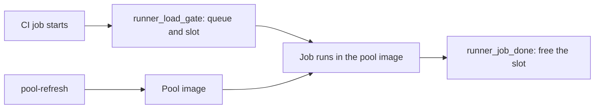

# Shared runner pool

Related: [delivery](../delivery/spec.md). The pool stays inside luismc-delivery. This spec holds its requirements. They moved here from delivery section 13 (D181, D184). Each old ID stays in the delivery spec as a pointer.

## 1. In one paragraph

The runner pool is one set of CI runners that several repositories on one machine share. A machine config limits how many jobs run at once. A pool image carries the build tools. `pool-refresh` rebuilds that image and the doctor checks it.

## 2. Why

Without a shared limit, several runners start heavy jobs at once and the machine stalls. The pool also needs one image that serves every repository, and a rebuild must never break a running job.

## 3. How it works

A job takes a ticket and then a slot. It runs. The completed hook frees the slot. `pool-refresh` changes the image only when no pool runner is busy.

## 5. Functional requirements

Each requirement names its old delivery ID. Delivery keeps that ID as a pointer.

### 5.1 Machine config, slots and load

**R5.1** (was delivery R13.60) — **One machine config** (D21, D22, G2). Every runner account on a machine reads one file: `machine.json` in the machine folder (`C:\ProgramData\luismc-delivery\` on Windows, `/etc/luismc-delivery/` elsewhere, `/machine` in the pool; `DELIVERY_MACHINE_DIR` overrides it for tests). It holds `load_limits`, `ci_slots` (2), `local_heavy` (2), `cloud_ci_sessions` (10), `slot_stale_min` (120), `runner_gate` and `runner_dirs`. Setup code writes it only through `machine_slots.write_machine_config`. `load.py` reads it first and the old `~/.claude/luismc-delivery-machine.json` only when the new file has no `load_limits`. A project's `.delivery/config.json` may lower a machine limit for its own work and never raises it. The doctor warns when the two files differ.

**R5.2** (was delivery R13.61) — **CI slots and one queue** (D21, D30). The job-started hook `runner_load_gate` takes a ticket in `queue/`, waits until its ticket is first, a slot is free and the load is under the limits, then takes the slot by creating `slots/slot-N.lock` (create-new, so two hooks never take one slot) and removes its ticket. A ready pull request's run and a run on the default branch go first (read from `GITHUB_EVENT_PATH`); inside a group it is first come, first served. After `runner_gate.max_wait_min` (30) the job fails with a log line (or `on_timeout: run` lets it go without a slot). Without a machine folder the hook is the plain load gate of DL-79.

**R5.3** (was delivery R13.62) — **Free the slot** (D25). The job-completed hook `runner_job_done` (`ACTIONS_RUNNER_HOOK_JOB_COMPLETED`) frees the job's slot, writes the released line of the slot log and empties the job's work folder (only inside a `_work` folder). A slot whose holder process is gone (same host) is freed at once. Any slot older than `slot_stale_min` is freed. Each freed slot is logged with what held it. The slot log `slot-log.jsonl` has one JSON line per take and per free (repository, run, attempt, job, shard, queue time, slot time, release time, slot, runner, outcome `ran`, `claim-lost` or `stale-freed`) and keeps the last 5,000 lines. `delivery_ci.py slots` prints the holders, the queue and each wait.

**R5.4** (was delivery R13.63) — **Host load file** (D22, G3). A scheduled task on the host runs `load.py --write` every 15 seconds and writes `host-load.json` (memory %, CPU %, time). A reader in WSL or a container uses it when it is under 60 seconds old, and its own figures when it is older. Inside a container the reader also reads the cgroup v2 figures (`memory.current`, `memory.max`, `cpu.stat`) and decides on the worse of host and container.

**R5.5** (was delivery R13.64) — **A slot wait starts the fallback** (D29, D32, G6). While the hook waits it keeps the marker `ci-wait/<sha>/<shard>`, a git branch made like a claim (the shard is `DELIVERY_SHARD` when the hook sees it, else the job key `GITHUB_JOB`; a job-level `env:` value does not reach the hook, so each sharded job's key is named after its shard, and the fallback uses the same name for `ci-wait` and `ci-claim`). `shard_wait_minutes` counts a shard with a wait marker and no claim as waiting, from the time on the marker. When the fallback has claimed the shard and the held job later gets its slot, the job ends without work (exit 3, "claim lost") and frees the slot. The marker is written from a git checkout (`DELIVERY_MARKER_ROOT`, or the job's workspace); with none, the hook writes no marker and says so. It loads `ci_fallback.py` from that checkout, else from the plugin's own copy, and logs one line whenever it writes no marker (no sha, no shard, no checkout, no module, or a failed push).

**R5.6** (was delivery R13.65) — **Local heavy work limit** (D23, D36, G4). At most `local_heavy` (2) heavy local calls run at once on the machine, across sessions. A heavy foreground command (Bash, PowerShell, Workflow) counts from its PreToolUse to its PostToolUse; a local agent counts from the ledger. At the limit a new heavy call is refused with the list of what runs. A project may lower the limit, never raise it. Local work does not take CI slots; the load check covers both. `checks_off: ["DL-91"]` turns it off.

**R5.7** (was delivery R13.66) — **Cloud CI session limit** (D34, D37). At most `cloud_ci_sessions` (10) Claude cloud sessions run CI at once, as main runner (Option 3) or fallback (Option 4). The count is the cloud claims with no `ci-posted` marker (a claim older than 3 hours is not counted). At the limit the launcher waits and retries; it never starts an 11th session. These sessions also count toward the cap of 50 cloud agents. A hosted fallback is not limited here.

**R5.8** (was delivery R13.67) — **Doctor `machine` check** (D31, D45). It checks that `machine.json` exists and is readable, that every runner folder has both hooks (a Windows `.ps1` hook passes the execution policy check; a hook that ends in `.cmd` **fails**, because the runner accepts only `.sh`, `.ps1` and `.js`), that no slot is stale and no ticket is older than `slot_stale_min`, that `host-load.json` is under 60 seconds old, the pool checks when the pool module is installed, and a dry-run push of a `ci-wait` test ref from each runner's kept checkout (**warns** with the fix when it fails: store a fine-grained token with contents write for the runner account, or use the pool), the size of each runner's `_work` folder (large totals are a warning with an offer to clean; cleaning needs a yes and skips runners with a job running). An Option 1 project whose repository variable `CI_RUNS_ON` is unset **fails**: its jobs would run on hosted runners and may bill minutes.

### 5.2 Pool image and refresh

**R5.9** (was delivery R13.68) — **Pool image layers** (DL149, D146). The pool base image is ubuntu:24.04 and always carries `build-essential` and `pkg-config`. `.delivery/config.json` `pool.layers` may list `windows-packaging`, which adds `dotnet-sdk-8.0 wine wine64 xvfb xauth msitools` (about 1 GB, 64-bit Wine, packages from the distribution, no extra feed); it is off by default. A project file `.delivery/pool.apt` lists extra apt packages, one per line, `#` for comments. A name holds only letters, digits and `+ - .` and does not start with `-`; anything else is refused with the line number and nothing changes. An unknown layer is refused the same way. `pool-refresh` reads both from the project checkout and adds them to what the pool `.env` already holds in `POOL_LAYERS` and `POOL_APT` (R5.11); `compose.yaml` passes them as build args. A missing or empty key changes nothing, and a layer turned off in the repo config alone is not removed from the pool.

**R5.10** (was delivery R13.69) — **No rebuild under a running job** (DL149). `pool-refresh --yes` reads `gh api repos/<repo>/actions/runners` for each repository in the pool's `agents.json`. When a pool runner has `busy=true`, or the list cannot be read, it refuses with `refused: pool runner busy: <name> (<repo>). Wait for the job or use --force.` and changes nothing. `--force` rebuilds and prints a warning.

**R5.11** (was delivery R13.79) — **Shared pool layers** (DL155, D153). One pool may serve several repositories, so `pool-refresh` merges. The layers in `POOL_LAYERS` and the names in `POOL_APT` of the pool `.env` stay; the calling repository's layers and apt names are added. `--drop-layer NAME` and `--drop-apt NAME` (each repeatable) remove one. The pool `.env` records which repository asked for each layer in `POOL_LAYER_SOURCES` (for example `windows-packaging:owner/app1`), and the plan prints `windows-packaging (asked by owner/app1)`. The asking repository is the first `--repos` entry, else the `origin` remote, else the folder name. Turning a layer off in the repository config alone does not remove it; the plan says to pass `--drop-layer`.

**R5.12** (was delivery R13.80) — **Playwright version never drops** (DL155, D154). `pool-refresh` never lowers `PLAYWRIGHT_VERSION` in the pool `.env`. It raises it when the calling repository's lockfile needs a newer one. `--playwright X` sets it exactly and may lower it. When the plan keeps a higher version, it says so and names the flag.

**R5.13** (was delivery R13.84) — **Pool refresh copies the pool files** (DL162). `pool-refresh` compares the plugin's pool files (Dockerfile, compose.yaml, `pool_*.py`, `pool-*` scripts, `hooks/`, and the machine scripts under `delivery/`) with the pool's copies, line endings ignored. The plan lists each file that differs as `<file>: differs from luismc-delivery <version>`. With `--yes`, it copies only those files into `<pool>/bak-<UTC time>/`, writes the templates, then builds. It never touches `.env`, `agents.json` or `db-admin.pw`. After the build it compares the image the running container uses with the tagged image. When they differ and no job runs, it runs `docker compose up -d --no-build --force-recreate pool`. The result says what happened: `image unchanged (cache hit)` or `image rebuilt, container recreated`; it never says the pool was rebuilt when the image id did not change. The doctor check `pool.<name>.files-current` warns when a pool file differs and names `pool-refresh --yes`.

**R5.14** (was delivery R13.86) — **Pool refresh fixes a wrong runner hash** (DL165). A `RUNNER_SHA256` in the pool `.env` that is not 64 hex characters, or is one repeated character, is always wrong. When `RUNNER_VERSION` is the pinned version and the hash differs from the pinned hash, the plan lists `RUNNER_SHA256: <short old> -> <short pinned> (did not match the pinned hash for <version>)` and `--yes` writes the pinned hash. For another version it uses the released hash from `runner_sha`; when that cannot be read it keeps the value and says so in the plan. The doctor check `pool.<name>.runner-sha` warns when the hash is not the pinned or released hash for its version and names `pool-refresh --yes`. Tests never write to the real machine folder.

**R5.15** (was delivery R13.87) — **Pool refresh reports the build truthfully** (DL166). When the build fails, `pool-refresh` prints `the rebuild failed: ...`, exits 1 and leaves the old container running. It reads the container id, the image the container runs and the tagged image id before the build and again after it. A changed tagged id is `image rebuilt`. A changed container id or container image is `container recreated`, and the command is not run again. Only when the tagged id is the same before and after, and the container is unchanged, does it say `image unchanged (cache hit)`.

**R5.16** (was delivery R13.88) — **Pool image has the LLVM tools for Windows builds** (DL167). The pool image always installs the distro `clang`, `lld` and `llvm` packages (about 250 MB) in its base apt layer, not behind `POOL_LAYERS`. It links `clang-cl`, `lld-link`, `llvm-lib`, `llvm-ar`, `llvm-rc` and `lld` into `/usr/local/bin` from the LLVM version found at build time, so every user finds them. A build-time check runs `clang-cl --version`, `lld-link --version` and `llvm-lib /?`, so a broken install fails the build. `cargo xwin build --target x86_64-pc-windows-msvc` needs these tools for crates with C or C++ code.

**R5.17** — **Wine prefix per agent** (DL179, D192). Only when the image has the `windows-packaging` layer (`wine` is on PATH), `pool_supervisor.py` prepares a Wine prefix for each agent user before it starts that agent's runner. It runs, as that user, `WINEPREFIX=/agents/<slug>/.wine wineboot --init` under `xvfb-run -a`, with `WINEDEBUG=-all`, a 180 s timeout and `wineserver -w` after it. It skips an agent whose prefix already holds `system.reg`. A failure is logged and never stops the runner from starting. Without `wine` nothing runs. The prefix lives in `/agents`, so a container recreated by a resize or refresh keeps it.

**R5.18** — **`POOL_WINE_PREFIX`** (DL179, D192). With `wine` on PATH, the supervisor sets `POOL_WINE_PREFIX=/agents/<slug>/.wine` in each agent's environment. A job can use it directly or copy it (`cp -a "$POOL_WINE_PREFIX" "$WINEPREFIX"`) instead of booting a fresh prefix. Without `wine` the variable is not set.

**R5.19** — **Wine runs without `TMPDIR`** (DL180). Wine aborts with `free(): invalid pointer` when `TMPDIR` is set, to any value. With the `windows-packaging` layer the image wraps each Wine entry tool (`wine`, `wine64`, `wine-stable`, `wineboot`, `wineserver`, `winecfg`, `msiexec`) in `/usr/local/bin` with a script that unsets `TMPDIR` and runs the real tool from `/usr/bin`. The pool still sets `TMPDIR` for every other tool. The image build fails if `wine` on PATH is not the wrapper.

### 5.3 Pool doctor checks and setup

**R5.17** (was delivery R13.70) — **Doctor pool checks** (DL149). `pool.<name>.layer-windows-packaging`: with the layer on, `wine`, `xvfb-run` and `dotnet` exist in the pool image (a warning when Docker cannot be read). `pool.<name>.layers-config`: the project config and the pool `.env` agree. `pool.<name>.stray-dockerfile`: a Dockerfile under a `runners` or `runner` folder of the project is flagged, because the pool never uses it; the fix is `.delivery/pool.apt` or a layer. `pool.<name>.tool-cache`: `compose.yaml` mounts a named volume at `/ci-tools` and it is writable.

**R5.18** (was delivery R13.71) — **Setup asks about Windows installers** (DL149). `/delivery-ci-setup` asks whether the project builds Windows installers on Linux and suggests yes when the repository has `*.wxs` files. Yes adds `windows-packaging` to `pool.layers`. It also names `.delivery/pool.apt`.

**R5.19** — **A pool plan keeps what the pool has** (DL176). `pool-plan` and `pool-run` take `--browsers none|chromium`. With no flag, the plan keeps `POOL_BROWSERS` from the pool `.env`; repository detection may raise `none` to `chromium` and never lowers it. The plan also keeps `POOL_LAYERS`, `POOL_APT`, `POOL_LAYER_SOURCES` and `PLAYWRIGHT_VERSION`, and the pool files it writes keep every other `.env` line. `--drop-layer`, `--drop-apt` and `--playwright` change them, as in `pool-refresh` (R5.11, R5.12).

**R5.20** — **A stable cap that does not shrink by accident** (DL176). The memory used outside WSL is the median of about 5 samples taken 1 second apart, so another program's short spike does not cut the room. The plan prints its inputs: the machine total, the memory used outside WSL, the 85% budget, the room and the Docker ceiling. A `--resize` that would lower `POOL_MEM` or `POOL_CPUS` below the `.env` refuses with a plain message and changes nothing, unless the owner passes `--shrink`.

**R5.21** — **The owner sets the pool size** (DL176). `--cpus` and `--used-gib` are machine numbers: this machine's CPU count and the memory used outside WSL. `--pool-gib N` and `--pool-cpus N` are the owner's target for the pool. The plan uses them as given when they fit the 85% memory budget (the pool, the sidecar and the VM headroom), the 60% CPU budget, the floors (4 GiB, 2 CPUs) and 1.5 GiB per CPU. Otherwise it refuses and names the budget that is short. The `.wslconfig` memory and processors rise to fit.

**R5.22** — **The VM is measured, not guessed** (DL177). The size of the WSL VM is the larger of the `vmmem`/`vmmemWSL` working set and its private bytes, and never less than the memory the containers use. Windows trims the working set, so it alone swings. The plan prints each figure on its `Sizing inputs` line.

**R5.23** — **Docker is read through the Windows CLI first** (DL177). On Windows, the container use and the CPUs Docker sees come from the `docker` CLI on `PATH` (Docker Desktop installs it). `wsl docker` is the fallback, used only when that CLI cannot run. If both fail, the use reads 0 and the CPUs read unknown.

**R5.24** — **Sizing does not hang on one moment** (DL177). "Fits" is judged against the larger of the 5-sample median (R5.20) and the host-load file's last sample (memory % of the total, minus the VM). A missing or stale file (over 60 s old) is ignored and the samples alone decide. The `Sizing inputs` line says which decided. A refusal for memory per CPU names the nearest sizes that pass, for example "10 GiB fits 6 CPUs; 7 CPUs needs 10.5 GiB".

## 8. Failure modes

| Failure | Result |
|---|---|
| A job crashes while it holds a slot | A dead holder process frees the slot at once; any slot is freed after `slot_stale_min` (R5.3). |
| A job is held for a slot while the fallback runs its shard | The held job gets its slot, finds the claim taken, ends with exit 3 and frees the slot (R5.5). |
| Ten cloud CI sessions already run | The launcher starts no more and retries on the next poll (R5.7). |
| A pool runner is busy or the runner list cannot be read | `pool-refresh --yes` refuses and changes nothing (R5.10). |

## 9. How it is proven

| Requirement | Test |
|---|---|
| R5.1 to R5.8 | `tools/test_delivery_runner.py`, `claude/plugins/delivery/tests/test_load.py`, `claude/plugins/delivery/tests/test_doctor.py` |
| R5.9 to R5.16 | `claude/plugins/delivery/tests/test_runner_pool.py`, `claude/plugins/delivery/tests/test_dl149_pool_layers.py`, `claude/plugins/delivery/tests/test_dl155_pool_refresh_shared.py`, `claude/plugins/delivery/tests/test_dl162_pool_refresh_files.py`, `claude/plugins/delivery/tests/test_dl165_pool_refresh_hash_result.py`, `claude/plugins/delivery/tests/test_dl167_pool_llvm.py` |
| R5.17, R5.18 | `claude/plugins/delivery/tests/test_dl149_pool_layers.py`, `claude/plugins/delivery/tests/test_doctor.py` |
| R5.19 to R5.21 | `claude/plugins/delivery/tests/test_dl176_pool_resize.py`, `claude/plugins/delivery/tests/test_dl103_pool_keep_cap.py` |
| R5.22 to R5.24 | `claude/plugins/delivery/tests/test_dl177_pool_measure.py` |

## 12. Code map

Source: claude/plugins/delivery/scripts/delivery_runner_pool.py
Source: claude/plugins/delivery/scripts/machine_slots.py
Source: claude/plugins/delivery/templates/runner-pool/

## Versions

Written by the release fold. Do not edit by hand.

| Version | Date | Release | What changed | Tasks |
|---|---|---|---|---|
| 0.5.2 | 2026-11-11 | RELEASE-92 | The pool folder records the writing plugin version in pool-version.json; the pool code holds the shared agent-name, CI_RUNS_ON and image rules the doctor uses. Contract text is in the delivery feature spec. | DL184 |
| 0.5.1 | 2026-11-10 | RELEASE-90 | R5.19: the image build clears the shell's command hash before checking that wine on PATH is the wrapper. | DL182 |
| 0.5.0 | 2026-11-10 | RELEASE-89 | Wine prefix prepared per agent at container start and exported as POOL_WINE_PREFIX (R5.17, R5.18). Wine entry tools in the pool image run through wrappers that unset TMPDIR, because Wine aborts with free(): invalid pointer when it is set. | DL179, DL180 |
| 0.4.0 | 2026-11-10 | RELEASE-88 | Pool sizing measures the WSL VM (larger of working set and private bytes, never below container use), reads Docker through the Windows CLI before wsl, judges fit against the host-load sample too, and names sizes that pass (R5.22 to R5.24). | DL177 |
| 0.3.0 | 2026-11-10 | RELEASE-87 | Pool plans keep browsers, layers, apt and Playwright from the pool .env; the memory figure is a median of samples; a --resize that lowers the cap needs --shrink; --pool-gib and --pool-cpus set the pool size (R5.19 to R5.21). | DL176 |
| 0.2.0 | 2026-11-10 | RELEASE-84 | Runner-pool requirements move here from the delivery spec (D181, D184); old IDs stay as pointers. | DL174 |
