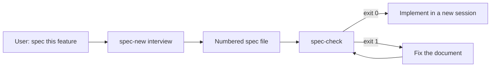

# Spec authoring and checking (luismc-specs)

## 1. In one paragraph

`luismc-specs` has two skills. `spec-new` interviews the user and writes a numbered spec with testable requirements before any code. `spec-check` reads a spec and reports numbering errors and references that point nowhere. One skill writes to a discipline. The other proves that the discipline held.

## 2. Why

Code, tests and other specs cite specs by requirement ID. When a number is duplicated, skipped or renumbered, citations rot unseen. A spec written after the code describes the code, not the intent.

Goals: IDs that stay stable, every requirement tied to a test, and a check that a build can gate on.

Non-goals: judging whether two requirements contradict (a human does that), and content checks tied to one document.

## 3. How it works

1. `spec-new` asks about scope, data that must not be lost, failure behaviour and retries.
2. It writes the spec from `assets/spec-template.md`: to `docs/` in a repo that follows DOCSPEC, else `specs/`.
3. It stops. Implementation starts in a fresh session.
4. `spec-check` runs `assets/spec_check.py` and reports headings, identifiers and references.
5. The author fixes the document, never the citation target.

## 5. Functional requirements

**R5.1** — `spec_check.py` reports a duplicate, wrongly nested, orphaned, gapped or out-of-order heading number.

**R5.2** — `spec_check.py` reports a duplicate, malformed, gapped or out-of-order requirement ID, and an ID whose prefix does not match its section.

**R5.3** — `spec_check.py` reports a `§n.n` that resolves to no heading and an `Rn.n` that resolves to no definition.

**R5.4** — A citation that names a registered document (`--external NAME=PATH`) resolves against that document. An unregistered name falls through to this document's own numbering, with a hint when that also fails.

**R5.5** — Statutory citations (numbers of 100 and above) and lettered insertions (`R4.9a`) are not reported.

**R5.6** — Exit status is 0 when clean, 1 with findings, and 2 when a file cannot be parsed. It accepts several paths, `--only`, `--strict` and `--json`.

**R5.7** — `spec-new` writes IDed, testable requirements to a numbering discipline that `spec-check` accepts, and stops once the spec is written.

## 6. Non-functional requirements

**R6.1** — `spec_check.py` uses only the Python standard library.

## 7. Design

`claude/plugins/specs/skills/spec-check/assets/spec_check.py` is the checker. It parses headings and definitions, then resolves references. `tools/spec_check.py` is a symlink to it, so the repository's tests and CI run the same file. The skills pin `opus` (spec-new) and `sonnet` (spec-check), both at medium effort.

## 8. Failure modes

- A file that cannot be parsed exits 2, never 0.
- An unregistered external citation can match a local heading of the same number. So a document must register what it cites.
- The checker fails closed in CI: findings exit 1.

## 9. How it is proven

| Requirement | Test |
|---|---|
| R5.1, R5.2, R5.3, R5.4, R5.5 | `tools/test_spec_check.py` |
| R5.6 | not covered by a test yet; see section 11 |
| R5.7 | not covered by a test yet; see section 11 |
| R6.1 | not covered by a test yet; see section 11 |

## 11. Not built yet

NOT YET IMPLEMENTED: a test that a spec written from `spec-template.md` passes `spec-check`, and a test of the exit codes and flags (R5.6). The seam is `tools/test_spec_check.py`.

## 12. Code map

Source: claude/plugins/specs/skills/spec-new/SKILL.md
Source: claude/plugins/specs/skills/spec-new/assets/spec-template.md
Source: claude/plugins/specs/skills/spec-check/SKILL.md
Source: claude/plugins/specs/skills/spec-check/assets/spec_check.py
Source: tools/spec_check.py
Source: tools/test_spec_check.py
