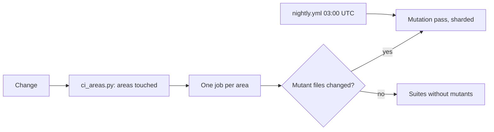

# Test and validation cost

## 1. In one paragraph

All eight fixes shipped in #47: CI runs only the areas a change touches, mutation passes only when their files change, and the record pushes once per turn.

### What is wrong

The owner was right about duplication, and wrong in one place it would be easy to cut: the checks themselves are good. All 94 gate mutants are caught, and the extra CI runs found three Linux-only bugs and one weak test. What is wrong is *how often* and *how indiscriminately* they run. Four causes:

1. **Everything runs for every change.** spec-lint is one job of 17 steps with no scoping, so a luismc-artifacts patch pays 13.7 minutes for delivery-script tests it cannot affect, including an 8.8-minute mutation pass.
2. **The same commit is tested at three stages.** Agents ran the full workflow on their branches (half of all CI time), the ready PR ran it again on the joined result, and `main` ran it a third time on a tree that differs only in record files.
3. **Tests that once had a reason were never retired.** The fake-renderer group covered the time before the real renderer existed; it now doubles the artifacts suite. Mutants rerun whole scenarios after they are already caught.
4. **The record writes to main like a chat.** One push per status change: 264 commits in a day, each scanned, all of them moving `main` under the CI runs that are meant to test a fixed tree.

What this cost the owner: a release that changes only luismc-artifacts waits about 17.5 minutes for its ready-PR run where about 3.8 would prove the same, plus 17.4 more on `main`. A train like 7.1.0 spent 1 h 54 between its first branch run and its merge.

## 3. How it works

### The question

On 11 October the owner wrote: I'm concerned we're overdoing it in terms of tests and validations and there might be a lot of duplication and unnecessary tests being run. This page answers that with measurements, not impressions: what runs, how often, for how long, and what each run actually caught.

Scope: the test suites in `tools/`, the GitHub workflows of this repository (`spec-lint`, `secret-scan`, `template-build`, `train-cleanup`), the runs agents and the session made on this PC, and the record commands of luismc-artifacts. Window: 10 October 20:35 to 11 October 11:00 (Lisbon), the two days in which STACKSPEC 7.0.0 and 7.1.0 and luismc-artifacts 1.1.0 to 1.3.1 were built.

**One correction up front.** This repository is public, so GitHub Actions minutes are free (a sampled run reports 0 billable milliseconds). The cost is not money: it is the owner's waiting time before a merge, this PC's CPU while agents test, and noise in the history. The findings below are weighed on those three.

### How it was measured

Each suspicion was written down as a hypothesis first, then tested against data that could prove it wrong. Four sources:

| Source | What it gave |
|---|---|
| GitHub run history (300 runs, `gh run list`) | Every workflow run: trigger, branch, commit, duration, result. |
| CI logs of the 7.1.0 ready PR and of every failed run | Per-step times, the time split inside a suite (from log timestamps), and what each failure was. |
| Session and agent transcripts on this PC (45 files) | Every local suite execution, with its flags, before and after the 02:30 testing rule. |
| Timed experiments on this PC (Windows), in a scratch worktree of `main` | E1: every case of the artifacts suite timed in both renderer groups. E2: every scenario and each of the 94 mutants of the gate suite timed to its end and to its first failed check. A static read of the suites replaced a planned E3 (see H4). |

Two hypotheses I had stated earlier turned out false and are kept below as false, with the evidence. One estimate from the read-only audit (DS46) was tested and corrected.

### Hypotheses and verdicts

Ten hypotheses, each with the test that could have proved it wrong. Three were false or overstated, and say so.

| # | Hypothesis | Test | Verdict |
|---|---|---|---|
| H1 | One change is tested many times over | Count spec-lint runs per stage in the run history | **True.** 24 full runs in 14 hours for 5 releases. In the 7.1.0 train, 10 agent-branch runs used 132 of 167 CI minutes (79%); the ready PR then repeated all of it. |
| H2 | Mutation passes dominate CI time | E2: time every scenario and mutant of the gate suite | **True.** 94 mutants take 81% of the gate suite (1,357 of 1,682 s on Windows), and the gate suite is 62% of a ready-PR run (10.9 of 17.5 min). |
| H3 | The run on `main` after a merge repeats the ready PR | Compare the merged tree with the tested tree; read every failed `main` run | **True.** In all three merges checked, the only difference was record files under `docs/artifacts/`. Its one failure was a flake (`git clone` could not copy a file), not a bug. |
| H4 | The artifacts suite's fake-renderer group repeats the real group | Static read of every case; E1: time every case in both groups; read every failed run | **True.** The real group runs every case but one, and every assertion that differs is weaker in the fake group. Each group costs the same per case (median ratio 1.02), so the fake group is 46% of the suite. It never caught a bug the real group missed. |
| H4a | The fake group is twice as slow as the real one (my earlier claim) | E1, measured directly | **False.** The CI log timestamps I used come from buffered output. Measured: fake 485 s, real 561 s. |
| H5 | Agents' local runs wasted this PC's CPU | Count local suite executions in 45 transcripts, before and after the 02:30 rule | **True before 02:30, fixed after.** Before the rule: 17 full mutation runs of the gate suite at about 28 min each (E2), about 8 CPU-hours. After it: 1. |
| H6 | A join re-runs the suites (my earlier claim) | Look for `join.py` and `branch_gate.py` runs in this repository | **False here.** dev-standards has no `gate.json`; its joins are plain git merges. The gate on join exists only in the templates products get. |
| H7 | Record commands cost a lot (each validates and renders every page) | Time `check`, `render`, `pending`, `set-task-status` | **False.** 1.6 to 1.8 s each, 4.0 s for a status change including the push. |
| H8 | Record commits flood `main` and its checks | Classify every commit on `main` and every secret-scan run | **True.** 264 of 276 commits on `main` since 10 October are record commits, and 189 of 194 secret-scan runs on `main` scanned one. Cheap (10 s each), but they bury the 12 real commits and keep `main` moving under every CI run. |
| H9 | Stopping a mutant at its first failed check would halve the mutation pass | E2: for each mutant, time to its first failed check against its full run | **Partly true.** 51% of mutant time comes after the first failure, so about 49% is saved, not the audit's 45 to 65%. Uneven: `e2e_map`, `push_check` and `fast_report` fail in the first third; `timeout` and `verify` fail late and save little. |

**What the extra runs did catch.** In the window, CI found three Linux-only bugs that Windows runs could not (DS17 twice: a test PATH that dropped `/usr/bin`; DS29: a missing `origin/main` case) and one weak test (a DS29 mutant nobody caught). So the checks themselves earn their place. The problem is running them several times, and running all of them whatever changed.

### Where the time goes

##### Full spec-lint runs, by what started them

      132 min 89 min 49 min Agent branch runs (10) Ready PRs (9) main after merge (5) 269 CI minutes, 10 Oct 20:35 to 11 Oct 11:00; runs under 1 min left out  Half of all CI time was agents testing their own branches; the ready PR then ran the same suites on the joined result, and `main` ran them a third time after the merge.

##### One ready-PR run, step by step (7.1.0, 17.5 min)

    Gate suite: mutants8.8 Gate suite: scenarios2.1 Artifacts commands3.1 Train cleanup1.7 CI scripts, templates0.8 Artifacts hooks0.3 Change notes0.3 Spec checks, rest0.4   05 min10 min needed by a luismc-artifacts change not touched by one  Step times from the CI run of PR #45; the gate suite's split from E2 (81% mutants). A change to luismc-artifacts alone needs about 3.8 of the 17.5 minutes; the other 13.7 test the delivery scripts it never touched.

##### The full run doubled in six hours

The full ready-PR run took 8.5 min at 21:36 on 10 October and 17.5 min at 03:59 on 11 October. Every release added tests and mutants, nothing was removed, and all of it runs for every change.

### The mutation pass

A mutant breaks one rule in a copy of the delivery scripts and reruns the scenario that should notice. All 94 gate mutants were caught: the tests are strong. But each mutant reruns its *whole* scenario even after the first check has already failed, and the pass runs for every change, including ones that never touch the files it mutates.

   timeout (7)196 s e2e_map (7)174 s push_check (13)173 s verify (8)157 s fast_report (7)156 s fork_point (7)94 s the other 45407 s* until the first failed check after it: the mutant is already caught E2, Windows · 2.04 px per second · * this row at half scale  E2 on this PC: 1,357 s of mutant runs, 692 s of them up to the first failed check (51%). Stopping at the first failure saves about 49%, about 4.3 of the 8.8 minutes on Linux.

The larger saving is *when* it runs. The gate mutants guard six files under `tooling/shared/scripts/delivery/` and the pre-push hook. Of the five releases in the window, two changed those files (STACKSPEC 7.0.0 and 7.1.0). A third (#42) changed only `cleanup.py`, which the cleanup suite's own 54 mutants guard. For #42 and the other two (luismc-artifacts 1.1.0 and 1.1.1) the gate's 8.8 minutes proved nothing new, checked with `git diff` of each merge.

### Repeats and noise

##### The artifacts suite runs every case twice

   fake renderer, 99 cases485 s real renderer, 98 cases561 s E1, Windows. Per case the two cost the same (median fake/real 1.02). The fake group's only unique case: test_check_runs_check_html.  The fake group was written while the real renderer did not exist yet, so the script could be tested on its own. The real renderer now always ships with it, and the fake group is 46% of the suite: about 8 minutes on this PC and 1.5 on Linux.

##### Record commits drown main

     264 record commits (docs/artifacts: …), each one a push and a secret-scan run 12 real commits main, 10 Oct 00:00 to 11 Oct 10:15 · 189 of 194 secret-scan runs on main scanned a record commit  Every status change commits and pushes the record to `main` right away. Each push is cheap (a 10 s scan), but together they bury the release commits and keep `main` moving under every ready-PR run. In each of the three merges checked, the merged tree differed from the tree its PR tested only by these record files.

##### Other repeats found

- **No cancel on spec-lint.** A new push to a ready PR starts a second full run while the first keeps going: on 11 October at 00:07, two 9 to 11 minute runs of the DS17 PR ran side by side.
- **Not a repeat after all: the checksum tests.** The audit (DS46) flagged the installer's checksum check as tested twice. Reading both: `test_delivery_gate.py` tests the old checksums-file fallback (lines 2109 to 2188), `test_delivery_ci.py` the pinned form (lines 1550 to 1584). Two code paths, so both stay.
- **On this PC, Windows is the slow part.** The same artifacts suite takes 3.1 min on Linux and 17.5 on Windows, because every case starts several Python and git processes. That cost is spent only by local runs.

### Solutions, ranked

Ranked by what they save the owner's wait, with what each could let slip. Savings are Linux CI minutes unless marked.

| # | Change | Saves | Risk, and how it is covered | Task |
|---|---|---|---|---|
| S1 | Split spec-lint into jobs by area (delivery, artifacts, specs, auth) that run only when their files change; anything shared runs all | A luismc-artifacts PR: 17.5 → about 3.8 min. Jobs also run side by side, so a full run's wait becomes its longest job, not the sum | A file used by two areas but listed under one. Covered by a "shared" path list that runs every job, checked by a test | DS43 (chosen) |
| S2 | Run each mutation pass only when the files it mutates (or its test) change; run all mutants on `main` once a night | 8.8 min on every PR that does not touch the delivery scripts (3 of 5 releases in the window) | A mutant's target text drifting unseen: it can only drift when its file changes, which is exactly when the pass runs. The nightly run covers Python and runner image changes | TC1 (open: D6) |
| S3 | A mutant stops at its first failed check | About 4.3 of the 8.8 mutant minutes whenever they do run (E2: 49%) | A mutant caught only by a later check would show as NOT CAUGHT: loud, never silent | TC2 |
| S4 | No full branch runs by agents; the ready PR is the one full run. An agent triggers CI on its branch only for a Linux-specific change, and then only its area's job | About 132 min per train like 7.1.0, and this PC's CPU | Linux-only bugs surface at the ready PR, not on the branch: 3 in the window, each one more fix-forward round (about 4 to 17 min) | DS45 (chosen) |
| S5 | Skip the full run on `main` when the merge differs from the tested tree only under `docs/artifacts/` and other ignored paths | 17.4 min per merge | Drift on `main` between test and merge: covered by the nightly full run of S2 | DS44 (chosen) |
| S6 | Retire the fake-renderer group; move its one unique case into the real group | 46% of the artifacts suite: about 1.5 min in CI, 8 min per local run on this PC | A script bug hidden by the real renderer's behaviour: none found in the window; the real group already runs a superset of the cases | TC3 (open: D7) |
| S7 | Cancel a ready PR's older spec-lint run when a newer commit arrives | A whole duplicate run each time a ready PR gets a fix (twice for DS17) | None: the newer commit's run decides | TC4 |
| S8 | The record commits on every change but pushes once, at the end of the turn (the end-of-turn hook already runs there) | About 250 pushes and scans a day; `main` stops moving under CI, so S5's tree check can match exactly | A session that dies before the end of its turn loses that turn's status changes until the next push. Covered by pushing before any PR, merge or publish | TC5 (open: D8) |

**Together**, for a release that changes only luismc-artifacts: S1, S5 and S6 take the wait from about 35 minutes (ready PR plus `main`) to about 2.5. For a release of the delivery scripts: S3 and S5 take it from about 35 to about 13. S4 removes the branch runs before either.

**Not recommended.** Removing `template-build`'s Windows jobs: they exist for a path-separator bug that only Windows shows. Rewriting the artifacts suite to run in one process: it would cut the Windows time several-fold, but S4 and S6 already take most local runs away, so the rewrite is not worth its risk now.

Related: [delivery speed](../delivery-speed/spec.md), [delivery](../delivery/spec.md), [artifacts](../artifacts/spec.md). How to test here: `docs/testing.md`.

## 5. Functional requirements

**R5.1** — `tools/ci_areas.py` maps a change to the areas it touches. A shared path (the workflow, the script, its test, `change-notes.json`, any `tools/*common*`) runs every area. A path no rule names also runs every area.

**R5.2** — The ready PR runs only the jobs of the touched areas.

**R5.3** — A mutation pass runs only when its own scripts, hooks or suite file change. `nightly.yml` and the `mutants` dispatch input force all on.

**R5.4** — In mutant mode a scenario stops at its first failed check. A crash counts as caught. An uncaught mutant fails loudly.

**R5.5** — A push to main that differs from the tested PR only under ignored paths skips the run.

**R5.6** — A newer commit cancels an older ready-PR run.

**R5.7** — Delivery suites run as parallel jobs. The gate mutation pass runs as 4 shards (`--shard I/N`) when on. A small final job keeps the required-check name.

**R5.8** — The artifacts record commits on every change and pushes once per turn, before any PR, merge or publish.

**R5.9** — `python tools/ci_areas.py --branch-advice` prints `light` or `heavy` for the branch.

## 6. Non-functional requirements

**R6.1** — A ready PR that changes one area finishes in about the time of that area's slowest job (3.0 minutes for the delivery area after sharding).

**R6.2** — Cutting a test never removes a check that caught a bug. A suite is heavy when it takes over 3 minutes locally.

## 7. Design

Areas: `specs`, `delivery`, `artifacts`, `profiles`, `transcript-folds`, `docs`. The first job, `areas`, runs `ci_areas.py` and writes GitHub outputs, including one mutants flag per delivery suite. Workflows: `spec-lint.yml` (PR and push), `nightly.yml` (cron), `template-build.yml`, `secret-scan.yml`, `train-cleanup.yml`.

## 8. Failure modes

| Dependency | Fails | Why |
|---|---|---|
| Unknown path in `ci_areas.py` | closed (runs all) | A missed area is worse than a slow run. |
| Drift between a skipped main run and the PR tree | caught nightly | The nightly full run covers it. |
| Session dies before the end-of-turn push | record lags | The next push, or any PR/merge/publish, pushes first. |

## 9. How it is proven

| Requirement | Test |
|---|---|
| R5.1, R5.2, R5.3, R5.5, R5.9 | `tools/test_ci_areas.py` |
| R5.4, R5.7 | `tools/test_delivery_gate.py`, `tools/test_delivery_cleanup.py` |
| R5.6 | `tools/test_ci_speedups.py` |
| R5.8 | `tools/test_project_artifacts_hooks.py` |
| R6.2 | `tools/test_rule_tags.py` |

## 10. Decisions

| ID | Question | Chosen | Date |
|---|---|---|---|
| D1 | Make path-scoped CI jobs? (asked as one of four cuts in a single multi-select question) | Yes | 2026-10-11 |
| D2 | Skip the main re-run when its files equal what the ready PR tested? (same multi-select question) | Yes | 2026-10-11 |
| D3 | Agents test only what they touch? (same multi-select question) | Yes | 2026-10-11 |
| D4 | Audit the suites for duplicates? (same multi-select question) | Yes | 2026-10-11 |
| D5 | AR35 and AR37 are being tested now. Cut their testing short? | One CI run only | 2026-10-11 |
| D6 | When should the mutation passes run? | When their files change, plus nightly | 2026-10-11 |
| D7 | Retire the artifacts suite's fake-renderer group? | Retire it | 2026-10-11 |
| D8 | How often should the record push to main? | Once per turn | 2026-10-11 |
| D9 | When does the nightly full run with mutants start? | 03:00 UTC | 2026-10-11 |
| D10 | Shorten the PR CI run (11 min, one serial delivery job with every suite's mutants on for any delivery change)? | Add to DL12 now | 2026-10-11 |
| D11 | Which of the three CI cuts go into DL12 now? | 1+2+3 | 2026-10-11 |
| D12 | How should the CI-speed ideas reach other projects? | Generic SHOULD, next train | 2026-10-11 |
| D13 | When should TC8 run? (its 12 Oct date had no basis) | Start now, in parallel | 2026-10-11 |
| D14 | How should TC8 get past the pre-commit false positive on `GH_TOKEN: ${{ github.token }}`? | Hook: allow GitHub expressions | 2026-10-11 |
| D15 | Build the four checks (measured suite times, test-run hook, change-note check at commit, ready PR only from *-integration, join.py fix) in luismc-project-setup? | Yes, next train | 2026-10-11 |
| D16 | Tag every line of the shipped rule files with its check or 'advice', with a test that fails on an untagged line? | Yes, in TC9 | 2026-10-11 |
| D17 | When a check catches a break, block or warn? | Block | 2026-10-11 |
| D18 | When does a suite count as heavy? | Over 3 min locally | 2026-10-11 |

Decisions in MADR form: [0035](../../architecture/decisions/0035-ci-by-area-and-nightly-mutants.md), [0036](../../architecture/decisions/0036-retire-fake-renderer-group.md), [0037](../../architecture/decisions/0037-record-push-once-per-turn.md), [0038](../../architecture/decisions/0038-parallel-delivery-suites-and-shards.md), [0040](../../architecture/decisions/0040-rule-tags-and-blocking-checks.md).

## 11. Not built yet

Stopping every mutant at its first failed check is done for the gate suite; a single-process artifacts suite was judged not worth its risk.

## 12. Code map

Source: tools/ci_areas.py
Source: .github/workflows/spec-lint.yml
Source: .github/workflows/nightly.yml
