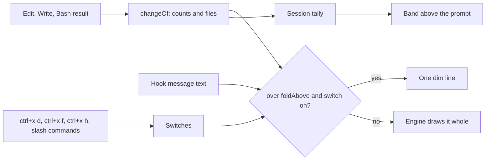
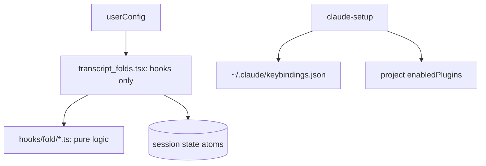

# Transcript folds

## 1. In one paragraph

`luismc-transcript-folds` draws each long diff, each finished shell command and each long hook message as one line in the Claude Code transcript. Long diffs from Edit, Write, NotebookEdit and Bash, and long hook feedback, no longer push the conversation off screen. Three chords and three slash commands show or hide the detail. A line above the prompt shows the switches and the changes made in this session.

## 2. Why

Long diffs and command output fill the terminal. The person wants to see the conversation, with the detail one keystroke away.

Goals: one line per long diff (an icon, the file and line, lines added and removed); one line per finished command (the command cut to fit, then its line count, its error, or the files it changed); one line per long hook message (the hook event, its first sentence, the words hidden); nothing that depends on a keyboard shortcut alone.

Non-goals: changing what Claude does, writing files, or running commands. The plugin is a display mod only.

**Why its own plugin.** A change to how the transcript is drawn runs inside Claude Code as a mod. A mod runs only from an enabled plugin. As part of the standard setup, `claude-setup` enables the plugin in the project's `.claude/settings.json` and installs it with `--scope project`, like the other plugins. It writes the three chords to `~/.claude/keybindings.json`, because keybindings have no project scope.

**Written from scratch.** The idea comes from a third-party plugin. The plugin uses none of its code, names or layout (see [decision 0016](../../architecture/decisions/0016-build-transcript-folds-from-scratch.md)).

## 3. How it works

- **Folded diffs.** A change over `foldAbove` changed lines (default 5) draws one dim line: marker, relative path, first changed line, `+added −removed`. A new file reads `new <path> (+n)`. A notebook names its cell. Errored results, small changes and review dialogs are never folded.
- **Folded commands.** A finished Bash or PowerShell call draws one row with the command cut to fit and its outcome: `n lines`, `no output`, or the first line of the error. A command that edited files adds `n files (+a −r)`. Running and interrupted calls are not folded.
- **Compact mode.** The counts go on the Edit or Write row itself and the line under it is dropped.
- **Band.** One dim line above the prompt holds three buttons and the tally, for example `Diffs folded (ctrl+x d) · Commands folded (ctrl+x f) · Hooks folded (ctrl+x h) · 7 files +120 −34 this session`.
- **Folded hook messages.** A hook message is the feedback text a hook adds to the transcript. The engine has no render component for it and no hook marker in the render input, so the plugin watches the non-assistant rows (`UserMessage`, `InfoNotice`) and matches the text. Only a message whose first line is `<Event> says`, `<Event> hook error` or `<Event> hook feedback` is hook output (`Event` may carry a matcher, as in `PreToolUse:Bash`). A message over `foldHooksAbove` words draws one dim line: the event words, the first sentence cut to the width, and the words hidden, for example `Stop says: DL-63 row is still open. (+412 words)`. The person's own prompt, a message in `ctrl+o` view, a `<system-reminder>` block and any text of another shape are never folded.
- **Chords.** `ctrl+x d` flips diffs (action `theme:toggleSyntaxHighlighting`). `ctrl+x f` flips commands (action `theme:editCustom`). `ctrl+x h` flips hook messages (action `settings:sortByTokens`). The engine has only two `theme:` actions, both taken, so the third chord uses an action that the engine handles only inside the usage settings. Outside those dialogs the chords reach the plugin and do not clash with other bindings.
- **Slash commands.** `/fold-diffs`, `/fold-commands` and `/fold-hooks` flip the same switches and answer in one line. `/fold-hooks diag` prints, in one line, the component and first 40 characters of the last five messages the matcher folded or passed as hook output, and of the last five non-assistant messages over 80 words that it did not match. The owner uses it to check the matcher against the real transcript.

Settings under `/config`:

| Key | Default | Meaning |
|---|---|---|
| `foldAbove` | 5 | A diff with this many changed lines or fewer is drawn whole; 0 folds every diff |
| `marker` | `»` | Starts every folded diff line; empty for none |
| `compactCounts` | false | Compact mode |
| `foldHooksAbove` | 40 | A hook message with this many words or fewer is drawn whole; 0 folds every hook message |

## 4. Screens and states

All three switches start folded in every session. A toggle lasts for that session only, so a stray chord never carries over (owner, 16 October 2026). With a switch off, the engine draws as usual. Runs of edits that it groups into one row are drawn expanded, so every diff shows. The band steps aside while a survey is shown.

## 5. Functional requirements

**R5.1** — A change over `foldAbove` changed lines folds to one line; a change at exactly the threshold does not. With `foldAbove` 0, every diff that changes something folds and an empty change never does.

**R5.2** — Line counts come from the patch: several hunks add up, the first changed line is the first hunk's start, CRLF and a missing final newline are handled, and a new file counts all its lines.

**R5.3** — A notebook edit counts added, changed and removed cells and names the cell.

**R5.4** — A shell outcome is the number of output lines, `no output`, or the first line of the error; stderr-only output counts its own lines; an error with only an exit code still has an outcome.

**R5.5** — Text is cut to the display width, counting wide characters and emoji as two cells, and an ellipsis marks a cut, down to tiny widths.

**R5.6** — The session tally adds each file once and adds its lines every time.

**R5.7** — `/fold-diffs`, `/fold-commands` and `/fold-hooks` flip their switch and say the new state.

**R5.8** — A hook message folds only when its first line has the shape `<Event> says`, `<Event> hook error` or `<Event> hook feedback` and it has more than `foldHooksAbove` words (default 40). A message at exactly the threshold is drawn whole. The folded line holds the event words, the first sentence cut to the width, and the number of words hidden.

**R5.9** — A long message of any other shape, a `<system-reminder>` block, a prompt typed by the person and any message with the hooks switch off are drawn whole.

**R5.10** — `/fold-hooks diag` prints the last five matched messages and the last five unmatched messages over 80 words, each as component name and first 40 characters.

## 6. Non-functional requirements

**R6.1** — The plugin writes no files and runs no commands.

**R6.2** — The logic in `hooks/fold/` imports only sibling `.ts` files: no engine import, no JSX, no Node API. The plugin needs no npm package.

**R6.3** — The three chords differ from those other plugins borrow, so all can be installed together.

## 7. Design

`transcript_folds.tsx` is glue. Each decision is a call into `hooks/fold/`, split by concern (`change`, `hookfold`, `lines`, `shell`, `summary`, `tally`, `width`, `options`). Session state holds the three switches, the diagnostic lists, the tally, the project root, and the counts and outcome of each finished call by `tool_use_id`. `claude-setup` merges the three chords into the `Global` context of the user's keybindings. A chord bound to another action is a conflict the owner decides. It never changes another binding.

## 8. Failure modes

| Situation | Behaviour | Why |
|---|---|---|
| Edit data unavailable on a Bash result | No change, no fold | Show the engine's output rather than guess |
| A call was interrupted | Never folded | The detail matters most then |
| A call errored | Folded to its first error line (R5.4) | The row keeps the error text in view |
| A chord is already bound to another action | `claude-setup` reports a conflict | Never overwrite a binding |
| A hook message has another shape than R5.8 | Drawn whole, never guessed | Only text the matcher is sure of is folded |
| The engine adds a hook marker or a hook component | The matcher can then use it; the text rule still holds | `/fold-hooks diag` shows what it saw |
| The plugin is not enabled | The chords do nothing | A mod runs only from an enabled plugin |

## 9. How it is proven

| Requirement | Test |
|---|---|
| R5.1 | `foldedFileChange`, `threshold` cases in `claude/plugins/transcript-folds/tests/change.test.ts` |
| R5.2 | `claude/plugins/transcript-folds/tests/lines.test.ts` |
| R5.3 | `claude/plugins/transcript-folds/tests/change.test.ts` and `claude/plugins/transcript-folds/tests/lines.test.ts` |
| R5.4 | `claude/plugins/transcript-folds/tests/shell.test.ts` |
| R5.5 | `claude/plugins/transcript-folds/tests/width.test.ts` |
| R5.8, R5.9, R5.10 | `claude/plugins/transcript-folds/tests/hookfold.test.ts` |
| R5.6 | `claude/plugins/transcript-folds/tests/tally.test.ts` |
| R6.2 | `claude/plugins/transcript-folds/tests/purity.test.ts` |
| R6.3 | `tools/test_model_profiles.py`, check K1 (the keybindings asset holds the three chords and their actions, and the plugin source names the same actions) |

Run the Node suites with `node --test --experimental-strip-types claude/plugins/transcript-folds/tests/*.test.ts`. R5.7 and R6.1 have no automated test; R5.7 was checked in a smoke run of the plugin in Claude Code. The hook-message matcher (R5.8 to R5.10) is proven on sample text only; it is not yet checked against a live transcript, which is what `/fold-hooks diag` is for.

## 10. Decisions

| ID | Question | Chosen | Date |
|---|---|---|---|
| [0016](../../architecture/decisions/0016-build-transcript-folds-from-scratch.md) | Adopt the third-party plugin or build our own? | Build our own | 2026-10-13 |
| [0017](../../architecture/decisions/0017-test-the-fold-logic-with-the-node-runner.md) | How are the plugin's hooks tested? | Pure logic under `node:test` | 2026-10-13 |
| [0018](../../architecture/decisions/0018-marketplace-is-named-dev-standards.md) | Which marketplace name do installs use? | `dev-standards` | 2026-10-13 |
| page D4 | What is the plugin called? | `luismc-transcript-folds` | 2026-10-13 |
| page D5 | Which chords? | `ctrl+x d`, `ctrl+x f` | 2026-10-13 |
| page D7 | How does `claude-setup` offer it? | Standard, user target | 2026-10-13 |
| page D8 | What state does a session start in? | Diffs folded, commands folded; never remembered | 2026-10-16 |
| DS268 | Which component draws a hook message? | None is named; match the text of `UserMessage` and `InfoNotice` rows | 2026-11-26 |
| DS268 | Which action for the third chord? | `settings:sortByTokens`; no third `theme:` action exists | 2026-11-26 |

## 11. Not built yet

None.

## 12. Code map

Source: `claude/plugins/transcript-folds/`

| Path | Holds |
|---|---|
| `hooks/transcript_folds.tsx` | The hooks, the band, the slash commands |
| `hooks/fold/*.ts` | The pure logic |
| `types/state.d.ts` | The session state contract |
| `tests/*.test.ts` | The Node suites |
| `.claude-plugin/plugin.json` | Name, version and the four settings |

Also `claude/plugins/project-setup/skills/claude-setup/assets/keybindings.json` (the chords `claude-setup` merges).

## Versions

Written by the release fold. Do not edit by hand.

| Version | Date | Release | What changed | Tasks |
|---|---|---|---|---|
| 0.2.1 | 2026-11-04 | RELEASE-42 | Errored shell calls fold to their first error line (failure table); the documented test command runs on Node 22. | TF6 |
| 0.2.0 | 2026-11-01 | RELEASE-28 | claude-setup now turns on transcript-folds in the project's enabledPlugins and installs it with --scope project. Only the two chords stay in ~/.claude/keybindings.json. | SO4 |
| 0.1.1 | 2026-11-01 | RELEASE-22 | Wording pass; requirements and IDs unchanged. | DS143 |
