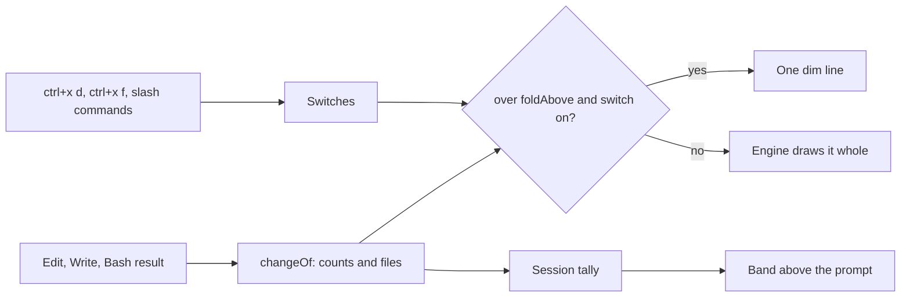
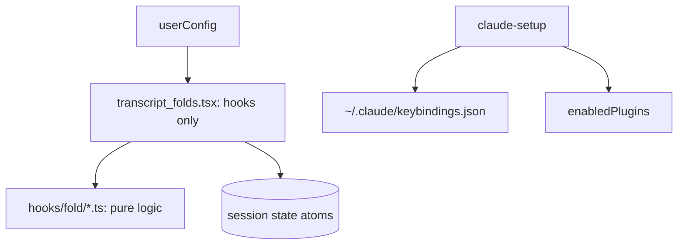

# Transcript folds

## 1. In one paragraph

`luismc-transcript-folds` draws each long diff as one line and each finished shell command as one line in the Claude Code transcript. Long diffs from Edit, Write, NotebookEdit and Bash no longer push the conversation off screen. Two chords and two slash commands show or hide the detail. A line above the prompt shows the switches and what changed this session.

## 2. Why

Long diffs and command output fill the terminal. The person wants the conversation, with the detail one keystroke away.

Goals: one line per long diff (an icon, the file and line, lines added and removed); one line per finished command (the command cut to fit, then its line count, its error, or the files it changed); nothing that depends on a keyboard shortcut alone.

Non-goals: changing what Claude does, writing files, or running commands. The plugin is a display mod only.

**Why its own plugin.** A change to how the transcript is drawn runs inside Claude Code as a mod, and a mod runs only from an enabled plugin. `claude-setup` enables the plugin and writes the two chords to `~/.claude/keybindings.json` as part of the standard setup.

**Written from scratch.** The idea comes from a third-party plugin. None of its code, names or layout is used (see [decision 0016](../../architecture/decisions/0016-build-transcript-folds-from-scratch.md)).

## 3. How it works

- **Folded diffs.** A change over `foldAbove` changed lines (default 5) draws one dim line: marker, relative path, first changed line, `+added −removed`. A new file reads `new <path> (+n)`. A notebook names its cell. Errored results, small changes and review dialogs are never folded.
- **Folded commands.** A finished Bash or PowerShell call draws one row with the command cut to fit and its outcome: `n lines`, `no output`, or the first line of the error. A command that edited files adds `n files (+a −r)`. Running and interrupted calls are not folded.
- **Compact mode.** The counts go on the Edit or Write row itself and the line under it is dropped.
- **Band.** One dim line above the prompt holds two buttons and the tally, for example `Diffs folded (ctrl+x d) · Commands folded (ctrl+x f) · 7 files +120 −34 this session`.
- **Chords.** `ctrl+x d` flips diffs (action `theme:toggleSyntaxHighlighting`). `ctrl+x f` flips commands (action `theme:editCustom`). Both actions are handled only inside `/theme`, so outside it the chords reach the plugin and do not clash with other bindings.
- **Slash commands.** `/fold-diffs` and `/fold-commands` flip the same switches and answer in one line.

Settings under `/config`:

| Key | Default | Meaning |
|---|---|---|
| `foldAbove` | 5 | A diff with this many changed lines or fewer is drawn whole; 0 folds every diff |
| `marker` | `»` | Starts every folded diff line; empty for none |
| `compactCounts` | false | Compact mode |

## 4. Screens and states

Both switches start folded in every session. A toggle lasts for that session only, so a stray chord never carries over (owner, 16 October 2026). With a switch off, the engine draws as usual, and runs of edits it groups into one row are drawn expanded so every diff shows. The band steps aside while a survey is shown.

## 5. Functional requirements

**R5.1** — A change over `foldAbove` changed lines folds to one line; a change at exactly the threshold does not. With `foldAbove` 0, every diff that changes something folds and an empty change never does.

**R5.2** — Line counts come from the patch: several hunks add up, the first changed line is the first hunk's start, CRLF and a missing final newline are handled, and a new file counts all its lines.

**R5.3** — A notebook edit counts added, changed and removed cells and names the cell.

**R5.4** — A shell outcome is the number of output lines, `no output`, or the first line of the error; stderr-only output counts its own lines; an error with only an exit code still has an outcome.

**R5.5** — Text is cut to the display width, counting wide characters and emoji as two cells, and an ellipsis marks a cut, down to tiny widths.

**R5.6** — The session tally adds each file once and adds its lines every time.

**R5.7** — `/fold-diffs` and `/fold-commands` flip their switch and say the new state.

## 6. Non-functional requirements

**R6.1** — The plugin writes no files and runs no commands.

**R6.2** — The logic in `hooks/fold/` imports only sibling `.ts` files: no engine import, no JSX, no Node API. The plugin needs no npm package.

**R6.3** — The two chords differ from those other plugins borrow, so both can be installed together.

## 7. Design

`transcript_folds.tsx` is glue: each decision is a call into `hooks/fold/`, split by concern (`change`, `lines`, `shell`, `summary`, `tally`, `width`, `options`). Session state holds the two switches, the tally, the project root, and the counts and outcome of each finished call by `tool_use_id`. `claude-setup` merges the two chords into the `Global` context of the user's keybindings. A chord bound to another action is a conflict the owner decides. It never changes another binding.

## 8. Failure modes

| Situation | Behaviour | Why |
|---|---|---|
| Edit data unavailable on a Bash result | No change, no fold | Show the engine's output rather than guess |
| A call was interrupted or errored | Never folded | The detail matters most then |
| A chord is already bound to another action | `claude-setup` reports a conflict | Never overwrite a binding |
| The plugin is not enabled | The chords do nothing | A mod runs only from an enabled plugin |

## 9. How it is proven

| Requirement | Test |
|---|---|
| R5.1 | `foldedFileChange`, `threshold` cases in `claude/plugins/transcript-folds/tests/change.test.ts` |
| R5.2 | `claude/plugins/transcript-folds/tests/lines.test.ts` |
| R5.3 | `claude/plugins/transcript-folds/tests/change.test.ts` and `claude/plugins/transcript-folds/tests/lines.test.ts` |
| R5.4 | `claude/plugins/transcript-folds/tests/shell.test.ts` |
| R5.5 | `claude/plugins/transcript-folds/tests/width.test.ts` |
| R5.6 | `claude/plugins/transcript-folds/tests/tally.test.ts` |
| R6.2 | `claude/plugins/transcript-folds/tests/purity.test.ts` |
| R6.3 | `tools/test_model_profiles.py`, check K1 (the keybindings asset holds the two chords and their actions, and the plugin source names the same actions) |

Run the Node suites with `node --test claude/plugins/transcript-folds/tests/`. R5.7 and R6.1 have no automated test; R5.7 was checked in a smoke run of the plugin in Claude Code.

## 10. Decisions

| ID | Question | Chosen | Date |
|---|---|---|---|
| [0016](../../architecture/decisions/0016-build-transcript-folds-from-scratch.md) | Adopt the third-party plugin or build our own? | Build our own | 2026-10-13 |
| [0017](../../architecture/decisions/0017-test-the-fold-logic-with-the-node-runner.md) | How are the plugin's hooks tested? | Pure logic under `node:test` | 2026-10-13 |
| [0018](../../architecture/decisions/0018-marketplace-is-named-dev-standards.md) | Which marketplace name do installs use? | `dev-standards` | 2026-10-13 |
| page D4 | What is the plugin called? | `luismc-transcript-folds` | 2026-10-13 |
| page D5 | Which chords? | `ctrl+x d`, `ctrl+x f` | 2026-10-13 |
| page D7 | How does `claude-setup` offer it? | Standard, user target | 2026-10-13 |
| page D8 | What state does a session start in? | Diffs folded, commands folded; never remembered | 2026-10-16 |

## 11. Not built yet

None.

## 12. Code map

Source: `claude/plugins/transcript-folds/`

| Path | Holds |
|---|---|
| `hooks/transcript_folds.tsx` | The hooks, the band, the slash commands |
| `hooks/fold/*.ts` | The pure logic |
| `types/state.d.ts` | The session state contract |
| `tests/*.test.ts` | The Node suites |
| `.claude-plugin/plugin.json` | Name, version and the three settings |

Also `claude/plugins/project-setup/skills/claude-setup/assets/keybindings.json` (the chords `claude-setup` merges).

## Versions
