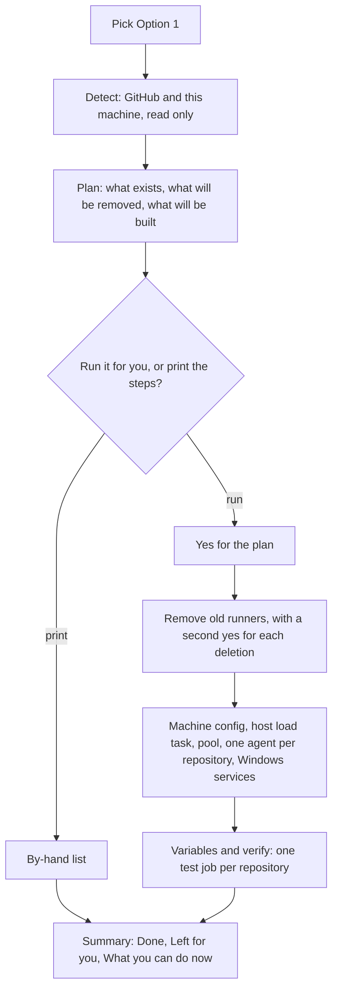

# Set up CI for a project

Use this guide to choose where a project's CI runs and to finish the steps only a person can do. The rules are in [delivery spec section 13](../features/delivery/spec.md#13-ci-options).

You need Claude Code open in the project, the `luismc-delivery` plugin installed, and admin rights on the GitHub repository.

## The four options

| Option | Runs on | Costs | Good when |
|---|---|---|---|
| 1. Own runners | Runners you install on any of your machines | No per-minute bill. Your machines and power. | You have a machine that can stay on. |
| 2. GitHub-hosted | GitHub's runners | Per minute, on your GitHub plan | You want no machines to look after. |
| 3. Claude cloud sessions | One cloud session per shard, no Actions | Claude plan usage. No GitHub bill. | Linux only tests, no Windows. |
| 4. Own runners first, fallback after X minutes | Option 1; Option 2 or 3 when a shard waits more than X minutes | Free unless the fallback starts | Your runners are sometimes busy or off. |

Option 3 runs Linux only. If the project tests on Windows, pick another option for Windows. The choice is per OS.

## Steps

### Guided: `/delivery-ci-setup`

1. Run `/delivery-ci-setup`. It has no default at any question.
2. It reads the project: tracks, whether an installer is built, whether a shard table exists.
3. For each OS the product tests on, choose Option 1, 2 or 3. Option 4 is Option 1 plus a fallback: answer Option 1, then say yes when it asks about a fallback.
4. Answer the questions of that option:
   - Option 1: the machines (a name and an OS each), the runner labels, whether ready-PR runs queue one at a time, the memory and CPU ceiling of each machine.
   - Option 2: the runner size per OS, whether to use larger runners, an optional monthly minutes cap.
   - Option 3: the repository, the branches to watch, the shard timeout, the name of the variable that holds the token, an optional cap on sessions per day.
   - Option 4 (written to `ci.fallback`): the fallback per OS (`cloud`, Linux only, or `github-hosted`), X in minutes (`after_min`; the setup shows 10 as an example), and the optional caps `max_shards_per_day` and `max_minutes_per_month`. For `cloud` it also asks the URL of the routine's API trigger and the name of the variable that holds its token. Every run may use the fallback. Optional per-option `limits` (`browser_workers`, `integration_workers`, `memory_gib`) go to `ci.limits`.
5. It writes `.delivery/config.json` (`ci.options`, and for Option 4 `ci.fallback`), runs `delivery_ci_install.py install` and `delivery_doctor.py`.
6. It prints the by-hand list for your choice. Do those steps next.
7. To change the choice later, run the command again. It changes the config only and says what the new choice still needs.

### Guided shared CI on your machine (Option 1)

For Option 1 the setup also offers to build shared CI on this machine for you. It follows the pattern of [Shared CI on your machine](../features/delivery/shared-self-hosted-runners.md): plan first, do everything it can, one line per step, then a summary. It is safe to run again.

1. **Detect.** The setup lists every repository you administer, the runners GitHub knows, runner services, runner folders, containers and the WSL limits. It only reads. A public repository is named and refused.
2. **Plan.** You see one plan: each old runner that will be removed, the pool and its CPU and memory cap, the files it writes (under the machine folder, not your repository), what changes outside the repository, what needs you, and about how long it takes. If you name no repository, the plan takes every private repository that has a runner or a workflow with `self-hosted`. If it finds none, it plans nothing and removes nothing. The cap is measured on your machine; you only give numbers to override it.
3. **Yes.** Answer yes to run it. Each step prints one line while it runs.
4. **Deletions.** Removing a runner from GitHub, a Windows runner service, a runner folder, a container or its volumes needs its own yes that names what goes. A "no" stops the run and lists what is left.
5. **Your part.** Steps that need an administrator shell are printed: stopping and deleting an old Windows runner service, creating the new Windows service, and the scheduled task for the host load file. Run them, and the setup checks them. The task starts at boot and runs a loop that writes the file every 15 seconds, because a scheduled task cannot repeat faster than once a minute.
6. **Verify.** Each agent must be online with its labels, then one `pool-check` run per repository takes a slot and passes.
7. **Summary.** Three parts: *Done*, *Left for you* (numbered, exact steps) and *What you can do now*.

If a step fails, the setup stops and prints what is done and what is left. Fix the cause and run `/delivery-ci-setup` again. It says "already set" for finished steps and changes only what is missing.

#### What you can do after it

| You want to | Do this |
|---|---|
| See who holds the CI slots and who waits | `python3 scripts/delivery_ci.py slots` |
| Test one job through the pool | `gh workflow run pool-check.yml` |
| Check the machine, the pool and every runner | `python3 scripts/delivery_doctor.py` |
| Add a repository to the pool | Run `/delivery-ci-setup` again and name it. It adds one agent. |
| Change a limit | Run `/delivery-ci-setup` again and give the new numbers. It writes the machine config through the machine layer. |
| Remove a repository from the pool | Pipe a removal token into `pool-remove-agent SLUG` in the pool container. The folder stays unless you add `--delete-files`. |

### By hand

Do the steps that match your option. The doctor re-checks them.

1. **Runners (Options 1 and 4).** Install the GitHub runner on each machine and register it with the labels the setup printed. The setup prints the commands for each OS. Add a runner on a second machine when a job waits longer than X minutes: one runner per label is the first bottleneck.
2. **Repository variables.** Set the variables the setup prints (for example `CI_RUNS_ON`).
3. **Larger runners (Option 2).** Create them in the organisation settings, if you use them.
4. **Spending limit (Options 2 and 4 with a hosted fallback).** Set a spending limit in GitHub billing. This is the hard stop on money. The plugin caps are a second brake.
5. **Token (Option 3 and a cloud fallback).** Create a fine-grained token with only `commit statuses: write`. Put it in the cloud environment under the variable name you gave. Do not put it in a file.
6. **Ruleset: "Any source".** Required checks are commit statuses. In the repository ruleset, set each required check to accept **Any source**. The doctor cannot see or change this. If you skip it, the checks stay missing.
7. **Cloud access (Option 3 and a cloud fallback).** Give the cloud sessions access to the repository.
8. **Runner hooks (Option 1 and 4).** In each runner folder's `.env` set `ACTIONS_RUNNER_HOOK_JOB_STARTED` to `scripts/runner_load_gate.ps1` and `ACTIONS_RUNNER_HOOK_JOB_COMPLETED` to `scripts/runner_job_done.ps1` on Windows (`.sh` on Linux and macOS). The runner accepts only `.sh`, `.ps1` and `.js`: a `.cmd` hook fails every job with "not a valid path to a script". The doctor fails a `.cmd` hook.
9. **Shard names.** The hook sees the job key, not the job's `env:`. Name each job's key after its shard in `ci-shards.json` (the templates do). Set `DELIVERY_SHARD` in the runner's `.env` only to override. Matrix legs share the key of their job.
10. **Git credentials for the runner account (Option 4).** The wait marker is pushed from the kept checkout with the runner account's git credentials. A service account such as `NETWORK SERVICE` has none. Store a fine-grained token for that account with contents write on the repository, or use the runner pool. The doctor tries a dry-run push from each runner's checkout and warns when it fails.
11. Run `python3 claude/plugins/delivery/scripts/delivery_doctor.py` and fix what it names.

## Good to know

- **A fallback can start late when nobody is watching.** The fallback is started by the CI watch of the session that opened the pull request. If no session is open, an hourly routine starts it, so it can start up to an hour after X.
- **Caps are optional.** The setup offers them and explains the risk. It does not refuse a fallback without caps.
- **The first claim wins.** If the main runner frees up while the fallback runs, the fallback finishes. Nothing is pre-empted, and only one status is posted.
- **Windows.** Cloud sessions cannot run Windows tests. Use Option 1, or Option 2 for the small Windows-only set.
- **A Linux-built installer** is a CI check only. The shipped installer is built on Windows.

## Security

- **The wait marker needs a push.** The token for it has contents write on one repository and nothing else. Keep it in the credential store of the runner account. Never put it in a file in the repository, in `.env`, or in a log. The doctor and the hooks never print it.
- **Hooks run as the runner account.** Give that account read and execute rights on the plugin folder and on Python, and nothing more.

## Check it worked

1. The doctor's `ci` check passes.
2. Open a pull request. Each required context shows a status.
3. Stop the main runner, wait X minutes (Option 4). The fallback posts the status.
