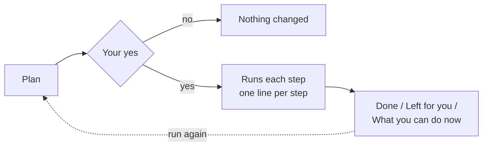
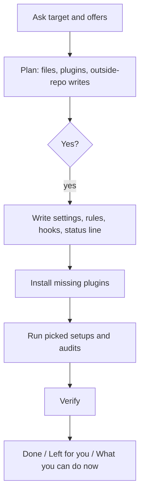
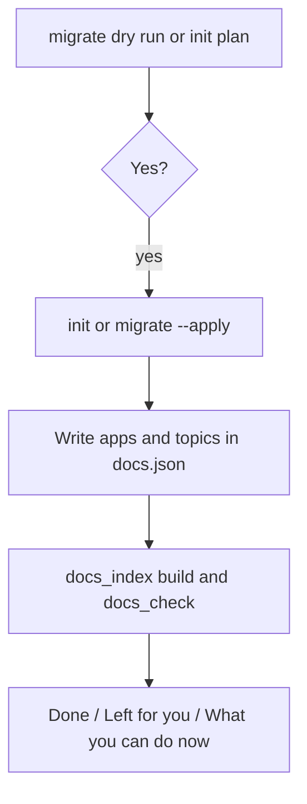
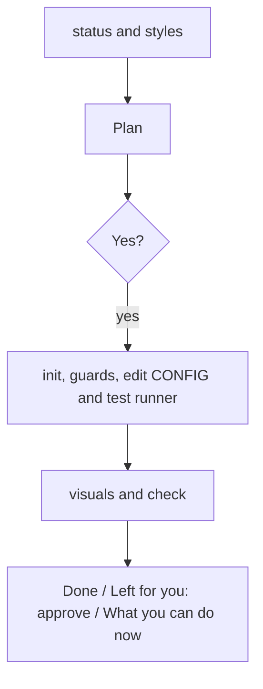
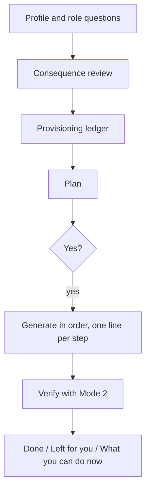
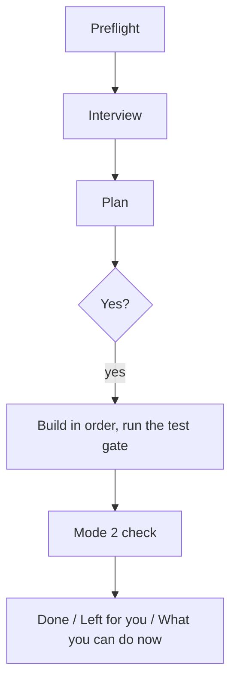

# What the setup skills do and what you can do after

Use this guide to see, before you run a setup, what it will do, and what you have after it. The pattern is in [shared runners, section 13](../features/delivery/shared-self-hosted-runners.md). The feature pages are [project setup](../features/project-setup/spec.md) and [docs](../features/docs/spec.md).

## How every setup behaves

Every setup follows the same five parts.

1. **Plan first.** It shows what it will install, configure and write, what changes outside the repository, what needs you, and about how long it takes. It changes nothing before your yes.
2. **It does the work.** After the yes it runs every install and configuration it can. It leaves to you only what it cannot do: an administrator shell, a web setting, a sign-in, a secret. Each has exact steps and a check after.
3. **One line per step.** You see what it is doing, then done, or failed with the reason and the fix.
4. **Three-part summary.** *Done* (what changed, with paths), *Left for you* (numbered steps), *What you can do now* (commands and features, each with an example).
5. **Safe to run again.** A second run says what is already set and changes only what is missing.

## claude-setup

Applies the Claude Code configuration to the project and/or your user folder, turns on the eight plugins, installs the missing ones, then runs the setups you pick.

After it: `/luismc-project-setup:claude-setup status` shows what is set, `/luismc-docs:docs-check` checks the docs, `/luismc-docs:spec-new` writes a spec, `/luismc-audits:security-audit` audits security, `ctrl+x d` toggles syntax highlighting. Reload with `/reload-plugins`.

## docs-setup

Lays out `docs/` to DOCSPEC, or moves an existing repo with `git mv` (never deletes).

After it: `/luismc-docs:docs-check`, `/luismc-docs:docs-index` (then open `docs/index.html`), `/luismc-docs:feature-spec-new`, `/luismc-docs:docs-note`.

## design-system-setup

Creates `docs/design-system/` with a draft, a review gallery and guard tests. Only you approve a version.

After it: `design_system.py status`, `design_system.py visuals` after a token change, `design_system.py check`, and `promote` when you approve.

## tech-stack-setup

A wizard picks a coherent stack, then generates the repository, CI, hooks and a Stack Profile.

After it: `pnpm dev`, `pnpm test`, the branch gate (`python3 scripts/delivery/branch_gate.py --no-publish`) and `/luismc-project-setup:auth-setup`.

## auth-setup

Builds authentication to AUTHSPEC, or audits an existing build. It refuses until `tech-stack-setup` has run.

After it: the auth endpoints in `apps/api`, the auth test suites with `pnpm test`, and an audit any time with `/luismc-project-setup:auth-setup`.
