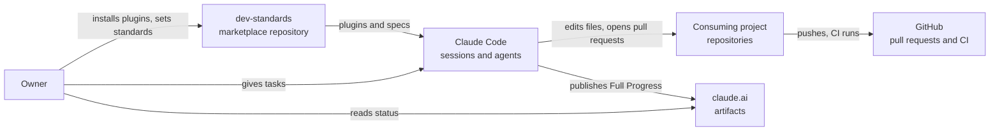
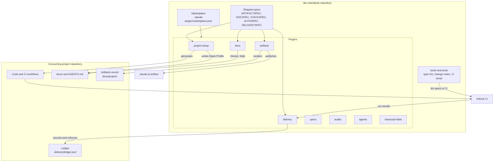

# How the parts fit

## Context

The owner installs plugins from the marketplace into Claude Code. Claude Code then works inside the owner's project repositories, which use GitHub for pull requests and CI. One status page is published to claude.ai.

## Containers

Inside dev-standards, the marketplace lists eight plugins. Hooks and scripts act on the consuming project's files, its `docs/` and its `.delivery/` ledger.

## Data flows

**Install.** The owner adds the marketplace and installs plugins. Claude Code copies each plugin and reads its skills, hooks and agents.

**Set up a project.** `claude-setup` writes Claude Code settings and rule files. `tech-stack-setup` generates the repository, its CI and its delivery scripts, then records the spec versions in a Stack Profile. `auth-setup` builds on that.

**Deliver work.** An agent works on a short-lived task branch and runs its gate. The orchestrator joins branches into a release, opens one ready pull request, and merges at green CI. The delivery hooks read and write the ledger at each step, then require cleanup after the merge.

**Show status.** Each task change goes into the artifacts record through a script. Hooks queue changes from pull request, CI and deploy events. At the end of a turn, Full Progress is rendered and published to claude.ai. Feature artifacts stay as local HTML files.

**Keep docs true.** A task changes the code, the feature spec and adds a change note. The docs check compares code and docs. The release fold turns the notes into version bumps.
