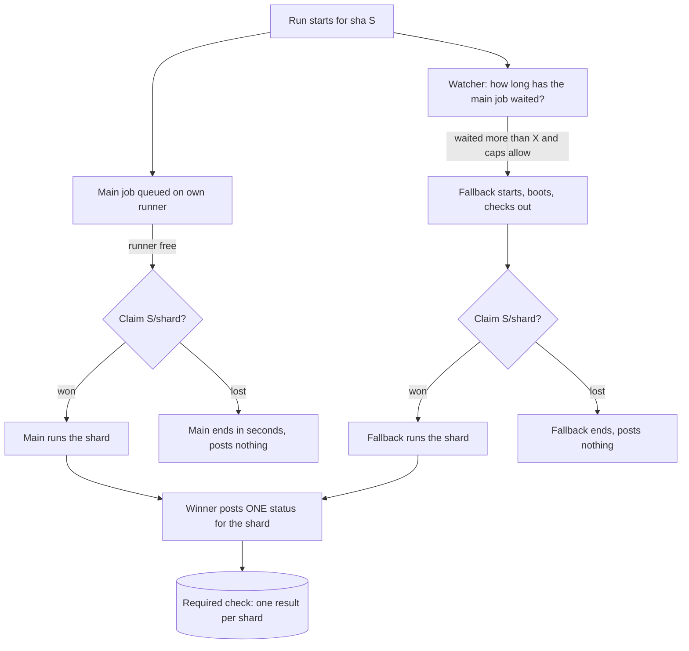

# CI in the delivery plugin: what to take and how a project sets it up

Status: proposal for the owner. Nothing here is built. The owner reads it and decides. Task CIR10, 3 Nov 2026.

## In short

- DL15 built the frame: one config key per OS, one shard table, a starter cloud runner and a status poster. It built **no speed learnings** and **no Option 4**.
- The speed work on the first product found eight things that are not about that product. They are listed in section 2 with their evidence. The plan is to move each into `luismc-delivery`, built generically, and to import it back.
- Option 4 (own runners first, a fallback after a wait) is feasible. The safe design is a **claim**: one atomic marker per commit and shard, taken before any work starts. The first claim wins. Only the winner posts the result, as a commit status. That gives one result per required check and never runs a shard twice.
- Cloud sessions are Linux. A small part of the tests and the installer smoke test need a real Windows machine. Section 2.3 says which, and how each option covers it.
- Total: about 78 agent hours in 11 steps (section 6). Most steps run in parallel after the first.

### What I could not check

- The page `09-measured` and the file `decisions.json` of the CI study (D15 to D19, D28, D29) are not on any branch I can read. I used the option wording from the brief.
- The CIR12 prices of rented runners are not in the product's docs. Section 3 gives my own arithmetic from list prices and marks it as such. Please point me to the file.
- Nothing here was run. The numbers come from the reports named next to them.

## 1. What DL15 built and what is missing

DL15 is live in `luismc-delivery` 1.3.0 (spec section 13).

| Piece | State |
|---|---|
| `ci.options` per OS in `.delivery/config.json`, no default | Built. Three values: `self-hosted`, `github-hosted`, `cloud`. They are Options 1, 2 and 3 of the owner's list. |
| `delivery_ci.py show / set / unset` | Built. It changes the config only. |
| `delivery_ci_install.py install / update` | Built. Writes the shared scripts and the track's workflows. Keeps files the project edits. |
| One shard table (`ci-shards.json`: id, os, context, commands) | Built. Format in `CONTRACT.md`. |
| `cloud_shard.py` (runs one shard, writes a result JSON, pushes a result branch) | **Starter.** Runs commands in order and stops at the first failure. No sizing, no memory limit, no timeout per command, no pass records. |
| `cloud_status.py` (finds commits with missing shards, posts commit statuses with a statuses-only token) | **Starter.** Posts what the result says. No claim, so two posters could both post. |
| `delivery_doctor.py` `ci` check | Built. Checks runners (a), workflow files (b), repo, token variable, branches, contexts (c). |
| `runner_health.py` (warn when no online runner has a job's labels), `ci_watch.py` (warn when a job is queued over 10 minutes) | Built. Warn only. |
| Template `ci.yml` (ts): plan job, areas, turbo cache, e2e shards, nightly full run | Built. |
| Runner labels as a setting (`CI_RUNS_ON`), one-at-a-time ready-PR CI (`CI_SERIAL`) | Built. |

**Missing:**

1. **Option wording.** The code and docs say "the owner's runners". The owner's rule: Option 1 is the user's own runners on **any** machines. The setup must guide adding a runner on a second or third machine. Today it does not.
2. **Option 4.** Not in the config, the doctor, the watcher or the templates.
3. **A guided setup.** `delivery_ci.py set` is a command, not a conversation. Nothing asks about X minutes, spend caps or tokens, and nothing prints the by-hand steps.
4. **The speed learnings** in section 2. The generic `ci.yml` has turbo caching and area selection. It has none of: pass records, a shard guard, the timing probe, report-only job skipping (DL16 changes only the `run-times` job, see below), worker and memory settings.
5. **Windows.** The plugin has Windows-safe guard starters (U9) and a `windows` OS value. It has no Windows-only test set, no Linux-built installer recipe, and the artifact prune does not hold installers after a failed publish.
6. **No measured claim.** The shard runner and the status poster were tested on fakes. No real cloud run is on record in this repository.

DL16 (branch `claude/DL16-ci-wait-fix`, not merged) moves `run-times` into the last step of `e2e` in the ts template. Its other two steps (skip report-only jobs, secret scan beside the plan) do not fit the generic template, which has no report-only jobs. That work stays in the product and is the model for item 4.

## 2. Learnings to move into the plugin

The evidence comes from the first product, a large TypeScript monorepo with a Postgres suite, a browser suite and two Windows installers. The study read 1,030 runs of its main workflow (290 ran something). "Measured" means a run or a log. "Estimate" means arithmetic.

### 2.1 Speed

| # | Learning | Evidence | What the plugin takes |
|---|---|---|---|
| L1 | **Fail fast, cheapest first.** Run the checks that fail most often and cost least first, then the big suites. | 58% of Linux minutes went to runs that did not end green (measured, 14 days: 11,668 Linux minutes, 42% green, 39% failed, 19% cancelled). A red unit test found at minute 50 had already paid for e2e and integration. The local branch gate was ordered the same way: guards, then typecheck and lint, then tests. | Template job order and gate order: secret scan, format, lint, typecheck, boundary check first. A `fail_fast_order` list in `gate.json` and a guard test that the cheap steps come first. |
| L2 | **One job per suite family, not one per tool.** Fewer, larger jobs on Linux. A single required job that judges the rest. | On Linux a job costs about 15 s (checkout 2 s, install 2 s). On Windows a job costs 2 to 3 minutes (checkout 76 to 100 s, install 40 to 58 s). The Linux suites run as one job; Windows runs one job instead of three. | Template rule: Linux gets one job per suite family. Windows gets as few jobs as the tests allow. One required `verify` job that judges the others. |
| L3 | **A shard table, with a guard.** One table says what each shard runs. A test fails when a workspace, an integration file or a budget file is in no shard or in two. Cut by recorded timings. | 10 shards (static, unit a/b, integration 1 to 3, e2e 1/2, budget 1/2). The guard test caught every omission during the work. Cloud shards ran about 12 minutes each (from the brief; the `09-measured` page is missing). A run of 4 CPUs per shard worked after 4-CPU sizing (1 workspace at a time, 4 workers). | `ci-shards.json` grows to hold groups, a timings file and a `members` rule. `cloud_shard.py` gets sizing from the table. A generic guard test checks that every test file belongs to exactly one shard. `shard_balance.py` is used for all suites, not only e2e. |
| L4 | **Cache by inputs.** A shard is skipped when nothing it reads has changed. | The turbo cache covers unit, lint and typecheck only. For integration and e2e the "which files" map listed 15 shared paths and 13 of the last 14 releases touched one, so they ran 100% of the files. A file-level estimate says 6 of those 14 needed under 20% (estimate). Pass records on the same inputs made a rerun of one shard take 0.6 s instead of 336 s (measured, CIR17; 520 s then 0.6 s in CIR18). | The **inputs key** and **pass records** of CIR17/18, generic: key = hash of the shard id, its commands, the git blob ids of the shard's workspaces and their dependencies, and a list of root files. Records go on one orphan branch, one file per branch and shard, so shards never race (CIR18: a refs namespace was refused by the proxy, a branch was not). |
| L5 | **Rerun only what failed or changed (D28).** | Same records. A failed record never skips. A ready PR to the default branch reads only the default branch's records, never the PR branch's own. `--all` ignores records. | Same module. Cleanup of a branch's records is added to `cleanup.py`. |
| L6 | **Skip report-only jobs (DL16).** A job that only reports must not hold a runner. | Run 41602331288: 31 minutes, of which 19 were work and 12 were waiting for the one Linux runner; three report jobs took about 3 minutes each on the same runner. DL16 estimates 23 to 24 minutes after the change (**estimate, not measured**). The earlier cold-run estimate of 27.9 minutes was measured at 38.9 (brief). **Lesson: measure the first real run of every change before promising a number.** | A report-only job becomes a step of the last job, `continue-on-error`. A template guard test fails on a job that has no `needs` consumer and does no judging. |
| L7 | **Timing budgets run only in CI, alone, on a runner of known speed.** | A budget measured on a 4-CPU cloud session missed in 5 of 35 files on the first pass and 3 after a rerun; on the 10-CPU runner they pass. CIR13 added a speed probe (median of 5 runs of a fixed workload) that scales every millisecond budget; a scale above 3 refuses to judge. The probe itself varied by about 20% between runs. Budgets run alone because a second suite beside them changes the result (3.1 minutes alone). | Naming rule and a "budgets run alone" job. The probe and `scaled(ms)` as a tooling template. The check-branch gate records "budgets run in CI only". |
| L8 | **Fix concurrency and memory as settings, with measured defaults.** | Browser suite: 7 workers 14.3 min; 2 workers 23.7 min. Owner decision: 2 workers, in CI as well. The Postgres suite and the browser suite cannot share the box (25 min beside, 12 alone). Container memory 8.5 GiB; the peak of 2 workers × 2 parts was 5.0 GiB (measured, CIR14); the biggest single peak in a cloud session was 5.4 GiB. One database per test worker, made from a template, cut the integration part from 1,054 s to 698 s (-34%). | `ci.limits` in the config: `browser_workers`, `integration_workers`, `memory_gib` per option. A shard that reports a peak above its limit fails a guard. A tooling template for the database-per-worker pattern (Postgres projects only). |

### 2.2 Windows and installers

| # | Learning | Evidence | What the plugin takes |
|---|---|---|---|
| W1 | **Build the installer pieces on Linux.** The single executable and the C# programs build on Linux in seconds. The MSI builds under Wine in about 46 s each. | CIR15. Build tools must be **started by their full path**, never found through `PATH`: the product's join fix for the release guards did exactly this (`buildTool`), because a runner's service account does not share a user's `PATH`. Every download is pinned and checked by SHA-256 (the plugin already does this for gitleaks in `tools.json`). The Wine prefix cache is 1.7 GB. | A `windows-build-on-linux` recipe in the installer template: `setup-windows-build.sh`, the pinned tools, `xvfb-run`, the cache folder. It is an **optional recipe** for projects that ship an MSI, not part of the default. |
| W2 | **Wine cannot write LZX.** The cabinet compression is `mszip` off Windows and `high` on Windows. | CIR15 (Wine error "compression 1503 not supported", then "Invalid handle"). The authoring reads the level from a variable, so the Windows command line is unchanged. | Recipe note and a guard test: the authoring must read the level from a variable. **A Linux-built MSI is not the file that ships.** It is bigger and has never been installed. It proves "it builds", not "it installs". |
| W3 | **A small Windows-only test set.** Of 199 unit files that once ran on Windows, 12 need a real Windows (icacls, SID, DPAPI, PowerShell, `C:\` and UNC rules, SQLite file URIs, case-blind paths). 187 are proven on Linux. | CIR16. The table lives in code and a guard checks it: every old file is in exactly one class, every Windows file still contains its Windows-only check, the cap is 12, the estimate is under 5 minutes. About 3 minutes of tests on Windows (estimate) plus checkout and install. | `windows-real` table (a JSON file) and its guard test, as a template. The shard table gets `os: windows` shards that name only that set. |
| W4 | **Keep the previous installer so the first self-update can roll back.** | CO815. The first update had nothing to roll back to, so a failed self-test could not restore the old version. The fix keeps the installed version's installer (from the download cache, or a verified download). | Not plugin code: it is product code. The plugin takes it as a **checklist item in the packaged smoke test** (`smoke_packaged.py`): "an update leaves a verified copy of the running version". |
| W5 | **Keep the installer files until publish succeeds.** | DS41. On 1 Nov 2026 both publish jobs failed (the service answered 503 to the token request), but the cleanup job still deleted the installers, so "re-run failed jobs" found nothing. The fix: the delete job runs only when no publish job failed or was cancelled; the prune keeps installers while the newest packaging run did not succeed; the token request retries 5xx with 1, 2, 4 s back-off. | `package.yml` templates and `artifact_prune.py`: hold named artifacts while the last packaging run failed. A test for both. |

### 2.3 What still needs a real Windows machine

| Needs real Windows | Why | Today |
|---|---|---|
| The 12 REAL-WINDOWS test files (W3) | Real ACLs, DPAPI, PowerShell, drive and UNC paths | Runs on the Windows runner |
| Install, start, update, roll back and remove the real MSI | MSI engine, services, scheduled tasks, registry, Event Log. **No test in the reference product's CI runs these for real**; they run against recorded command output | Done by hand on a PC after a release |
| Code signing | `signtool` is Windows-only | Not used yet |
| A post-install self-test | Needs the installed program on Windows | Proposed in the CIR11 study; not built |

How each option covers it:

| Option | Windows tests (12 files) | Real install smoke |
|---|---|---|
| 1. Own runners | A Windows runner on any machine the user runs (a spare PC, a Windows server, a VM) | Same runner, on release PRs only |
| 2. GitHub-hosted | `windows-latest` for the small set only. Cost: a few Windows minutes per run (section 3) | `windows-latest` on release PRs only |
| 3. Claude cloud sessions | **Not covered.** Sessions are Linux. Linux proves 187 of 199 files and the MSI build. The other 12 and the install smoke need Option 1 or 2 for Windows only | Not covered |
| 4. Own runners + fallback | Main: a Windows runner. Fallback: GitHub-hosted Windows only (cloud cannot) | Same as Option 1; fallback optional |

So a project that picks Option 3 must still pick **another option for the Windows OS**. The config is per OS (as DL15 already has it), so this is a normal answer: Linux = cloud, Windows = self-hosted or hosted. The setup says this in plain words and the doctor fails when a shard with `os: windows` has no option that can run Windows.

## 3. The guided setup, per option

### How the setup works for every option

`/delivery-ci-setup` (a new command of `luismc-delivery`, replacing the bare `delivery_ci.py set` for people) does these steps. It has **no default** at any question.

1. Read the project: tracks, whether an installer is built, whether the shard table exists.
2. Ask, per OS the product tests on, which option (1 to 4). Show the table in this section first.
3. Ask the option's own questions (below).
4. Write `.delivery/config.json`, then run `delivery_ci_install.py install` (writes the missing templates) and `delivery_doctor.py`.
5. Print the **by-hand list**: the exact steps only a person can do (tokens, runner install, repository variables). The doctor re-checks each one.
6. Say how to change the choice: run the command again; it only changes the config and says what the new choice still needs.

Everything below that is "automated" is written by the plugin. Everything under "by hand" is printed as a numbered list.

### Option 1: own self-hosted runners, on any machines

- **Asked:** which machines run a runner (a name and an OS each); the runner labels; whether ready-PR runs queue one at a time (`CI_SERIAL`); the memory ceiling and CPU ceiling of each machine (the runner load gate).
- **Automated:** workflow files with `CI_RUNS_ON`; `runner_health.py` and the doctor check that every label is carried by an online runner; the repair loop and load gate for runners; limits written into `ci.limits`.
- **By hand:** install the GitHub runner on **each** machine and register it with the labels; for a machine that is also a person's PC, decide the ceiling; set the repository variables. The setup prints the commands for the OS of each machine, and says "add a second runner on another machine if a job waits more than X minutes", because one runner of a label is the first bottleneck (measured: 12 of 31 minutes in run 41602331288).
- **Cost:** no per-minute bill. The machines and their power. GitHub has announced and then changed a fee for self-hosted minutes. **I could not confirm the current fee; check before choosing.**
- **Speed for a product like the first one:** the work itself is 19 minutes (measured) on a 10-CPU runner. With one Linux runner the wait is the problem: 0 to 12 minutes or more. After DL16: about 23 to 24 minutes (estimate). A second Linux runner removes most of the wait.
- **Switch later:** `delivery_ci.py set --os linux --option 2` (or 3 or 4). Nothing is removed from the machines. The doctor warns that the old runners can be removed only after the required checks no longer need them.

### Option 2: GitHub-hosted runners

- **Asked:** the runner size per OS (a hosted 2-core runner is too small for a large suite); whether to use larger runners (need a paid plan); a monthly minutes cap; whether Windows runs only the small set (W3).
- **Automated:** `CI_RUNS_ON` set to hosted labels; the shard table cut into a matrix; the cap written into the config; a monthly counter (section 4 of Option 4).
- **By hand:** create larger runners in the organisation settings (if used); set a spending limit in GitHub billing (this is the real brake; the plugin counter is the second).
- **Cost (my arithmetic, not CIR12; verify the prices):** the study counted 11,668 Linux minutes in 14 days, about 25,000 a month. At a 2-core list price of roughly $0.008 a minute that is about $200 a month; a 4-core runner costs about double per minute and, if it halves the time, costs about the same. Windows minutes cost about double Linux. With fail-fast and pass records the minutes should fall well below that. This is a guess until a run is measured.
- **Speed:** shards run in parallel up to the plan's limit, so wall time is the longest shard plus the plan job: about 12 minutes if a shard fits a 4-core runner (the cloud-shard figure; **estimate for hosted**).
- **Switch later:** one command. The workflows already exist.

### Option 3: Claude cloud sessions (no GitHub Actions, no webhooks)

- **Asked:** the repository; the branches to watch; the shard timeout; the name of the environment variable that holds the statuses-only token; which OS use it (Linux only, see section 2.3); the cap on sessions per day.
- **Automated:** the launcher (one session per missing shard, through the routines API), `cloud_shard.py`, `cloud_status.py`, the result branches, the contexts in the shard table, and the doctor checks.
- **By hand:** create the **statuses-only token** (a fine-grained token with only commit statuses: write); put it in the cloud environment, not in a file; **change the master ruleset so the required checks accept "Any source"**, because the status is not posted by the Actions app (the doctor cannot do this for you); give the sessions access to the repository.
- **Cost:** no GitHub bill. Sessions count against the Claude plan's usage. I have no figure per run; the owner should read the usage page after one measured run. Ten sessions of about 12 minutes each is the size of a full run on the first product.
- **Speed:** a session must start, check out, install and run. Measured shard time was about 12 minutes (brief). The first run on the first product took longer than predicted (38.9 against 27.9 minutes cold), mostly set-up, so budget more for the first run.
- **Switch later:** one command. The ruleset change stays; it also works for Options 1 and 2 if the statuses are posted.

### Option 4: own runners first, a fallback after a wait (D29)

- **Asked, per OS:** the **main** (Option 1, always); the **fallback** (Option 3 cloud sessions, or Option 2 GitHub-hosted; for Windows only hosted); **X**, the minutes a run may wait for the main runners; whether the fallback applies to all runs or only ready pull requests to the default branch; the spend caps (section 4.5).
- **Automated:** everything of Option 1 plus the fallback's own parts, the claim, the watcher, the status poster and the counter (section 4).
- **By hand:** everything of Option 1, plus Option 3's token and ruleset change or Option 2's spending limit.
- **Cost:** main is free per minute. The fallback costs only when a run waited more than X, and is capped.
- **Speed:** with a free main runner it is Option 1. When the main is busy or offline the wait is at most X plus the fallback's start and run time. For the first product, X = 10 means a run is never later than about 10 + 12 + 2 = 24 minutes (estimate).
- **Switch later:** `delivery_ci.py set --os linux --option 4 --fallback cloud --after-min 10`, or set the fallback back to none.

## 4. Option 4 in detail

### 4.1 The parts

### 4.2 How the wait is measured

- A job is **waiting** while GitHub reports it `queued` and no runner has started it. The wait is now minus the job's `created_at`. It stops at `started_at`.
- The unit is the **shard** (a job or a group of jobs for one OS), not the whole run. A Windows shard can wait while the Linux shards run.
- A run held back by the queue-one-at-a-time setting (`CI_SERIAL`) has no jobs yet. That is a different wait: it is the plan, not a lack of runners. It does **not** count toward X. (Question 5 asks whether it should.)
- If `runner_health.py` can see that **no** online runner carries the job's labels, the watcher may start the fallback at once. That is a setting, `after_min_if_offline`, default "same as X" until the owner chooses.
- Who measures: the watcher. For a cloud fallback, the watcher is the CI watch of the session that opened the ready PR (it exists anyway; `ci_watch.py` already warns at 10 minutes). A scheduled routine is only a safety net: its normal minimum interval is hourly, so it cannot honour X below 60 minutes. For a GitHub-hosted fallback the watcher can be a job of the workflow itself (see 4.3).

### 4.3 How the switch happens, once

The switch is a **claim**: a marker that says "I am running shard Z of commit S, attempt N".

- The marker is a branch `ci-claim/<sha>/<shard>/<attempt>`, created by a push that creates it. A second create of the same name is refused by git. That is atomic and needs no extra service. It uses the same push the cloud runner already does for result branches.
- **Order:**
  1. Main job: its first step claims. If refused, it ends (success, no status, no work).
  2. Watcher: after X it starts the fallback. The fallback boots, checks out, installs, then **claims last**, just before the first test command. If the main job started during boot, the main one already holds the claim and the fallback ends.
  3. The winner runs and posts.
- **GitHub-hosted fallback with no session:** the workflow has the main job and a fallback job per shard on a hosted runner. The fallback job's first step polls every 30 s for the claim. If the main job claims, it ends after about a minute. If X passes with no claim, it claims and runs. Cost: about one hosted minute per run in the normal case, up to X in the waiting case.
- **Cloud fallback:** a polling job would defeat the point of "no Actions". So the watcher of the session starts the cloud sessions. Unattended, the latency can be an hour (question 1).
- A new push gives a new sha, so old claims and old cloud sessions are ignored; GitHub's cancel stops the old Actions run; `cleanup.py` deletes `ci-claim/*` for finished commits.

### 4.4 One result for each required check

- The required checks are **commit statuses** with the shard's `context`, posted only by the claim holder. The main path posts through `GITHUB_TOKEN` (`statuses: write`); the cloud path with the statuses-only token. Both use the same `cloud_status.py post`, which refuses a result for any sha but its own and refuses to post unless the claim file names the poster.
- The Actions job names are **not** the required names, so a green "main skipped" job can never stand in for the check.
- The ruleset must accept "Any source" for these contexts. This is the one repository setting the plugin cannot change.
- A newer status on the same context replaces the older, so a retry cannot leave two answers.
- A claim holder that dies leaves no status. The watcher's **reaper** sees a claim with no result after the shard timeout (`ci.cloud.shard_timeout_min`, already in the config), posts `error` ("run lost") and opens attempt N+1. The attempt counter is capped at 2.

### 4.5 Cost limits

- `fallback.max_shards_per_day`, `fallback.max_minutes_per_month` (hosted), `fallback.only_for` (all runs, or ready PRs to the default branch). Agent branch runs wait for the main by default.
- A counter on the pass-records branch adds up fallback shards and minutes. When a cap is hit, the fallback is off, the run waits, and the watcher says so in one line ("fallback paused: monthly cap"). It never overruns a cap.
- Money rule: nothing is spent without a limit the owner set. The setup refuses to enable a fallback with no cap. For hosted runners the GitHub spending limit is the hard stop and is a by-hand step.

### 4.6 The main runner frees up in the middle of a fallback

**The first claim wins and nobody is pre-empted.** The main job starts, sees the claim, ends in seconds, and the runner takes the next job. Why: a switch half-way wastes both runs and risks two results. The claim is taken late (just before the tests start, 4.3) so the window is small. Cost of the rule: one fallback run finishes that the main could have run. The cost cap covers it.

### 4.7 What cannot go wrong, and what can

| Case | What happens |
|---|---|
| Both start at the same moment | One create wins; the other ends. Tested with a fake remote. |
| The main runner dies after claiming | No result; the reaper posts `error` after the timeout and opens attempt 2. The fallback may then claim it. |
| Fallback is capped | The run waits. A warning is printed. |
| The ruleset still says "Actions app" | The doctor cannot see it. The setup prints it as a by-hand step, and the first run shows missing checks. |
| Budgets run on a fallback runner of another speed | They are judged only with the speed probe (L7). A probe above 3 refuses, and the shard reports `error`, not `success`. |
| The fallback is Windows | Only hosted Windows. Cloud cannot. |

## 5. What stays in the project and what is generic

| Generic, in `luismc-delivery` | Per project |
|---|---|
| The option config (`ci.options`, `ci.fallback`, `ci.limits`), the setup command, the doctor | The answers |
| Claim, wait measurement, watcher, reaper, status poster, caps | The token and the ruleset |
| Inputs key, pass records, cleanup of records and claims | The list of "root files" that change every key |
| Shard table **format**, the shard guard test, timings balance | The shard table itself: which workspaces, which test files, how many shards |
| Test commands as `@name` | What `@unit`, `@integration`, `@e2e` run |
| Speed probe and `scaled(ms)` template | Which budgets exist and their limits |
| Worker and memory settings, with measured defaults | The values for the project's machines |
| Windows-only table format and guard | The 12 (or n) files and why |
| Installer recipe **template** (Linux build, Wine, `mszip`, hold artifacts, retry token) | The authoring files, the pinned tool list, the signing step, the installer smoke test |
| Workflow templates per track | Edits to `ci.yml` for project jobs |

Rule: a thing that names a test, a workspace, a database table or a product file is the project's. A thing that names a shard, a key, a claim, a status or an option is the plugin's.

## 6. Open questions for the owner

Each has options and a recommendation. Ask them together (one round).

1. **Who runs the fallback watcher when nobody has a session open?**
   (a) The session that opened the ready PR, plus an hourly routine as safety net. (b) For a hosted fallback, a watchdog job in the workflow (no session needed). (c) Accept up to an hour of extra wait for a cloud fallback.
   **Recommend a + b:** session first, workflow watchdog for the hosted fallback, and say plainly that an unattended cloud fallback can start up to an hour late.
2. **Should required checks be commit statuses for Options 3 and 4?**
   (a) Yes, always, with the ruleset on "Any source". (b) Keep Actions check names for Option 4's main path and post statuses only for the fallback.
   **Recommend a.** (b) can show two answers for one name.
3. **The default value of X.** (a) 10 minutes, as the existing queue warning. (b) 5. (c) 20. **No default is the owner's rule for the option; for X, recommend asking with 10 shown as the example.**
4. **Spend caps.** (a) The setup refuses to enable a fallback without caps. (b) Caps optional. **Recommend a.** Which numbers: for a project like the first one, start at 20 shards a day and 500 hosted minutes a month, then adjust from the counter.
5. **Does the queue-one-at-a-time wait count toward X?** (a) No, only runner waits. (b) Yes. **Recommend a.** A queued run is waiting for its own predecessor, which a fallback would not fix.
6. **Fallback scope.** (a) Ready PRs to the default branch only. (b) Every run. (c) The owner chooses per branch pattern. **Recommend a.** Agent runs can wait; the release cannot.
7. **Windows fallback.** (a) None: Windows waits for its own runner. (b) Hosted Windows for the 12-file set on ready PRs only, capped. **Recommend b.** It is about three test minutes plus set-up.
8. **Budget tests on a fallback runner.** (a) Scale by the speed probe, refuse above 3. (b) Skip them on fallback and say so. (c) Fail closed: the fallback does not run them and the check stays pending until the main runs them. **Recommend a.** It matches CIR13, and a silent skip would break the rule that budgets are first proved in CI.
9. **First claim wins, or the main pre-empts a fallback that has not started tests?** **Recommend first claim wins** (4.6).
10. **The Linux-built MSI.** (a) It is a CI check only, and the shipped MSI is built on Windows. (b) It ships. **Recommend a** until a real install smoke on Windows runs against the Linux-built file at least once per release; then reopen.
11. **Where do I find the CIR12 prices, and the `decisions.json` and `09-measured` page?** They are not on a branch I can read. Without them the cost lines in section 3 stay my arithmetic.
12. **Config names.** The owner says Option 1 to 4. The config says `self-hosted`, `github-hosted`, `cloud` (letters a to c). **Recommend** keeping the three names, adding `fallback` as a block, and having the docs and the setup say "Option 1 to 4".

## 7. Step plan

Sizes are agent hours (one agent at medium effort), including tests and the one affected gate. They are estimates, not measurements. S2 to S5 and S10 can run in parallel once S1 is in.

| Step | What | Hours | What it proves |
|---|---|---|---|
| S1 | Reword DL15: Option 1 to 4 names, "any machine", the add-a-runner guide, doctor wording. Merge DL16's template change | 3 | `test_ci_options` and `test_delivery_ci` pass; the doctor names the runner steps for a second machine |
| S2 | L1, L2, L6 in the templates: cheap-first order, one job per family, report-only as a step. Guard tests | 5 | Template guard tests; a mutant that adds a report-only job fails |
| S3 | L3: shard-table guard, timings balance for all suites, sizing and memory limit in `cloud_shard.py` | 8 | A guard test fails for a file in no shard and in two shards; a sample project's shards fit their limits |
| S4 | L4 and L5: inputs key, pass records on a records branch, skip on the same inputs, base-branch-only reads, cleanup | 8 | Second run of one shard takes seconds; a changed file changes the key; a failed record never skips (fake remote, as CIR18) |
| S5 | L7 and L8: speed probe and `scaled(ms)` template, `ci.limits`, database-per-worker template | 6 | Probe above 3 refuses; a budget at scale 1 equals the unscaled one |
| S6 | Guided setup command for Options 1 to 3 and the by-hand list; doctor checks for each | 8 | Doctor tests with fakes for each option; the by-hand list matches the doctor's checks |
| S7 | Option 4 core: config, wait measurement, claim, status poster (claim-checked), reaper, caps counter | 12 | Simulation tests with a fake remote and a local status server: main first, fallback first, a tie, the main frees mid-fallback, a dead claim, a cap hit. Never two posts |
| S8 | Fallback parts: hosted watchdog job template; cloud launcher and watcher hook in `ci_watch.py` | 10 | One real run of each on a test repository (the owner starts them) |
| S9 | W1 to W5: Windows-only table and guard, the Linux MSI recipe, hold-artifacts-until-publish, retry token, rollback checklist item in the packaged smoke | 10 | Guard test; artifact prune test holds installers after a failed run; recipe builds an MSI in a sample project |
| S10 | Import into the first product and **measure**: replace its local copies with the plugin's, run a release PR, compare to the prediction | 6 | Measured wall time against the predicted 23 to 24 minutes; any gap is reported before the next step |
| S11 | Docs: spec section 13 rewritten for four options, feature page, change notes, and the guide "set up CI" | 2 | `docs_check` clean; the guide's steps match the command |

**Total: about 78 hours.** Critical path: S1 (3) + S7 (12) + S8 (10) + S10 (6) = 31 hours. The rest runs beside it.

Order of risk: S7 and S8 carry the new ideas, so I would run them first on a test repository after S1. S4 gives the most speed for the least risk and is the one to do first for the first product.

Nothing here changes a spec's version, a plugin's `version`, `.claude/rules/` or any config. The release fold writes versions from the change notes that each step adds.

## 8. Owner answers (3 Nov 2026, ~14:55, decisions D30 to D41)

The inputs this proposal could not read are now in `docs/proposals/CIR10-inputs/` (CIR12 runner prices, the study's `decisions.json`, `09-measured.html`).

| Q | Answer | Note |
|---|---|---|
| 1 Watcher | **Session + hourly routine only** | No watchdog job in the workflow. Unattended, a fallback may start up to an hour late; the setup says so plainly. |
| 2 Required checks | **Always commit statuses**, ruleset "Any source" | |
| 3 X | Setup shows **10** as the example; no default | |
| 4 Spend caps | **Caps optional** | The setup offers caps and explains the risk, but does not refuse a fallback without them. GitHub's spending limit stays a by-hand step it prints. |
| 5 Queue wait | **Only runner waits count** toward X | |
| 6 Scope | **Every run** may use the fallback | Not only ready PRs. |
| 7 Windows | **Hosted Windows** for the Windows-only set on ready PRs, within caps if set | |
| 8 Budgets | **Scale by speed probe**, refuse above 3 | |
| 9 Pre-empt | **First claim wins** | |
| 10 Linux MSI | **CI check only** for now | Reopen after a Windows install smoke passes on it each release. |
| 11 Inputs | In `CIR10-inputs/` | |
| 12 Names | Keep `self-hosted` / `github-hosted` / `cloud`, add a `fallback` block; docs and setup say Option 1 to 4 | |

Go: **build all steps** (S1 to S11). Because of answer 1, S8 builds the cloud launcher + `ci_watch.py` hook + hourly routine, and no hosted watchdog job (a hosted fallback is started by the same watcher).
